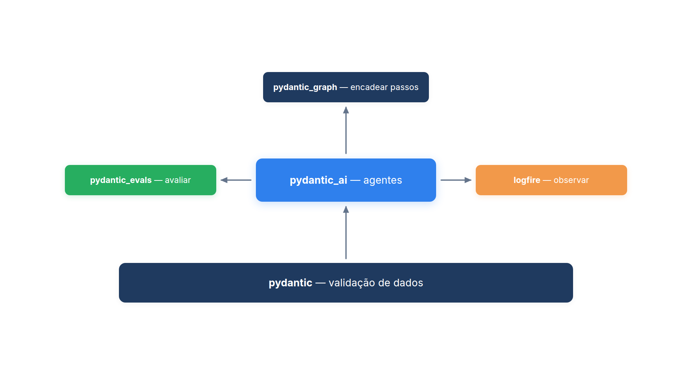
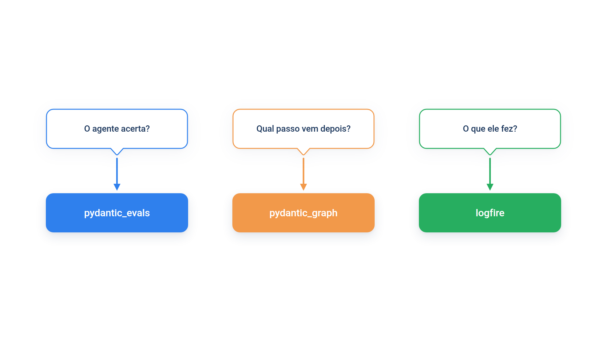

# Capítulo 0.1 — O ecossistema Pydantic e o PydanticAI

O livro começa no Módulo 1 com um agente da loja *Casa Verde* que consulta e cancela pedidos em poucas linhas. Essas poucas linhas escondem várias bibliotecas trabalhando juntas. Este módulo existe para que você conheça cada uma antes de depender delas. Neste primeiro capítulo, você instala o ambiente, importa cada peça do ecossistema e executa um exemplo mínimo de cada uma, sem chave de API e sem rede.



A figura mostra as cinco peças e como elas se apoiam: o Pydantic na base, o PydanticAI em cima dele, e três bibliotecas de apoio ao redor. Vamos conhecer uma por vez.

## Instalar e conferir o ambiente

Você precisa de Python 3.10 ou superior. Crie um ambiente virtual (uma pasta com um Python isolado, só para este projeto) e instale o framework:

```bash
python -m venv .venv
source .venv/bin/activate
pip install pydantic-ai
```

O pacote `pydantic-ai` é a instalação **completa**: além do framework, traz os clientes dos principais provedores de modelo (OpenAI, Anthropic, Google), o Pydantic Evals, o Pydantic Graph e o Logfire. É o caminho mais simples para começar.

Antes de escrever qualquer agente, confirme que tudo foi instalado. Crie o arquivo abaixo:

*ecossistema_versoes.py*

```python
import pydantic
import pydantic_ai
import pydantic_evals
import pydantic_graph
import logfire

for pacote in (pydantic, pydantic_ai, pydantic_evals, pydantic_graph, logfire):
    print(pacote.__name__, "importado")

print("pydantic", pydantic.VERSION)
print("pydantic_ai", pydantic_ai.__version__)
```

Execute `python ecossistema_versoes.py`. Saída:

```text
pydantic importado
pydantic_ai importado
pydantic_evals importado
pydantic_graph importado
logfire importado
pydantic 2.13.5
pydantic_ai 2.54.0
```

Cada `import` carregou um **pacote**: uma pasta de código Python com um nome que você usa no `import`. Repare em um detalhe que confunde iniciantes: o nome que você instala com `pip` usa hífen (`pydantic-ai`, `pydantic-evals`), e o nome que você importa usa sublinhado (`pydantic_ai`, `pydantic_evals`). São a mesma coisa vista de dois lados: o hífen é o nome de distribuição no PyPI, o sublinhado é o nome do módulo no código. Se as suas versões forem diferentes das mostradas, os exemplos do livro ainda devem funcionar; o livro foi testado com as versões acima.

### Instalação enxuta: `pydantic-ai-slim` com extras

A instalação completa baixa bibliotecas que você talvez nunca use. Quando você já sabe qual provedor vai usar, prefira o pacote **slim** (enxuto), que traz só o núcleo do framework, e acrescente os **extras**: grupos opcionais escritos entre colchetes. O README do livro usa esta linha:

```bash
pip install "pydantic-ai-slim[anthropic,mcp]" fastmcp pydantic-evals logfire
```

Ela instala o núcleo do PydanticAI, o cliente da Anthropic (`anthropic`) e o suporte a MCP (`mcp`), e depois acrescenta o Pydantic Evals e o Logfire como pacotes separados. Os mesmos dois também existem como extras: `pydantic-ai-slim[evals,logfire]` dá o mesmo resultado.

| Você quer | Instale |
| --- | --- |
| começar sem pensar em dependências | `pip install pydantic-ai` |
| só o núcleo e um provedor | `pip install "pydantic-ai-slim[openai]"` |
| núcleo, provedor, avaliações e observabilidade | `pip install "pydantic-ai-slim[anthropic,evals,logfire]"` |

As aspas em volta do nome são necessárias em alguns terminais (como o zsh), que interpretam colchetes como padrão de arquivo.

### Armadilha: o extra que faltou

Instale só `pydantic-ai-slim`, sem extras, e tente criar um agente com `Agent("anthropic:claude-sonnet-5-5")`. O Python não reclama no `import pydantic_ai`; o erro aparece quando o framework tenta carregar o cliente do provedor, com uma mensagem que pede para instalar `anthropic` e sugere o extra correspondente. O diagnóstico é simples: se o erro cita um pacote de provedor ausente, falta o extra entre colchetes. Reinstale com `"pydantic-ai-slim[anthropic]"` e o problema desaparece.

### Faça você mesmo — instalação

- **0.1.1 Conferência:** execute `ecossistema_versoes.py` no seu ambiente e anote as versões. Se alguma linha falhar com `ModuleNotFoundError`, descubra qual pacote falta e instale-o.
- **0.1.2 Inventário:** rode `pip list | grep -i -E "pydantic|logfire"` e compare a lista com a figura de abertura. Qual pacote aparece instalado sem que você o tenha pedido? Por quê?

## A base: `pydantic`

O nome do framework começa com "Pydantic" porque ele foi construído pela mesma equipe e **sobre** a biblioteca `pydantic`, a mais usada em Python para validar dados. Validar significa conferir se um dado tem o formato esperado e, quando possível, convertê-lo para o tipo certo. Veja isso acontecer com um pedido da Casa Verde:

*ecossistema_pydantic.py*

```python
from pydantic import BaseModel, ValidationError


class Pedido(BaseModel):
    codigo: str
    valor: float


pedido = Pedido(codigo="1002", valor="189.90")
print(pedido)
print(type(pedido.valor))

try:
    Pedido(codigo="1003", valor="caro")
except ValidationError as erro:
    print(erro.error_count(), "erro:", erro.errors()[0]["loc"], erro.errors()[0]["type"])
```

Saída:

```text
codigo='1002' valor=189.9
<class 'float'>
1 erro: ('valor',) float_parsing
```

Você passou o valor como texto (`"189.90"`) e o Pydantic entregou um número (`float`), porque a classe declarou `valor: float`. Essa declaração, o nome seguido de dois-pontos e do tipo, é uma **anotação de tipo**. No segundo pedido, `"caro"` não pode virar número, e o Pydantic recusou o dado com uma `ValidationError` que diz o campo (`valor`) e o motivo (`float_parsing`, falha ao interpretar um número).

Essa é a ideia central que atravessa o livro inteiro: **você descreve a forma dos dados com tipos, e o Pydantic garante que os dados reais obedeçam**. O PydanticAI usa exatamente esse mecanismo para conferir o que o modelo de linguagem devolve e os argumentos com que ele chama suas ferramentas. Modelos de linguagem erram formatos com frequência; ter um validador rigoroso entre o modelo e o seu código é o que torna um agente confiável.

O Capítulo 0.3 aprofunda `BaseModel`, `Field` e `ValidationError`. Aqui basta guardar a ideia: classe com tipos entra, dado validado sai.

## O framework: `pydantic_ai`

O `pydantic_ai` é o framework de agentes. Ele conversa com o modelo de linguagem, registra as ferramentas, executa o ciclo de chamadas e valida cada resposta com o Pydantic. O exemplo abaixo cria um agente que deve devolver um `Status` estruturado. Em vez de um modelo real, usamos o `TestModel`, um **modelo simulado** que não faz chamada de rede e gera respostas válidas a partir do formato pedido:

*ecossistema_agente.py*

```python
from pydantic import BaseModel
from pydantic_ai import Agent
from pydantic_ai.models.test import TestModel


class Status(BaseModel):
    codigo: str
    status: str


agente = Agent(TestModel(), output_type=Status)

resultado = agente.run_sync("Qual o status do pedido 1002?")
print(resultado.output)
print(type(resultado.output).__name__)
```

Saída:

```text
codigo='a' status='a'
Status
```

O texto `'a'` não é um defeito: o `TestModel` não entende a pergunta, ele só preenche cada campo de texto com um valor de exemplo. O que importa está na segunda linha. A resposta chegou como um objeto `Status`, validado pelo Pydantic, e não como uma frase solta. Com um modelo real, os campos teriam o código e o status de verdade, e o tipo continuaria o mesmo.

Repare como as duas bibliotecas se encaixam: `Status` é um `BaseModel` do `pydantic`; `Agent`, `run_sync` e `output_type` são do `pydantic_ai`. O Capítulo 0.4 explica cada parte do agente, e o Capítulo 0.5 mostra como testar agentes com o `TestModel` e o `FunctionModel`.

### Armadilha: confundir os dois pacotes

Um erro comum é procurar `Agent` em `pydantic` (`from pydantic import Agent`), ou `BaseModel` em `pydantic_ai`. O Python responde com `ImportError: cannot import name 'Agent' from 'pydantic'`. Use esta regra: **dados e validação vêm de `pydantic`; agentes, modelos e mensagens vêm de `pydantic_ai`**.

### Faça você mesmo — pydantic e pydantic_ai

- **0.1.3 Outro formato:** acrescente o campo `valor: float` à classe `Status` em `ecossistema_agente.py` e execute de novo. Que valor o `TestModel` inventou para o número?
- **0.1.4 Sem tipo:** remova `output_type=Status` e observe o que `resultado.output` passa a ser. Use `type(...)` para confirmar.

## As três bibliotecas de apoio

O PydanticAI resolve o agente. Construir agentes que funcionam em produção exige mais três coisas: medir se eles acertam, controlar fluxos com muitos passos e ver o que eles fizeram. Cada necessidade tem uma biblioteca, desenvolvida pela mesma equipe.



### Avaliar: `pydantic_evals`

Você mudou uma instrução do agente. Ele continua acertando os casos que acertava antes? O `pydantic_evals` responde a essa pergunta com um **conjunto de casos** (`Dataset`): entradas com a saída esperada, executadas contra uma função e conferidas por **avaliadores**. Ele funciona com qualquer função Python, não só com agentes, o que permite começar com algo bem simples:

*ecossistema_evals.py*

```python
from pydantic_evals import Case, Dataset
from pydantic_evals.evaluators import EqualsExpected


def status_do_pedido(codigo: str) -> str:
    pedidos = {"1001": "enviado", "1002": "em separação"}
    return pedidos.get(codigo, "desconhecido")


casos = Dataset(
    name="status_casa_verde",
    cases=[
        Case(name="pedido_enviado", inputs="1001", expected_output="enviado"),
        Case(name="pedido_entregue", inputs="1003", expected_output="entregue"),
    ],
    evaluators=[EqualsExpected()],
)

relatorio = casos.evaluate_sync(status_do_pedido, progress=False)
for caso in relatorio.cases:
    print(caso.name, "->", caso.output, "| passou:", caso.assertions["EqualsExpected"].value)
```

Saída:

```text
pedido_enviado -> enviado | passou: True
pedido_entregue -> desconhecido | passou: False
```

Cada `Case` é um caso de teste com nome, entrada (`inputs`) e saída esperada (`expected_output`). O avaliador `EqualsExpected` compara a saída obtida com a esperada. O segundo caso falhou de propósito: a função não conhece o pedido 1003. Em um agente real, é exatamente esse tipo de falha que você quer encontrar antes do cliente. O argumento `progress=False` só desliga a barra de progresso, para a saída ficar limpa. O Módulo 9 inteiro usa o `pydantic_evals` para avaliar agentes.

### Encadear passos: `pydantic_graph`

Alguns processos têm etapas fixas, ramificações e estados que você quer explícitos. O `pydantic_graph` modela esses processos como um **grafo**: um conjunto de **passos** (nós) ligados por **arestas** que dizem quem vem depois de quem. Ele é independente do PydanticAI (pode ser usado sem nenhum modelo de linguagem), mas o próprio PydanticAI o usa por dentro para executar o ciclo do agente.

*ecossistema_grafo.py*

```python
import asyncio

from pydantic_graph import GraphBuilder, StepContext

g = GraphBuilder(input_type=str, output_type=str)


@g.step
async def consultar(ctx: StepContext[None, None, str]) -> str:
    pedidos = {"1002": "em separação", "1001": "enviado"}
    return pedidos.get(ctx.inputs, "desconhecido")


@g.step
async def responder(ctx: StepContext[None, None, str]) -> str:
    return f"Status do pedido: {ctx.inputs}"


g.add(
    g.edge_from(g.start_node).to(consultar),
    g.edge_from(consultar).to(responder),
    g.edge_from(responder).to(g.end_node),
)
grafo = g.build()

print(asyncio.run(grafo.run(inputs="1002")))
print(grafo)
```

Saída:

```text
Status do pedido: em separação
stateDiagram-v2
  consultar
  responder

  [*] --> consultar
  consultar --> responder
  responder --> [*]
```

O `GraphBuilder` monta o grafo: cada função marcada com `@g.step` vira um passo, e `ctx.inputs` contém o que o passo anterior devolveu. As três chamadas a `edge_from(...).to(...)` ligam início, passos e fim. A segunda parte da saída é o grafo descrito em Mermaid, uma linguagem de diagramas que muitos editores de Markdown desenham automaticamente. As palavras `async`, `await` e `asyncio.run` aparecem aqui porque o grafo executa passos de forma assíncrona; o Capítulo 0.2 explica esse recurso do Python.

A própria documentação do PydanticAI recomenda cautela: para a maioria dos agentes, Python comum e os padrões multiagente bastam. Use um grafo quando o fluxo de controle for a parte difícil do problema. O livro mostra os padrões de orquestração primeiro em Python comum, justamente para você enxergar a lógica sem abstração extra.

### Observar: `logfire`

Um agente que errou não deixa rastro óbvio: você vê a resposta final, mas não sabe quais ferramentas ele chamou, quantas vezes perguntou ao modelo ou quanto gastou. O `logfire` é o pacote de **observabilidade** da equipe Pydantic: ele registra cada execução como um **rastro** (*trace*), formado por **trechos** (*spans*), um para cada etapa medida. O Pydantic Logfire é também uma plataforma comercial na web, com plano gratuito, que exibe esses rastros. Mas ele usa o padrão aberto OpenTelemetry, então o mesmo rastro pode ir para outro destino, inclusive para a memória do seu programa, como no exemplo:

*ecossistema_logfire.py*

```python
import logfire
from opentelemetry.sdk.trace.export import SimpleSpanProcessor
from opentelemetry.sdk.trace.export.in_memory_span_exporter import InMemorySpanExporter
from pydantic_ai import Agent
from pydantic_ai.models.test import TestModel

memoria = InMemorySpanExporter()
logfire.configure(
    send_to_logfire=False,
    console=False,
    additional_span_processors=[SimpleSpanProcessor(memoria)],
)
logfire.instrument_pydantic_ai()

atendente = Agent(TestModel(), name="atendente")


@atendente.tool_plain
def consultar_pedido(codigo: str) -> str:
    """Consulta o status de um pedido pelo código."""
    return "enviado"


print(atendente.run_sync("Onde está o pedido 1001?").output)
for trecho in memoria.get_finished_spans():
    print(trecho.name)
```

Saída:

```text
{"consultar_pedido":"enviado"}
chat test
execute_tool consultar_pedido
chat test
invoke_agent atendente
```

Leia a saída de baixo para cima, porque cada trecho é registrado quando termina. A execução inteira do agente é o trecho `invoke_agent atendente`. Dentro dela, o modelo foi chamado (`chat test`), pediu a ferramenta (`execute_tool consultar_pedido`) e foi chamado de novo com o resultado (`chat test`). A primeira linha é a resposta final do `TestModel`, que, sem tipo de saída definido, resume em texto o que as ferramentas devolveram.

Duas linhas fazem o trabalho: `logfire.configure(...)` prepara o envio e `logfire.instrument_pydantic_ai()` liga o registro de todos os agentes. Com `send_to_logfire=False`, nada sai da sua máquina; com uma conta e um projeto configurados, os mesmos trechos aparecem na plataforma web. O Módulo 10 usa essa integração para operar agentes em produção.

### Armadilha: observar sem querer enviar

Se você chamar `logfire.configure()` sem argumentos fora de um projeto configurado, o Logfire tenta usar credenciais que não existem e avisa que não há token. Para estudar localmente, passe `send_to_logfire=False`, como no exemplo. Para uso real, autentique com `logfire auth` e escolha um projeto antes; nunca cole o token direto no código.

### Faça você mesmo — bibliotecas de apoio

- **0.1.5 Caso que passa:** acrescente ao `ecossistema_evals.py` um caso para o pedido 1002 que passe no avaliador. Depois corrija a função para que o caso do pedido 1003 também passe.
- **0.1.6 Mais um passo:** acrescente ao grafo um passo `formatar` entre `consultar` e `responder` que deixe o status em letras maiúsculas. Confira o novo diagrama Mermaid na saída.
- **0.1.7 Duas ferramentas:** acrescente ao `atendente` uma segunda ferramenta, `cancelar_pedido`, e execute `ecossistema_logfire.py` de novo. Quantos trechos `execute_tool` aparecem agora?

## Como ler os exemplos do livro

Os capítulos seguem sempre as mesmas convenções. Conhecê-las agora evita confusão depois:

- **Nome do arquivo em itálico** acima de cada bloco de código, como *ecossistema_pydantic.py*. O arquivo existe, idêntico, na pasta `codigo/` do módulo.
- **Saída real** em um bloco logo abaixo, depois da palavra "Saída". Exemplos com modelo simulado (`TestModel`, `FunctionModel`) produzem exatamente essa saída. Exemplos com modelo real mostram uma "saída típica", que varia a cada execução.
- **Um único lugar para o modelo**: o arquivo `config.py` de cada módulo guarda `MODELO = "anthropic:claude-sonnet-5-5"`. Trocar de provedor é trocar essa linha e a chave de API.
- **Domínio fixo**: quase todos os exemplos usam a loja *Casa Verde*, com pedidos como 1001 (enviado) e 1002 (em separação).
- **Exercícios numerados** em blocos "Faça você mesmo", como os deste capítulo (0.1.1, 0.1.2...).

Todos os exemplos do Módulo 0 rodam sem chave de API e sem rede. Isso é proposital: você aprende o framework sem gastar com chamadas e sem depender de um modelo que responde diferente a cada vez.

## O mapa do Módulo 0

Este módulo prepara a base que os demais assumem. Cada capítulo é dono de um conjunto de conceitos; quando um capítulo de orquestração usar algum deles, ele apontará para cá.

| Cap. | Título | O que você aprende |
| --- | --- | --- |
| 0.1 | [O ecossistema Pydantic e o PydanticAI](../modulo-00/0.1-o-ecossistema-pydantic.md) | as cinco peças, a instalação e as convenções do livro |
| 0.2 | [O Python que o livro assume](../modulo-00/0.2-o-python-que-o-livro-assume.md) | anotações de tipo, decoradores, `with` e `async`/`await` |
| 0.3 | [Pydantic na prática](../modulo-00/0.3-pydantic-na-pratica.md) | `BaseModel`, `Field`, validação e esquemas JSON |
| 0.4 | [O primeiro agente por dentro](../modulo-00/0.4-o-primeiro-agente-por-dentro.md) | `Agent`, instruções, `run_sync` e o objeto de resultado |
| 0.5 | [Mensagens e testes sem API](../modulo-00/0.5-mensagens-e-testes-sem-api.md) | o que trafega entre código e modelo; `TestModel` e `FunctionModel` |
| 0.6 | [Ferramentas e saída tipada](../modulo-00/0.6-ferramentas-e-saida-tipada.md) | como nasce o esquema da ferramenta e como a saída é validada |
| 0.7 | [Dependências e contexto](../modulo-00/0.7-dependencias-e-contexto.md) | `deps_type`, `RunContext` e instruções dinâmicas |

Se você já programa em Python com tipos, pode ler o Capítulo 0.2 rapidamente. Se já usa Pydantic, o Capítulo 0.3 serve de revisão. Os capítulos 0.4 a 0.7 são o núcleo do PydanticAI e valem a leitura completa.

### Faça você mesmo — mapa do módulo

- **0.1.8 Rota pessoal:** com base na tabela, marque os capítulos do Módulo 0 que você pode ler rapidamente e os que precisa estudar com calma. Justifique cada escolha em uma frase.

## Recapitulando

Você instalou o ambiente e conheceu as cinco peças do ecossistema. O `pydantic` valida dados a partir de classes com tipos e é a base de tudo; o `pydantic_ai` é o framework de agentes, que usa essa validação para conferir o que o modelo devolve; o `pydantic_evals` mede se uma função ou um agente acerta um conjunto de casos; o `pydantic_graph` modela processos de vários passos como grafos; e o `logfire` registra cada execução como um rastro que você pode inspecionar. Você também viu a diferença entre a instalação completa (`pydantic-ai`) e a enxuta (`pydantic-ai-slim` com extras) e as convenções que todos os exemplos seguem.

A peça que mais aparece no livro é a menos visível: o Python com anotações de tipo. Os exemplos deste capítulo já usaram `codigo: str`, decoradores como `@g.step` e até `async def`. O Capítulo 0.2 explica exatamente esse Python, um recurso por vez.

### Fontes do capítulo

- Documentação do PydanticAI — [Instalação](https://ai.pydantic.dev/install/): pacote completo, instalação `pydantic-ai-slim` e lista de extras.
- Documentação do PydanticAI — [Visão geral](https://ai.pydantic.dev/): por que o framework leva o nome Pydantic e o papel de Logfire, Evals e Graph.
- Documentação do PydanticAI — [Pydantic Evals](https://ai.pydantic.dev/evals/) e [guia rápido](https://ai.pydantic.dev/evals/quick-start/): `Dataset`, `Case` e `EqualsExpected`.
- Documentação do PydanticAI — [Graphs](https://ai.pydantic.dev/graph/) e [Graph Builder API](https://ai.pydantic.dev/graph/builder/): `GraphBuilder`, passos, arestas e diagramas Mermaid; a recomendação de usar grafos só quando necessário.
- Documentação do PydanticAI — [Pydantic Logfire](https://ai.pydantic.dev/logfire/): `logfire.configure`, `logfire.instrument_pydantic_ai` e o uso com OpenTelemetry.
- Documentação do PydanticAI — [Testing](https://ai.pydantic.dev/testing/): `TestModel` para executar agentes sem chamar um modelo real.
- Documentação do Pydantic — [Models](https://docs.pydantic.dev/latest/concepts/models/): `BaseModel`, conversão de tipos e `ValidationError`.
