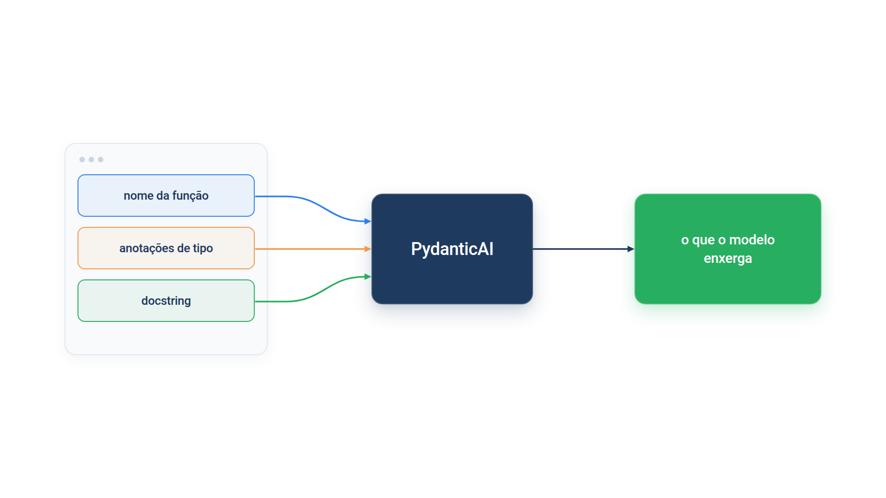
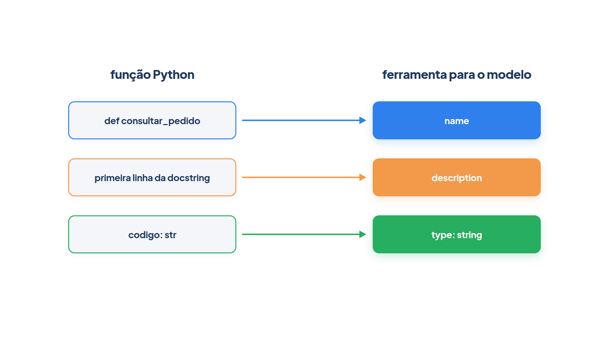
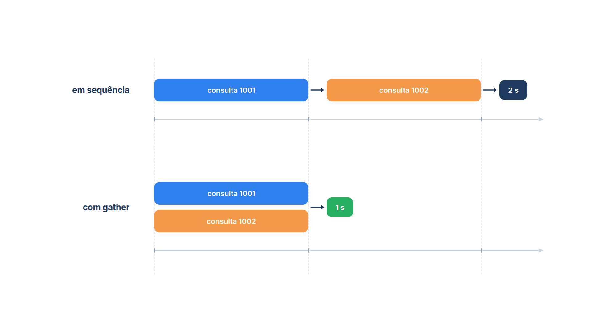

# Capítulo 0.2 — O Python que o livro assume

No Capítulo 0.1 você executou um exemplo de cada peça do ecossistema. Eles funcionaram, mas usaram recursos do Python que muitos iniciantes ainda não conhecem: `codigo: str` dentro de uma classe, `@g.step` em cima de uma função, `async def` e `asyncio.run`. O PydanticAI depende desses recursos a cada passo, porque **lê o seu código** para descobrir o que o modelo pode fazer. Neste capítulo você aprende só o Python que os exemplos do livro exigem, um recurso por vez, sempre com um programa curto que você executa e observa.



A figura resume o motivo deste capítulo: o PydanticAI transforma o nome da função, as anotações de tipo e a docstring em uma descrição que o modelo recebe. Se você entende essas três coisas, entende de onde vem boa parte do comportamento do agente.

## Anotações de tipo: o contrato escrito no código

A loja *Casa Verde* cobra frete de R$ 25,00 em compras abaixo de R$ 200,00, mas só quando o cliente informa o CEP; sem CEP, o pedido é retirado na loja. Você quer uma função que deixe claro, já na primeira linha, o que ela recebe e o que devolve:

*python_anotacoes.py*

```python
def frete(valor: float, cep: str | None = None) -> float:
    if cep is None:
        return 0.0
    return 25.0 if valor < 200 else 0.0


print(frete(189.90, "01001-000"))
print(frete(189.90))
print(frete.__annotations__)

try:
    frete("caro", "01001-000")
except TypeError as erro:
    print("TypeError:", erro)
```

Saída:

```text
25.0
0.0
{'valor': <class 'float'>, 'cep': str | None, 'return': <class 'float'>}
TypeError: '<' not supported between instances of 'str' and 'int'
```

O trecho `valor: float` é uma **anotação de tipo**: o nome do parâmetro, dois-pontos e o tipo esperado. O `-> float` depois dos parênteses anota o tipo do retorno. A terceira linha da saída mostra que o Python guarda essas anotações em `frete.__annotations__`, um dicionário que qualquer biblioteca pode ler. É exatamente isso que o Pydantic e o PydanticAI fazem.

A anotação `cep: str | None = None` diz: "`cep` é um texto **ou** `None`", e `None` é o valor do Python que significa "nada", "ausente". A barra vertical se lê "ou". O `= None` é o valor padrão: quem não informa o CEP recebe `None`, e a função testa isso com `if cep is None`. Você verá `X | None` no livro sempre que um dado puder faltar, como um campo opcional de um pedido.

### Armadilha: o Python não confere os tipos

A última chamada passou `"caro"` onde se esperava um número, e o Python **aceitou** a chamada. O erro só apareceu lá dentro, na comparação `valor < 200`, com uma mensagem que não fala em tipos. As anotações são informação, não fiscalização: o Python as guarda e segue em frente. Quem confere são as ferramentas que leem as anotações, como um verificador de tipos no editor (mypy, Pyright) ou o Pydantic durante a execução. Por isso o livro usa Pydantic: ele transforma o contrato em validação real.

### Faça você mesmo — anotações de tipo

- **0.2.1 Anotar:** escreva `def desconto(valor: float, cupom: str | None = None) -> float` que devolve 10% de desconto quando o cupom é `"VERDE10"` e o valor intacto nos demais casos. Imprima `desconto.__annotations__`.
- **0.2.2 Sem fiscal:** chame `desconto(100, 10)` (cupom numérico). O Python reclama? Explique por quê.

## Tipos que dizem mais: `Literal`, `Union`, `Optional` e `Annotated`

O status de um pedido não é qualquer texto: só pode ser "enviado", "em separação" ou "cancelado". A quantidade de um item precisa ser maior que zero. Os tipos básicos (`str`, `int`) não dizem isso. O módulo `typing` da biblioteca padrão traz tipos mais precisos, e o Pydantic sabe validá-los. O exemplo usa `TypeAdapter`, que valida um valor contra um tipo qualquer, sem precisar criar uma classe (o Capítulo 0.3 detalha):

*python_tipos_especiais.py*

```python
from typing import Annotated, Literal, Optional, Union

from pydantic import Field, TypeAdapter, ValidationError

Status = Literal["enviado", "em separação", "cancelado"]
Quantidade = Annotated[int, Field(gt=0)]

print(TypeAdapter(Status).validate_python("enviado"))
print(TypeAdapter(Quantidade).validate_python("3"))
print(TypeAdapter(Union[int, str]).validate_python("1002"))
print(Optional[str] == Union[str, None] == (str | None))

for tipo, valor in ((Status, "perdido"), (Quantidade, 0)):
    try:
        TypeAdapter(tipo).validate_python(valor)
    except ValidationError as erro:
        print(erro.errors()[0]["type"])
```

Saída:

```text
enviado
3
1002
True
literal_error
greater_than
```

Veja cada tipo em ação:

- **`Literal`** fixa os valores permitidos. `Literal["enviado", "em separação", "cancelado"]` aceitou `"enviado"` e recusou `"perdido"` com o erro `literal_error`. Repare que `Status` é só um nome para o tipo, um **apelido**, que você reaproveita onde quiser.
- **`Annotated`** prende uma informação extra a um tipo. Em `Annotated[int, Field(gt=0)]`, o tipo continua sendo `int`, e o `Field(gt=0)` ("maior que zero") é um **metadado**: uma anotação sobre a anotação, que o Python ignora e o Pydantic usa. O texto `"3"` virou o número `3`, e o `0` foi recusado com `greater_than`.
- **`Union`** aceita um tipo ou outro. `Union[int, str]` é a forma antiga de escrever `int | str`. O texto `"1002"` continuou texto, porque o Pydantic prefere o tipo que casa exatamente com o valor recebido antes de tentar converter.
- **`Optional`** é um atalho antigo: `Optional[str]` significa `str | None`. A quarta linha da saída (`True`) confirma que as três formas são o mesmo tipo.

Use no seu código a forma moderna (`int | str`, `str | None`), disponível desde o Python 3.10. Mas reconheça `Union` e `Optional`: eles aparecem em documentação, em bibliotecas e em mensagens de erro.

No PydanticAI, esses tipos aparecem em dois lugares. Nos parâmetros de uma ferramenta, um `Literal` vira uma lista fechada de opções no esquema que o modelo recebe, e o modelo deixa de inventar valores. No `output_type` de um agente, um `Literal` ou um `Annotated` restringe a resposta final, e o PydanticAI pede ao modelo que tente de novo se a resposta não obedecer.

### Faça você mesmo — tipos precisos

- **0.2.3 Formas de pagamento:** crie `Pagamento = Literal["pix", "cartão", "boleto"]` e valide `"pix"` e `"cheque"` com `TypeAdapter`. Qual tipo de erro aparece?
- **0.2.4 Limite superior:** troque `Field(gt=0)` por `Field(gt=0, le=10)` e valide a quantidade `11`. Leia a mensagem completa com `print(erro)`.

## `dataclass`: uma classe só para guardar dados

Muitas vezes você só precisa de um objeto que agrupe alguns dados: o nome da loja, a regra de frete, os pedidos conhecidos. Escrever uma classe com `__init__` à mão para isso é repetitivo. O decorador `@dataclass` escreve esse código por você:

*python_dataclass.py*

```python
from dataclasses import dataclass, field


@dataclass
class Loja:
    nome: str
    frete_gratis_acima: float = 200.0
    pedidos: dict[str, str] = field(default_factory=dict)


casa_verde = Loja("Casa Verde", pedidos={"1001": "enviado"})
print(casa_verde)
print(casa_verde.pedidos["1001"])
print(casa_verde == Loja("Casa Verde", 200.0, {"1001": "enviado"}))
print(Loja("Casa Verde", frete_gratis_acima="barato").frete_gratis_acima)
```

Saída:

```text
Loja(nome='Casa Verde', frete_gratis_acima=200.0, pedidos={'1001': 'enviado'})
enviado
True
barato
```

A partir das anotações (`nome: str`, `frete_gratis_acima: float = 200.0`), o `@dataclass` gerou três coisas: um construtor que aceita os campos na ordem ou pelo nome, uma representação legível para o `print` e uma comparação campo a campo (por isso o `==` deu `True`). O `field(default_factory=dict)` garante que cada loja ganhe um dicionário **novo**; escrever `pedidos: dict[str, str] = {}` faria todas as lojas compartilharem o mesmo dicionário, e o Python recusa essa forma com um erro.

No PydanticAI, uma dataclass é o formato preferido para as **dependências** de um agente: o conjunto de objetos (conexões, configurações, dados do cliente) que as ferramentas recebem durante a execução. O Capítulo 0.7 mostra isso em detalhe.

### Armadilha: `dataclass` não valida

A última linha imprimiu `barato`. Você declarou `frete_gratis_acima: float` e passou um texto, e a dataclass aceitou sem reclamar, como a função `frete` da seção anterior. Uma dataclass comum usa as anotações para gerar código, não para conferir valores. Quando o dado vem de fora (de um usuário, de uma API, de um modelo de linguagem), use um `BaseModel` do Pydantic, que valida. Quando os dados são montados pelo seu próprio código, como as dependências de um agente, a dataclass basta.

### Faça você mesmo — dataclass

- **0.2.5 Cliente:** crie a dataclass `Cliente` com `nome: str`, `email: str | None = None` e `pedidos: list[str]` (use `field(default_factory=list)`). Crie dois clientes, acrescente um pedido ao primeiro e confirme que o segundo continua com a lista vazia.

## Decoradores e docstrings

O símbolo `@` em cima de uma função é um **decorador**: uma função que recebe outra função e devolve algo no lugar dela, quase sempre a própria função, depois de registrá-la ou modificá-la. O livro está cheio deles: `@dataclass`, `@g.step`, `@agente.tool_plain`. O exemplo escreve um decorador de verdade, para você ver que não há mágica:

*python_decoradores.py*

```python
registradas = {}


def ferramenta(funcao):
    registradas[funcao.__name__] = funcao.__doc__
    return funcao


@ferramenta
def consultar_pedido(codigo: str) -> str:
    """Consulta o status de um pedido pelo código."""
    return "enviado"


print(registradas)
print(consultar_pedido("1001"))
```

Saída:

```text
{'consultar_pedido': 'Consulta o status de um pedido pelo código.'}
enviado
```

Escrever `@ferramenta` acima de `def consultar_pedido` é o mesmo que escrever, logo depois da função, `consultar_pedido = ferramenta(consultar_pedido)`. A função `ferramenta` recebeu `consultar_pedido`, guardou o nome e a documentação no dicionário `registradas` e devolveu a mesma função, que continua funcionando normalmente (`enviado`).

O texto entre três aspas logo abaixo do `def` é a **docstring**: a documentação da função. O Python a guarda no atributo `__doc__`, e foi daí que o decorador a leu. Agora veja o decorador real do PydanticAI fazer a mesma coisa. O exemplo usa um `FunctionModel`, um modelo simulado que chama a sua função em vez de um modelo de linguagem; aqui, a função `espiar` só imprime o que o modelo receberia sobre cada ferramenta:

*python_docstring_agente.py*

```python
from pydantic_ai import Agent
from pydantic_ai.messages import ModelMessage, ModelResponse, TextPart
from pydantic_ai.models.function import AgentInfo, FunctionModel


def espiar(mensagens: list[ModelMessage], info: AgentInfo) -> ModelResponse:
    for ferramenta in info.function_tools:
        print(ferramenta.name, "->", ferramenta.description)
        print(ferramenta.parameters_json_schema["properties"])
    return ModelResponse(parts=[TextPart("ok")])


agente = Agent(FunctionModel(espiar))


@agente.tool_plain
def consultar_pedido(codigo: str) -> str:
    """Consulta o status de um pedido pelo código.

    Args:
        codigo: código do pedido, como '1002'.
    """
    return "enviado"


agente.run_sync("Onde está o pedido 1002?")
```

Saída:

```text
consultar_pedido -> Consulta o status de um pedido pelo código.
{'codigo': {'description': "código do pedido, como '1002'.", 'type': 'string'}}
```

O `@agente.tool_plain` registrou `consultar_pedido` como ferramenta do agente. O nome da função virou o nome da ferramenta; a primeira parte da docstring virou a descrição; a linha `codigo: código do pedido...`, escrita na seção `Args:`, virou a descrição do parâmetro; e a anotação `codigo: str` virou `'type': 'string'`. Isso é o que o modelo lê para decidir quando e como chamar a ferramenta. Uma docstring vaga produz um agente que chama a ferramenta errada; uma anotação de tipo errada produz argumentos errados.



### Faça você mesmo — decoradores e docstrings

- **0.2.6 Contador:** modifique o decorador `ferramenta` para também imprimir `"registrando consultar_pedido"` no momento do registro. Em que momento a mensagem aparece: na definição da função ou na chamada?
- **0.2.7 Docstring ruim:** apague a docstring de `consultar_pedido` em `python_docstring_agente.py` e execute de novo. O que a descrição passa a mostrar? Que efeito isso teria em um modelo real?

## `with` e `lambda`

Alguns recursos precisam ser abertos e, com certeza, fechados: um arquivo, uma conexão, um caixa da loja. A instrução `with` garante o fechamento mesmo quando algo dá errado no meio. Já o `lambda` resolve outra necessidade pequena: escrever uma função de uma linha no lugar em que ela é usada.

*python_with_lambda.py*

```python
class Caixa:
    def __enter__(self):
        print("caixa aberta")
        return self

    def __exit__(self, tipo, erro, rastro):
        print("caixa fechada")
        return False


with Caixa() as caixa:
    print("registrando venda")

try:
    with Caixa():
        raise ValueError("valor inválido")
except ValueError as erro:
    print("erro tratado:", erro)

pedidos = [("1001", 89.9), ("1002", 189.9), ("1003", 45.0)]
print(sorted(pedidos, key=lambda pedido: pedido[1]))
```

Saída:

```text
caixa aberta
registrando venda
caixa fechada
caixa aberta
caixa fechada
erro tratado: valor inválido
[('1003', 45.0), ('1001', 89.9), ('1002', 189.9)]
```

Um objeto usado com `with` é um **gerenciador de contexto**: ele tem os métodos `__enter__`, executado na entrada do bloco, e `__exit__`, executado na saída. O valor devolvido por `__enter__` fica no nome depois do `as` (`caixa`). No segundo bloco, o `ValueError` interrompeu o código, e mesmo assim `caixa fechada` apareceu antes de o erro ser tratado. Essa é a garantia do `with`. No livro, você vai usar gerenciadores prontos (arquivos, clientes HTTP, conexões a servidores MCP), sem precisar escrever `__enter__` e `__exit__`; basta reconhecer o padrão.

A última linha ordena os pedidos pelo valor. O argumento `key` espera uma função que diga "por qual critério comparar". Em vez de criar uma função com `def` só para isso, `lambda pedido: pedido[1]` cria uma função anônima de uma linha: recebe `pedido` e devolve o segundo elemento, o valor. Um `lambda` só pode conter uma expressão; se a lógica precisar de mais de uma linha, use `def`.

### Faça você mesmo — `with` e `lambda`

- **0.2.8 Ordem decrescente:** ordene `pedidos` do maior para o menor valor, usando o mesmo `lambda` e o argumento `reverse=True` do `sorted`.

## `async` e `await`: esperar sem ficar parado

Um agente passa a maior parte do tempo **esperando**: a resposta do modelo, o retorno de uma API, a consulta a um banco. Se o seu programa consulta dois pedidos e cada consulta leva um segundo, não faz sentido esperar a primeira terminar para começar a segunda. A programação **assíncrona** do Python permite que várias esperas aconteçam ao mesmo tempo. O exemplo simula consultas lentas com `asyncio.sleep(1)`:

*python_async.py*

```python
import asyncio
import time


async def consultar(codigo: str) -> str:
    await asyncio.sleep(1)
    return f"{codigo}: enviado"


async def principal() -> None:
    inicio = time.perf_counter()
    print(await consultar("1001"))
    print(await consultar("1002"))
    print(f"em sequência: {time.perf_counter() - inicio:.0f} s")

    inicio = time.perf_counter()
    respostas = await asyncio.gather(consultar("1001"), consultar("1002"))
    print(respostas)
    print(f"com gather: {time.perf_counter() - inicio:.0f} s")


asyncio.run(principal())
corotina = consultar("1003")
print(type(corotina).__name__)
corotina.close()
```

Saída:

```text
1001: enviado
1002: enviado
em sequência: 2 s
['1001: enviado', '1002: enviado']
com gather: 1 s
coroutine
```

Leia de dentro para fora:

1. `async def consultar` define uma **corrotina**: uma função que pode pausar no meio. Chamá-la não executa nada; só cria um objeto `coroutine`, como a última linha mostra. Por isso o exemplo chama `corotina.close()`: sem ele, o Python avisaria que a corrotina nunca foi esperada.
2. `await` executa a corrotina e espera o resultado. Enquanto espera, o Python fica livre para adiantar outras tarefas. `await` só pode ser escrito dentro de um `async def`.
3. `asyncio` é o módulo da biblioteca padrão que coordena essas tarefas. `asyncio.run(principal())` é a porta de entrada: inicia o **laço de eventos** (o coordenador que alterna entre as tarefas em espera), executa `principal` e encerra.
4. `asyncio.gather` recebe várias corrotinas e espera todas **ao mesmo tempo**. Em sequência, as duas consultas levaram 2 segundos; com `gather`, 1 segundo, e as respostas voltaram em uma lista, na mesma ordem dos pedidos.



### `async with` e `async for` em um agente

Os agentes do PydanticAI têm as duas formas: `run_sync`, que você já usou, e `run`, que é assíncrona. O `run_sync` é só uma conveniência que chama o `run` por você. Para receber a resposta aos pedaços, à medida que o modelo a gera, o PydanticAI usa as versões assíncronas do `with` e do `for`:

*python_async_agente.py*

```python
import asyncio

from pydantic_ai import Agent
from pydantic_ai.models.test import TestModel

agente = Agent(TestModel(custom_output_text="Pedido 1002 em separação."))


async def principal() -> None:
    resultado = await agente.run("Qual o status do pedido 1002?")
    print(resultado.output)

    async with agente.run_stream("E agora?") as resposta:
        async for texto in resposta.stream_text():
            print("parcial:", texto)


asyncio.run(principal())
```

Saída:

```text
Pedido 1002 em separação.
parcial: Pedido 1002 em separação.
```

A primeira linha veio de `await agente.run(...)`, o equivalente assíncrono de `run_sync`. Depois, `async with agente.run_stream(...)` abre uma resposta em fluxo (*streaming*) e garante que ela seja fechada, como o `with` comum, mas podendo esperar na entrada e na saída. Dentro dele, `async for` percorre os pedaços de texto conforme chegam; entre um pedaço e outro, o programa espera sem travar. O `TestModel` entrega o texto inteiro de uma vez, por isso há uma única linha `parcial:`; com um modelo real, você veria a frase crescendo aos poucos.

O padrão do livro é este: use `run_sync` em scripts simples; use `async def` com `await agente.run(...)` quando precisar executar vários agentes ou ferramentas em paralelo, como nos módulos de orquestração.

### Armadilha: `asyncio.run` dentro de um laço que já roda

Em um notebook Jupyter, o laço de eventos já está em execução. Chamar `asyncio.run(...)` ali produz `RuntimeError: asyncio.run() cannot be called from a running event loop`. No notebook, escreva `await principal()` direto na célula. Em um script `.py`, o correto é o contrário: `asyncio.run(principal())` uma única vez, no fim do arquivo. O mesmo vale para `run_sync`, que precisa iniciar o próprio laço: dentro de um `async def`, use `await agente.run(...)`.

### Faça você mesmo — `async` e `await`

- **0.2.9 Três de uma vez:** acrescente `consultar("1003")` ao `gather` e meça o tempo. Ele passa para 3 segundos? Por quê?
- **0.2.10 O `await` esquecido:** em `python_async.py`, remova o `await` de `print(await consultar("1001"))` e execute. O que é impresso no lugar de `1001: enviado`, e que aviso o Python mostra?
- **0.2.11 Dois agentes em paralelo:** em `python_async_agente.py`, use `asyncio.gather` para executar `agente.run("pedido 1001")` e `agente.run("pedido 1002")` ao mesmo tempo e imprima o `output` de cada resultado.

## Recapitulando

Você viu o Python que o PydanticAI lê e usa. As **anotações de tipo** (`valor: float`, `cep: str | None`) descrevem o contrato de funções e classes; o Python as guarda, mas não as confere, e o Pydantic as transforma em validação. `Literal` fixa valores permitidos, `Annotated` prende metadados como `Field(gt=0)` a um tipo, e `Union` e `Optional` são as formas antigas de `X | Y` e `X | None`. O `@dataclass` gera uma classe de dados a partir das anotações, sem validar. Um **decorador** recebe uma função e a registra ou modifica, e a **docstring** é a documentação que o `@agente.tool_plain` envia ao modelo como descrição da ferramenta. O `with` garante que um recurso seja fechado, e o `lambda` cria funções de uma linha. Por fim, `async def`, `await`, `asyncio.run` e `asyncio.gather` permitem esperar várias coisas ao mesmo tempo, e `async with` e `async for` recebem respostas em fluxo.

Com esse Python em mãos, o próximo passo é a biblioteca que dá sentido às anotações. O Capítulo 0.3 aprofunda o Pydantic: `BaseModel`, `Field`, validação, mensagens de erro e o esquema JSON que o modelo de linguagem recebe.

### Fontes do capítulo

- Documentação do PydanticAI — [Function Tools](https://ai.pydantic.dev/tools/): ferramentas registradas por decorador; nome, docstring e anotações de tipo viram o esquema da ferramenta; extração das descrições de parâmetros (`Args:`) com griffe.
- Documentação do PydanticAI — [Dependencies](https://ai.pydantic.dev/dependencies/): dataclasses como contêiner recomendado para as dependências de um agente.
- Documentação do PydanticAI — [Agents](https://ai.pydantic.dev/agents/): `run`, `run_sync` e `run_stream`, incluindo o uso com `async with` e `async for`.
- Documentação do PydanticAI — [Output](https://ai.pydantic.dev/output/): uniões, `Literal` e `Annotated[..., Field(...)]` como `output_type`.
- Documentação do PydanticAI — [Testing](https://ai.pydantic.dev/testing/): `TestModel` e `FunctionModel` para executar agentes sem modelo real.
- Documentação do Pydantic — [Types](https://docs.pydantic.dev/latest/concepts/types/) e [Type Adapter](https://docs.pydantic.dev/latest/concepts/type_adapter/): validação de `Literal`, `Annotated` e uniões sem `BaseModel`.
- Documentação do Pydantic — [Unions](https://docs.pydantic.dev/latest/concepts/unions/): o modo "smart", que prefere o tipo que casa exatamente com o valor.
- Documentação do Python — [typing](https://docs.python.org/3/library/typing.html), [dataclasses](https://docs.python.org/3/library/dataclasses.html) e [asyncio](https://docs.python.org/3/library/asyncio.html).
