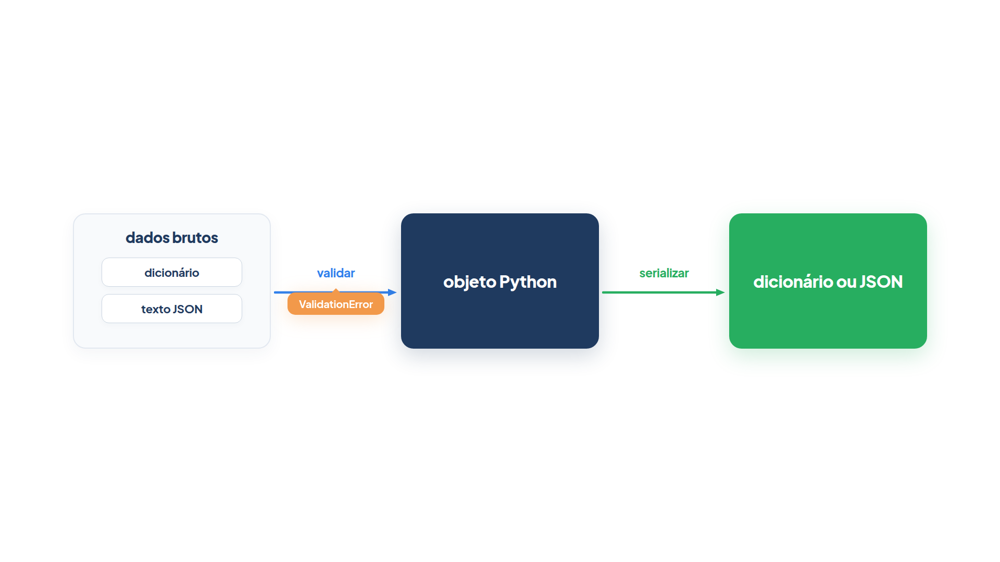
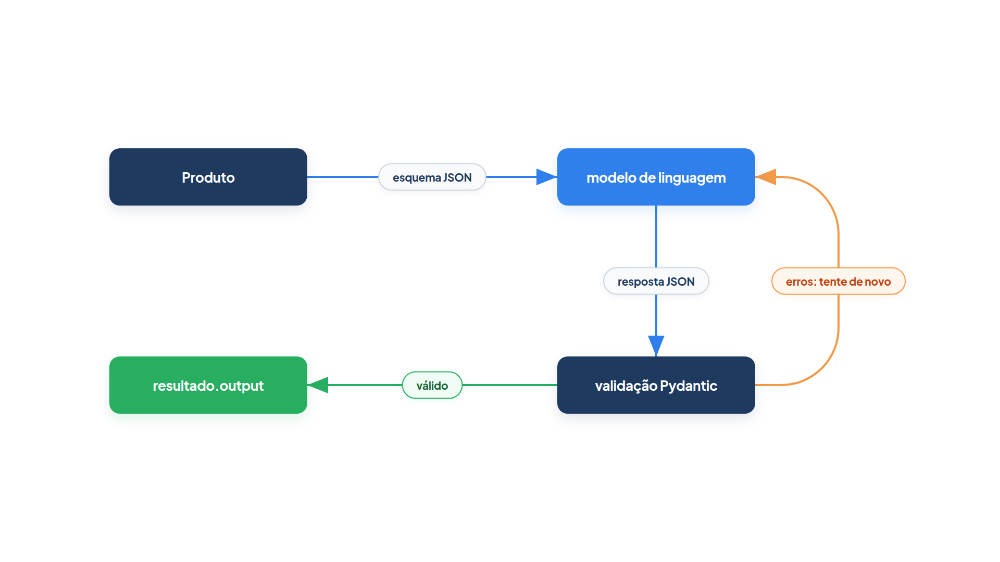

# Capítulo 0.3 — Pydantic na prática

No Capítulo 0.2 você viu que o Python guarda as anotações de tipo, mas não as confere: `frete("caro", ...)` só falhou lá dentro, com um erro confuso. Também viu que um `@dataclass` aceita `preco="caro"` sem reclamar. Este capítulo apresenta a biblioteca que leva as anotações a sério. O Pydantic lê os tipos que você escreveu, confere cada dado que chega, converte o que pode ser convertido e recusa o resto com uma mensagem clara. O PydanticAI faz isso a cada resposta do modelo de linguagem, então tudo o que você aprender aqui reaparece, por baixo, em cada agente do livro.



A figura mostra o caminho que você vai percorrer: dados brutos (um dicionário ou um texto JSON) entram, são **validados** contra uma classe, viram um objeto Python com tipos garantidos e, quando precisam sair do programa, são **serializados** de volta para dicionário ou JSON. Validar é conferir e converter na entrada; serializar é transformar em formato de transporte na saída.

## `BaseModel` e `Field`: um contrato que se defende

A loja *Casa Verde* vai cadastrar produtos a partir de dados que chegam de vários lugares: um formulário, uma planilha e, mais adiante, um agente. Você quer uma classe que só aceite produtos com nome de pelo menos três letras, preço positivo, estoque não negativo e nota de 1 a 5:

*pydantic_modelo.py*

```python
from pydantic import BaseModel, Field, ValidationError


class Produto(BaseModel):
    nome: str = Field(min_length=3, description="Nome do produto na vitrine")
    preco: float = Field(gt=0, description="Preço em reais")
    estoque: int = Field(default=0, ge=0)
    nota: int = Field(default=5, ge=1, le=5)


vaso = Produto(nome="Vaso de barro", preco="49.90")
print(vaso)
print(vaso.preco + 10)

try:
    Produto(nome="Va", preco=-1, nota=9)
except ValidationError as erro:
    print(erro.error_count(), "erros")
    for item in erro.errors():
        print(item["loc"], item["type"], "-", item["msg"])
```

Saída:

```text
nome='Vaso de barro' preco=49.9 estoque=0 nota=5
59.9
3 erros
('nome',) string_too_short - String should have at least 3 characters
('preco',) greater_than - Input should be greater than 0
('nota',) less_than_equal - Input should be less than or equal to 5
```

Observe três coisas no resultado.

- O preço chegou como texto (`"49.90"`) e saiu como número: `vaso.preco + 10` deu `59.9`. O Pydantic **converteu** o valor porque o campo declarou `float` e o texto representa um número sem ambiguidade.
- `estoque` e `nota` não foram informados e receberam os valores padrão `0` e `5`.
- O segundo produto tinha três problemas, e o Pydantic informou os **três de uma vez**, em vez de parar no primeiro.

`BaseModel` é a classe base de qualquer modelo Pydantic. Você herda dela (`class Produto(BaseModel)`) e declara os campos com anotações de tipo, como numa dataclass. A diferença é que, ao criar o objeto, o Pydantic **valida** cada campo. O objeto que sai da validação é confiável: se `vaso` existe, `vaso.preco` é um `float` maior que zero.

`Field` acrescenta regras e documentação a um campo. Os parâmetros que este livro usa mais:

| Parâmetro | Significado | No exemplo |
| --- | --- | --- |
| `default` | valor quando o campo não é informado | `estoque` começa em `0` |
| `gt`, `ge` | maior que, maior ou igual a | `preco` > 0, `estoque` ≥ 0 |
| `lt`, `le` | menor que, menor ou igual a | `nota` ≤ 5 |
| `min_length`, `max_length` | tamanho mínimo e máximo de texto ou lista | `nome` com 3 letras ou mais |
| `description` | explicação do campo, sem efeito na validação | vai para o esquema JSON |

Um campo sem valor padrão é **obrigatório**. `nome` e `preco` não têm padrão, então `Produto(nome="Vaso")` falha com o tipo de erro `missing`.

### Lendo uma `ValidationError`

Quando um dado não passa, o Pydantic lança `ValidationError`, uma exceção que reúne todos os problemas encontrados. Você a captura com `try`/`except`, como qualquer exceção, e consulta dois métodos:

- `erro.error_count()` devolve quantos problemas foram achados;
- `erro.errors()` devolve uma lista de dicionários, um por problema. Cada dicionário tem `loc` (onde: o caminho até o campo, como a tupla `('nota',)`), `type` (um código estável, como `greater_than` ou `string_too_short`) e `msg` (a explicação em inglês).

Use `type` quando o programa precisar decidir algo, porque o código não muda de uma versão para outra, e `msg` quando uma pessoa precisar ler. É exatamente essa lista que o PydanticAI devolve ao modelo de linguagem quando ele erra um formato, como você verá adiante neste capítulo.

### Armadilha: conversão não é adivinhação

O Pydantic converte `"49.90"` em `49.9` e `"4"` em `4`, mas não converte `"caro"` em número nem `4.5` em inteiro (perderia informação). Esse modo, chamado **leniente**, é o padrão. Se você precisar que `"49.90"` seja recusado por ser texto, use o modo estrito com `Field(strict=True)` no campo. Na dúvida, confira com um teste: o comportamento é previsível, mas nem sempre é o que você imagina.

### Faça você mesmo — `BaseModel` e `Field`

- **0.3.1 Campo obrigatório:** crie `Produto(preco=10)` sem `nome`. Qual é o `type` do erro e o que aparece em `loc`?
- **0.3.2 Nova regra:** acrescente `categoria: str = Field(default="jardim", max_length=12)` e tente criar um produto com `categoria="ferramentas de jardinagem"`.
- **0.3.3 Inteiro ou não:** passe `estoque="7"` e depois `estoque=7.5`. Explique por que um passa e o outro não.

## Dados que chegam: `model_validate` e `model_validate_json`

Até aqui você criou objetos chamando a classe com argumentos nomeados. Na prática, os dados chegam prontos: um dicionário lido do banco ou um texto JSON vindo de uma API ou de um modelo de linguagem. Para cada caso existe um método de classe:

*pydantic_entrada.py*

```python
from pydantic import BaseModel, Field, ValidationError


class Produto(BaseModel):
    nome: str = Field(min_length=3)
    preco: float = Field(gt=0)
    estoque: int = 0


do_banco = {"nome": "Regador", "preco": 35.0, "estoque": 12}
regador = Produto.model_validate(do_banco)
print(regador)

do_modelo = '{"nome": "Adubo 1 kg", "preco": "22.5"}'
adubo = Produto.model_validate_json(do_modelo)
print(adubo)

for texto in ['{"nome": "Terra", "preco": 0}', '{"nome": "Terra", "preco": 9,}']:
    try:
        Produto.model_validate_json(texto)
    except ValidationError as erro:
        print(erro.errors()[0]["type"], "->", texto)
```

Saída:

```text
nome='Regador' preco=35.0 estoque=12
nome='Adubo 1 kg' preco=22.5 estoque=0
greater_than -> {"nome": "Terra", "preco": 0}
json_invalid -> {"nome": "Terra", "preco": 9,}
```

`Produto.model_validate(do_banco)` recebe um objeto Python, normalmente um dicionário, e o valida campo a campo. O resultado é o mesmo de `Produto(**do_banco)`, mas a intenção fica clara e o método aceita opções extras, como `strict=True`.

`Produto.model_validate_json(do_modelo)` recebe um **texto** JSON e faz duas coisas em um passo só: interpreta o JSON e valida o resultado. Repare que o preço veio como `"22.5"` dentro do JSON e foi convertido. Esse é o método que importa para agentes, porque um modelo de linguagem devolve texto, e texto JSON é o formato combinado.

O laço final mostra os dois tipos de falha. O primeiro texto é um JSON correto com um valor proibido (`greater_than`). O segundo tem uma vírgula sobrando antes do `}` e nem chega a ser JSON válido (`json_invalid`). Os dois chegam como `ValidationError`, então um único `except` trata ambos.

### Faça você mesmo — entrada de dados

- **0.3.4 Campo a mais:** valide `{"nome": "Regador", "preco": 35, "cor": "verde"}`. O campo `cor` causa erro ou é ignorado? Procure na documentação do Pydantic o que `model_config = ConfigDict(extra="forbid")` muda.
- **0.3.5 Dois caminhos, um resultado:** use `json.loads` para transformar `do_modelo` em dicionário e passe-o a `model_validate`. Compare com `model_validate_json`.

## Dados que saem: `model_dump`, `model_dump_json` e `model_copy`

O caminho inverso também é frequente: gravar o produto no banco, enviá-lo para outra API ou incluí-lo no texto de um prompt. Para isso o objeto precisa voltar a ser dicionário ou JSON:

*pydantic_saida.py*

```python
from pydantic import BaseModel, Field


class Produto(BaseModel):
    nome: str = Field(min_length=3)
    preco: float = Field(gt=0)
    estoque: int = 0


vaso = Produto(nome="Vaso de barro", preco=49.9, estoque=4)

print(vaso.model_dump())
print(vaso.model_dump(include={"nome", "preco"}))
print(vaso.model_dump_json())

promocao = vaso.model_copy(update={"preco": 39.9})
print(promocao)
print(vaso.preco)

quebrado = vaso.model_copy(update={"preco": -5})
print(quebrado.preco)
```

Saída:

```text
{'nome': 'Vaso de barro', 'preco': 49.9, 'estoque': 4}
{'nome': 'Vaso de barro', 'preco': 49.9}
{"nome":"Vaso de barro","preco":49.9,"estoque":4}
nome='Vaso de barro' preco=39.9 estoque=4
49.9
-5
```

- `vaso.model_dump()` devolve um dicionário Python com todos os campos. O parâmetro `include` escolhe só alguns (e `exclude` faz o contrário).
- `vaso.model_dump_json()` devolve um texto JSON compacto, pronto para gravar em arquivo ou enviar pela rede. Note as aspas duplas: é JSON de verdade, não a representação de um dicionário Python.
- `vaso.model_copy(update={"preco": 39.9})` cria um **novo** objeto com o campo trocado. O original continua com `49.9`. Isso é útil quando você quer derivar uma versão (a promoção) sem alterar a que outra parte do programa ainda usa.

### Armadilha: `model_copy` não valida

A última linha imprimiu `-5`. O `update` de `model_copy` copia os valores sem passar pela validação, então ele aceita um preço negativo que `Produto(...)` recusaria. Use `model_copy` apenas com valores que você mesmo controla. Para dados de fora, valide de novo: `Produto.model_validate({**vaso.model_dump(), "preco": novo_preco})`.

### Faça você mesmo — saída de dados

- **0.3.6 Sem estoque:** imprima o JSON do vaso sem o campo `estoque`, usando `exclude`.
- **0.3.7 Ida e volta:** grave `vaso.model_dump_json()` em uma variável, recupere o objeto com `Produto.model_validate_json` e confira com `==` se os dois são iguais.

## `model_json_schema`: o contrato em formato que o modelo lê

Um modelo de linguagem não lê classes Python. Para que ele devolva um produto no formato certo, alguém precisa descrever esse formato em uma linguagem que ele entenda. Essa linguagem é o **JSON Schema**, um padrão para descrever a forma de um documento JSON. O Pydantic gera o esquema a partir da sua classe:

*pydantic_esquema.py*

```python
import json

from pydantic import BaseModel, Field


class Produto(BaseModel):
    """Um produto da loja Casa Verde."""

    nome: str = Field(min_length=3, description="Nome do produto na vitrine")
    preco: float = Field(gt=0, description="Preço em reais")
    estoque: int = Field(default=0, ge=0)


print(json.dumps(Produto.model_json_schema(), indent=2, ensure_ascii=False))
```

Saída:

```text
{
  "description": "Um produto da loja Casa Verde.",
  "properties": {
    "nome": {
      "description": "Nome do produto na vitrine",
      "minLength": 3,
      "title": "Nome",
      "type": "string"
    },
    "preco": {
      "description": "Preço em reais",
      "exclusiveMinimum": 0,
      "title": "Preco",
      "type": "number"
    },
    "estoque": {
      "default": 0,
      "minimum": 0,
      "title": "Estoque",
      "type": "integer"
    }
  },
  "required": [
    "nome",
    "preco"
  ],
  "title": "Produto",
  "type": "object"
}
```

Compare a classe com o esquema. Cada anotação virou um `type` (`str` virou `string`, `float` virou `number`, `int` virou `integer`). Cada regra de `Field` virou uma palavra-chave do padrão: `min_length=3` virou `minLength`, `gt=0` virou `exclusiveMinimum` e `ge=0` virou `minimum`. A lista `required` traz só os campos sem valor padrão. E os textos que você escreveu, a docstring da classe e cada `description`, foram copiados para o esquema. Eles não afetam a validação, mas são a única explicação que o modelo de linguagem recebe sobre o significado de cada campo. Escreva-os para um leitor que não conhece o seu sistema.

### Por baixo do PydanticAI

Agora junte as peças. Quando você passa `output_type=Produto` a um agente, o PydanticAI faz três coisas com o que você acabou de aprender: envia o esquema de `Produto` ao modelo, valida a resposta com o Pydantic e, se a validação falhar, devolve os erros ao modelo para que ele tente de novo. O exemplo abaixo usa um `FunctionModel`, um modelo simulado em que **você** escreve a resposta, para mostrar cada passo sem chamada de rede. Na primeira chamada, o modelo falso erra o preço de propósito:

*pydantic_por_baixo.py*

```python
from pydantic import BaseModel, Field

from pydantic_ai import Agent
from pydantic_ai.messages import ModelMessage, ModelResponse, RetryPromptPart, ToolCallPart
from pydantic_ai.models.function import AgentInfo, FunctionModel


class Produto(BaseModel):
    nome: str = Field(min_length=3)
    preco: float = Field(gt=0)


def modelo_falso(mensagens: list[ModelMessage], info: AgentInfo) -> ModelResponse:
    ferramenta = info.output_tools[0]
    if len(mensagens) == 1:
        print("esquema recebido:", ferramenta.parameters_json_schema["required"])
        argumentos = '{"nome": "Vaso", "preco": -1}'
    else:
        erro = mensagens[-1].parts[0]
        assert isinstance(erro, RetryPromptPart)
        print("erro devolvido:", erro.content[0]["type"])
        argumentos = '{"nome": "Vaso", "preco": 49.9}'
    return ModelResponse(parts=[ToolCallPart(ferramenta.name, argumentos)])


agente = Agent(FunctionModel(modelo_falso), output_type=Produto)
resultado = agente.run_sync("Cadastre o vaso.")
print(repr(resultado.output))
```

Saída:

```text
esquema recebido: ['nome', 'preco']
erro devolvido: greater_than
Produto(nome='Vaso', preco=49.9)
```

Leia a saída linha por linha.

1. **esquema recebido:** a função `modelo_falso` recebe em `info.output_tools` a ferramenta de saída que o PydanticAI criou. O `parameters_json_schema` dela é o esquema que `Produto.model_json_schema()` gera, e a lista `required` é a mesma que você viu na seção anterior.
2. **erro devolvido:** a primeira resposta trouxe `"preco": -1`. O PydanticAI validou os argumentos com o Pydantic, recebeu uma `ValidationError` e, em vez de lançar a exceção no seu programa, mandou ao modelo uma mensagem de nova tentativa (`RetryPromptPart`) cujo conteúdo é a lista de `erro.errors()`, com o mesmo `greater_than` que você leu no começo do capítulo.
3. **o resultado:** na segunda chamada o modelo corrigiu o preço, a validação passou, e `resultado.output` é um objeto `Produto` de verdade.



A figura resume o ciclo. Um modelo real erra formatos com alguma frequência; o Pydantic é a barreira que impede um dado inválido de entrar no seu código e, ao mesmo tempo, explica ao modelo o que corrigir. Os Capítulos 0.5 e 0.6 voltam a esse ciclo com mais detalhe.

### Faça você mesmo — esquema e agente

- **0.3.8 Descrição que falta:** acrescente `description` ao campo `estoque` de `pydantic_esquema.py` e localize o texto no esquema impresso.
- **0.3.9 Erro que persiste:** em `pydantic_por_baixo.py`, faça o modelo falso devolver `-1` em todas as chamadas. O que acontece depois de algumas tentativas? Qual exceção o programa recebe?

## Regras próprias: `field_validator` e `model_validator`

`Field` cobre limites numéricos e tamanhos. Algumas regras, porém, são do seu negócio. Na Casa Verde, cada código de cupom começa com `VERDE`, os clientes digitam com espaços e letras minúsculas, e o desconto precisa ser menor que a compra mínima. A primeira regra olha um campo; a segunda compara dois.

*pydantic_validadores.py*

```python
from pydantic import BaseModel, ValidationError, field_validator, model_validator


class Cupom(BaseModel):
    codigo: str
    desconto: float
    minimo: float = 0

    @field_validator("codigo")
    @classmethod
    def padronizar(cls, valor: str) -> str:
        valor = valor.strip().upper()
        if not valor.startswith("VERDE"):
            raise ValueError("o código deve começar com VERDE")
        return valor

    @model_validator(mode="after")
    def desconto_cabe(self) -> "Cupom":
        if self.minimo and self.desconto >= self.minimo:
            raise ValueError("o desconto precisa ser menor que a compra mínima")
        return self


print(Cupom(codigo="  verde10 ", desconto=10, minimo=100))

for dados in [{"codigo": "PROMO", "desconto": 5}, {"codigo": "verde50", "desconto": 50, "minimo": 30}]:
    try:
        Cupom.model_validate(dados)
    except ValidationError as erro:
        item = erro.errors()[0]
        print(item["loc"], "-", item["msg"])
```

Saída:

```text
codigo='VERDE10' desconto=10.0 minimo=100.0
('codigo',) - Value error, o código deve começar com VERDE
() - Value error, o desconto precisa ser menor que a compra mínima
```

`@field_validator("codigo")` registra um método que roda **depois** da validação de tipo do campo `codigo`. Ele recebe o valor já convertido para `str` e precisa **devolver** o valor final: aqui, sem espaços e em maiúsculas, por isso o cupom saiu como `VERDE10`. Para recusar o valor, basta lançar `ValueError` com uma mensagem; o Pydantic a transforma em um item da `ValidationError`, com `loc` apontando para `codigo`. O `@classmethod` logo abaixo é exigido: o validador roda antes de o objeto existir, então recebe a classe (`cls`), não o objeto.

`@model_validator(mode="after")` registra um método que roda depois que **todos** os campos foram validados. Ele recebe o objeto pronto (`self`), pode comparar campos entre si e precisa devolver `self`. O erro de uma regra entre campos não pertence a um campo só, por isso o `loc` saiu vazio, `()`.

### Armadilha: o validador que esquece o `return`

Se o método de `field_validator` não tiver `return`, o Python devolve `None`, e o campo passa a valer `None` sem nenhum erro. O mesmo vale para o `model_validator`, que precisa terminar com `return self`. Quando um campo aparecer vazio sem motivo, procure primeiro um `return` esquecido.

### Faça você mesmo — validadores

- **0.3.10 Desconto positivo:** acrescente a `Cupom` um `field_validator` para `desconto` que recuse valores menores ou iguais a zero. Daria para fazer o mesmo só com `Field`? Como?
- **0.3.11 Validador e agente:** use `Cupom` como `output_type` no `pydantic_por_baixo.py` e faça o modelo falso devolver primeiro `"codigo": "PROMO"`. Qual `msg` chega ao modelo na nova tentativa?

## `TypeAdapter`: validar o que não é `BaseModel`

Nem tudo o que você precisa validar é uma classe. O carrinho de compras é uma **lista** de itens; a nota de uma avaliação é só um inteiro de 1 a 5. Criar um `BaseModel` com um único campo para isso seria um desvio. O `TypeAdapter` resolve: ele envolve qualquer tipo e oferece os mesmos serviços de um modelo.

*pydantic_type_adapter.py*

```python
from typing import Annotated

from pydantic import BaseModel, Field, TypeAdapter, ValidationError


class Item(BaseModel):
    nome: str
    quantidade: int = Field(gt=0)


Carrinho = TypeAdapter(list[Item])

carrinho = Carrinho.validate_json('[{"nome": "Vaso", "quantidade": "2"}, {"nome": "Adubo", "quantidade": 1}]')
print(carrinho)
print(Carrinho.dump_python(carrinho))
print(Carrinho.dump_json(carrinho))

Nota = TypeAdapter(Annotated[int, Field(ge=1, le=5)])
print(Nota.validate_python("4"))
try:
    Nota.validate_python(7)
except ValidationError as erro:
    print(erro.errors()[0]["type"])

print(Nota.json_schema())
```

Saída:

```text
[Item(nome='Vaso', quantidade=2), Item(nome='Adubo', quantidade=1)]
[{'nome': 'Vaso', 'quantidade': 2}, {'nome': 'Adubo', 'quantidade': 1}]
b'[{"nome":"Vaso","quantidade":2},{"nome":"Adubo","quantidade":1}]'
4
less_than_equal
{'maximum': 5, 'minimum': 1, 'type': 'integer'}
```

`TypeAdapter(list[Item])` cria um adaptador para "lista de `Item`". Os métodos têm nomes curtos, mas correspondem um a um aos do `BaseModel`:

| `BaseModel` | `TypeAdapter` | O que faz |
| --- | --- | --- |
| `.model_validate` | `.validate_python` | valida um objeto Python |
| `.model_validate_json` | `.validate_json` | interpreta e valida um texto JSON |
| `.model_dump` | `.dump_python` | converte para dicionários e listas |
| `.model_dump_json` | `.dump_json` | converte para JSON |
| `.model_json_schema` | `.json_schema` | gera o JSON Schema |

Observe dois detalhes na saída. A quantidade `"2"` virou `2`, porque a validação percorre a lista e valida cada `Item`. E `dump_json` devolve `bytes` (o `b'...'`), não `str`; se precisar de texto, use `.decode()`. O segundo adaptador valida um tipo simples, `Annotated[int, Field(ge=1, le=5)]`, a mesma construção que você viu no Capítulo 0.2.

O PydanticAI usa `TypeAdapter` em vários lugares. Quando o `output_type` de um agente não é um `BaseModel`, como `list[str]` ou `int`, é um adaptador que valida a resposta. E para gravar e recarregar o histórico de uma conversa, o próprio PydanticAI oferece adaptadores prontos, como `ModelMessagesTypeAdapter`, usados com `.dump_json` e `.validate_json`.

### Faça você mesmo — `TypeAdapter`

- **0.3.12 Carrinho vazio de itens:** valide `'[{"nome": "Vaso", "quantidade": 0}]'` e imprima o `loc` do erro. O que significa o número que aparece no caminho?
- **0.3.13 Esquema da lista:** imprima `Carrinho.json_schema()` e localize onde o esquema de `Item` foi colocado.

## Recapitulando

`BaseModel` transforma anotações de tipo em validação: ao criar o objeto, cada campo é conferido e, quando possível, convertido. `Field` acrescenta valor padrão, limites (`gt`, `ge`, `lt`, `le`), tamanhos (`min_length`) e a `description` que documenta o campo. Quando algo não passa, a `ValidationError` traz todos os problemas de uma vez, cada um com `loc`, `type` e `msg`. Os dados entram por `model_validate` (objetos Python) e `model_validate_json` (texto JSON) e saem por `model_dump` e `model_dump_json`; `model_copy` deriva um objeto novo sem validar. `model_json_schema` gera o JSON Schema que o modelo de linguagem lê. `field_validator` e `model_validator` acrescentam regras do negócio, e o `TypeAdapter` oferece tudo isso a tipos que não são classes, com `.validate_python`, `.validate_json`, `.dump_python` e `.dump_json`.

Você também viu o PydanticAI usando cada peça: o esquema enviado ao modelo, a validação da resposta e os erros devolvidos para uma nova tentativa. O próximo passo é abrir o agente. O Capítulo 0.4 mostra o que acontece dentro de `Agent` e `run_sync`, do prompt ao `output`.

### Fontes do capítulo

- Documentação do Pydantic — [Models](https://docs.pydantic.dev/latest/concepts/models/): `BaseModel`, `model_validate`, `model_validate_json`, `model_copy` (incluindo o aviso de que `update` não valida).
- Documentação do Pydantic — [Fields](https://docs.pydantic.dev/latest/concepts/fields/): `Field`, valores padrão, restrições numéricas e de tamanho, `description`.
- Documentação do Pydantic — [Validation Errors](https://docs.pydantic.dev/latest/errors/validation_errors/): os códigos `missing`, `greater_than`, `string_too_short`, `json_invalid` e outros.
- Documentação do Pydantic — [Serialization](https://docs.pydantic.dev/latest/concepts/serialization/): `model_dump`, `model_dump_json`, `include` e `exclude`.
- Documentação do Pydantic — [JSON Schema](https://docs.pydantic.dev/latest/concepts/json_schema/): `model_json_schema` e a correspondência entre restrições e palavras-chave.
- Documentação do Pydantic — [Validators](https://docs.pydantic.dev/latest/concepts/validators/): `field_validator`, `model_validator` e o modo `after`.
- Documentação do Pydantic — [Type Adapter](https://docs.pydantic.dev/latest/concepts/type_adapter/): `validate_python`, `validate_json`, `dump_python`, `dump_json` e `json_schema`.
- Documentação do Pydantic — [Conversion Table](https://docs.pydantic.dev/latest/concepts/conversion_table/): o que o modo leniente converte e o que o modo estrito recusa.
- Documentação do PydanticAI — [Output](https://ai.pydantic.dev/output/): `output_type`, ferramenta de saída, validadores Pydantic na saída estruturada.
- Documentação do PydanticAI — [Retries](https://ai.pydantic.dev/retries/): `ValidationError` nos argumentos gera um `RetryPromptPart` com os detalhes do erro.
- Documentação do PydanticAI — [Messages and chat history](https://ai.pydantic.dev/message-history/): `ModelMessagesTypeAdapter` para gravar e recarregar mensagens em JSON.
- Documentação do PydanticAI — [Testing](https://ai.pydantic.dev/testing/): `FunctionModel` e `AgentInfo` para simular o modelo.
