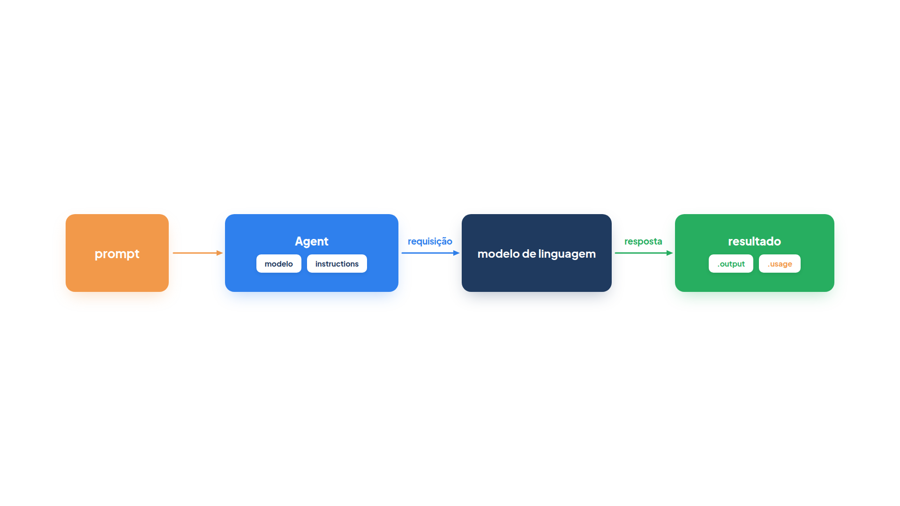
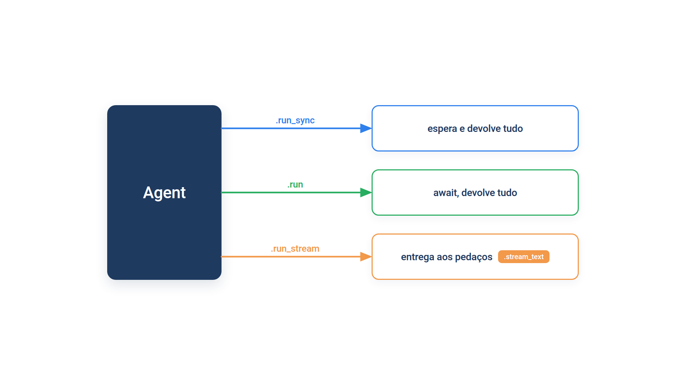

# Capítulo 0.4 — O primeiro agente por dentro

No Capítulo 0.3 você viu o Pydantic validar dados que chegam e sair deles em JSON, e viu de relance o PydanticAI usando essas peças para conversar com um modelo de linguagem. Agora é hora de abrir o agente. Neste capítulo você cria um `Agent`, executa-o de três maneiras diferentes, lê o objeto de resultado (a resposta e quanto ela custou em tokens) e ajusta o comportamento do modelo com `ModelSettings`. No fim, você vai entender por que o livro troca de modelo alterando uma única linha.



A figura resume o caminho: a sua pergunta (o **prompt**) entra no agente, o agente junta a pergunta com as instruções e envia tudo ao modelo; a resposta volta embrulhada num objeto de resultado, de onde você tira o texto (`.output`) e o consumo (`.usage`).

Todos os exemplos deste capítulo rodam **sem chave de API**. No lugar de um modelo real, eles usam o `TestModel` e o `FunctionModel`, dois modelos falsos que o PydanticAI traz para testes. O Capítulo 0.5 os explica em detalhe; por enquanto, basta saber que eles respondem na hora, sempre do mesmo jeito, sem custo.

## `Agent`: o objeto que conversa com o modelo

A loja *Casa Verde* quer um atendente que responda perguntas sobre preços. O código mínimo tem três passos: criar o agente, executá-lo e ler o resultado.

*agente_minimo.py*

```python
from pydantic_ai import Agent
from pydantic_ai.models.test import TestModel

modelo = TestModel(custom_output_text="O vaso de barro custa R$ 49,90.")

atendente = Agent(
    modelo,
    instructions="Você é o atendente da loja Casa Verde. Responda em uma frase.",
    name="atendente",
)

resultado = atendente.run_sync("Quanto custa o vaso de barro?")
print(resultado.output)
print(resultado.usage)

uso = resultado.usage
print("requisições:", uso.requests)
print("tokens de entrada:", uso.input_tokens)
print("tokens de saída:", uso.output_tokens)
print("total:", uso.total_tokens)
```

Saída:

```text
O vaso de barro custa R$ 49,90.
RunUsage(input_tokens=56, output_tokens=9, requests=1)
requisições: 1
tokens de entrada: 56
tokens de saída: 9
total: 65
```

O texto da resposta saiu na primeira linha. A segunda mostra um objeto com três números, e as quatro últimas linhas leem esses números um por um. Vamos dar nome a cada peça.

`Agent` é a classe central do PydanticAI. Um objeto `Agent` guarda **a configuração** de um assistente: qual modelo usar, que instruções seguir, que ferramentas oferecer e que tipo de saída esperar. Ele não guarda a conversa; cada execução começa do zero, a menos que você passe um histórico (assunto do Capítulo 0.5). Por isso o livro cria o agente uma vez, no nível do módulo, e o executa quantas vezes precisar.

O primeiro argumento é o **modelo**. Aqui é `TestModel(custom_output_text=...)`, um modelo falso que devolve sempre o texto combinado. Nos capítulos dos módulos, ele é um texto como `"anthropic:claude-sonnet-5-5"`, que você verá na próxima seção.

`Agent(instructions=)` recebe as **instruções**: o texto que diz ao modelo quem ele é e como deve responder. O PydanticAI envia esse texto em toda requisição ao modelo, junto com a pergunta. É aqui que mora a "rotina" que o Capítulo 2 ensina a escrever.

`Agent(name=)` dá um nome ao agente. O nome não muda a resposta; ele aparece em logs, nos rastros do Logfire e nas mensagens de erro, o que ajuda quando há vários agentes no mesmo programa. Se você não passar `name`, o PydanticAI tenta deduzi-lo do nome da variável na primeira execução: um agente guardado em `atendente` passa a se chamar `"atendente"`.

### O objeto de resultado: `.output` e `.usage`

`.run_sync` executa o agente e espera a resposta. Ele recebe o prompt do usuário e devolve um objeto de resultado (da classe `AgentRunResult`). Os dois atributos que você mais vai usar são:

- `.output`: a resposta final. Como este agente não declarou `output_type`, a saída é um `str`. Quando você declarar um `BaseModel` como tipo de saída (Capítulo 0.6), `.output` será um objeto desse modelo, já validado.
- `.usage`: o consumo da execução inteira, num objeto `RunUsage`.

Dentro de `.usage`, cada número tem um nome:

| Atributo | O que conta | No exemplo |
| --- | --- | --- |
| `.requests` | quantas chamadas foram feitas ao modelo | `1` |
| `.input_tokens` | tokens enviados ao modelo (instruções, prompt, histórico) | `56` |
| `.output_tokens` | tokens gerados pelo modelo | `9` |
| `.total_tokens` | a soma dos dois | `65` |

Um **token** é um pedaço de texto, em média menor que uma palavra, e é a unidade em que os provedores cobram. Os números do `TestModel` são estimativas, não preços reais, mas a estrutura é a mesma de um modelo real. Repare que `.requests` conta chamadas ao modelo, não execuções: quando o agente usa ferramentas, uma única execução faz várias requisições, e o Capítulo 37 usa justamente `resultado.usage.requests` para acompanhar custo em produção.

### Armadilha: `.output` é atributo, não método

Escrever `resultado.output()` gera `TypeError: 'str' object is not callable`, porque `.output` já é o valor. O mesmo vale para `.usage`. Outro engano comum é imprimir o objeto de resultado inteiro (`print(resultado)`) esperando só o texto; o que aparece é a representação do objeto, com a saída lá dentro.

### Faça você mesmo — `Agent` e o resultado

- **0.4.1 Outro texto:** mude `custom_output_text` para uma resposta mais longa e observe o que acontece com `.output_tokens` e `.total_tokens`.
- **0.4.2 Instruções maiores:** acrescente duas frases às instruções. Qual número de `.usage` mudou? Por quê?
- **0.4.3 Nome deduzido:** remova `name="atendente"`, imprima `atendente.name` antes e depois do `run_sync` e explique a diferença.

## A string `"provedor:modelo"` e a troca em uma linha

No livro, o modelo raramente é um objeto: é um texto no formato `"provedor:modelo"`, como `"anthropic:claude-sonnet-5-5"` ou `"openai:gpt-5.2"`. A parte antes dos dois-pontos diz **qual provedor** (a empresa ou serviço que hospeda o modelo); a parte depois diz **qual modelo** desse provedor. O PydanticAI lê esse texto, escolhe a classe certa e procura a chave de API na variável de ambiente correspondente.

*agente_modelo_string.py*

```python
from pydantic_ai import Agent
from pydantic_ai.exceptions import UserError

MODELO = "test"  # no livro: "anthropic:claude-sonnet-5-5"

agente = Agent(MODELO, instructions="Responda em português.")
print(agente.model.system)
print(agente.run_sync("Olá").output)

for nome in ["anthropic:claude-sonnet-5-5", "casaverde:modelo-1"]:
    try:
        Agent(nome)
    except UserError as erro:
        print(nome, "->", str(erro)[:60])
```

Saída:

```text
test
success (no tool calls)
anthropic:claude-sonnet-5-5 -> Set the `ANTHROPIC_API_KEY` environment variable or pass it
casaverde:modelo-1 -> Unknown model: casaverde:modelo-1
```

A string `"test"` é um atalho para o `TestModel`, e é por isso que este exemplo roda sem chave: `agente.model.system` mostra `test` e a resposta padrão do `TestModel` é `success (no tool calls)`. O laço final mostra os dois erros que você mais vai encontrar, ambos da classe `UserError`:

- `"anthropic:claude-sonnet-5-5"` é um nome válido, mas falta a variável de ambiente `ANTHROPIC_API_KEY`. O erro acontece **ao criar** o agente, não ao executá-lo, e a mensagem diz exatamente o que fazer. (Se você já tiver a chave configurada, essa linha não falha.)
- `"casaverde:modelo-1"` não é um provedor conhecido, e o erro é `Unknown model`.

Agora você entende o arquivo `config.py` dos módulos. Ele contém uma única linha, `MODELO = "anthropic:claude-sonnet-5-5"`, e todos os agentes fazem `Agent(MODELO, ...)`. Para testar o livro inteiro com outro provedor, você altera só essa linha, por exemplo para `"openai:gpt-5.2"` ou `"google:gemini-2.5-flash"`, e configura a chave do novo provedor. O código dos agentes não muda, porque todos os provedores devolvem o mesmo objeto de resultado.

### Faça você mesmo — a string do modelo

- **0.4.4 Variável de ambiente:** execute `agente_modelo_string.py` com `ANTHROPIC_API_KEY=qualquer-coisa` na frente do comando. Qual linha da saída muda? A chave falsa só seria recusada em qual momento?
- **0.4.5 Erro de digitação:** troque `"test"` por `"tset"` em `MODELO` e leia a mensagem de erro.

## `instructions` ou `system_prompt`?

Você vai encontrar, em exemplos antigos e na documentação, um segundo parâmetro parecido com `instructions`: o `system_prompt`. Os dois enviam um texto de orientação ao modelo. A diferença aparece quando a conversa continua em outra execução, ou em outro agente. Para enxergar isso, o exemplo usa um `FunctionModel` que, em vez de responder algo útil, imprime o que recebeu.

*agente_instrucoes.py*

```python
from pydantic_ai import Agent
from pydantic_ai.messages import ModelResponse, SystemPromptPart, TextPart
from pydantic_ai.models.function import AgentInfo, FunctionModel


def espiar(mensagens, info: AgentInfo) -> ModelResponse:
    sistema = [p.content for m in mensagens for p in m.parts if isinstance(p, SystemPromptPart)]
    print("  instructions:", info.instructions)
    print("  system_prompt:", sistema)
    return ModelResponse(parts=[TextPart("ok")])


com_instrucoes = Agent(FunctionModel(espiar), instructions="Seja o atendente da Casa Verde.")
com_sistema = Agent(FunctionModel(espiar), system_prompt="Seja o atendente da Casa Verde.")
revisor = Agent(FunctionModel(espiar), instructions="Revise o texto.")

for agente in [com_instrucoes, com_sistema]:
    print("primeira execução:")
    anterior = agente.run_sync("Oi")
    print("revisor com o histórico:")
    revisor.run_sync("Revise", message_history=anterior.all_messages())
```

Saída:

```text
primeira execução:
  instructions: Seja o atendente da Casa Verde.
  system_prompt: []
revisor com o histórico:
  instructions: Revise o texto.
  system_prompt: []
primeira execução:
  instructions: None
  system_prompt: ['Seja o atendente da Casa Verde.']
revisor com o histórico:
  instructions: Revise o texto.
  system_prompt: ['Seja o atendente da Casa Verde.']
```

Leia a saída em duas metades. Na primeira, `com_instrucoes` envia o texto como `instructions`; quando o `revisor` recebe o histórico dessa conversa (`message_history=anterior.all_messages()`), ele vê **apenas as suas próprias** instruções: "Revise o texto.". Na segunda metade, `com_sistema` grava o texto como uma parte do histórico (`SystemPromptPart`); por isso, o `revisor` continua recebendo "Seja o atendente da Casa Verde." junto com as próprias instruções.

Em resumo:

- `instructions` valem para o agente que está executando agora e não ficam presas no histórico. É o que a documentação recomenda e o que o livro usa.
- `system_prompt` vira uma mensagem dentro do histórico e viaja com ele para as próximas execuções, inclusive de outros agentes.

Use `system_prompt` só quando você quiser, de propósito, que a orientação acompanhe a conversa. Num sistema com vários agentes, como os do Módulo 7, carregar o papel de um agente para dentro de outro costuma causar respostas confusas.

### Faça você mesmo — instruções

- **0.4.6 Os dois juntos:** crie um agente com `instructions` e `system_prompt` ao mesmo tempo e observe o que o `espiar` imprime.
- **0.4.7 Instrução da execução:** passe `instructions="Responda em inglês."` diretamente ao `run_sync` de `com_instrucoes`. O texto se soma ao do agente ou o substitui?

## Três formas de executar: `.run_sync`, `.run` e `.run_stream`

Até aqui você usou `.run_sync`, que bloqueia o programa até a resposta chegar. É a forma mais simples, ideal para scripts. O agente oferece mais duas:



- `.run` é a versão **assíncrona** de `.run_sync`: uma função `async` que você chama com `await`. Use-a dentro de programas que já são assíncronos, como um servidor web ou um orquestrador que dispara vários agentes ao mesmo tempo. (`async`, `await` e `asyncio.run` foram apresentados no Capítulo 0.2.)
- `.run_stream` também é assíncrona, mas entrega a resposta **aos pedaços**, conforme o modelo gera. É o que faz o texto "aparecer digitando" num chat.

*agente_async.py*

```python
import asyncio

from pydantic_ai import Agent
from pydantic_ai.messages import ModelResponse, TextPart
from pydantic_ai.models.function import AgentInfo, FunctionModel


PEDACOS = ["O vaso ", "de barro ", "custa R$ 49,90."]


def de_uma_vez(mensagens, info: AgentInfo) -> ModelResponse:
    return ModelResponse(parts=[TextPart("".join(PEDACOS))])


async def em_pedacos(mensagens, info: AgentInfo):
    for pedaco in PEDACOS:
        yield pedaco


atendente = Agent(FunctionModel(de_uma_vez, stream_function=em_pedacos))


async def main():
    resultado = await atendente.run("Quanto custa o vaso?")
    print("run:", resultado.output)

    async with atendente.run_stream("Quanto custa o vaso?") as resposta:
        async for texto in resposta.stream_text(debounce_by=None):
            print("acumulado:", repr(texto))

    async with atendente.run_stream("Quanto custa o vaso?") as resposta:
        async for pedaco in resposta.stream_text(delta=True, debounce_by=None):
            print("delta:", repr(pedaco))

    async with atendente.run_stream("Quanto custa o vaso?") as resposta:
        print("get_output:", await resposta.get_output())
        print(resposta.usage)


asyncio.run(main())
```

Saída:

```text
run: O vaso de barro custa R$ 49,90.
acumulado: 'O vaso '
acumulado: 'O vaso de barro '
acumulado: 'O vaso de barro custa R$ 49,90.'
delta: 'O vaso '
delta: 'de barro '
delta: 'custa R$ 49,90.'
get_output: O vaso de barro custa R$ 49,90.
RunUsage(input_tokens=50, output_tokens=9, requests=1)
```

O `FunctionModel` recebeu duas funções: `de_uma_vez`, usada quando o agente pede a resposta inteira (`.run`), e `em_pedacos`, usada quando ele pede um fluxo (`.run_stream`). Assim você simula, sem rede, um modelo que gera o texto em três pedaços.

`await atendente.run(...)` devolve o mesmo objeto de resultado de `.run_sync`, com `.output` e `.usage`.

`.run_stream` é diferente: é um **gerenciador de contexto assíncrono**, por isso aparece em `async with ... as resposta`. Dentro do bloco, `resposta` é um `StreamedRunResult`, e você escolhe como ler:

- `.stream_text` produz o texto **acumulado** a cada pedaço: primeiro `'O vaso '`, depois `'O vaso de barro '` e assim por diante. Com `delta=True`, produz só o **trecho novo** de cada vez, que é o que você concatena numa interface.
- `.get_output` espera o fluxo terminar e devolve a saída completa, como `.output` faria.
- `.usage` está disponível depois que o fluxo termina.

O argumento `debounce_by=None` desliga um agrupamento que o PydanticAI faz por padrão: ele junta os pedaços que chegam em menos de 0,1 segundo para não sobrecarregar a interface. Com um modelo falso, que gera tudo instantaneamente, sem `debounce_by=None` você veria um único pedaço.

### Streaming de saída estruturada: `.stream_output`

Quando o agente tem `output_type` (Capítulo 0.6), o texto que chega é um JSON incompleto. `.stream_output` valida esse JSON parcial a cada pedaço e entrega objetos cada vez mais completos:

*agente_stream_saida.py*

```python
import asyncio

from pydantic import BaseModel
from pydantic_ai import Agent
from pydantic_ai.models.function import AgentInfo, DeltaToolCall, FunctionModel


class Produto(BaseModel):
    nome: str
    preco: float = 0


async def json_em_pedacos(mensagens, info: AgentInfo):
    ferramenta = info.output_tools[0].name
    yield {0: DeltaToolCall(name=ferramenta, json_args='{"nome": "Vaso', tool_call_id="c1")}
    for pedaco in [' de barro"', ', "preco": 49.9}']:
        yield {0: DeltaToolCall(json_args=pedaco)}


catalogo = Agent(FunctionModel(stream_function=json_em_pedacos), output_type=Produto)


async def main():
    async with catalogo.run_stream("Cadastre o vaso de barro") as resposta:
        async for parcial in resposta.stream_output(debounce_by=None):
            print(repr(parcial))


asyncio.run(main())
```

Saída:

```text
Produto(nome='Vaso', preco=0)
Produto(nome='Vaso de barro', preco=0)
Produto(nome='Vaso de barro', preco=49.9)
Produto(nome='Vaso de barro', preco=49.9)
```

O `FunctionModel` simula o modelo enviando os argumentos da "ferramenta de saída" em três pedaços (`DeltaToolCall`). A cada pedaço, o PydanticAI tenta validar o que já chegou: primeiro `nome='Vaso'`, depois o nome completo, por fim o preço. A última linha repete o objeto final, já validado por inteiro.

### Armadilha: campos obrigatórios e o fluxo parcial

Repare que `preco` tem valor padrão (`= 0`). Se o campo fosse obrigatório, os objetos parciais não passariam na validação enquanto o preço não chegasse, e você só veria o resultado final. Para mostrar progresso ao usuário, deixe com valor padrão os campos que chegam por último. E lembre que `.run_stream` considera "final" a **primeira** saída que combina com o tipo de saída; se o modelo ainda chamar ferramentas depois disso, elas não rodam. Para fluxos com ferramentas, a documentação indica `run_stream_events` ou `iter`.

### Faça você mesmo — as três execuções

- **0.4.8 Sem `debounce_by`:** remova `debounce_by=None` do laço "acumulado" e conte quantas linhas aparecem.
- **0.4.9 Duas ao mesmo tempo:** use `asyncio.gather` para executar `atendente.run` com duas perguntas diferentes e imprima os dois `.output`.
- **0.4.10 Preço obrigatório:** remova o `= 0` de `preco` em `agente_stream_saida.py` e compare a saída.

## `ModelSettings`: ajustando o modelo

Às vezes você quer que o modelo responda de modo mais previsível, ou que não passe de um certo tamanho. `ModelSettings` reúne esses ajustes num dicionário tipado: `temperature` (quanto o modelo varia nas escolhas de palavras; `0.0` é o mais previsível, embora nem assim a resposta seja totalmente determinística), `max_tokens` (o limite de tokens gerados), `timeout`, `seed` e outros.

*agente_configuracoes.py*

```python
from pydantic_ai import Agent, ModelSettings
from pydantic_ai.messages import ModelResponse, TextPart
from pydantic_ai.models.function import AgentInfo, FunctionModel


def espiar(mensagens, info: AgentInfo) -> ModelResponse:
    print("configurações recebidas:", info.model_settings)
    return ModelResponse(parts=[TextPart("ok")])


atendente = Agent(
    FunctionModel(espiar),
    model_settings=ModelSettings(temperature=0.7, max_tokens=300),
)

atendente.run_sync("Sugira um vaso")
atendente.run_sync("Sugira um vaso", model_settings=ModelSettings(temperature=0.0))
```

Saída:

```text
configurações recebidas: {'temperature': 0.7, 'max_tokens': 300}
configurações recebidas: {'temperature': 0.0, 'max_tokens': 300}
```

O agente foi criado com `model_settings=ModelSettings(temperature=0.7, max_tokens=300)`. Esses são os **padrões do agente**, enviados em toda execução, como mostra a primeira linha. Na segunda execução, `run_sync` recebeu `ModelSettings(temperature=0.0)`. O PydanticAI **mesclou** as duas camadas: a execução trocou a temperatura, e o `max_tokens` do agente continuou valendo. A regra é que o ajuste mais próximo da chamada vence: primeiro os padrões do modelo, depois os do agente, por fim os da execução.

Os provedores não aceitam os mesmos ajustes: a documentação de `ModelSettings` indica, campo a campo, quais provedores suportam cada um. Os mais comuns, `temperature` e `max_tokens`, valem para quase todos.

### Faça você mesmo — `ModelSettings`

- **0.4.11 Três camadas:** crie o modelo como `FunctionModel(espiar, settings=ModelSettings(seed=7))` e veja o `seed` aparecer nas duas execuções.
- **0.4.12 Desligando um ajuste:** na segunda execução, passe também `max_tokens=None` e observe o que o modelo recebe.

## Recapitulando

`Agent` guarda a configuração de um assistente: o modelo (um objeto ou a string `"provedor:modelo"`), as instruções em `instructions=` e um nome opcional em `name=`. Prefira `instructions` a `system_prompt`, que fica gravado no histórico e acompanha a conversa. `.run_sync` executa e espera; `.run` é a versão assíncrona; `.run_stream` entrega a resposta aos pedaços, lida com `.stream_text` (acumulado ou `delta=True`), `.stream_output` (objetos parciais validados) ou `.get_output` (tudo de uma vez). O resultado traz `.output`, a resposta, e `.usage`, com `.requests`, `.input_tokens`, `.output_tokens` e `.total_tokens`. `ModelSettings` ajusta temperatura, tamanho e outros parâmetros, mesclando agente e execução. E, como o modelo é só uma string, o livro troca de provedor alterando a linha de `config.py`.

Você fez tudo isso com modelos falsos, sem perceber o que eles recebiam além do que o `espiar` mostrou. O Capítulo 0.5 abre essa caixa: as mensagens que circulam entre o agente e o modelo, e como o `TestModel` e o `FunctionModel` permitem testar agentes sem API.

### Fontes do capítulo

- Documentação do PydanticAI — [Agents](https://ai.pydantic.dev/agent/): `Agent`, `run_sync`, `run`, `run_stream`, instruções x prompts de sistema, `ModelSettings` e a ordem de precedência das configurações.
- Documentação do PydanticAI — [API: pydantic_ai.agent](https://ai.pydantic.dev/api/agent/): parâmetros do construtor `Agent` (`instructions`, `system_prompt`, `name`, `model_settings`).
- Documentação do PydanticAI — [API: pydantic_ai.result](https://ai.pydantic.dev/api/result/): `StreamedRunResult`, `stream_text` (`delta`, `debounce_by`), `stream_output` e `get_output`.
- Documentação do PydanticAI — [API: pydantic_ai.usage](https://ai.pydantic.dev/api/usage/): `RunUsage`, `requests`, `input_tokens`, `output_tokens`, `total_tokens`.
- Documentação do PydanticAI — [API: pydantic_ai.settings](https://ai.pydantic.dev/api/settings/): os campos de `ModelSettings`.
- Documentação do PydanticAI — [Models overview](https://ai.pydantic.dev/models/overview/): o formato `"provedor:modelo"` e as variáveis de ambiente das chaves.
- Documentação do PydanticAI — [Output](https://ai.pydantic.dev/output/): streaming de saída estruturada e validação parcial.
- Documentação do PydanticAI — [Testing](https://ai.pydantic.dev/testing/): `TestModel` e `FunctionModel`.
