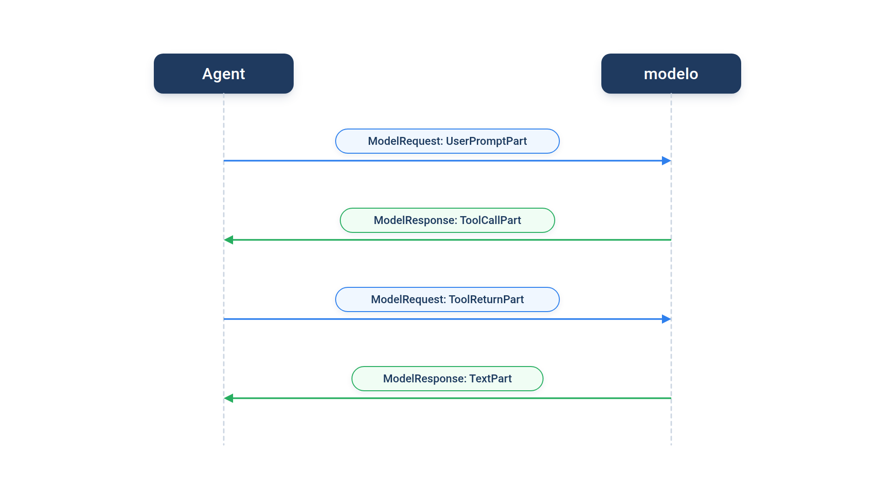
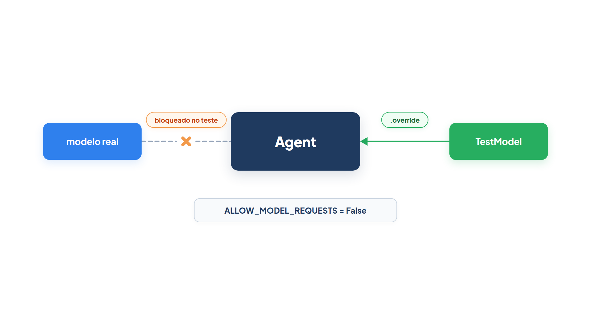

# Capítulo 0.5 — Mensagens e testes sem API

No Capítulo 0.4 você executou agentes com modelos falsos e leu o resultado pelo lado de fora: `.output` e `.usage`. Mas o `espiar` daquele capítulo já recebia um parâmetro `mensagens` que ninguém abriu. Neste capítulo você abre essa lista. Vai ver o que o agente envia ao modelo e o que o modelo devolve, como dar memória a uma conversa, como gravá-la em disco e, por fim, como testar um agente inteiro sem chave de API e sem gastar um centavo.



A figura mostra o vaivém de uma execução com ferramenta. O agente envia uma **requisição** com a pergunta; o modelo devolve uma **resposta** pedindo uma ferramenta; o agente executa a ferramenta e envia outra requisição com o retorno; o modelo, enfim, responde com texto. Cada seta é uma mensagem, e cada mensagem é feita de partes.

## O que trafega: `ModelRequest` e `ModelResponse`

A *Casa Verde* tem um atendente com uma ferramenta de preço. Você quer saber exatamente o que aconteceu numa execução, passo a passo. O resultado de `.run_sync` guarda isso:

*mensagens_conversa.py*

```python
from pydantic_ai import Agent
from pydantic_ai.models.test import TestModel

atendente = Agent(TestModel(), instructions="Você é o atendente da loja Casa Verde.")


@atendente.tool_plain
def consultar_preco(produto: str) -> float:
    """Devolve o preço de um produto da loja."""
    return 49.90


resultado = atendente.run_sync("Quanto custa o vaso de barro?")

for mensagem in resultado.all_messages():
    print(type(mensagem).__name__, mensagem.kind)
    for parte in mensagem.parts:
        print("   ", parte.part_kind)
```

Saída:

```text
ModelRequest request
    user-prompt
ModelResponse response
    tool-call
ModelRequest request
    tool-return
ModelResponse response
    text
```

Quatro mensagens, alternando `request` e `response`. Vamos dar nome a cada peça.

**`ModelRequest`** é uma mensagem que vai **do agente para o modelo**. Seu atributo `kind` vale sempre `"request"`. A primeira requisição leva a pergunta do usuário; a segunda leva o retorno da ferramenta.

**`ModelResponse`** é uma mensagem que vem **do modelo para o agente**, com `kind` igual a `"response"`. A primeira resposta pede uma ferramenta; a última traz o texto final.

**`ModelMessage`** não é uma classe a mais: é o nome do tipo "uma mensagem qualquer", ou seja, `ModelRequest | ModelResponse`. Você o encontra em anotações de tipo, como `list[ModelMessage]`. O campo `kind` é o **discriminador**: o Pydantic olha para ele para saber qual das duas classes montar quando lê mensagens de um JSON (você verá isso daqui a pouco).

Cada mensagem tem o atributo **`.parts`**, uma lista de **partes**. Uma requisição pode levar várias partes ao mesmo tempo (por exemplo, dois retornos de ferramenta), e uma resposta também (um texto e uma chamada de ferramenta). Toda parte tem **`.part_kind`**, um texto curto que diz o tipo dela. É ele que o laço interno imprimiu.

### As partes por dentro

O `part_kind` diz o tipo; agora você quer o conteúdo. O mesmo agente, desta vez lendo os atributos de cada parte:

*mensagens_partes.py*

```python
from pydantic_ai import Agent
from pydantic_ai.messages import TextPart, ToolCallPart, ToolReturnPart, UserPromptPart
from pydantic_ai.models.test import TestModel

atendente = Agent(TestModel(), instructions="Você é o atendente da loja Casa Verde.")


@atendente.tool_plain
def consultar_preco(produto: str) -> float:
    """Devolve o preço de um produto da loja."""
    return 49.90


resultado = atendente.run_sync("Quanto custa o vaso de barro?")

for mensagem in resultado.all_messages():
    for parte in mensagem.parts:
        if isinstance(parte, UserPromptPart):
            print("pergunta:", parte.content)
        elif isinstance(parte, ToolCallPart):
            print("chamada:", parte.tool_name, parte.args_as_dict(), parte.tool_call_id)
        elif isinstance(parte, ToolReturnPart):
            print("retorno:", parte.tool_name, parte.content, parte.tool_call_id)
        elif isinstance(parte, TextPart):
            print("texto:", parte.content)
```

Saída:

```text
pergunta: Quanto custa o vaso de barro?
chamada: consultar_preco {'produto': 'a'} pyd_ai_tool_call_id__consultar_preco
retorno: consultar_preco 49.9 pyd_ai_tool_call_id__consultar_preco
texto: {"consultar_preco":49.9}
```

Cada `elif` testa uma classe com `isinstance`. Estas são as partes que você mais vai encontrar:

| Classe | `part_kind` | Vem em | O que carrega |
| --- | --- | --- | --- |
| `UserPromptPart` | `user-prompt` | requisição | a pergunta do usuário, em `.content` |
| `ToolCallPart` | `tool-call` | resposta | o pedido de ferramenta: `.tool_name`, `.args`, `.tool_call_id` |
| `ToolReturnPart` | `tool-return` | requisição | o que a ferramenta devolveu, em `.content` |
| `TextPart` | `text` | resposta | o texto do modelo, em `.content` |
| `RetryPromptPart` | `retry-prompt` | requisição | um pedido de correção ao modelo, em `.content` |

Leia a saída com a tabela ao lado. `.content` aparece em várias partes, sempre como "a carga útil": a pergunta, o retorno (`49.9`, um `float`, não texto) ou o texto final.

Na `ToolCallPart`, `.tool_name` é o nome da ferramenta pedida. `.args` são os argumentos, e aqui mora uma sutileza: o modelo pode mandá-los como dicionário **ou** como texto JSON, conforme o provedor. Por isso o código usa o método `.args_as_dict()`, que devolve sempre um `dict`, venha como vier. `.tool_call_id` é um identificador da chamada; ele se repete na `ToolReturnPart` correspondente, e é assim que o modelo liga cada retorno ao pedido certo quando pede várias ferramentas de uma vez.

O `{'produto': 'a'}` não é erro seu. O `TestModel` não lê a pergunta: ele gera argumentos que apenas passam na validação (um `str` qualquer vira `"a"`). E o texto final `{"consultar_preco":49.9}` é o resumo que ele monta com os retornos. Você verá como controlar isso mais adiante.

### Faça você mesmo — mensagens e partes

- **0.5.1 Duas ferramentas:** acrescente uma ferramenta `consultar_estoque(produto: str) -> int` a `mensagens_partes.py` e observe quantas partes cabem na primeira resposta.
- **0.5.2 O tipo da mensagem:** no laço de `mensagens_conversa.py`, troque `type(mensagem).__name__` por `isinstance(mensagem, ModelRequest)` (importe de `pydantic_ai.messages`) e confira que o resultado bate com `kind`.
- **0.5.3 Sem ferramenta:** remova `@atendente.tool_plain` e preveja, antes de executar, quantas mensagens e partes vão aparecer.

## Memória de conversa: `message_history`

O Capítulo 0.4 disse que o `Agent` não guarda a conversa. Você quer que o atendente lembre da pergunta anterior: "E o de cerâmica?" só faz sentido depois de "Quanto custa o vaso de barro?". Para ver o efeito, este exemplo usa um modelo falso que só conta quantas mensagens recebeu:

*mensagens_historico.py*

```python
from pydantic_ai import Agent
from pydantic_ai.messages import ModelResponse, TextPart
from pydantic_ai.models.function import AgentInfo, FunctionModel


def contar(mensagens, info: AgentInfo) -> ModelResponse:
    return ModelResponse(parts=[TextPart(f"recebi {len(mensagens)} mensagem(ns)")])


atendente = Agent(FunctionModel(contar))

primeira = atendente.run_sync("Quanto custa o vaso de barro?")
print(primeira.output)

segunda = atendente.run_sync("E o de cerâmica?", message_history=primeira.all_messages())
print(segunda.output)
print("all_messages:", len(segunda.all_messages()))
print("new_messages:", len(segunda.new_messages()))

esquecida = atendente.run_sync("E o de cerâmica?")
print(esquecida.output)
```

Saída:

```text
recebi 1 mensagem(ns)
recebi 3 mensagem(ns)
all_messages: 4
new_messages: 2
recebi 1 mensagem(ns)
```

Na primeira execução, o modelo recebeu uma mensagem: a requisição com a pergunta. Na segunda, recebeu três: a pergunta antiga, a resposta antiga e a pergunta nova. Na terceira, sem histórico, voltou a receber uma só, e um modelo real não saberia de que "cerâmica" se trata.

O parâmetro **`message_history`** de `.run_sync` (e de `.run` e `.run_stream`) recebe uma lista de mensagens de execuções anteriores. O agente as coloca **antes** da pergunta nova, e o modelo vê a conversa inteira.

O resultado oferece duas formas de pegar essas mensagens:

- **`.all_messages()`**: todas as mensagens, incluindo as que vieram em `message_history`. Na segunda execução, 4 (as 2 antigas e as 2 novas).
- **`.new_messages()`**: só as mensagens criadas nesta execução. Na segunda, 2.

Os dois são **métodos**: escreva os parênteses. Sem eles você passa o método, não a lista, e a execução falha com `TypeError: 'method' object is not iterable`.

**Armadilha:** para continuar uma conversa de vários turnos, passe `all_messages()` do último resultado. Se passar `new_messages()`, o terceiro turno recebe só o segundo e perde o primeiro. `new_messages()` serve para outra coisa: gravar no banco apenas o que é novo, acrescentando ao que já estava salvo.

### Gravar e recuperar: `ModelMessagesTypeAdapter`

Um atendente de verdade atende muitos clientes, e a conversa precisa sobreviver entre uma visita e outra. Você grava a lista em JSON e, depois, lê de volta:

*mensagens_salvar.py*

```python
from pathlib import Path

from pydantic_ai import Agent, ModelMessagesTypeAdapter
from pydantic_ai.models.test import TestModel

atendente = Agent(TestModel(custom_output_text="Custa R$ 49,90."))
resultado = atendente.run_sync("Quanto custa o vaso de barro?")

arquivo = Path("conversa.json")
arquivo.write_bytes(ModelMessagesTypeAdapter.dump_json(resultado.all_messages()))

historico = ModelMessagesTypeAdapter.validate_json(arquivo.read_bytes())
print(type(historico[0]).__name__, type(historico[1]).__name__)
print(historico == resultado.all_messages())

continuacao = atendente.run_sync("E o de cerâmica?", message_history=historico)
print(len(continuacao.all_messages()))
arquivo.unlink()
```

Saída:

```text
ModelRequest ModelResponse
True
4
```

`ModelMessagesTypeAdapter` é um `TypeAdapter(list[ModelMessage])`, a mesma ferramenta do Pydantic que você viu no Capítulo 0.3, já pronta para listas de mensagens. `.dump_json` transforma a lista em bytes JSON; `.validate_json` faz o caminho inverso e **valida**: graças ao discriminador `kind`, cada item volta como `ModelRequest` ou `ModelResponse`, com as partes certas. A comparação `True` mostra que nada se perdeu, e a continuação com `message_history=historico` funciona como se a conversa nunca tivesse saído da memória.

Cuidado com a origem do histórico. Se ele vier de um navegador ou de outro sistema em que você não confia, alguém pode fabricar mensagens, inclusive chamadas de ferramenta que o modelo nunca pediu. A documentação do PydanticAI trata o histórico como estado confiável do servidor; não aceite o que o cliente mandar sem conferir.

### Faça você mesmo — histórico

- **0.5.4 Três turnos:** em `mensagens_historico.py`, faça um terceiro turno passando `segunda.new_messages()` e depois `segunda.all_messages()`. Compare os números.
- **0.5.5 JSON à vista:** em `mensagens_salvar.py`, imprima `arquivo.read_text()` antes de apagar o arquivo e encontre os campos `kind` e `part_kind`.
- **0.5.6 Histórico quebrado:** troque `"kind":"request"` por `"kind":"pedido"` no JSON antes de validar e leia o `ValidationError`.

## Testes sem API: `TestModel` e `FunctionModel`

Desde o Capítulo 0.4 você usa dois modelos falsos. Agora vale entender o que cada um faz, porque eles são a base dos testes de qualquer agente: respondem na hora, sempre igual, sem rede e sem custo.

**`TestModel`** é o modelo falso automático. Por padrão, ele **chama todas as ferramentas** do agente uma vez, com argumentos gerados a partir do esquema de cada uma (foi assim que `consultar_preco` recebeu `"a"`), e depois responde com um resumo dos retornos. Não há inteligência nenhuma: é código Python comum que produz dados válidos. Você controla o comportamento com parâmetros: `custom_output_text` fixa o texto final, `custom_output_args` fixa uma saída estruturada e `call_tools=[]` impede a chamada de ferramentas. Use-o quando quiser exercitar o encanamento: as ferramentas executam? A saída valida?

Quando você precisa decidir **o que** o modelo responde, a cada passo, entra o **`FunctionModel`**. Você escreve uma função comum que recebe a lista de mensagens e devolve uma `ModelResponse`. O exemplo abaixo simula um modelo que erra o nome do produto e se corrige:

*teste_functionmodel.py*

```python
from pydantic_ai import Agent, ModelRetry, capture_run_messages
from pydantic_ai.messages import ModelResponse, TextPart, ToolCallPart
from pydantic_ai.models.function import AgentInfo, FunctionModel


def modelo_roteirizado(mensagens, info: AgentInfo) -> ModelResponse:
    print("ferramentas:", [ferramenta.name for ferramenta in info.function_tools])
    ultima = mensagens[-1].parts[-1]
    if ultima.part_kind == "user-prompt":
        return ModelResponse(parts=[ToolCallPart("consultar_preco", {"produto": "vaso"})])
    if ultima.part_kind == "retry-prompt":
        print("o agente reclamou:", ultima.content)
        return ModelResponse(parts=[ToolCallPart("consultar_preco", '{"produto": "vaso de barro"}')])
    return ModelResponse(parts=[TextPart(f"O vaso de barro custa R$ {ultima.content}.")])


atendente = Agent(FunctionModel(modelo_roteirizado))


@atendente.tool_plain
def consultar_preco(produto: str) -> float:
    """Devolve o preço de um produto da loja."""
    if produto != "vaso de barro":
        raise ModelRetry("Produto desconhecido. Use o nome completo, como 'vaso de barro'.")
    return 49.90


with capture_run_messages() as mensagens:
    resultado = atendente.run_sync("Quanto custa o vaso?")

print(resultado.output)
print([parte.part_kind for mensagem in mensagens for parte in mensagem.parts])
segunda_chamada = mensagens[3].parts[0]
print(repr(segunda_chamada.args), segunda_chamada.args_as_dict())
```

Saída:

```text
ferramentas: ['consultar_preco']
ferramentas: ['consultar_preco']
o agente reclamou: Produto desconhecido. Use o nome completo, como 'vaso de barro'.
ferramentas: ['consultar_preco']
O vaso de barro custa R$ 49.9.
['user-prompt', 'tool-call', 'retry-prompt', 'tool-call', 'tool-return', 'text']
'{"produto": "vaso de barro"}' {'produto': 'vaso de barro'}
```

A função `modelo_roteirizado` é chamada uma vez a cada vez que o agente consultaria o modelo: três vezes, como mostram as três linhas `ferramentas:`. Ela olha a última parte recebida e decide.

Ela recebe dois argumentos. O primeiro é a lista de mensagens até ali. O segundo é um **`AgentInfo`**, um objeto com informações sobre a execução. O atributo mais usado é **`.function_tools`**: a lista das ferramentas oferecidas ao modelo, cada uma com `name`, `description` e o esquema JSON dos parâmetros. É o que um modelo real receberia para decidir o que chamar.

A resposta é montada à mão com **`ModelResponse(parts=[...])`**: uma lista de partes, exatamente como as que você leu nas seções anteriores. Na primeira chamada, a função devolve uma `ToolCallPart` com `{"produto": "vaso"}`. A ferramenta não conhece "vaso" e lança `ModelRetry`. O agente, então, envia ao modelo uma **`RetryPromptPart`**: uma parte de requisição que diz "corrija e tente de novo", com a mensagem do erro em `.content`. A função vê `retry-prompt`, imprime a reclamação e pede de novo, desta vez com os argumentos em texto JSON. A terceira chamada encontra o `tool-return` e responde com texto. Você não passou um `tool_call_id`; o PydanticAI gera um.

A última linha mostra a diferença entre `.args` e `.args_as_dict()`: `.args` guardou o texto JSON tal como veio, e `.args_as_dict()` o converteu em dicionário.

**Armadilha:** a função do `FunctionModel` precisa sempre terminar a conversa. Se ela devolver uma `ToolCallPart` em toda chamada, o agente pede ferramentas sem parar até estourar o limite de 50 requisições e lançar `UsageLimitExceeded`. Escreva o caminho do texto final primeiro.

### Inspecionar uma execução: `capture_run_messages`

Repare no `with capture_run_messages() as mensagens:`. **`capture_run_messages`** é um gerenciador de contexto que guarda, na lista `mensagens`, as mensagens da execução feita dentro do bloco. Parece igual a `resultado.all_messages()`, mas tem uma vantagem: funciona **mesmo quando a execução falha**. Se a ferramenta lançasse `ModelRetry` mais vezes do que o limite de tentativas, `run_sync` lançaria `UnexpectedModelBehavior` e não haveria `resultado`; a lista `mensagens` ainda teria tudo até a falha. É a primeira coisa a imprimir quando um teste quebra.

### Faça você mesmo — modelos de teste

- **0.5.7 Saída fixa:** em `mensagens_partes.py`, troque `TestModel()` por `TestModel(custom_output_text="Custa R$ 49,90.")` e, depois, por `TestModel(call_tools=[])`. Observe o que some da saída.
- **0.5.8 Erro persistente:** em `teste_functionmodel.py`, faça a função pedir sempre `{"produto": "vaso"}`. Envolva o `run_sync` em `try/except` e imprima `len(mensagens)` depois da falha.
- **0.5.9 Descrições:** imprima `info.function_tools[0].description` dentro de `modelo_roteirizado` e confirme que é a docstring da ferramenta.

## Testando o agente de produção: `.override` e `ALLOW_MODEL_REQUESTS`

Até aqui o modelo falso foi passado na criação do agente. Mas o atendente de verdade nasce com `"anthropic:claude-sonnet-5-5"`, dentro de um módulo que você não quer editar para testar. E você quer a garantia de que nenhum teste vai, por descuido, chamar a API paga.



A figura mostra a ideia: o mesmo agente, durante o teste, tem o modelo real trocado por um falso; fora do bloco, tudo volta ao normal.

*teste_override.py*

```python
import os

from pydantic_ai import Agent, models
from pydantic_ai.models.test import TestModel

os.environ["ANTHROPIC_API_KEY"] = "chave-falsa"  # só para criar o agente; nada é enviado
models.ALLOW_MODEL_REQUESTS = False

atendente = Agent("anthropic:claude-sonnet-5-5", instructions="Você é o atendente da Casa Verde.")


def responder(pergunta: str) -> str:
    return atendente.run_sync(pergunta).output


try:
    responder("Quanto custa o vaso de barro?")
except RuntimeError as erro:
    print("bloqueado:", erro)

with atendente.override(model=TestModel(custom_output_text="O vaso custa R$ 49,90.")):
    print("no teste:", responder("Quanto custa o vaso de barro?"))

print("depois:", atendente.model.model_name)
```

Saída:

```text
bloqueado: Model requests are not allowed, since ALLOW_MODEL_REQUESTS is False
no teste: O vaso custa R$ 49,90.
depois: claude-sonnet-5-5
```

A chave falsa existe só porque o PydanticAI exige uma chave para **criar** um agente Anthropic (o Capítulo 0.4 mostrou isso); nenhuma requisição sai do programa.

**`ALLOW_MODEL_REQUESTS`** é uma variável global do módulo `pydantic_ai.models`. Com `models.ALLOW_MODEL_REQUESTS = False`, qualquer tentativa de usar um modelo real lança `RuntimeError` antes de tocar a rede, como mostra a linha `bloqueado:`. Os modelos de teste continuam permitidos. Coloque essa linha no início dos seus arquivos de teste (ou no `conftest.py` do pytest) e um esquecimento vira erro em vez de fatura.

**`.override`** é um método do `Agent` usado com `with`. Dentro do bloco, o agente usa o modelo que você passou em `model=`; ao sair, volta ao original, como mostra a linha `depois:`. O ganho está em `responder`: a função não recebe o agente nem o modelo como parâmetro, e mesmo assim o teste trocou o modelo que ela usa. `override` também aceita `deps=`, `toolsets=` e outros, para trocar dependências (Capítulo 0.7) e ferramentas.

**Cuidado:** `override` vale para um objeto `Agent` específico. Ele vence até um `model=` passado na própria chamada (`atendente.run_sync(pergunta, model=...)`), mas um agente criado **dentro** da função testada é outro objeto, e o `override` do seu teste não o alcança. Crie os agentes no nível do módulo, como o livro faz.

### Faça você mesmo — testes de produção

- **0.5.10 Trava local:** troque a atribuição global por um bloco `with models.override_allow_model_requests(False):` em volta do primeiro `try` e confirme que a linha `bloqueado:` continua igual.
- **0.5.11 Override com roteiro:** dentro do `with`, use `FunctionModel` com uma função que devolve `ModelResponse(parts=[TextPart("roteiro")])`.
- **0.5.12 Um teste de verdade:** escreva `test_atendente.py` com uma função `test_responder()` que usa `override` e um `assert`, e execute-o com `pytest`.

## Recapitulando

A conversa entre o agente e o modelo é uma lista de `ModelMessage`: cada item é uma `ModelRequest` (do agente para o modelo) ou uma `ModelResponse` (do modelo para o agente), distinguidas pelo campo `kind`. Cada mensagem tem `.parts`, e cada parte tem `.part_kind`: `UserPromptPart` leva a pergunta, `ToolCallPart` o pedido de ferramenta (`.tool_name`, `.args`, `.args_as_dict()`, `.tool_call_id`), `ToolReturnPart` o retorno, `RetryPromptPart` o pedido de correção e `TextPart` o texto; quase todas guardam a carga em `.content`. Para lembrar, passe `message_history`, com `.all_messages()` para continuar e `.new_messages()` para gravar só o novo; `ModelMessagesTypeAdapter` leva tudo para JSON e de volta. Para testar sem API, `TestModel` chama tudo automaticamente, `FunctionModel` deixa você escrever o modelo com `ModelResponse(parts=)` e `AgentInfo.function_tools`, `capture_run_messages` mostra o que houve mesmo na falha, `.override` troca o modelo sem mexer no código e `ALLOW_MODEL_REQUESTS = False` impede chamadas reais.

Nos exemplos, as ferramentas foram declaradas com `@atendente.tool_plain` e a saída foi sempre texto. O Capítulo 0.6 explica as ferramentas por dentro (como a docstring e as anotações viram o esquema que você viu em `info.function_tools`) e como pedir ao modelo uma saída tipada, validada pelo Pydantic.

### Fontes do capítulo

- Documentação do PydanticAI — [Messages and chat history](https://ai.pydantic.dev/message-history/): `all_messages`, `new_messages`, `message_history`, `ModelMessagesTypeAdapter` e o cuidado com histórico vindo do cliente.
- Documentação do PydanticAI — [API: pydantic_ai.messages](https://ai.pydantic.dev/api/messages/): `ModelMessage`, `ModelRequest`, `ModelResponse`, `UserPromptPart`, `TextPart`, `ToolCallPart` (`args`, `args_as_dict`, `tool_call_id`), `ToolReturnPart`, `RetryPromptPart`.
- Documentação do PydanticAI — [Unit testing](https://ai.pydantic.dev/testing/): `TestModel`, `FunctionModel`, `Agent.override`, `capture_run_messages` e `ALLOW_MODEL_REQUESTS`.
- Documentação do PydanticAI — [API: pydantic_ai.models.test](https://ai.pydantic.dev/api/models/test/): parâmetros `call_tools`, `custom_output_text` e `custom_output_args`.
- Documentação do PydanticAI — [API: pydantic_ai.models.function](https://ai.pydantic.dev/api/models/function/): `FunctionModel` e `AgentInfo` (`function_tools`).
- Documentação do PydanticAI — [API: pydantic_ai.models](https://ai.pydantic.dev/api/models/base/): `ALLOW_MODEL_REQUESTS`.
- Documentação do Pydantic — [Type Adapter](https://docs.pydantic.dev/latest/concepts/type_adapter/): `validate_json` e `dump_json`, usados por `ModelMessagesTypeAdapter`.
