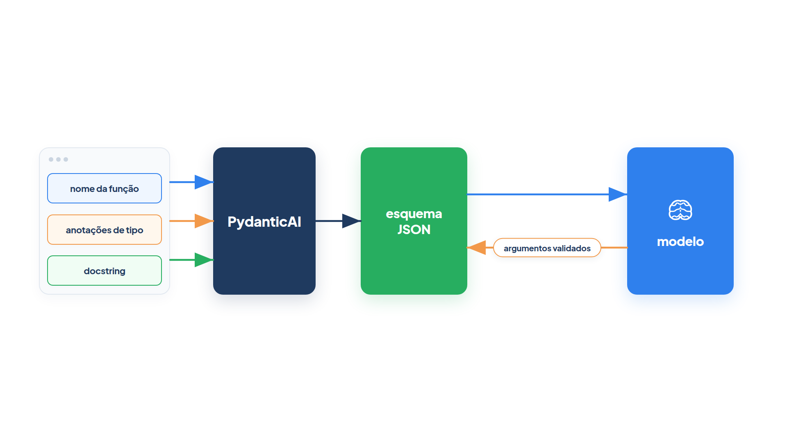
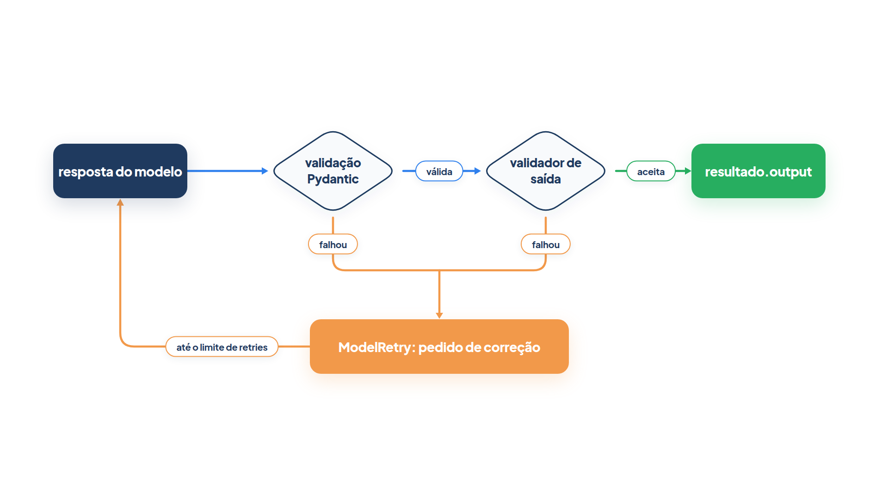

# Capítulo 0.6 — Ferramentas e saída tipada

No Capítulo 0.5 você abriu a lista de mensagens e viu o modelo pedir `consultar_preco` com argumentos que o agente validou, executou e devolveu. Ficaram duas perguntas no ar. Primeira: como o modelo sabe que `consultar_preco` existe e que ela recebe um `produto` do tipo texto? Segunda: todas as respostas foram texto livre; e quando o seu programa precisa de um objeto com campos, e não de uma frase? Este capítulo responde às duas. Você vai ver o esquema de uma ferramenta nascer da assinatura e da docstring, e vai pedir ao agente uma saída tipada que o Pydantic valida antes de entregar a você.



A figura resume a primeira metade do capítulo. O PydanticAI lê o nome da função, as anotações de tipo dos parâmetros e a docstring, monta um **esquema JSON** (a descrição, em formato padrão, de quais argumentos existem e de que tipo são) e o envia ao modelo. Quando o modelo pede a ferramenta, o mesmo esquema valida os argumentos antes de a função rodar.

## O esquema nasce da assinatura: `@tool_plain` e `@tool`

Você quer que o atendente da *Casa Verde* consulte o estoque. Escreve uma função Python comum e a registra no agente. Para ver o que o modelo recebe, use um `FunctionModel` que, em vez de responder algo útil, imprime as ferramentas oferecidas:

*ferramentas_esquema.py*

```python
from pydantic_ai import Agent, RunContext
from pydantic_ai.messages import ModelResponse, TextPart
from pydantic_ai.models.function import AgentInfo, FunctionModel


def mostrar_ferramentas(mensagens, info: AgentInfo) -> ModelResponse:
    for ferramenta in info.function_tools:
        print(ferramenta.name, "->", ferramenta.description)
        for nome, campo in ferramenta.parameters_json_schema["properties"].items():
            print("   ", nome, campo)
        print("    obrigatórios:", ferramenta.parameters_json_schema.get("required", []))
    return ModelResponse(parts=[TextPart("ok")])


atendente = Agent(FunctionModel(mostrar_ferramentas))


@atendente.tool_plain
def consultar_estoque(produto: str, loja: str = "centro") -> int:
    """Informa quantas unidades de um produto há em uma loja.

    Args:
        produto: nome do produto, como 'vaso de barro'.
        loja: unidade da Casa Verde onde procurar.
    """
    return 12


@atendente.tool
def etapa_atual(ctx: RunContext) -> int:
    """Diz em que etapa da execução o agente está."""
    return ctx.run_step


atendente.run_sync("Tem vaso de barro na loja do centro?")
```

Saída:

```text
consultar_estoque -> Informa quantas unidades de um produto há em uma loja.
    produto {'description': "nome do produto, como 'vaso de barro'.", 'type': 'string'}
    loja {'default': 'centro', 'description': 'unidade da Casa Verde onde procurar.', 'type': 'string'}
    obrigatórios: ['produto']
etapa_atual -> Diz em que etapa da execução o agente está.
    obrigatórios: []
```

Você não escreveu nenhum JSON. Mesmo assim, o modelo recebeu tudo de que precisa para usar a ferramenta. Veja de onde veio cada peça:

| No esquema | Veio de |
| --- | --- |
| `consultar_estoque` | nome da função |
| `Informa quantas unidades...` | primeira parte da docstring |
| `'type': 'string'` | anotação `produto: str` |
| `'default': 'centro'` | valor padrão `loja: str = "centro"` |
| `'description': "nome do produto..."` | seção `Args:` da docstring |
| `obrigatórios: ['produto']` | parâmetros sem valor padrão |

**`@tool_plain`** é o decorador que registra uma função como ferramenta de um agente específico: `@atendente.tool_plain` liga `consultar_estoque` ao objeto `atendente`. "Plain" (simples) quer dizer que a função recebe apenas os argumentos que o modelo envia. O PydanticAI inspeciona a assinatura com a mesma maquinaria do Pydantic que você viu no Capítulo 0.3: cada parâmetro vira um campo, cada anotação vira um tipo, e o esquema é gerado como o de um `BaseModel`. A docstring é lida no formato Google (a seção `Args:`), mas os formatos NumPy e Sphinx também são reconhecidos.

**`@tool`** faz o mesmo, com uma diferença: a função recebe, como **primeiro** parâmetro, um `RunContext`, o contexto da execução. Em `etapa_atual`, `ctx.run_step` diz em que passo da conversa o agente está. Repare na saída: o esquema de `etapa_atual` não tem parâmetro nenhum. O `ctx` é preenchido pelo próprio agente e nunca aparece para o modelo. O uso principal do `RunContext` é dar à ferramenta acesso a dependências, como uma conexão de banco, e isso é assunto do Capítulo 0.7.

A regra para escolher é curta: se a função precisa do contexto, `@tool`; se não precisa, `@tool_plain`.

**Armadilha:** a docstring não é enfeite. É o único texto que o modelo lê para decidir **quando** chamar a ferramenta e **o que** passar em cada argumento. Uma ferramenta sem docstring chega ao modelo sem descrição, e um parâmetro chamado `p` sem a seção `Args:` vira um palpite. Se quiser que o PydanticAI recuse ferramentas mal documentadas, use `@atendente.tool_plain(require_parameter_descriptions=True)`: a falta de descrição de um parâmetro passa a ser um erro no momento em que a ferramenta é registrada.

### Faça você mesmo — esquemas

- **0.6.1 Tipo errado:** troque `produto: str` por `produto: int` e observe como muda o `type` no esquema.
- **0.6.2 Sem docstring:** apague a docstring de `consultar_estoque` e veja o que o modelo passa a receber como descrição.
- **0.6.3 Lista como argumento:** acrescente o parâmetro `cores: list[str] | None = None` e leia o esquema gerado.

## Registrar sem decorador: `.tool_plain`, `.tool` e a classe `Tool`

Às vezes a função já existe em outro módulo, com um nome que não serve para o modelo e sem docstring. Você não quer editá-la. O PydanticAI oferece duas saídas:

*ferramentas_tool.py*

```python
from pydantic_ai import Agent, Tool
from pydantic_ai.models.test import TestModel


def preco(produto: str) -> float:
    return 49.90


def frete(cep: str) -> float:
    """Calcula o frete de entrega para um CEP."""
    return 15.00


ferramenta_preco = Tool(preco, name="consultar_preco", description="Devolve o preço de um produto da Casa Verde.")
atendente = Agent(TestModel(), tools=[ferramenta_preco])
atendente.tool_plain(frete)

resultado = atendente.run_sync("Quanto custa o vaso com entrega?")
for mensagem in resultado.all_messages():
    if mensagem.kind == "response":
        for chamada in mensagem.tool_calls:
            print("pediu:", chamada.tool_name, chamada.args)
print(resultado.output)
```

Saída:

```text
pediu: consultar_preco {'produto': 'a'}
pediu: frete {'cep': 'a'}
{"consultar_preco":49.9,"frete":15.0}
```

**`Tool`** é a classe que representa uma ferramenta já embrulhada, pronta para ser entregue a um agente. `Tool(preco, ...)` recebe a função e aceita ajustes. **`Tool(name=)`** troca o nome que o modelo vê: a função continua `preco` no seu código, mas o modelo pede `consultar_preco`. **`Tool(description=)`** fornece a descrição que a docstring forneceria; aqui ela é obrigatória na prática, porque `preco` não tem docstring. O objeto vai para o agente pela lista `tools=[...]` do construtor. A `Tool` descobre sozinha se a função recebe `RunContext` e se comporta como `@tool` ou `@tool_plain` conforme o caso.

**`.tool_plain`** e **`.tool`** são os mesmos métodos que você usou como decoradores. Um decorador é só uma função aplicada a outra (Capítulo 0.2), então `atendente.tool_plain(frete)` registra `frete` exatamente como `@atendente.tool_plain` faria. Os dois aceitam argumentos nomeados quando usados com parênteses, como `@atendente.tool_plain(name="calcular_frete", retries=3)`.

Para ler os pedidos, o código usou **`.tool_calls`**, uma propriedade de `ModelResponse` que devolve só as partes do tipo `ToolCallPart`, sem que você precise filtrar `.parts` à mão. O `TestModel` chamou as duas ferramentas com o valor de teste `'a'` e respondeu com um resumo JSON dos retornos, como você viu no Capítulo 0.5.

### Faça você mesmo — `Tool`

- **0.6.4 Nome duplicado:** crie `Tool(frete, name="consultar_preco")` e passe as duas ferramentas em `tools=[...]`. Leia o erro que o PydanticAI lança.
- **0.6.5 Contando chamadas:** use `len(mensagem.tool_calls)` para imprimir quantas ferramentas cada resposta pediu.

## Saída tipada: `output_type`

Até aqui a saída foi sempre texto. Agora você quer outra coisa: o cliente escreve "Quero 3 vasos de barro" e o sistema de pedidos precisa de um objeto com `produto` e `quantidade`, não de uma frase. Você descreve o formato com um `BaseModel` e o entrega ao agente:

*saida_tipada.py*

```python
from pydantic import BaseModel, Field
from pydantic_ai import Agent
from pydantic_ai.messages import ModelResponse, ToolCallPart
from pydantic_ai.models.function import AgentInfo, FunctionModel


class Pedido(BaseModel):
    """Pedido extraído da mensagem do cliente."""

    produto: str
    quantidade: int = Field(gt=0)


def modelo_extrator(mensagens, info: AgentInfo) -> ModelResponse:
    print("aceita texto?", info.allow_text_output)
    for ferramenta in info.output_tools:
        print("ferramenta de saída:", ferramenta.name, "-", ferramenta.description)
    return ModelResponse(parts=[ToolCallPart("final_result", {"produto": "vaso de barro", "quantidade": "3"})])


extrator = Agent(FunctionModel(modelo_extrator), output_type=Pedido)
resultado = extrator.run_sync("Quero 3 vasos de barro.")

print(repr(resultado.output))
print(resultado.output.quantidade * 49.90)
```

Saída:

```text
aceita texto? False
ferramenta de saída: final_result - Pedido extraído da mensagem do cliente.
Pedido(produto='vaso de barro', quantidade=3)
149.7
```

`resultado.output` não é texto: é um `Pedido`, e `quantidade` é um `int` de verdade (a conta `* 49.90` funcionou). O modelo enviou `"3"` entre aspas; o Pydantic converteu, como faria em `Pedido.model_validate`.

**`output_type`** é o parâmetro que diz ao agente que tipo de resultado você espera. **`Agent(output_type=)`** recebe esse tipo no construtor; o padrão é `str`, por isso todas as saídas anteriores eram texto. Quando você passa um `BaseModel`, três coisas acontecem. O PydanticAI gera o esquema JSON de `Pedido` (com a docstring como descrição). Ele oferece esse esquema ao modelo como uma **ferramenta de saída**, chamada `final_result`. E, quando o modelo a chama, os argumentos passam pela validação de `Pedido`; só um objeto válido chega a `.output`.

O `FunctionModel` mostrou isso por dentro. **`.output_tools`** é o atributo do `AgentInfo` que lista as ferramentas de saída, separadas das ferramentas comuns de `.function_tools`. E `aceita texto? False` revela que, com `output_type=Pedido`, o modelo não pode encerrar com uma frase: o único jeito de terminar é chamar `final_result`. Do ponto de vista do modelo, "responder" virou "chamar uma ferramenta com os campos certos".

Veja o tipo que você escreveu: `Agent(..., output_type=Pedido)`. Editores e verificadores de tipo leem isso e sabem que `resultado.output` é um `Pedido`, então o autocompletar de `.quantidade` funciona.

### Uniões e listas

Um atendente de triagem recebe mensagens de três tipos: compra, reclamação e perguntas gerais. Cada uma pede uma saída diferente. Passe uma lista de tipos:

*saida_uniao.py*

```python
from pydantic import BaseModel
from pydantic_ai import Agent
from pydantic_ai.messages import ModelResponse, TextPart, ToolCallPart
from pydantic_ai.models.function import AgentInfo, FunctionModel


class Pedido(BaseModel):
    """Use quando o cliente quer comprar."""

    produto: str
    quantidade: int


class Reclamacao(BaseModel):
    """Use quando o cliente relata um problema."""

    motivo: str


def modelo_triagem(mensagens, info: AgentInfo) -> ModelResponse:
    print("menu:", [ferramenta.name for ferramenta in info.output_tools], "| texto livre:", info.allow_text_output)
    pergunta = mensagens[0].parts[-1].content
    if "quebrado" in pergunta:
        return ModelResponse(parts=[ToolCallPart("final_result_Reclamacao", {"motivo": "vaso quebrado"})])
    if "quero" in pergunta:
        return ModelResponse(parts=[ToolCallPart("final_result_Pedido", {"produto": "regador", "quantidade": 2})])
    return ModelResponse(parts=[TextPart("Abrimos às 8h.")])


triagem = Agent(FunctionModel(modelo_triagem), output_type=[Pedido, Reclamacao, str])

for pergunta in ("quero 2 regadores", "o vaso chegou quebrado", "que horas vocês abrem?"):
    saida = triagem.run_sync(pergunta).output
    print(" ", type(saida).__name__, "->", saida)


def modelo_sugestoes(mensagens, info: AgentInfo) -> ModelResponse:
    return ModelResponse(parts=[ToolCallPart("final_result", {"response": ["regador", "terra adubada"]})])


lista = Agent(FunctionModel(modelo_sugestoes), output_type=list[str])
print(lista.run_sync("Sugira dois produtos.").output)
```

Saída:

```text
menu: ['final_result_Pedido', 'final_result_Reclamacao'] | texto livre: True
  Pedido -> produto='regador' quantidade=2
menu: ['final_result_Pedido', 'final_result_Reclamacao'] | texto livre: True
  Reclamacao -> motivo='vaso quebrado'
menu: ['final_result_Pedido', 'final_result_Reclamacao'] | texto livre: True
  str -> Abrimos às 8h.
['regador', 'terra adubada']
```

Com `output_type=[Pedido, Reclamacao, str]`, o PydanticAI cria uma ferramenta de saída para cada modelo, chamada `final_result_` mais o nome da classe, e a docstring de cada classe diz ao modelo quando usá-la. Como `str` está na lista, `texto livre: True`: o modelo também pode simplesmente responder com texto. O seu código descobre o que veio olhando o tipo de `saida`, com `type()` ou `isinstance`. A sintaxe de união do Capítulo 0.2 também vale: `output_type=Pedido | Reclamacao`.

Tipos que não são `BaseModel`, como `list[str]` ou `int`, também funcionam. O PydanticAI os embrulha num objeto com um único campo, `response`; por isso o `modelo_sugestoes` enviou `{"response": [...]}`. Você recebe a lista já desembrulhada.

### Faça você mesmo — saída tipada

- **0.6.6 Campo novo:** acrescente `observacao: str | None = None` a `Pedido` e faça o `modelo_extrator` não enviá-lo. Confira o valor em `.output`.
- **0.6.7 Sem texto:** retire `str` da lista em `saida_uniao.py` e rode de novo. Leia o erro da terceira pergunta e explique por que o agente não aceitou "Abrimos às 8h.".

## Quando o modelo erra: validação, `ModelRetry` e `retries`

Modelos erram o formato. Um deles pode mandar `quantidade: 0` ou inventar um produto que a loja não vende. O que o agente faz? O exemplo abaixo usa um `FunctionModel` "desastrado", que erra duas vezes antes de acertar, e roda o mesmo cenário com dois limites de tentativas:

*saida_validacao.py*

```python
from pydantic import BaseModel, Field
from pydantic_ai import Agent, ModelRetry
from pydantic_ai.exceptions import UnexpectedModelBehavior
from pydantic_ai.messages import ModelResponse, ToolCallPart
from pydantic_ai.models.function import AgentInfo, FunctionModel

CATALOGO = {"vaso de barro", "terra adubada", "regador"}
TENTATIVAS = [
    {"produto": "vaso de barro", "quantidade": 0},
    {"produto": "vaso", "quantidade": 3},
    {"produto": "vaso de barro", "quantidade": 3},
]


class Pedido(BaseModel):
    produto: str
    quantidade: int = Field(gt=0)


def modelo_desastrado(mensagens, info: AgentInfo) -> ModelResponse:
    ultima = mensagens[-1].parts[-1]
    if ultima.part_kind == "retry-prompt":
        erro = ultima.content
        print("  correção pedida:", erro[0]["msg"] if isinstance(erro, list) else erro)
    numero = sum(1 for mensagem in mensagens if mensagem.kind == "response")
    return ModelResponse(parts=[ToolCallPart("final_result", TENTATIVAS[numero])])


for limite in (1, 2):
    extrator = Agent(FunctionModel(modelo_desastrado), output_type=Pedido, retries=limite)

    @extrator.output_validator
    def produto_existe(pedido: Pedido) -> Pedido:
        if pedido.produto not in CATALOGO:
            raise ModelRetry(f"'{pedido.produto}' não está no catálogo.")
        return pedido

    print(f"retries={limite}")
    try:
        print("  saída:", extrator.run_sync("Quero 3 vasos de barro.").output)
    except UnexpectedModelBehavior as erro:
        print("  falhou:", erro)
```

Saída:

```text
retries=1
  correção pedida: Input should be greater than 0
  falhou: Exceeded maximum output retries (1)
retries=2
  correção pedida: Input should be greater than 0
  correção pedida: 'vaso' não está no catálogo.
  saída: produto='vaso de barro' quantidade=3
```

Leia a execução com `retries=2` de cima para baixo. A primeira resposta tem `quantidade: 0`, e o `Field(gt=0)` de `Pedido` a recusa. O agente **não** lança o erro para você: devolve a mensagem de validação ao modelo, numa `RetryPromptPart` (Capítulo 0.5), e pede outra resposta. A segunda passa pelo Pydantic, mas `"vaso"` não está no catálogo, e quem reclama agora é `produto_existe`. A terceira passa pelas duas barreiras.

**`ModelRetry`** é a exceção que diz "modelo, corrija e tente de novo". Você a lança com uma mensagem clara, e essa mensagem é exatamente o que o modelo lê na próxima requisição. Ela funciona em dois lugares: dentro de uma ferramenta (como em `consultar_preco` no Capítulo 0.5) e dentro de um validador de saída.

**`@output_validator`** é o decorador que registra um **validador de saída**: uma função que recebe a saída já validada pelo Pydantic e decide se ela serve. `@extrator.output_validator` registra `produto_existe` no agente `extrator`; você também pode chamar o método **`.output_validator`** diretamente, como fez com `.tool_plain`. Por que não um `field_validator` do Pydantic (Capítulo 0.3)? Porque um **`output_validator`** pode consultar coisas de fora do modelo de dados, como um catálogo, um banco ou uma API, pode ser `async` e pode receber `RunContext` como primeiro parâmetro. Ele deve devolver a saída, que pode até ser ajustada antes de seguir.

**`retries`** é o número de vezes que o agente pede uma correção antes de desistir. **`Agent(retries=)`** define esse limite para o agente inteiro; o padrão é `1`. Com `retries=1`, o primeiro erro gastou a única tentativa, o segundo esgotou o limite e `run_sync` lançou `UnexpectedModelBehavior` com a mensagem `Exceeded maximum output retries (1)`. Um número vale tanto para ferramentas quanto para a saída; para separar, passe um dicionário, como `retries={"tools": 3, "output": 2}`. Cada ferramenta também aceita o seu próprio limite: `@atendente.tool_plain(retries=3)`.

**Cuidado com o custo.** Cada nova tentativa é uma nova requisição ao modelo, com o histórico inteiro, e é paga. Um `retries` alto esconde instruções ruins e multiplica a fatura. Prefira mensagens de `ModelRetry` que digam exatamente como corrigir, e mantenha o limite pequeno.



A figura mostra o ciclo completo: a resposta do modelo passa pelo Pydantic e pelo validador de saída; qualquer falha volta ao modelo como pedido de correção, até o limite de `retries`.

### Faça você mesmo — validação

- **0.6.8 Validador que ajusta:** faça `produto_existe` devolver `pedido.model_copy(update={"produto": pedido.produto.lower()})` e envie `"Vaso de Barro"` na terceira tentativa.
- **0.6.9 Sem rede de proteção:** com `retries=0`, preveja a saída antes de rodar e confira.
- **0.6.10 Erro na ferramenta:** em `ferramentas_esquema.py`, faça `consultar_estoque` lançar `ModelRetry` quando `loja` não for `"centro"` ou `"bairro"`.

## Três modos de saída: `ToolOutput`, `NativeOutput` e `PromptedOutput`

Ferramenta de saída não é o único jeito de obter dados estruturados. Alguns provedores aceitam um esquema JSON como parâmetro próprio da requisição e garantem que a resposta o siga; outros modelos não suportam ferramentas e só conseguem seguir uma instrução escrita. O PydanticAI oferece um marcador para cada estratégia. Um **marcador** é um objeto que embrulha o seu tipo e diz **como** pedi-lo ao modelo:

*saida_modos.py*

```python
from pydantic import BaseModel
from pydantic_ai import Agent, NativeOutput, PromptedOutput, ToolOutput
from pydantic_ai.messages import ModelResponse, TextPart, ToolCallPart
from pydantic_ai.models.function import AgentInfo, FunctionModel


class Pedido(BaseModel):
    """Pedido extraído da mensagem do cliente."""

    produto: str
    quantidade: int


def modelo(mensagens, info: AgentInfo) -> ModelResponse:
    parametros = info.model_request_parameters
    print("modo:", parametros.output_mode)
    if info.output_tools:
        print("  ferramenta:", info.output_tools[0].name)
        return ModelResponse(parts=[ToolCallPart(info.output_tools[0].name, {"produto": "regador", "quantidade": 1})])
    if info.instructions:
        print("  instrução:", info.instructions.splitlines()[0])
    else:
        print("  esquema enviado à parte:", parametros.output_object.name)
    return ModelResponse(parts=[TextPart('{"produto": "regador", "quantidade": 1}')])


for tipo in (ToolOutput(Pedido, name="registrar_pedido"), NativeOutput(Pedido), PromptedOutput(Pedido)):
    agente = Agent(FunctionModel(modelo), output_type=tipo)
    print("  saída:", agente.run_sync("Quero um regador.").output)
```

Saída:

```text
modo: tool
  ferramenta: registrar_pedido
  saída: produto='regador' quantidade=1
modo: native
  esquema enviado à parte: Pedido
  saída: produto='regador' quantidade=1
modo: prompted
  instrução: Always respond with a JSON object that's compatible with this schema:
  saída: produto='regador' quantidade=1
```

O mesmo `Pedido` saiu nas três execuções. O que mudou foi o caminho até ele:

| Marcador | Como o esquema chega ao modelo | O modelo responde com |
| --- | --- | --- |
| `ToolOutput` | ferramenta de saída | chamada de ferramenta |
| `NativeOutput` | parâmetro próprio da API do provedor | texto JSON |
| `PromptedOutput` | instrução acrescentada ao pedido | texto JSON |

**`ToolOutput`** é o modo padrão, que você já usava sem saber: passar `output_type=Pedido` equivale a `ToolOutput(Pedido)`. O marcador serve para ajustar a ferramenta, como `name="registrar_pedido"`, `description=` e `max_retries=` (um limite de tentativas só para ela). É o modo mais compatível, porque quase qualquer modelo moderno sabe chamar ferramentas.

**`NativeOutput`** usa a "saída estruturada" que alguns provedores oferecem: o esquema vai em `output_object`, fora das ferramentas e das instruções, e o provedor força o modelo a segui-lo. Alguns modelos não suportam esse recurso; se o seu não suportar, o PydanticAI lança um erro antes de enviar a requisição.

**`PromptedOutput`** funciona com qualquer modelo: o PydanticAI escreve o esquema nas instruções ("Always respond with a JSON object...") e valida o texto que voltar. É o modo menos garantido, porque o modelo pode desobedecer, e então a validação falha e entra o ciclo de `retries`.

Nos três modos, a validação final é a mesma: o Pydantic confere o JSON contra `Pedido`, e os validadores de saída rodam em seguida.

**Armadilha:** `ToolOutput` é um objeto, não um tipo. Para oferecer vários deles, use uma lista, `output_type=[ToolOutput(Pedido, name="registrar_pedido"), ToolOutput(Reclamacao, name="abrir_chamado")]`; o operador `|` não funciona entre marcadores. Já `NativeOutput` e `PromptedOutput` recebem a lista por dentro: `NativeOutput([Pedido, Reclamacao])`.

### Faça você mesmo — modos

- **0.6.11 Nome da ferramenta:** em `saida_modos.py`, passe `description="Registra um pedido de compra."` ao `ToolOutput` e imprima `info.output_tools[0].description`.
- **0.6.12 Modelo rebelde:** faça o `modelo` devolver `TextPart("Claro! Segue o pedido.")` no modo `prompted` e leia o erro com o limite de tentativas padrão.

## Recapitulando

Uma ferramenta é uma função Python comum. O PydanticAI lê o nome, as anotações e a docstring e monta o esquema JSON que o modelo recebe; os argumentos são validados contra esse esquema antes de a função rodar. `@tool_plain` registra funções que só recebem argumentos do modelo, `@tool` registra as que recebem `RunContext` primeiro, e `.tool_plain`/`.tool` fazem o mesmo sem a sintaxe de decorador. A classe `Tool`, com `Tool(name=)` e `Tool(description=)`, embrulha funções que você não quer editar e vai para `Agent(tools=[...])`. `.tool_calls` filtra os pedidos de ferramenta de uma `ModelResponse`.

Do lado da saída, `Agent(output_type=)` troca o texto livre por um tipo: um `BaseModel`, uma lista de modelos (com ou sem `str`), `list[str]` ou outro tipo do Pydantic. Por padrão, o tipo vira uma ferramenta de saída, visível em `.output_tools`. Quando a saída é inválida, ou quando um validador registrado com `@output_validator` lança `ModelRetry`, o agente devolve o erro ao modelo e pede outra resposta, até o limite de `Agent(retries=)`. `ToolOutput`, `NativeOutput` e `PromptedOutput` escolhem como o esquema chega ao modelo; a validação é sempre a do Pydantic.

Nas ferramentas deste capítulo, os dados foram fixos: o estoque era sempre 12 e o preço, 49,90. Numa loja real, a ferramenta precisa de uma conexão com o banco, um cliente HTTP ou o cliente que está sendo atendido. O Capítulo 0.7 mostra como entregar esses recursos às ferramentas e às instruções por meio de dependências e do `RunContext`.

### Fontes do capítulo

- Documentação do PydanticAI — [Function Tools](https://ai.pydantic.dev/tools/): `@agent.tool`, `@agent.tool_plain`, `Agent(tools=[...])`, a classe `Tool` e a extração de descrições da docstring (formatos Google, NumPy e Sphinx, `require_parameter_descriptions`).
- Documentação do PydanticAI — [Advanced Tool Features](https://ai.pydantic.dev/tools-advanced/): `ModelRetry` em ferramentas e limites de tentativas por ferramenta.
- Documentação do PydanticAI — [Output](https://ai.pydantic.dev/output/): `output_type`, ferramentas de saída, uniões, `ToolOutput`, `NativeOutput`, `PromptedOutput` e validadores de saída (`output_validator`).
- Documentação do PydanticAI — [Retries](https://ai.pydantic.dev/retries/): as camadas de nova tentativa, `retries={"tools": ..., "output": ...}` e o custo de cada tentativa.
- Documentação do PydanticAI — [API: pydantic_ai.tools](https://ai.pydantic.dev/api/tools/): `Tool` (`name`, `description`, `max_retries`) e `RunContext`.
- Documentação do PydanticAI — [API: pydantic_ai.output](https://ai.pydantic.dev/api/output/): parâmetros de `ToolOutput`, `NativeOutput` e `PromptedOutput`.
- Documentação do PydanticAI — [API: pydantic_ai.models.function](https://ai.pydantic.dev/api/models/function/): `AgentInfo` (`function_tools`, `output_tools`, `allow_text_output`).
- Documentação do PydanticAI — [API: pydantic_ai.messages](https://ai.pydantic.dev/api/messages/): `ModelResponse.tool_calls`.
- Documentação do Pydantic — [JSON Schema](https://docs.pydantic.dev/latest/concepts/json_schema/): como modelos e anotações viram esquema JSON.
