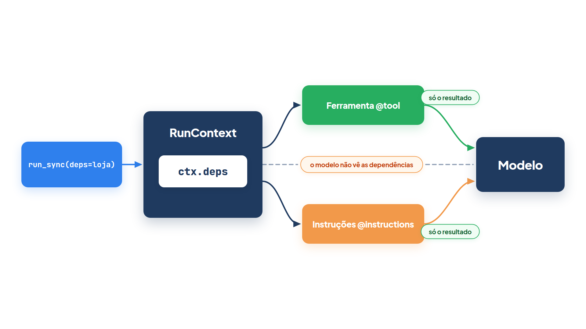
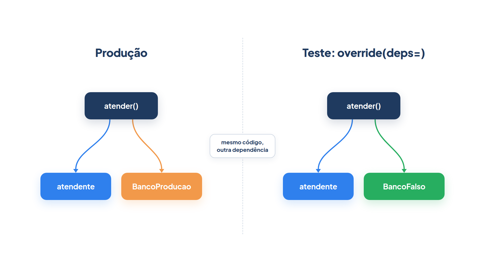

# Capítulo 0.7 — Dependências e contexto

No Capítulo 0.6 as ferramentas da *Casa Verde* devolviam números fixos: o estoque era sempre 12 e o preço, sempre 49,90. Numa loja real, a resposta depende de coisas que só existem na hora da execução: qual loja está atendendo, quem é o cliente, qual banco de dados está ligado. Este capítulo mostra como entregar esses recursos ao agente sem escondê-los em variáveis globais. Você vai declarar um tipo de **dependências**, recebê-lo nas ferramentas e nas instruções por meio do `RunContext` e, no fim, trocar o banco de produção por um banco falso em um teste.



A figura mostra o caminho que você vai percorrer. O seu código chama `run_sync(..., deps=loja)`. O agente guarda `loja` dentro de um objeto de contexto, o `RunContext`, e entrega esse contexto a cada ferramenta e a cada função de instruções que pedir por ele. O modelo de linguagem nunca vê `loja`: ele vê apenas o que as funções devolvem.

## A necessidade: a mesma ferramenta, lojas diferentes

A *Casa Verde* tem duas unidades, Centro e Bairro Alto, cada uma com o seu estoque. Você quer **um** atendente, com **uma** ferramenta `consultar_estoque`, que responda pela loja certa em cada atendimento. A loja é uma **dependência**: um recurso de que o agente precisa para trabalhar, mas que não faz parte da pergunta do cliente.

O exemplo usa um `FunctionModel` (Capítulo 0.5) que imita o modelo: no primeiro passo pede a ferramenta; quando recebe o resultado, responde com o número.

*dependencias_deps.py*

```python
from dataclasses import dataclass

from pydantic_ai import Agent, RunContext
from pydantic_ai.messages import ModelResponse, TextPart, ToolCallPart, ToolReturnPart
from pydantic_ai.models.function import AgentInfo, FunctionModel


@dataclass
class Loja:
    nome: str
    estoque: dict[str, int]


def modelo(mensagens, info: AgentInfo) -> ModelResponse:
    ultima = mensagens[-1].parts[-1]
    if isinstance(ultima, ToolReturnPart):
        return ModelResponse(parts=[TextPart(f"Temos {ultima.content} unidades.")])
    return ModelResponse(parts=[ToolCallPart("consultar_estoque", {"produto": "vaso de barro"})])


atendente = Agent(FunctionModel(modelo), deps_type=Loja)


@atendente.tool
def consultar_estoque(ctx: RunContext[Loja], produto: str) -> int:
    """Informa quantas unidades de um produto há na loja do cliente."""
    print("  consultando a loja", ctx.deps.nome)
    return ctx.deps.estoque.get(produto, 0)


centro = Loja("Centro", {"vaso de barro": 12})
bairro = Loja("Bairro Alto", {"vaso de barro": 3})

for loja in [centro, bairro]:
    resultado = atendente.run_sync("Tem vaso de barro?", deps=loja)
    print(resultado.output)
```

Saída:

```text
  consultando a loja Centro
Temos 12 unidades.
  consultando a loja Bairro Alto
Temos 3 unidades.
```

O agente e a ferramenta são os mesmos nas duas execuções. Só mudou o objeto passado em `deps=`, e a resposta acompanhou a loja.

### As peças, uma de cada vez

**`Agent(deps_type=)`** declara o **tipo** das dependências do agente. Aqui, `deps_type=Loja` diz: "toda execução deste agente recebe um objeto `Loja`". Você passa a classe, não uma instância. O valor concreto chega depois, em cada execução, pelo argumento `deps=` de `run_sync`, `run` ou `run_stream`.

**`deps_type`** também fica guardado no agente como atributo: `atendente.deps_type` devolve `Loja`. O PydanticAI não usa esse valor para validar nada durante a execução; ele existe para os verificadores de tipo, como você vai ver adiante.

**`RunContext`** é o objeto de contexto da execução. Quando uma ferramenta registrada com `@tool` declara um primeiro parâmetro do tipo `RunContext`, o agente preenche esse parâmetro sozinho, a cada chamada. Como você viu no Capítulo 0.6, esse parâmetro não aparece no esquema enviado ao modelo.

**`RunContext[...]`** é o mesmo `RunContext` com o tipo das dependências entre colchetes. `RunContext[Loja]` lê-se "contexto cujas dependências são uma `Loja`". Os colchetes não mudam o comportamento em tempo de execução; eles informam ao editor e ao verificador de tipos o que existe em `ctx.deps`, e com isso você ganha autocompletar em `ctx.deps.estoque`.

**`.deps`** é o atributo do contexto que guarda o objeto que você passou em `deps=`. Em `consultar_estoque`, `ctx.deps` é `centro` na primeira execução e `bairro` na segunda; `ctx.deps.nome` e `ctx.deps.estoque` são campos comuns da dataclass.

Por que uma `@dataclass`? Porque as dependências costumam ser várias (uma conexão, uma chave, um cliente HTTP), e a dataclass (Capítulo 0.2) é o jeito mais curto de agrupá-las em um objeto só. Qualquer tipo serve: `deps_type=str` também é válido.

### Armadilha: esquecer o `deps=`

Execute `atendente.run_sync("Tem vaso de barro?")` sem `deps=`. O agente não reclama na entrada; a execução começa, o modelo pede a ferramenta e só então aparece o erro:

```text
AttributeError: 'NoneType' object has no attribute 'nome'
```

Sem `deps=`, `ctx.deps` vale `None`. O diagnóstico é sempre o mesmo: quando um erro fala de `NoneType` dentro de uma ferramenta que usa `ctx.deps`, procure a chamada `run_sync` que esqueceu as dependências.

### Faça você mesmo — dependências

- **0.7.1 Terceira loja:** crie `Loja("Jardim", {})` e execute o atendente com ela. Qual número aparece, e por quê?
- **0.7.2 Mais um campo:** acrescente `cidade: str` à `Loja` e faça `consultar_estoque` imprimir também a cidade.
- **0.7.3 O erro real:** remova `deps=loja` do `run_sync` e leia a mensagem completa. Em que linha da sua ferramenta ela aponta?

## Tipos que o editor confere: `Agent[...]`

O `deps_type` não é verificado em tempo de execução. Então para que serve? Para que um verificador de tipos estático (programas como `mypy` e `pyright`, que leem o código sem executá-lo) encontre o erro antes de o cliente encontrá-lo.

*dependencias_tipos.py*

```python
from dataclasses import dataclass

from pydantic import BaseModel

from pydantic_ai import Agent, RunContext
from pydantic_ai.models.test import TestModel


@dataclass
class Loja:
    nome: str


class Resposta(BaseModel):
    texto: str


atendente: Agent[Loja, Resposta] = Agent(TestModel(), deps_type=Loja, output_type=Resposta)


@atendente.instructions
def nome_da_loja(ctx: RunContext[Loja]) -> str:
    return f"Você atende a loja {ctx.deps.nome}."


print(atendente.deps_type.__name__, atendente.output_type.__name__)
resultado = atendente.run_sync("Oi", deps=Loja("Centro"))
print(repr(resultado.output))

try:
    atendente.run_sync("Oi", deps="Centro")
except AttributeError as erro:
    print("deps errada:", erro)
```

Saída:

```text
Loja Resposta
Resposta(texto='a')
deps errada: 'str' object has no attribute 'nome'
```

**`Agent[...]`** é a forma de escrever o tipo de um agente com dois parâmetros: o tipo das dependências e o tipo da saída. `Agent[Loja, Resposta]` lê-se "agente que recebe uma `Loja` e devolve uma `Resposta`". A anotação na linha `atendente: Agent[Loja, Resposta] = ...` é opcional, porque o PydanticAI já deduz esses dois tipos a partir de `deps_type=` e `output_type=`; escrevê-la é útil quando o agente é devolvido por uma função ou guardado em um atributo de classe.

A terceira linha da saída mostra o limite dessa proteção. A execução com `deps="Centro"` começou normalmente e só quebrou dentro de `nome_da_loja`, quando o código tentou ler `.nome` de uma string. Em tempo de execução, nada impede o objeto errado. Quem impede é o verificador estático: com `Agent[Loja, Resposta]`, ele sabe que `run_sync` espera `deps: Loja` e marca `deps="Centro"` como erro. A documentação do PydanticAI mostra o `mypy` acusando uma função de instruções declarada como `RunContext[str]` num agente com `deps_type=User`:

```text
error: Argument 1 to "instructions" of "Agent" has incompatible type "Callable[[RunContext[str]], str]"; expected "Callable[[RunContext[User]], str | None]"
```

O livro não exige que você rode um verificador. Mas os tipos entre colchetes custam pouco e transformam erros de execução em avisos do editor.

### Faça você mesmo — tipos

- **0.7.4 Resposta diferente:** troque `output_type=Resposta` por `output_type=int` sem mudar a anotação `Agent[Loja, Resposta]`. O programa roda? Que linha um verificador de tipos marcaria?
- **0.7.5 Sem anotação:** remova `: Agent[Loja, Resposta]` e confirme, passando o mouse sobre `atendente` no editor, que o tipo deduzido continua o mesmo.

## Instruções que dependem da execução: `@instructions`

As instruções do Capítulo 0.4 eram um texto fixo em `instructions=`. Agora você quer que o atendente saiba o nome do cliente e quantos pedidos ele tem em aberto, e isso muda a cada atendimento. O `FunctionModel` abaixo apenas imprime as instruções que recebe.

*instrucoes_dinamicas.py*

```python
from dataclasses import dataclass

from pydantic_ai import Agent, RunContext
from pydantic_ai.messages import ModelResponse, TextPart
from pydantic_ai.models.function import AgentInfo, FunctionModel


@dataclass
class Cliente:
    nome: str
    pedidos_abertos: int


def espiar(mensagens, info: AgentInfo) -> ModelResponse:
    print(info.instructions)
    print("---")
    return ModelResponse(parts=[TextPart("ok")])


atendente = Agent(
    FunctionModel(espiar),
    deps_type=Cliente,
    instructions="Você é o atendente da Casa Verde.",
)


@atendente.instructions
def quem_e_o_cliente(ctx: RunContext[Cliente]) -> str:
    return f"O cliente se chama {ctx.deps.nome}."


@atendente.instructions
def pedidos(ctx: RunContext[Cliente]) -> str:
    if ctx.deps.pedidos_abertos == 0:
        return ""
    return f"Ele tem {ctx.deps.pedidos_abertos} pedido(s) em aberto."


@atendente.instructions
def horario() -> str:
    return "A loja abre às 8h."


atendente.run_sync("Oi", deps=Cliente("Ana", 2))
atendente.run_sync("Oi", deps=Cliente("Bruno", 0))
```

Saída:

```text
Você é o atendente da Casa Verde.

O cliente se chama Ana.

Ele tem 2 pedido(s) em aberto.

A loja abre às 8h.
---
Você é o atendente da Casa Verde.

O cliente se chama Bruno.

A loja abre às 8h.
---
```

O texto fixo veio primeiro, seguido do resultado de cada função decorada, na ordem em que foram definidas. Para Bruno, a função `pedidos` devolveu uma string vazia, e o PydanticAI simplesmente não acrescentou nada.

**`@instructions`** é o decorador que registra uma função de **instruções dinâmicas**: `@atendente.instructions` liga `quem_e_o_cliente` ao agente `atendente`. A função pode receber um `RunContext` como único parâmetro, como `quem_e_o_cliente` e `pedidos`, ou nenhum, como `horario`. Ela devolve um texto, que é somado às instruções fixas de `instructions=`.

**`.instructions`** aparece com dois papéis neste capítulo. No agente, `atendente.instructions` é o método usado como decorador. Do outro lado, `info.instructions`, no `AgentInfo` que o `FunctionModel` recebe, é o texto final já montado, exatamente o que um modelo real receberia. Use o segundo para conferir o resultado do primeiro.

O detalhe que justifica o nome "dinâmicas": as funções rodam a **cada requisição** ao modelo, não quando o agente é criado. Numa execução com uma chamada de ferramenta há duas requisições, e a função roda duas vezes. Por isso ela pode ler `ctx.deps`, que só existe durante a execução, e por isso nunca fica presa no histórico, como acontecia com `system_prompt` no Capítulo 0.4.

**Armadilha:** como roda a cada requisição, a função de instruções deve ser barata. Uma consulta lenta ao banco dentro dela é repetida a cada passo. Busque o dado uma vez, guarde-o nas dependências antes do `run_sync` e deixe a função apenas formatar o texto.

### Faça você mesmo — instruções dinâmicas

- **0.7.6 Ordem:** mova `horario` para antes de `quem_e_o_cliente` no arquivo e observe a nova ordem na saída.
- **0.7.7 Cliente novo:** acrescente `primeira_compra: bool` ao `Cliente` e uma função que, só nesse caso, devolva "Ofereça o cupom de boas-vindas."
- **0.7.8 Duas requisições:** coloque um `print` dentro de `quem_e_o_cliente` e registre uma ferramenta qualquer com `@atendente.tool_plain`, trocando o `FunctionModel` por um `TestModel()`. Quantas vezes o `print` aparece?

## O que mais o contexto sabe: `.retry`

O `RunContext` não carrega só as dependências. Ele também conta em que ponto a execução está. Isso fica útil quando uma ferramenta recusa um argumento com `ModelRetry` (Capítulo 0.6) e você quer saber se aquela já é a segunda tentativa. No exemplo, o modelo erra o nome do produto na primeira chamada.

*contexto_retry.py*

```python
from dataclasses import dataclass

from pydantic_ai import Agent, ModelRetry, RunContext
from pydantic_ai.messages import ModelResponse, RetryPromptPart, TextPart, ToolCallPart
from pydantic_ai.models.function import AgentInfo, FunctionModel


@dataclass
class Loja:
    estoque: dict[str, int]


def modelo(mensagens, info: AgentInfo) -> ModelResponse:
    ultima = mensagens[-1].parts[-1]
    if len(mensagens) == 1:
        return ModelResponse(parts=[ToolCallPart("reservar", {"produto": "vaso de barr"})])
    if isinstance(ultima, RetryPromptPart):
        return ModelResponse(parts=[ToolCallPart("reservar", {"produto": "vaso de barro"})])
    return ModelResponse(parts=[TextPart(ultima.content)])


atendente = Agent(FunctionModel(modelo), deps_type=Loja)


@atendente.tool
def reservar(ctx: RunContext[Loja], produto: str) -> str:
    """Reserva uma unidade de um produto do estoque."""
    print(f"passo {ctx.run_step}, tentativa {ctx.retry}: {produto!r}")
    if produto not in ctx.deps.estoque:
        raise ModelRetry(f"Produto desconhecido. Opções: {list(ctx.deps.estoque)}")
    ctx.deps.estoque[produto] -= 1
    return f"Reservado. Restam {ctx.deps.estoque[produto]}."


loja = Loja({"vaso de barro": 12, "regador": 4})
resultado = atendente.run_sync("Reserve um vaso de barro.", deps=loja)
print(resultado.output)
print(loja.estoque)
```

Saída:

```text
passo 1, tentativa 0: 'vaso de barr'
passo 2, tentativa 1: 'vaso de barro'
Reservado. Restam 11.
{'vaso de barro': 11, 'regador': 4}
```

**`.retry`** é o contador de novas tentativas da execução: `ctx.retry` vale 0 na primeira chamada e sobe a cada `ModelRetry`. Na saída, a chamada com `'vaso de barr'` aconteceu com `tentativa 0`; a ferramenta lançou `ModelRetry` com a lista de opções, o modelo corrigiu o nome, e a nova chamada chegou com `tentativa 1`. Ao lado, `ctx.run_step` mostra o passo da execução, que você já viu no Capítulo 0.6.

O contador serve para decisões graduais: na primeira falha, devolver só uma dica; na segunda, a lista completa. O limite vem de `Agent(retries=)`, cujo padrão é 1; o contexto também expõe esse limite em `ctx.max_retries`. Se o modelo errasse de novo com `ctx.retry` igual a 1, a execução terminaria com erro.

Repare também na última linha: `loja.estoque` mostra 11 vasos. A ferramenta alterou o objeto que você passou em `deps=`, porque `ctx.deps` **é** esse objeto, não uma cópia. Isso é conveniente, mas significa que reutilizar a mesma `loja` em duas execuções leva junto o que a primeira mudou.

### Faça você mesmo — contexto

- **0.7.9 Dica gradual:** altere `reservar` para que, com `ctx.retry == 0`, a mensagem do `ModelRetry` seja só "Produto desconhecido." e, a partir da segunda, inclua a lista.
- **0.7.10 Esgotar o limite:** faça o `modelo` errar o nome nas duas chamadas e leia o erro. Depois passe `retries=2` ao `Agent` e repita.

## Por que injetar, e como isso facilita o teste

Você poderia ter escrito `ESTOQUE = {...}` no topo do arquivo e lido essa variável global dentro da ferramenta. Funcionaria até o dia em que houvesse duas lojas na mesma execução do programa, ou até o primeiro teste: a ferramenta passaria a depender de um valor que ela não declara, e o teste precisaria alterar o módulo inteiro para mudar um número. **Injetar** a dependência (entregá-la de fora, em `deps=`, em vez de buscá-la dentro da função) deixa explícito do que a ferramenta precisa e permite trocar o recurso sem tocar no agente.

O exemplo final mostra essa troca. Em produção, `atender` cria a `Loja` com o banco real. No teste, você não quer depender desse banco.



A figura resume a ideia: o código de `atender` é o mesmo nos dois lados; muda apenas o objeto que chega em `ctx.deps`.

*dependencias_teste.py*

```python
from dataclasses import dataclass

from pydantic_ai import Agent, RunContext
from pydantic_ai.messages import ModelResponse, TextPart, ToolCallPart, ToolReturnPart
from pydantic_ai.models.function import AgentInfo, FunctionModel


class BancoProducao:
    def quantidade(self, produto: str) -> int:
        raise ConnectionError("sem conexão com o banco de produção")


class BancoFalso:
    def __init__(self, estoque: dict[str, int]):
        self.estoque = estoque

    def quantidade(self, produto: str) -> int:
        return self.estoque.get(produto, 0)


@dataclass
class Loja:
    banco: BancoProducao | BancoFalso


def modelo(mensagens, info: AgentInfo) -> ModelResponse:
    ultima = mensagens[-1].parts[-1]
    if isinstance(ultima, ToolReturnPart):
        return ModelResponse(parts=[TextPart(f"Temos {ultima.content} unidades.")])
    return ModelResponse(parts=[ToolCallPart("consultar_estoque", {"produto": "regador"})])


atendente = Agent(FunctionModel(modelo), deps_type=Loja)


@atendente.tool
def consultar_estoque(ctx: RunContext[Loja], produto: str) -> int:
    """Informa quantas unidades de um produto há em estoque."""
    return ctx.deps.banco.quantidade(produto)


def atender(pergunta: str) -> str:
    return atendente.run_sync(pergunta, deps=Loja(BancoProducao())).output


try:
    atender("Tem regador?")
except ConnectionError as erro:
    print("produção:", erro)

with atendente.override(deps=Loja(BancoFalso({"regador": 4}))):
    print("teste:", atender("Tem regador?"))
```

Saída:

```text
produção: sem conexão com o banco de produção
teste: Temos 4 unidades.
```

A função `atender` é a mesma nas duas chamadas e continua passando `deps=Loja(BancoProducao())`. Dentro do bloco `with atendente.override(deps=...)`, o agente ignora esse valor e usa o `BancoFalso`. O `.override` é o mesmo método do Capítulo 0.5, que lá trocou o modelo; aqui troca as dependências, e os dois podem ser combinados em uma única chamada, `override(model=..., deps=...)`.

Duas condições tornam o teste possível. A primeira: a ferramenta só conversa com o banco por `ctx.deps.banco.quantidade`, então qualquer objeto com um método `quantidade` serve. A segunda: criar `BancoProducao()` não abre conexão nenhuma; o erro só aparece quando alguém consulta. Se o construtor do banco real já conectasse, o teste falharia antes de o `override` entrar em ação. Mantenha a criação das dependências barata e deixe o trabalho pesado para quando ele for usado.

### Faça você mesmo — testes

- **0.7.11 Teste com `assert`:** troque o `print` do bloco `with` por `assert atender("Tem regador?") == "Temos 4 unidades."`.
- **0.7.12 Modelo e dependências:** combine `model=` e `deps=` no mesmo `override`, usando um `FunctionModel` que pede `consultar_estoque` com `{"produto": "vaso de barro"}`.

## Recapitulando

Dependências são os recursos de que o agente precisa e que não fazem parte da pergunta. `Agent(deps_type=)` declara o tipo; o valor chega em cada execução por `deps=`. Ferramentas registradas com `@tool`, funções de `@instructions` e validadores de saída recebem um `RunContext` como primeiro parâmetro e leem as dependências em `.deps`. `RunContext[Loja]` e `Agent[Loja, Resposta]` não mudam a execução, mas permitem que o editor e o verificador de tipos apontem o objeto errado antes de o programa rodar. As instruções dinâmicas são recalculadas a cada requisição, o texto final pode ser conferido em `info.instructions`, e `.retry` conta as novas tentativas. Injetar em vez de usar variáveis globais deixa cada função honesta sobre o que usa e permite trocar o banco em um teste com `override(deps=)`.

Com este capítulo, o Módulo 0 termina: você conhece as peças do PydanticAI que o restante do livro usa. No [Capítulo 1](../modulo-01/01-chatbot-workflow-agente.md), o foco passa do funcionamento do agente para a orquestração: quando um problema pede um chatbot, um workflow ou um agente.

### Fontes do capítulo

- Documentação do PydanticAI — [Dependencies](https://ai.pydantic.dev/dependencies/): `deps_type`, `deps=`, acesso por `RunContext.deps`, dependências síncronas e assíncronas e substituição com `override`.
- Documentação do PydanticAI — [Agents](https://ai.pydantic.dev/agent/): instruções estáticas e dinâmicas (`@agent.instructions`), ordem de montagem, verificação estática de tipos e `ctx.retry`.
- Documentação do PydanticAI — [API: pydantic_ai.tools](https://ai.pydantic.dev/api/tools/): campos de `RunContext` (`deps`, `retry`, `max_retries`, `run_step`).
- Documentação do PydanticAI — [API: pydantic_ai.agent](https://ai.pydantic.dev/api/agent/): parâmetros genéricos de `Agent`, `deps_type`, `Agent.instructions` e `Agent.override`.
- Documentação do PydanticAI — [Testing](https://ai.pydantic.dev/testing/): `override` e `FunctionModel` em testes sem chamadas reais.
- Documentação do Python — [dataclasses](https://docs.python.org/3/library/dataclasses.html): a classe usada para agrupar as dependências.
