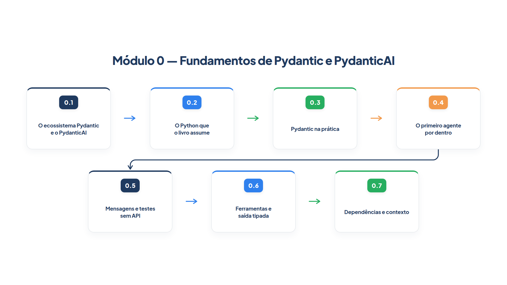

# Módulo 0 — Fundamentos de Pydantic e PydanticAI

Este livro ensina a orquestrar agentes de IA com o **PydanticAI**. Os módulos seguintes assumem que você já sabe o que é um `Agent`, como uma ferramenta chega ao modelo e o que significa dizer que uma resposta foi *validada*. Este módulo constrói essa base, um degrau por vez, antes de qualquer orquestração.

Você não precisa de nenhum conhecimento prévio do Pydantic. Precisa apenas de Python básico. Ao final do módulo, você será capaz de:

- explicar o que cada peça do ecossistema faz (Pydantic, PydanticAI, avaliação, grafos e observabilidade) e instalar o que o livro usa;
- ler os recursos de Python que aparecem nos exemplos: anotações de tipo, `dataclass`, decoradores e `async`/`await`;
- descrever dados com `BaseModel` e `Field`, validá-los, lidar com `ValidationError` e gerar o esquema JSON;
- criar um agente, executá-lo de três formas diferentes e ler o que ele devolve;
- enxergar as mensagens que trafegam entre o seu código e o modelo e testar agentes sem chave de API;
- registrar ferramentas, pedir saída tipada e entender como o PydanticAI valida e pede correção;
- entregar dependências ao agente com `RunContext`, sem variáveis globais.

## Percurso

1. **Capítulo 0.1 — O ecossistema Pydantic e o PydanticAI.** Você conhece cada biblioteca da família, descobre por que o framework carrega "Pydantic" no nome e instala o ambiente do livro.
2. **Capítulo 0.2 — O Python que o livro assume.** Você revisa, com exemplos mínimos, os recursos de Python que os exemplos exigem, para que nenhum deles seja um obstáculo mais adiante.
3. **Capítulo 0.3 — Pydantic na prática.** Você descreve dados com `BaseModel`, vê a validação falhar com `ValidationError` e aprende a ler o esquema JSON que o PydanticAI entrega ao modelo.
4. **Capítulo 0.4 — O primeiro agente por dentro.** Você abre o `Agent`, usa `run_sync`, `run` e `run_stream` e lê o resultado de uma execução.
5. **Capítulo 0.5 — Mensagens e testes sem API.** Você observa as mensagens trocadas com o modelo e usa `TestModel` e `FunctionModel` para testar sem chave de API e sem rede.
6. **Capítulo 0.6 — Ferramentas e saída tipada.** Você vê como o esquema de uma ferramenta nasce da função, pede uma saída com `output_type` e entende o ciclo de validação e nova tentativa.
7. **Capítulo 0.7 — Dependências e contexto.** Você injeta dependências com `deps_type` e `RunContext`, e vê por que isso torna o agente fácil de testar.

## Como usar este módulo

Os exemplos deste módulo rodam **sem chave de API e sem rede**: usam apenas Pydantic ou modelos simulados. Você pode executar todos eles no seu computador antes de configurar qualquer provedor.

Se você já domina Python e Pydantic, leia só os capítulos 0.4 a 0.7, que tratam do PydanticAI em si. Se preferir seguir direto para a orquestração, comece pelo Módulo 1: cada capítulo seguinte abre com uma caixa **Antes de começar** que lista os recursos do PydanticAI que ele usa e aponta para o capítulo deste módulo onde cada um é explicado.

Todos os módulos seguintes continuam usando a loja fictícia *Casa Verde*. Quando o Capítulo 0.1 terminar, o ambiente do livro estará pronto, e o Capítulo 1 começa pelo problema que justifica tudo isto.
