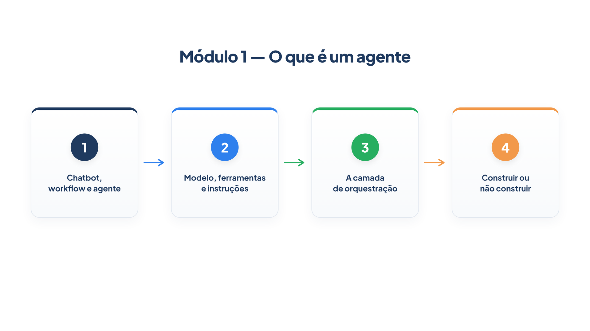

# Módulo 1 — O que é um agente

Este livro ensina a construir agentes de IA capazes de assumir tarefas que hoje dependem de uma pessoa — como atender um cliente, consultar um sistema e executar uma ação — e a coordenar vários deles em conjunto. Usaremos o **PydanticAI**, um framework Python, para escrever cada exemplo.

Antes de orquestrar qualquer coisa, você precisa saber exatamente o que é um agente, do que ele é feito e quando vale a pena construir um. Este módulo entrega essa base. Ao final dele, você será capaz de:

- distinguir um chatbot, um workflow e um agente a partir de quem decide o caminho da execução;
- montar um agente com modelo, ferramentas e instruções;
- ler o ciclo que o agente executa por baixo dos panos e limitá-lo;
- decidir, para um problema real, se ele pede um agente ou algo mais simples.



## Percurso

1. **Capítulo 1 — Chatbot, workflow e agente.** Você escreve os três programas para o mesmo problema — consultar um pedido — e descobre que a diferença entre eles é quem decide o próximo passo.
2. **Capítulo 2 — Modelo, ferramentas e instruções.** Você abre o agente e examina as três peças que o formam, aprendendo a escrever instruções que funcionam como rotina e ferramentas que o modelo consegue usar.
3. **Capítulo 3 — A camada de orquestração.** Você observa o ciclo que liga as peças: o agente raciocina, age, observa o resultado e repete até concluir. Também aprende a dar a esse ciclo memória e um limite.
4. **Capítulo 4 — Construir ou não construir.** Você usa tudo o que viu para escolher a camada certa — chamada única, workflow ou agente — e combina duas delas em um mesmo atendimento.

Cada capítulo reaproveita o código do anterior. Todos os exemplos giram em torno do atendimento de uma loja fictícia, a *Casa Verde*, porque um domínio simples deixa a atenção no conceito.

## Preparando o ambiente

Você precisa de Python 3.10 ou superior e de uma chave de API de um provedor de modelos de linguagem. Crie uma pasta de trabalho, instale o PydanticAI e defina a chave:

```bash
mkdir casa-verde && cd casa-verde
python -m venv .venv
source .venv/bin/activate
pip install pydantic-ai
export ANTHROPIC_API_KEY="sua-chave-aqui"
```

O PydanticAI funciona com vários provedores. Para trocar de provedor depois, basta mudar uma linha. Crie o arquivo que guarda essa linha:

*config.py*

```python
MODELO = "anthropic:claude-sonnet-5-5"
```

Todos os exemplos do livro importam `MODELO` desse arquivo. Se preferir outro provedor, altere apenas o texto entre aspas, seguindo o formato `provedor:nome-do-modelo`, e defina a variável de ambiente da chave correspondente.

> **Nota:** Modelos de linguagem não são determinísticos. Nos exemplos que chamam um modelo real, o texto exato da sua saída será diferente do mostrado aqui. O que deve coincidir é o comportamento descrito logo abaixo de cada saída. Quando um exemplo precisar de saída idêntica, usaremos um modelo simulado, e você verá isso anunciado.

Está pronto. No Capítulo 1, começamos pelo problema que justifica tudo isto.
