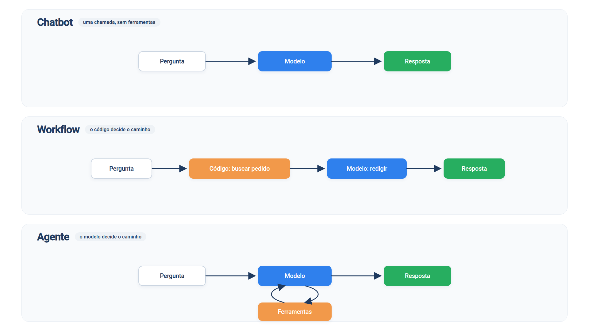

# Capítulo 1 — Chatbot, workflow e agente

Neste capítulo você resolve o mesmo problema três vezes: um cliente da loja *Casa Verde* pergunta onde está o seu pedido. Cada solução entrega mais autonomia ao modelo de linguagem do que a anterior. Ao final, você saberá nomear a diferença entre um chatbot, um workflow e um agente — e reconhecer qual deles está diante de você.



> **Antes de começar — PydanticAI neste capítulo**
>
> Neste capítulo você usa `Agent`, `Agent(instructions=)`, `.run_sync`, `.output`, `.usage` e `.requests`. Se algum deles não for familiar, revise o [Capítulo 0.4](../modulo-00/0.4-o-primeiro-agente-por-dentro.md). O decorador `@agente.tool_plain` e a docstring da ferramenta vêm do [Capítulo 0.6](../modulo-00/0.6-ferramentas-e-saida-tipada.md), e o tipo `dict | None` de `buscar_pedido` está no [Capítulo 0.2](../modulo-00/0.2-o-python-que-o-livro-assume.md).

## Um dado que o modelo não tem

Os pedidos da loja ficam em um sistema, representado aqui por um dicionário. Crie o arquivo abaixo; ele será reutilizado em todos os capítulos.

*loja.py*

```python
PEDIDOS = {
    "1001": {"status": "enviado", "previsao": "12/10", "valor": 189.90},
    "1002": {"status": "em separação", "previsao": "15/10", "valor": 64.50},
    "1003": {"status": "entregue", "previsao": "01/10", "valor": 320.00},
}


def buscar_pedido(codigo: str) -> dict | None:
    return PEDIDOS.get(codigo)
```

Agora a solução mais simples: entregar a pergunta ao modelo e devolver a resposta.

## Chatbot: uma pergunta, uma resposta

*chatbot.py*

```python
from pydantic_ai import Agent

from config import MODELO

chatbot = Agent(
    MODELO,
    instructions="Você atende clientes da loja Casa Verde. Responda em até duas frases.",
)

resultado = chatbot.run_sync("Onde está o meu pedido 1001?")
print(resultado.output)
print("Chamadas ao modelo:", resultado.usage.requests)
```

Execute com `python chatbot.py`. Saída típica:

```text
Não consigo consultar o status de pedidos por aqui. Acompanhe o pedido 1001 pelo site ou fale com a nossa central.
Chamadas ao modelo: 1
```

O programa chamou o modelo uma vez e devolveu o que ele produziu. O modelo não tem acesso ao dicionário `PEDIDOS`; ele só conhece o texto da pergunta e o que aprendeu no treinamento. Na melhor hipótese, admite que não sabe. Na pior, inventa um status plausível.

Um programa que usa um modelo dessa forma é um *chatbot*: ele conversa, mas não consegue consultar nem alterar nada fora da conversa. Para responder de verdade, o programa precisa buscar o pedido.

## Workflow: o código decide o caminho

Podemos buscar o pedido no nosso próprio código e entregar ao modelo apenas a tarefa de redigir a resposta.

*workflow.py*

```python
import re

from pydantic_ai import Agent

from config import MODELO
from loja import buscar_pedido

redator = Agent(
    MODELO,
    instructions=(
        "Escreva uma resposta cordial de até duas frases para o cliente "
        "usando apenas os dados do pedido recebidos."
    ),
)


def atender(mensagem: str) -> str:
    achado = re.search(r"\d{4}", mensagem)
    if achado is None:
        return "Não encontrei o número do pedido. Pode informá-lo?"

    pedido = buscar_pedido(achado.group())
    if pedido is None:
        return "Não localizei esse pedido."

    return redator.run_sync(f"Dados do pedido: {pedido}").output


print(atender("Onde está o meu pedido 1001?"))
print(atender("Cadê a minha cadeira? O pedido é o mil e dois."))
```

Saída típica:

```text
O seu pedido 1001 já foi enviado e a previsão de entrega é 12/10.
Não encontrei o número do pedido. Pode informá-lo?
```

A primeira resposta é correta e baseada em dados reais. A segunda mostra o custo desse desenho: o cliente escreveu o número por extenso, a expressão regular `\d{4}` não o reconheceu, e o programa caiu na mensagem fixa.

Observe quem tomou cada decisão. O código escolheu extrair o número, buscar o pedido, tratar os casos de erro e só então acionar o modelo. O modelo cumpriu uma etapa isolada. Isso é um *workflow*: um sistema em que modelos e ferramentas são orquestrados por um caminho de código definido de antemão.

## Agente: o modelo decide o caminho

Agora entregamos ao modelo a própria ferramenta de consulta e deixamos que ele decida quando usá-la.

*agente.py*

```python
from pydantic_ai import Agent

from config import MODELO
from loja import buscar_pedido

agente = Agent(
    MODELO,
    instructions=(
        "Você atende clientes da loja Casa Verde. Consulte o pedido antes de "
        "responder e nunca invente dados. Responda em até duas frases."
    ),
)


@agente.tool_plain
def consultar_pedido(codigo: str) -> str:
    """Consulta o status de um pedido pelo código de quatro dígitos."""
    pedido = buscar_pedido(codigo)
    return str(pedido) if pedido else "Pedido não encontrado."


if __name__ == "__main__":
    resultado = agente.run_sync("Onde está o meu pedido 1001?")
    print(resultado.output)
    print("Chamadas ao modelo:", resultado.usage.requests)

    resultado = agente.run_sync("Cadê a minha cadeira? O pedido é o mil e dois.")
    print(resultado.output)
```

Saída típica:

```text
O pedido 1001 foi enviado e a previsão de entrega é 12/10.
Chamadas ao modelo: 2
Seu pedido 1002 está em separação, com previsão de entrega para 15/10.
```

Duas coisas mudaram em relação ao workflow.

A primeira é o número de chamadas: **2**. Na primeira, o modelo recebeu a pergunta e pediu para executar `consultar_pedido` com o código `"1001"`. O programa rodou a função e devolveu o resultado ao modelo. Na segunda chamada, o modelo, já com o dado em mãos, redigiu a resposta.

A segunda é o tratamento do "mil e dois". Nenhuma linha do nosso código converte números por extenso. O modelo entendeu a frase, chamou a ferramenta com `"1002"` e respondeu. Quem decidiu *se* consultar, *o quê* consultar e *quando* parar foi o modelo.

Um sistema em que o modelo dirige o próprio processo e o uso das ferramentas é um *agente*. O trecho `@agente.tool_plain` registra `consultar_pedido` como ferramenta; o Capítulo 2 explica como o modelo a enxerga.

Para ver esse ciclo sem chave de API, troque o modelo real por um `TestModel`, que finge ser o modelo. Com `call_tools=["consultar_pedido"]` ele sempre chama a ferramenta antes de responder:

*agente_offline.py*

```python
from pydantic_ai import Agent
from pydantic_ai.models.test import TestModel

from loja import buscar_pedido

agente = Agent(TestModel(call_tools=["consultar_pedido"]))


@agente.tool_plain
def consultar_pedido(codigo: str) -> str:
    """Consulta o status de um pedido pelo código de quatro dígitos."""
    pedido = buscar_pedido(codigo)
    return str(pedido) if pedido else "Pedido não encontrado."


resultado = agente.run_sync("Onde está o meu pedido 1001?")
print("Chamadas ao modelo:", resultado.usage.requests)
print("Chamadas de ferramenta:", resultado.usage.tool_calls)
print("Resposta:", resultado.output)
```

Saída:

```text
Chamadas ao modelo: 2
Chamadas de ferramenta: 1
Resposta: {"consultar_pedido":"Pedido não encontrado."}
```

Os números são os mesmos do agente real: uma chamada para pedir a ferramenta, outra para responder. O texto da resposta é artificial porque o `TestModel` não entende a pergunta: ele inventa o argumento (`codigo` recebe um texto qualquer, não `"1001"`), então a ferramenta devolve "Pedido não encontrado.". Serve para testar o ciclo, não a qualidade da resposta.

> **Nota:** O bloco `if __name__ == "__main__":` faz a demonstração rodar apenas quando você executa `agente.py` diretamente. Assim, os próximos capítulos podem importar `agente` sem disparar chamadas ao modelo.

## A regra que separa os três

Compare os três programas por uma única pergunta: **quem decide o próximo passo?**

| Programa | Quem decide o próximo passo | Ferramentas |
| --- | --- | --- |
| Chatbot | Ninguém: há um único passo | Nenhuma |
| Workflow | O seu código, por um caminho fixo | Chamadas escritas por você |
| Agente | O modelo, a cada iteração | Escolhidas pelo modelo |

Essa é a distinção usada pela Anthropic em seu guia sobre agentes eficazes: *workflows* seguem caminhos de código predefinidos, enquanto *agentes* dirigem dinamicamente o próprio processo. Não se trata de "novo" contra "velho". São camadas diferentes, cada uma com seu preço.

### O custo da autonomia

O agente resolveu o caso que o workflow não resolveu, mas pagou por isso. Ele fez duas chamadas ao modelo onde o workflow fez uma; consome mais tempo e mais tokens; e seu caminho varia de uma execução para outra. Em contrapartida, ele lida com formulações que você não previu.

Um agente também carrega o risco de erro acumulado: se o modelo errar um passo no meio do ciclo, os passos seguintes herdam o erro. Por isso a recomendação é começar pela solução mais simples que funcione e só adicionar autonomia quando a simples falhar. O Capítulo 4 transforma isso em um critério de decisão.

### Armadilha: chamar de agente o que é workflow

É comum chamar de "agente" qualquer programa que usa um modelo. A pergunta do quadro acima desmascara o engano. Se o seu código sempre executa os mesmos passos na mesma ordem, e o modelo apenas preenche um deles, você tem um workflow — o que, aliás, pode ser a melhor escolha. O nome importa menos que a clareza sobre quem controla o fluxo.

### Faça você mesmo

- **1.1 Pedido entregue:** execute `chatbot.py`, `workflow.py` e `agente.py` com a pergunta "O pedido 1003 já chegou?". Registre a diferença entre as três respostas.
- **1.2 Pedido inexistente:** pergunte pelo pedido 9999 nos programas `workflow.py` e `agente.py`. Descreva quem produziu a mensagem de erro em cada um e qual das duas é mais natural para o cliente.
- **1.3 Contando chamadas:** acrescente a `workflow.py` uma linha que exiba quantas chamadas ao modelo o redator fez. Compare com `agente.py` e explique a diferença.
- **1.4 Quem decide?:** para cada cenário, diga se descreve um chatbot, um workflow ou um agente, e justifique em uma frase: (a) um programa que sempre traduz um texto e depois resume a tradução; (b) um assistente que recebe um chamado e decide sozinho se consulta o estoque, o financeiro ou ambos; (c) uma caixa de perguntas frequentes que apenas responde com texto.

## Recapitulando

Você escreveu três soluções para o mesmo problema e viu que a fronteira entre elas está em quem decide o próximo passo. Um chatbot responde sem consultar nada; um workflow executa um caminho que você fixou no código; um agente deixa o modelo escolher se, quando e com que argumentos usar as ferramentas. Também viu que autonomia custa chamadas, tempo e previsibilidade.

Falta abrir o agente. Ele funcionou com uma ferramenta e uma instrução, mas você ainda não sabe o que compõe um agente nem como escrever cada peça com cuidado. É o assunto do Capítulo 2.

### Fontes do capítulo

- Anthropic — [Building Effective Agents](https://www.anthropic.com/engineering/building-effective-agents): definição de workflow e agente; princípio de buscar a solução mais simples; custo de latência e erro acumulado.
- OpenAI — [A Practical Guide to Building Agents](https://cdn.openai.com/business-guides-and-resources/a-practical-guide-to-building-agents.pdf): aplicações que usam um modelo sem controlar o fluxo, como chatbots simples, não são agentes.
