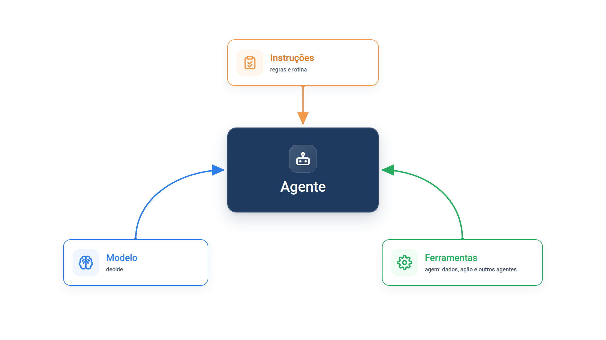

# Capítulo 2 — Modelo, ferramentas e instruções

No Capítulo 1, o agente da Casa Verde funcionou com poucas linhas, mas você ainda não sabe por que funcionou nem como fazê-lo funcionar em casos mais difíceis. Neste capítulo, você abre o agente, examina as três peças que o formam e aprende a escrever cada uma. O resultado prático é um atendente capaz de consultar e cancelar pedidos seguindo uma regra de negócio.



> **Antes de começar — PydanticAI neste capítulo**
>
> Neste capítulo você usa `Agent`, `Agent(instructions=)`, `.run_sync` e `.output`; revise o [Capítulo 0.4](../modulo-00/0.4-o-primeiro-agente-por-dentro.md) se algum deles não for familiar. O decorador `@suporte.tool_plain` e a docstring da ferramenta vêm do [Capítulo 0.6](../modulo-00/0.6-ferramentas-e-saida-tipada.md). Em `espiar.py` aparecem `FunctionModel`, `AgentInfo`, `ModelResponse`, `TextPart` e `.function_tools`, apresentados no [Capítulo 0.5](../modulo-00/0.5-mensagens-e-testes-sem-api.md).

## O agente em três peças

Todo agente, em sua forma mais básica, reúne três componentes:

- **Modelo:** o modelo de linguagem que raciocina e decide.
- **Ferramentas:** funções ou APIs externas que o agente usa para obter dados e agir.
- **Instruções:** diretrizes explícitas que definem como o agente se comporta.

Você já usou os três em `agente.py`. Veja onde cada um apareceu:

| Peça | No PydanticAI |
| --- | --- |
| Modelo | primeiro argumento de `Agent(...)` |
| Instruções | argumento `instructions=` |
| Ferramentas | funções registradas com `@agente.tool_plain` |

Vamos examinar uma peça por vez, começando pela que mais influencia o comportamento: as instruções.

## Instruções: escreva uma rotina, não um desejo

Uma instrução como "seja um bom atendente" deixa o modelo adivinhar o que você espera. Uma rotina — passos numerados, cada um ligado a uma ação concreta — reduz a margem de interpretação. Vamos construir o atendente da Casa Verde com uma rotina para cancelamentos.

*suporte.py*

```python
from pydantic_ai import Agent

from config import MODELO
from loja import buscar_pedido

INSTRUCOES = """\
Você é o atendente virtual da loja Casa Verde. Siga esta rotina:

1. Se o cliente não informou o código do pedido, peça o código e pare.
2. Consulte o pedido com `consultar_pedido`.
3. Se o cliente quer cancelar:
   - pedido "em separação": use `cancelar_pedido` e confirme o cancelamento;
   - qualquer outro status: explique que o cancelamento não é possível e
     oriente a solicitar devolução depois da entrega.
4. Se o código não existir, diga isso e peça que o cliente confira o número.
5. Responda em português, em até três frases.
"""

suporte = Agent(MODELO, instructions=INSTRUCOES)


@suporte.tool_plain
def consultar_pedido(codigo: str) -> str:
    """Consulta o status de um pedido pelo código de quatro dígitos."""
    pedido = buscar_pedido(codigo)
    return str(pedido) if pedido else "Pedido não encontrado."


@suporte.tool_plain
def cancelar_pedido(codigo: str) -> str:
    """Cancela um pedido que ainda está em separação."""
    pedido = buscar_pedido(codigo)
    if pedido is None or pedido["status"] != "em separação":
        return "Cancelamento não permitido."
    pedido["status"] = "cancelado"
    return f"Pedido {codigo} cancelado."


if __name__ == "__main__":
    print(suporte.run_sync("Quero cancelar o pedido 1002.").output)
```

Execute `python suporte.py`. Saída típica:

```text
Pronto! O pedido 1002 estava em separação e foi cancelado com sucesso.
```

O modelo seguiu os passos 2 e 3: consultou o pedido, viu o status "em separação" e chamou `cancelar_pedido`. Troque a mensagem por "Quero cancelar o pedido 1001." e o comportamento muda: o status é "enviado", então o modelo explica que não é possível cancelar e orienta a pedir devolução depois da entrega. Troque por "Quero cancelar meu pedido." e ele pede o código antes de qualquer consulta.

### O que torna esta instrução boa

A rotina aplica quatro práticas que valem para qualquer agente:

- **Parta de documentos existentes.** Os passos acima poderiam vir direto de um procedimento de atendimento ou de um artigo da base de conhecimento da empresa. Transcreva o que sua equipe já segue.
- **Divida em passos curtos.** Passos pequenos deixam menos espaço para o modelo se perder.
- **Ligue cada passo a uma ação.** "Consulte o pedido com `consultar_pedido`" é verificável; "verifique o pedido" não é.
- **Cubra os casos de borda.** Os passos 1 e 4 existem porque clientes esquecem o código e digitam números errados. Se a instrução não prevê a situação, o modelo improvisa.

### Armadilha: instruções que dependem de adivinhação

Substitua a rotina por "Você é um atendente simpático da Casa Verde. Resolva os problemas dos clientes." e execute o mesmo pedido de cancelamento algumas vezes. O sintoma é a inconsistência: ora o modelo consulta antes de cancelar, ora cancela direto, ora promete algo que a loja não faz. A causa é que nada na instrução diz *quando* cancelar. O diagnóstico é simples: se duas execuções com a mesma entrada seguem caminhos diferentes, procure a decisão que a instrução deixou em aberto.

### Faça você mesmo

- **2.1 Três cenários:** execute `suporte.py` com as mensagens "Quero cancelar o pedido 1001", "Quero cancelar meu pedido" e "Quero cancelar o pedido 7777". Confira se cada resposta corresponde ao passo esperado da rotina.
- **2.2 Nova regra:** acrescente à rotina um passo que trate pedidos com status "entregue" de modo diferente dos "enviados", sugerindo abrir uma devolução. Teste com o pedido 1003.
- **2.3 Instrução vaga:** troque `INSTRUCOES` por uma frase genérica, repita o cenário do pedido 1001 três vezes e anote o que variou.

## Ferramentas: o que o modelo enxerga

O modelo nunca vê o corpo da sua função. Ele recebe apenas uma descrição da ferramenta: nome, texto explicativo e os parâmetros. Para observar exatamente isso, vamos usar um *modelo simulado*, que não faz chamada de rede: ele só imprime o que recebe e responde "ok".

*espiar.py*

```python
from pydantic_ai import ModelResponse, TextPart
from pydantic_ai.models.function import AgentInfo, FunctionModel

from suporte import suporte


def espiar(mensagens, info: AgentInfo) -> ModelResponse:
    for ferramenta in info.function_tools:
        print(ferramenta.name, "->", ferramenta.description)
    return ModelResponse(parts=[TextPart("ok")])


suporte.run_sync("oi", model=FunctionModel(espiar))
```

Saída:

```text
consultar_pedido -> Consulta o status de um pedido pelo código de quatro dígitos.
cancelar_pedido -> Cancela um pedido que ainda está em separação.
```

O PydanticAI montou a descrição de cada ferramenta a partir do nome da função, da *docstring* (o texto entre aspas triplas logo abaixo de `def`) e das anotações de tipo dos parâmetros. O parâmetro `codigo: str` virou um campo de texto obrigatório. O argumento `model=` em `run_sync` substitui o modelo do agente apenas nessa execução, o que torna o truque seguro para depurar.

> **Lembrete — `FunctionModel`**
>
> A função `espiar` ocupa o lugar do modelo: o PydanticAI a chama com as mensagens e com um `AgentInfo`, cujo `.function_tools` lista as ferramentas do agente, e ela devolve um `ModelResponse` com um `TextPart`. Detalhes no [Capítulo 0.5](../modulo-00/0.5-mensagens-e-testes-sem-api.md).

### O esquema dos parâmetros

Além do nome e da descrição, o modelo recebe os parâmetros em formato de *JSON Schema*, uma descrição padronizada dos argumentos que a ferramenta aceita. Cada ferramenta guarda esse esquema em `parameters_json_schema`. O exemplo abaixo monta uma versão mínima de `consultar_pedido` com um modelo simulado próprio, para rodar sem chave de API, e imprime o esquema.

*espiar_esquema.py*

```python
import json

from pydantic_ai import Agent, ModelResponse, TextPart
from pydantic_ai.models.function import AgentInfo, FunctionModel

from loja import buscar_pedido


def espiar(mensagens, info: AgentInfo) -> ModelResponse:
    ferramenta = info.function_tools[0]
    print(ferramenta.name)
    print(json.dumps(ferramenta.parameters_json_schema, indent=2))
    return ModelResponse(parts=[TextPart("ok")])


agente = Agent(FunctionModel(espiar))


@agente.tool_plain
def consultar_pedido(codigo: str) -> str:
    """Consulta o status de um pedido pelo código de quatro dígitos."""
    pedido = buscar_pedido(codigo)
    return str(pedido) if pedido else "Pedido não encontrado."


agente.run_sync("oi")
```

Saída:

```text
consultar_pedido
{
  "additionalProperties": false,
  "properties": {
    "codigo": {
      "type": "string"
    }
  },
  "required": [
    "codigo"
  ],
  "type": "object"
}
```

Leia o esquema de dentro para fora: `codigo` é uma propriedade do tipo texto (`"string"`, vindo de `codigo: str`), está em `required` porque não tem valor padrão, e `additionalProperties: false` proíbe argumentos que a função não declara. Se você mudar a anotação para `int`, o tipo no esquema muda para número inteiro; o PydanticAI valida os argumentos que o modelo envia contra esse esquema antes de chamar a função.

### Armadilha: a ferramenta sem descrição

Remova a docstring de `consultar_pedido` e renomeie o parâmetro para `c`:

```python
@suporte.tool_plain
def consultar_pedido(c: str) -> str:
    return str(buscar_pedido(c))
```

A saída de `espiar.py` passa a mostrar `consultar_pedido -> None`. O modelo ficou sem descrição e com um parâmetro chamado `c`. Ele ainda pode adivinhar o uso pelo nome da função, mas você trocou uma instrução clara por um palpite. Trate o design de uma ferramenta com o mesmo cuidado que dá a um prompt: nome claro, descrição que diga o que ela faz e quando usá-la, parâmetros com nomes autoexplicativos.

### Três tipos de ferramenta

Os agentes costumam precisar de três categorias:

- **Dados:** recuperam contexto, como consultar um banco, ler um documento ou pesquisar na web. `consultar_pedido` é uma delas.
- **Ação:** alteram algo no mundo, como enviar uma mensagem, atualizar um cadastro ou cancelar um pedido. `cancelar_pedido` é uma delas.
- **Orquestração:** outro agente usado como ferramenta. Você só precisará dessa categoria no módulo sobre multiagentes.

### Onde colocar a regra: na instrução ou na ferramenta?

Releia `cancelar_pedido`. A rotina diz ao modelo que só cancele pedidos em separação, mas a própria função repete a verificação e devolve "Cancelamento não permitido." caso contrário. A duplicação é intencional. A instrução *orienta* o modelo; a ferramenta *garante* o resultado. Se o modelo errar um passo, a função impede a ação indevida.

Use esta regra: **orientação vai na instrução; invariantes que não podem ser violadas vão dentro da ferramenta.** Ações que alteram dados merecem esse cuidado; o Módulo 8 aprofunda a proteção de ações de risco.

### Faça você mesmo

- **2.4 Ferramenta de dados:** acrescente a `suporte.py` a ferramenta `consultar_previsao(codigo)`, que devolve apenas a data prevista de entrega. Use `espiar.py` para confirmar que a descrição aparece.
- **2.5 Ferramenta sem rótulo:** remova a docstring de uma ferramenta, rode `espiar.py` e anote o que o modelo recebe. Depois restaure o texto.
- **2.6 Limite dentro da função:** altere `cancelar_pedido` para recusar cancelamentos de pedidos com valor acima de R$ 300, devolvendo uma mensagem explicativa. Verifique se o modelo transmite a recusa ao cliente.

## Modelo: escolha por evidência

A terceira peça é o modelo. Modelos diferem em capacidade, latência e custo, e nem toda tarefa exige o mais poderoso: classificar a intenção de uma mensagem costuma funcionar com um modelo menor e mais rápido, enquanto decidir se um reembolso se justifica pode pedir um modelo mais capaz.

Um procedimento que funciona bem:

1. Monte o protótipo com o modelo mais capaz disponível, para estabelecer a qualidade-base.
2. Defina como você vai medir o acerto, com um conjunto fixo de mensagens de teste.
3. Substitua por modelos menores e confira se o resultado continua aceitável.

O passo 3 é barato graças ao argumento `model=`:

```python
suporte.run_sync(
    "Quero cancelar o pedido 1002.",
    model="anthropic:claude-haiku-4-5-20251001",
)
```

Comece pelo modelo mais forte para não limitar o agente por precaução e para descobrir *onde* os modelos menores falham. Só depois otimize custo e latência. O Módulo 9 ensina a transformar essas mensagens de teste em avaliações sistemáticas.

### Faça você mesmo

- **2.7 Comparação de modelos:** rode as três mensagens do exercício 2.1 com dois modelos diferentes. Monte uma lista com o acerto de cada um.
- **2.8 Modelo por tarefa:** descreva em duas frases qual parte do atendimento da Casa Verde você entregaria a um modelo menor e qual manteria em um modelo mais capaz.

## Recapitulando

Você agora sabe montar um agente a partir de suas três peças. Escreve instruções como rotinas verificáveis, projeta ferramentas com nome, descrição e parâmetros claros, separa orientação (instrução) de garantia (ferramenta) e escolhe o modelo por comparação em vez de por intuição. Também aprendeu a usar um modelo simulado para ver exatamente o que o modelo recebe.

Falta entender o que liga as três peças em movimento. No Capítulo 1, o agente fez duas chamadas ao modelo sem que você escrevesse um laço. O Capítulo 3 mostra o ciclo que faz isso acontecer.

### Fontes do capítulo

- OpenAI — [A Practical Guide to Building Agents](https://cdn.openai.com/business-guides-and-resources/a-practical-guide-to-building-agents.pdf): os três componentes; os três tipos de ferramenta; boas práticas de instruções; escolha de modelos pelo método baseline → substituição por modelos menores.
- Anthropic — [Building Effective Agents](https://www.anthropic.com/engineering/building-effective-agents): atenção ao design das ferramentas com o mesmo rigor dado aos prompts.
- Documentação do PydanticAI: *Agentes* e *Function Tools*.
