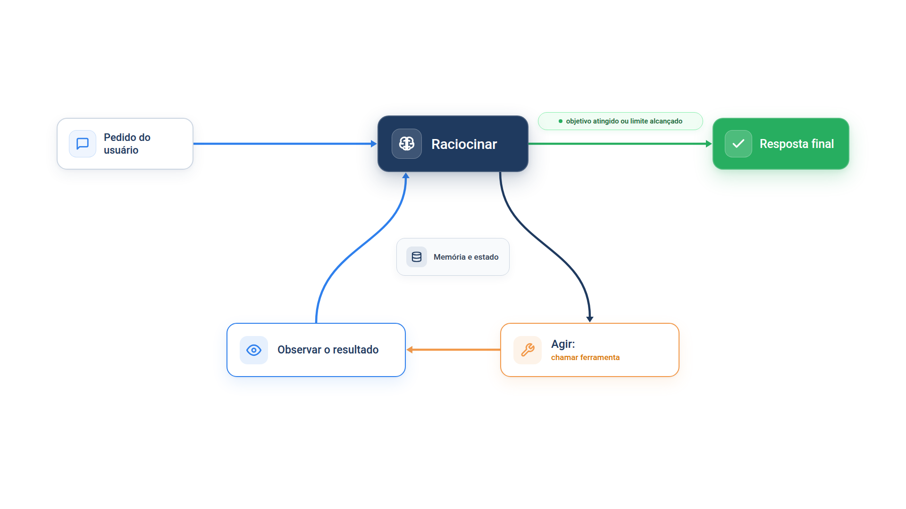
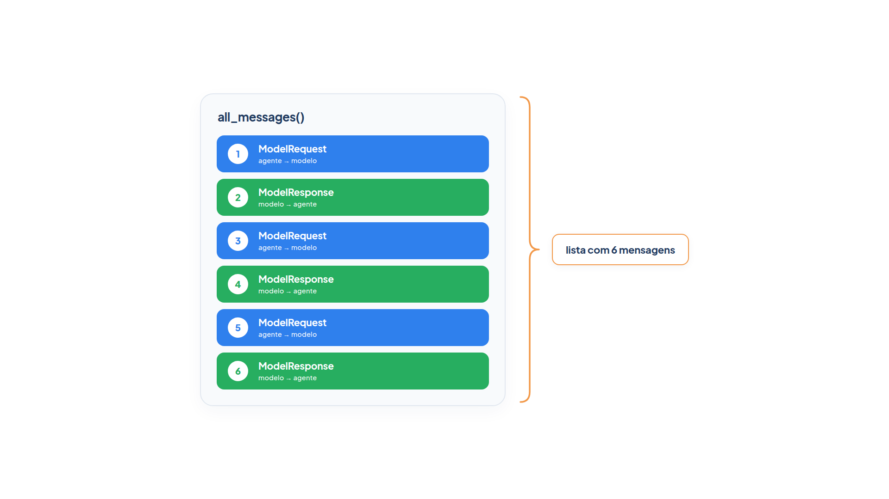
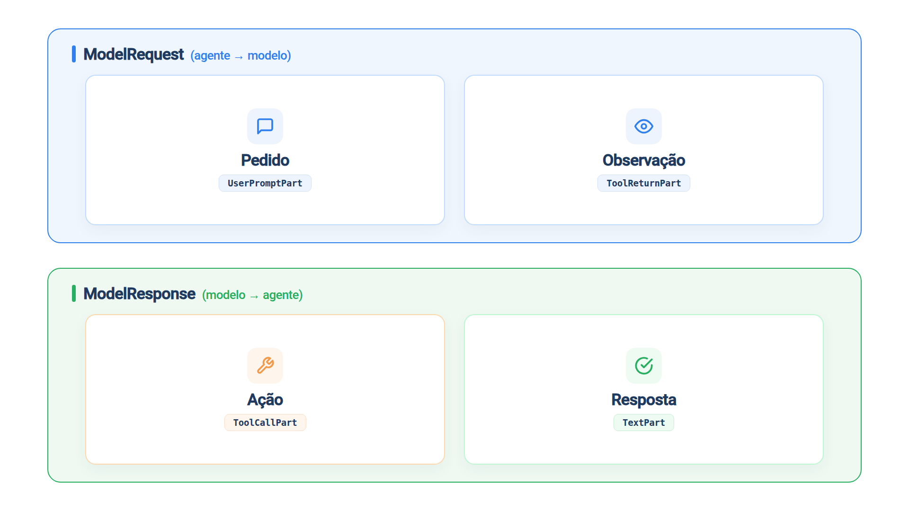
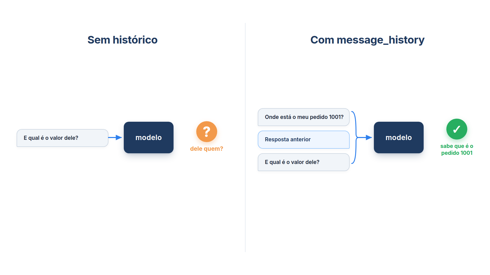
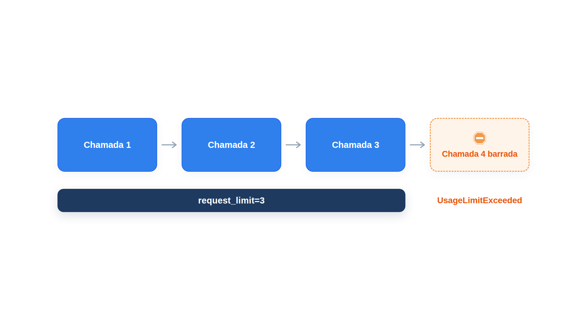

# Capítulo 3 — A camada de orquestração

No Capítulo 2, você montou as três peças do agente. Neste capítulo, você descobre o que as faz funcionar juntas: um ciclo que se repete até o objetivo ser atingido. Você vai observar esse ciclo registro por registro, dar ao agente memória entre perguntas e impor um limite para que ele nunca rode sem fim.



> **Antes de começar — PydanticAI neste capítulo**
>
> Neste capítulo você usa `.all_messages`, `.new_messages`, `message_history`, `ModelRequest`, `ModelResponse`, `.parts`, `.part_kind`, `.content`, `.tool_name`, `.args_as_dict`, `ToolCallPart`, `ToolReturnPart`, `TextPart` e `UserPromptPart`. Os modelos simulados dos exemplos usam `FunctionModel` e `AgentInfo`. Se algum deles não for familiar, revise o [Capítulo 0.5](../modulo-00/0.5-mensagens-e-testes-sem-api.md). Para `Agent`, `.run_sync` e `.output`, veja o [Capítulo 0.4](../modulo-00/0.4-o-primeiro-agente-por-dentro.md).

## O ciclo que você não escreveu

Em `agente.py`, uma única chamada a `run_sync` produziu duas chamadas ao modelo, e você não escreveu nenhum laço. Quem o escreveu foi o framework. Esse ciclo é a **camada de orquestração**: o processo que governa como o agente recebe informação, raciocina sobre ela e usa o raciocínio para decidir a próxima ação. Ele se repete até o agente atingir o objetivo ou um ponto de parada.

Pense em um cozinheiro. Ele reúne informação (o pedido e os ingredientes disponíveis), raciocina sobre o que pode preparar e age: corta, tempera, frita. A cada etapa ele ajusta o plano conforme o que acontece. O agente faz o mesmo, e a **arquitetura cognitiva** é o nome dado ao conjunto formado por modelo, ferramentas e esse ciclo.

Em termos do nosso agente, uma volta do ciclo é:

1. o modelo recebe a conversa até aqui;
2. ele decide: chamar uma ferramenta ou responder;
3. se chamou uma ferramenta, o resultado volta como nova informação e o ciclo recomeça;
4. se respondeu, o ciclo termina.

Vamos ver isso acontecer.

## Observando a trajetória

O objeto devolvido por `run_sync` guarda todas as mensagens trocadas entre o agente e o modelo, na ordem em que aconteceram. Essa conversa não acontece de uma vez só: acontece em momentos diferentes. O agente envia o pedido; o modelo responde pedindo uma ferramenta; o agente devolve o resultado da ferramenta; e assim por diante, até o modelo responder com texto. Cada um desses momentos é uma mensagem, e o método `.all_messages()` devolve todas elas em uma **lista**.

Ler essa lista item por item é a forma de enxergar o ciclo por dentro. Faremos isso em etapas: primeiro contar as mensagens, depois olhar de que tipo é cada uma e, só então, ler o conteúdo. No fim, o que você construiu cabe em uma função pequena, que os módulos seguintes reaproveitam.



A figura mostra o que você vai encontrar: uma execução com duas consultas de pedido produz uma lista de seis mensagens, que alternam entre o que o agente envia ao modelo e o que o modelo devolve ao agente.

### Preparação — um modelo que segue um roteiro

Para que você obtenha uma saída idêntica à mostrada aqui, usaremos novamente um modelo simulado. Ele segue um roteiro: consulta o pedido 1001, depois o 1002, e só então responde. É um agente que precisa de duas voltas do ciclo antes de concluir. Guardamos esse modelo em um arquivo próprio, porque todos os passos a seguir vão reutilizá-lo.

*modelo_roteirizado.py*

```python
from pydantic_ai import ModelResponse, TextPart, ToolCallPart
from pydantic_ai.messages import ToolReturnPart
from pydantic_ai.models.function import AgentInfo


def modelo_roteirizado(mensagens, info: AgentInfo) -> ModelResponse:
    retornos = [
        parte
        for mensagem in mensagens
        for parte in mensagem.parts
        if isinstance(parte, ToolReturnPart)
    ]
    if len(retornos) == 0:
        return ModelResponse(parts=[ToolCallPart("consultar_pedido", {"codigo": "1001"})])
    if len(retornos) == 1:
        return ModelResponse(parts=[ToolCallPart("consultar_pedido", {"codigo": "1002"})])
    return ModelResponse(parts=[TextPart("O 1001 já foi enviado; o 1002 ainda está em separação.")])
```

Você não precisa dominar esse código agora; o `FunctionModel` e o `AgentInfo` são apresentados no [Capítulo 0.5](../modulo-00/0.5-mensagens-e-testes-sem-api.md). Basta entender a regra. A função recebe a lista de mensagens da conversa até aquele ponto e conta quantos retornos de ferramenta (`ToolReturnPart`) já existem nela. Nenhum retorno: pede o pedido 1001. Um retorno: pede o 1002. Dois: responde com texto. Repare que o modelo simulado decide olhando a mesma lista de mensagens que você vai inspecionar a seguir.

### Passo 1 — A conversa é uma lista

Execute o agente com esse modelo e peça a `.all_messages()` apenas o tamanho da lista.

*trajetoria_1_lista.py*

```python
from pydantic_ai.models.function import FunctionModel

from agente import agente
from modelo_roteirizado import modelo_roteirizado

resultado = agente.run_sync(
    "Compare os pedidos 1001 e 1002.", model=FunctionModel(modelo_roteirizado)
)

mensagens = resultado.all_messages()
print("Mensagens na conversa:", len(mensagens))
```

Saída:

```text
Mensagens na conversa: 6
```

Uma única chamada a `run_sync`, duas ferramentas consultadas, seis mensagens. Ainda não sabemos o que há em cada uma; é o que os próximos passos mostram. Experimente trocar `all_messages()` por `new_messages()`: o número continua 6, porque, sem histórico anterior, tudo o que aconteceu é novo. A diferença entre os dois métodos aparece na seção sobre memória.

### Passo 2 — Duas direções, várias partes

Seis mensagens, mas nem todas são iguais. Cada uma tem um de dois tipos, conforme o sentido em que viaja: `ModelRequest` vai do agente para o modelo, e `ModelResponse` volta do modelo para o agente. Dentro de cada mensagem, `.parts` é a lista das **partes** que ela carrega, e o `.part_kind` de cada parte diz que tipo de conteúdo ela é. Vamos imprimir os dois níveis, ainda sem ler o conteúdo.

*trajetoria_2_partes.py*

```python
from pydantic_ai.models.function import FunctionModel

from agente import agente
from modelo_roteirizado import modelo_roteirizado

resultado = agente.run_sync(
    "Compare os pedidos 1001 e 1002.", model=FunctionModel(modelo_roteirizado)
)

for posicao, mensagem in enumerate(resultado.all_messages(), start=1):
    print(posicao, type(mensagem).__name__)
    for parte in mensagem.parts:
        print("   ", parte.part_kind)
```

Saída:

```text
1 ModelRequest
    user-prompt
2 ModelResponse
    tool-call
3 ModelRequest
    tool-return
4 ModelResponse
    tool-call
5 ModelRequest
    tool-return
6 ModelResponse
    text
```

A estrutura se revela. As mensagens alternam entre ida e volta, como numa conversa de verdade, e aqui cada uma carrega uma só parte (uma mensagem pode carregar várias, como mostra o Capítulo 0.5). Nesta execução aparecem quatro tipos de parte: `user-prompt`, `tool-call`, `tool-return` e `text`. É assim que o PydanticAI separa a comunicação: uma lista de mensagens, cada mensagem com um sentido, cada mensagem feita de partes e cada parte com um tipo. E esses quatro tipos são o ciclo do início do capítulo, agora com nome técnico:



| `part_kind` | Classe | Papel no ciclo | Viaja em |
| --- | --- | --- | --- |
| `user-prompt` | `UserPromptPart` | Pedido | `ModelRequest` |
| `tool-call` | `ToolCallPart` | Ação | `ModelResponse` |
| `tool-return` | `ToolReturnPart` | Observação | `ModelRequest` |
| `text` | `TextPart` | Resposta | `ModelResponse` |

Note o padrão: o agente fala com o modelo por meio de pedidos e observações; o modelo fala com o agente por meio de ações e respostas. Existem outros tipos de parte (o `RetryPromptPart`, por exemplo, também está no Capítulo 0.5), mas estes quatro bastam para este capítulo.

### Passo 3 — Ler o conteúdo: o pedido e as ações

Agora o conteúdo. Cada classe de parte guarda a carga em atributos diferentes, e `isinstance(parte, Classe)` pergunta de que classe é a parte. Começamos pelas duas que abrem o ciclo: o pedido do usuário (`UserPromptPart`, com a pergunta em `.content`) e a ação do modelo (`ToolCallPart`, com `.tool_name`, o nome da ferramenta pedida, e `.args_as_dict()`, os argumentos como dicionário). As partes de outras classes ficam de fora por enquanto.

*trajetoria_3_pedido_acao.py*

```python
from pydantic_ai import ToolCallPart
from pydantic_ai.messages import UserPromptPart
from pydantic_ai.models.function import FunctionModel

from agente import agente
from modelo_roteirizado import modelo_roteirizado

resultado = agente.run_sync(
    "Compare os pedidos 1001 e 1002.", model=FunctionModel(modelo_roteirizado)
)

for mensagem in resultado.all_messages():
    for parte in mensagem.parts:
        if isinstance(parte, UserPromptPart):
            print("Pedido     :", parte.content)
        elif isinstance(parte, ToolCallPart):
            print("Ação       :", parte.tool_name, parte.args_as_dict())
```

Saída:

```text
Pedido     : Compare os pedidos 1001 e 1002.
Ação       : consultar_pedido {'codigo': '1001'}
Ação       : consultar_pedido {'codigo': '1002'}
```

Repare no que falta. Há duas ações, mas nada entre elas: o resultado de cada ferramenta ainda não apareceu. E a resposta final do modelo também não aparece. As duas classes que faltam entram no passo seguinte.

### Passo 4 — O ciclo completo: a observação e a resposta

Acrescentamos as duas classes que faltam: `ToolReturnPart`, com o que a ferramenta devolveu em `.content`, e `TextPart`, com o texto do modelo, também em `.content`. Só entram mais dois `elif`.

*trajetoria_4_ciclo.py*

```python
from pydantic_ai import TextPart, ToolCallPart
from pydantic_ai.messages import ToolReturnPart, UserPromptPart
from pydantic_ai.models.function import FunctionModel

from agente import agente
from modelo_roteirizado import modelo_roteirizado

resultado = agente.run_sync(
    "Compare os pedidos 1001 e 1002.", model=FunctionModel(modelo_roteirizado)
)

for mensagem in resultado.all_messages():
    for parte in mensagem.parts:
        if isinstance(parte, UserPromptPart):
            print("Pedido     :", parte.content)
        elif isinstance(parte, ToolCallPart):
            print("Ação       :", parte.tool_name, parte.args_as_dict())
        elif isinstance(parte, ToolReturnPart):
            print("Observação :", parte.content)
        elif isinstance(parte, TextPart):
            print("Resposta   :", parte.content)
```

Saída:

```text
Pedido     : Compare os pedidos 1001 e 1002.
Ação       : consultar_pedido {'codigo': '1001'}
Observação : {'status': 'enviado', 'previsao': '12/10', 'valor': 189.9}
Ação       : consultar_pedido {'codigo': '1002'}
Observação : {'status': 'em separação', 'previsao': '15/10', 'valor': 64.5}
Resposta   : O 1001 já foi enviado; o 1002 ainda está em separação.
```

Leia a saída de cima para baixo. O pedido do usuário abriu o ciclo. O modelo respondeu com uma **ação**: pedir a execução de uma ferramenta. O framework executou a função e devolveu o resultado como uma **observação**. Com a observação, o modelo decidiu agir de novo, agora sobre o pedido 1002. Na terceira chamada, com as duas observações em mãos, ele produziu a resposta e o ciclo terminou.

### Passo 5 — Empacotar em uma função

O laço do passo anterior imprime as mensagens de qualquer execução, então não vale copiá-lo a cada exemplo. Criamos uma função que as imprime de forma legível, rotulando cada parte com o papel que ela cumpre no ciclo. É o `trajetoria.py` que os módulos seguintes importam.

*trajetoria.py*

```python
from pydantic_ai import TextPart, ToolCallPart
from pydantic_ai.messages import ToolReturnPart, UserPromptPart


def mostrar(resultado) -> None:
    for mensagem in resultado.all_messages():
        for parte in mensagem.parts:
            if isinstance(parte, UserPromptPart):
                print("Pedido     :", parte.content)
            elif isinstance(parte, ToolCallPart):
                print("Ação       :", parte.tool_name, parte.args_as_dict())
            elif isinstance(parte, ToolReturnPart):
                print("Observação :", parte.content)
            elif isinstance(parte, TextPart):
                print("Resposta   :", parte.content)
```

Com ela, o `roteiro.py` junta as três peças (o agente, o modelo roteirizado e a função `mostrar`) e ainda imprime quantas chamadas ao modelo foram feitas.

*roteiro.py*

```python
from pydantic_ai.models.function import FunctionModel

from agente import agente
from modelo_roteirizado import modelo_roteirizado
from trajetoria import mostrar

resultado = agente.run_sync(
    "Compare os pedidos 1001 e 1002.", model=FunctionModel(modelo_roteirizado)
)
mostrar(resultado)
print("Chamadas ao modelo:", resultado.usage.requests)
```

Saída:

```text
Pedido     : Compare os pedidos 1001 e 1002.
Ação       : consultar_pedido {'codigo': '1001'}
Observação : {'status': 'enviado', 'previsao': '12/10', 'valor': 189.9}
Ação       : consultar_pedido {'codigo': '1002'}
Observação : {'status': 'em separação', 'previsao': '15/10', 'valor': 64.5}
Resposta   : O 1001 já foi enviado; o 1002 ainda está em separação.
Chamadas ao modelo: 3
```

As seis linhas são as mesmas do passo anterior, agora produzidas pela função, e a última linha traz o número de chamadas. Os dois números se encaixam: as seis mensagens do Passo 1 são três idas (`ModelRequest`) e três voltas (`ModelResponse`), uma de cada para cada chamada ao modelo.

Repare no número de chamadas: **3** para duas ferramentas. Cada volta custa uma chamada ao modelo, e a chamada final, que produz o texto, sempre existe. O módulo seguinte dá nome a esse padrão — raciocinar, agir, observar — e mostra como ele se tornou a base da maioria dos agentes.

> **Nota:** Execute `mostrar` com o agente real, no lugar do modelo simulado. A forma da trajetória será a mesma, mas o modelo pode, por exemplo, consultar os dois pedidos em uma só volta. Quem decide a sequência é ele.

### Faça você mesmo

- **3.1 Trajetória real:** importe `mostrar` em um arquivo seu, execute `agente.run_sync("Onde está o pedido 1003?")` com o modelo real e imprima a trajetória. Identifique a ação, a observação e a resposta.
- **3.2 Três voltas:** altere o `modelo_roteirizado` (em `modelo_roteirizado.py`) para consultar também o pedido 1003 antes de responder. Preveja quantas chamadas serão registradas e confira.
- **3.3 Pedido inexistente:** faça o roteiro consultar o pedido 9999. Descreva o que aparece na observação.

## Memória: o agente lembra da conversa?

Um modelo, sozinho, responde a cada pergunta como se fosse a primeira. Um agente se distingue por gerenciar o histórico da sessão e usá-lo nas decisões seguintes. No PydanticAI, esse histórico é a lista de mensagens que você viu em `all_messages()`, e você escolhe passá-la adiante.

Vamos ver isso em três passos: o que o modelo enxerga quando você não passa histórico, o que muda quando você passa e, por fim, o mesmo com o modelo real. Os dois primeiros rodam sem chave de API, com o truque do `espiar.py` do Capítulo 2: um modelo simulado que só mostra o que recebe. Desta vez, ele mostra as perguntas que chegaram até ele.

### Preparação — um modelo espião

*espiar_historico.py*

```python
from pydantic_ai import ModelResponse, TextPart
from pydantic_ai.messages import UserPromptPart
from pydantic_ai.models.function import AgentInfo


def espiar_historico(mensagens, info: AgentInfo) -> ModelResponse:
    perguntas = [
        parte.content
        for mensagem in mensagens
        for parte in mensagem.parts
        if isinstance(parte, UserPromptPart)
    ]
    print("O modelo está vendo:", perguntas)
    return ModelResponse(parts=[TextPart("ok")])
```

A função percorre as mensagens que recebeu, separa as partes `UserPromptPart` (as perguntas, que você já sabe ler pelo `.content`) e imprime o conteúdo delas. Ela responde "ok" só para encerrar a execução.

### Passo 1 — Sem histórico, cada pergunta começa do zero

Faça duas perguntas em sequência, cada uma em sua própria chamada a `run_sync`.

*memoria_1_sem_historico.py*

```python
from pydantic_ai.models.function import FunctionModel

from agente import agente
from espiar_historico import espiar_historico

modelo = FunctionModel(espiar_historico)

agente.run_sync("Onde está o meu pedido 1001?", model=modelo)
agente.run_sync("E qual é o valor dele?", model=modelo)
```

Saída:

```text
O modelo está vendo: ['Onde está o meu pedido 1001?']
O modelo está vendo: ['E qual é o valor dele?']
```

A segunda execução não sabe nada da primeira. O modelo só vê "E qual é o valor dele?", e um modelo real não teria como descobrir a que "dele" a pergunta se refere. O `Agent` não guarda a conversa: cada `run_sync` começa do zero.

### Passo 2 — Passando a conversa adiante

Para que a segunda execução conheça a primeira, entregamos as mensagens da primeira no argumento `message_history`. `primeira.new_messages()` devolve a lista de mensagens que a primeira execução criou, e o agente as coloca antes da pergunta nova.

*memoria_2_com_historico.py*

```python
from pydantic_ai.models.function import FunctionModel

from agente import agente
from espiar_historico import espiar_historico

modelo = FunctionModel(espiar_historico)

primeira = agente.run_sync("Onde está o meu pedido 1001?", model=modelo)
segunda = agente.run_sync(
    "E qual é o valor dele?", model=modelo, message_history=primeira.new_messages()
)
print("Mensagens na conversa:", len(segunda.all_messages()))
```

Saída:

```text
O modelo está vendo: ['Onde está o meu pedido 1001?']
O modelo está vendo: ['Onde está o meu pedido 1001?', 'E qual é o valor dele?']
Mensagens na conversa: 4
```

Agora o modelo vê as duas perguntas, na ordem em que foram feitas, e a segunda deixa de ser um mistério. O 4 do final são as mensagens da primeira execução (a pergunta e a resposta) mais as da segunda (a pergunta e a resposta).



A figura resume os dois passos: sem `message_history`, o modelo recebe só a pergunta nova; com ele, recebe a conversa inteira.

### Passo 3 — O mesmo, com o modelo real

Com um modelo real, o código é o `conversa.py` completo. A mecânica é a dos passos anteriores; a diferença é que agora quem responde é o modelo, e ele de fato consulta a ferramenta quando precisa. Este passo exige a chave de API; se você ainda não a configurou, os dois anteriores já mostram o mecanismo.

*conversa.py*

```python
from agente import agente

primeira = agente.run_sync("Onde está o meu pedido 1001?")
print(primeira.output)

segunda = agente.run_sync(
    "E qual é o valor dele?", message_history=primeira.new_messages()
)
print(segunda.output)
print("Mensagens na conversa:", len(segunda.all_messages()))
```

Saída típica:

```text
O pedido 1001 foi enviado e a previsão de entrega é 12/10.
O valor do pedido 1001 é R$ 189,90.
Mensagens na conversa: 6
```

A segunda pergunta, "E qual é o valor dele?", não menciona o pedido. Sem o histórico, o modelo não teria como saber a que "dele" se refere. Com `message_history=primeira.new_messages()`, a segunda execução começa já conhecendo a primeira. Dessa vez o modelo nem precisou chamar a ferramenta, pois a observação anterior continha o valor.

Os 6 do final correspondem a: pergunta, chamada da ferramenta, resultado, resposta, nova pergunta e nova resposta. Se o modelo consultasse a ferramenta de novo, a contagem seria maior.

No passo anterior a conta deu 4, porque o modelo espião nunca chama ferramenta. As duas mensagens a mais são a chamada da ferramenta e o seu resultado, e foram elas que guardaram o valor do pedido para a segunda pergunta.

Essa é a memória de **curto prazo**: o histórico da sessão em curso. Ela é perdida quando o programa termina, a menos que você a guarde. O Módulo 3 trata de memória em profundidade, incluindo como impedir que o histórico cresça além do que o modelo consegue usar bem.

### Armadilha: `new_messages()` ou `all_messages()`?

Em `conversa.py`, `primeira.new_messages()` funciona porque a primeira execução não recebeu histórico: tudo o que ela criou é novo, e por isso `new_messages()` e `all_messages()` devolvem a mesma coisa. Do terceiro turno em diante isso muda. `new_messages()` devolve só o que a execução *atual* criou. Se você passar `segunda.new_messages()` adiante, o modelo verá a segunda pergunta e a terceira, e perderá a primeira. Para continuar uma conversa de vários turnos, passe `.all_messages()` do último resultado, que já inclui o histórico anterior. Você vai precisar disso no exercício 3.5.

### Faça você mesmo

- **3.4 Sem histórico:** remova o argumento `message_history` de `conversa.py` e execute. Descreva como o modelo reage a "E qual é o valor dele?".
- **3.5 Terceira pergunta:** acrescente uma terceira execução que pergunte "E a previsão?" encadeando o histórico da segunda. Preveja o número de mensagens antes de rodar.

## Ponto de parada: o ciclo precisa ter fim

O ciclo termina quando o modelo responde com texto. Mas e se ele nunca responder? Um modelo que insiste em chamar a mesma ferramenta, ou uma ferramenta que sempre falha, produziria um ciclo sem fim, com custo crescente. Todo agente de produção precisa de um limite.

Vamos ver o problema antes da solução, em três passos: um modelo que não para, um limite que o interrompe e o tratamento do erro que sobra.

### Passo 1 — Um modelo que nunca termina

Para ver o problema, criamos um modelo simulado teimoso, que só sabe pedir a consulta do pedido 9999. Ele ignora tudo o que recebe e repete sempre a mesma ação, então jamais responde com texto. Neste passo ainda não há limite nenhum no código.

*limite_1_sem_teto.py*

```python
from pydantic_ai import ModelResponse, ToolCallPart
from pydantic_ai.models.function import AgentInfo, FunctionModel

from agente import agente


def modelo_teimoso(mensagens, info: AgentInfo) -> ModelResponse:
    return ModelResponse(parts=[ToolCallPart("consultar_pedido", {"codigo": "9999"})])


agente.run_sync("Onde está o pedido 9999?", model=FunctionModel(modelo_teimoso))
```

Execute o arquivo. Ele não fica rodando para sempre: termina com um erro, cujo final é este (o rastro das chamadas, que ocupa várias linhas, foi omitido):

```text
pydantic_ai.exceptions.UsageLimitExceeded: The next request would exceed the request_limit of 50. Consider raising the limit, or see the docs on usage limits for budget-aware patterns: https://pydantic.dev/docs/ai/core-concepts/agent/#usage-limits
```

Você não escreveu limite nenhum, e mesmo assim o ciclo parou. O PydanticAI traz um teto padrão de 50 chamadas ao modelo por execução: o modelo teimoso foi chamado 50 vezes, cada uma pedindo a mesma consulta, e só então o framework barrou a seguinte. É uma rede de segurança, mas 50 chamadas ainda custam caro.

### Passo 2 — Definir o seu próprio teto

No PydanticAI, o limite se expressa em `UsageLimits`. Criamos um objeto com `request_limit=3`, o número máximo de chamadas ao modelo, e o entregamos a `run_sync` no argumento `usage_limits`. As novidades em relação ao passo anterior são o `import` de `UsageLimits` e esse argumento.

*limite_2_com_teto.py*

```python
from pydantic_ai import ModelResponse, ToolCallPart
from pydantic_ai.models.function import AgentInfo, FunctionModel
from pydantic_ai.usage import UsageLimits

from agente import agente


def modelo_teimoso(mensagens, info: AgentInfo) -> ModelResponse:
    return ModelResponse(parts=[ToolCallPart("consultar_pedido", {"codigo": "9999"})])


agente.run_sync(
    "Onde está o pedido 9999?",
    model=FunctionModel(modelo_teimoso),
    usage_limits=UsageLimits(request_limit=3),
)
```

O final do erro agora é:

```text
pydantic_ai.exceptions.UsageLimitExceeded: The next request would exceed the request_limit of 3. Consider raising the limit, or see the docs on usage limits for budget-aware patterns: https://pydantic.dev/docs/ai/core-concepts/agent/#usage-limits
```

É o mesmo erro, com o seu número: o modelo foi chamado três vezes e a quarta foi barrada antes de acontecer.



A figura mostra o que o limite faz: ele não interrompe uma chamada em andamento, ele impede que a próxima comece.

### Passo 3 — Tratar a interrupção

Um programa que termina com uma pilha de chamadas não serve a um cliente. Em produção, você quer decidir o que fazer quando o limite estoura: avisar o cliente ou encaminhar para uma pessoa. O erro tem nome, `UsageLimitExceeded`, e um `try`/`except` o captura. Este é o `limite.py` completo.

*limite.py*

```python
from pydantic_ai import ModelResponse, ToolCallPart
from pydantic_ai.exceptions import UsageLimitExceeded
from pydantic_ai.models.function import AgentInfo, FunctionModel
from pydantic_ai.usage import UsageLimits

from agente import agente


def modelo_teimoso(mensagens, info: AgentInfo) -> ModelResponse:
    return ModelResponse(parts=[ToolCallPart("consultar_pedido", {"codigo": "9999"})])


try:
    agente.run_sync(
        "Onde está o pedido 9999?",
        model=FunctionModel(modelo_teimoso),
        usage_limits=UsageLimits(request_limit=3),
    )
except UsageLimitExceeded as erro:
    print("Execução interrompida:", str(erro).split(".")[0])
```

Saída:

```text
Execução interrompida: The next request would exceed the request_limit of 3
```

Após três chamadas ao modelo, o framework recusou a quarta e levantou `UsageLimitExceeded`. A mensagem de erro está em inglês porque vem da biblioteca; o que importa é o efeito: o ciclo parou antes de gastar mais.

> **Por dentro do PydanticAI — `UsageLimits`**
>
> **O que é:** uma classe que reúne os tetos de consumo de uma execução: chamadas ao modelo, chamadas de ferramenta e tokens.
> **Como funciona aqui:** em `limite.py`, `UsageLimits(request_limit=3)` cria o objeto, e `usage_limits=` o entrega a `run_sync`. A cada volta do ciclo, o framework compara o uso acumulado com esses tetos antes de chamar o modelo de novo.
> **O que o PydanticAI faz por você:** conta o uso sozinho, sem que você escreva contador algum. Cada campo que você não preencher fica sem limite, exceto `request_limit`, que já vem com 50.
> **Cuidado:** sem passar `usage_limits`, o teto de 50 chamadas vale mesmo assim. Ele protege contra o pior caso, mas 50 chamadas ainda custam caro; defina o seu.

> **Por dentro do PydanticAI — `UsageLimits(request_limit=)`**
>
> **O que é:** o argumento que fixa o número máximo de chamadas ao modelo em uma execução.
> **Como funciona aqui:** com `request_limit=3`, o modelo teimoso pôde ser chamado três vezes, e cada uma pediu a consulta do pedido 9999. A quarta chamada foi barrada antes de acontecer, e por isso a mensagem diz "the next request would exceed".
> **O que o PydanticAI faz por você:** conta cada ida ao modelo, inclusive a final, que produz o texto. Lembre-se do resultado de `roteiro.py`: duas ferramentas custaram 3 chamadas.
> **Cuidado:** o limite conta chamadas ao modelo, não ferramentas. Um `request_limit=1` interrompe até um atendimento normal, pois o modelo precisa de uma chamada para pedir a ferramenta e de outra para responder.

> **Por dentro do PydanticAI — `UsageLimitExceeded`**
>
> **O que é:** a exceção levantada quando uma execução ultrapassa algum teto de `UsageLimits`.
> **Como funciona aqui:** o `try`/`except UsageLimitExceeded as erro` de `limite.py` a captura. Sem ele, o programa terminaria com um erro e a pilha de chamadas. Com ele, você decide o que fazer: avisar o cliente ou encaminhar para uma pessoa.
> **O que o PydanticAI faz por você:** interrompe o ciclo e levanta a exceção, cuja mensagem (`str(erro)`) diz qual limite foi atingido. Ela vem de `pydantic_ai.exceptions`, onde também estão as outras exceções de execução.
> **Cuidado:** a execução interrompida não devolve `resultado`. Se você precisar do que já foi trocado, trate o erro em um nível que registre o histórico, e não presuma que a variável existe depois do `except`.

Um limite de chamadas é a proteção mais barata contra laços descontrolados. Escolha um valor generoso o bastante para o caso legítimo mais longo e restrito o bastante para barrar o descontrole. Para o atendimento da Casa Verde, em que o caso comum usa duas ou três chamadas, algo entre 5 e 10 seria razoável.

### Armadilha: confiar apenas na instrução

É tentador escrever "pare depois de três tentativas" na instrução. Isso orienta o modelo, mas não o obriga. Segue a mesma regra do Capítulo 2: orientação na instrução, garantia no código. O limite de uso é a garantia.

### Faça você mesmo

- **3.6 Limite no agente real:** execute `agente.run_sync("Onde está o pedido 1001?", usage_limits=UsageLimits(request_limit=1))` com o modelo real. Preveja o resultado e explique o que aconteceu.
- **3.7 Tratamento amigável:** envolva a chamada do exercício anterior em um `try`/`except` que devolva ao cliente a mensagem "Não consegui concluir sua solicitação. Vou encaminhar para um atendente."
- **3.8 Escolhendo o limite:** defina um valor de `request_limit` para o atendente de `suporte.py` e justifique-o com a trajetória do cancelamento de um pedido.

## Recapitulando

Você agora sabe que um agente é um ciclo — o modelo age, o framework executa, o resultado volta como observação, e o processo se repete até uma resposta ou um limite. Você leu a trajetória completa de uma execução, deu memória de curto prazo ao agente com `message_history` e impôs um ponto de parada com `UsageLimits`.

Com a anatomia (Capítulo 2) e o movimento (Capítulo 3) entendidos, falta a pergunta que antecede tudo: dado um problema, vale a pena construir um agente? O Capítulo 4 oferece um critério para responder.

### Fontes do capítulo

- Google — [Whitepaper "Agents"](https://www.kaggle.com/whitepaper-agents): camada de orquestração como processo cíclico até um objetivo ou ponto de parada; arquitetura cognitiva; agentes versus modelos isolados (sessão gerenciada e ferramentas nativas).
- Anthropic — [Building Effective Agents](https://www.anthropic.com/engineering/building-effective-agents): agentes como "LLMs usando ferramentas com base em feedback do ambiente, em um laço"; condições de parada e custo do erro acumulado.
- Documentação do PydanticAI: *Agentes* e *Mensagens e histórico de bate-papo*.
