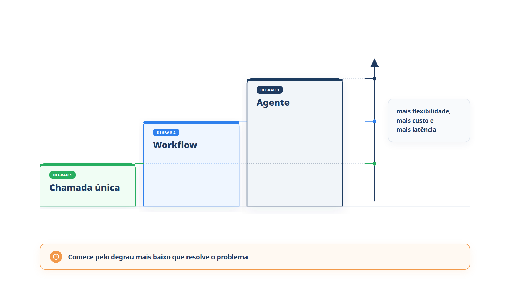

# Capítulo 4 — Construir ou não construir

Você já sabe o que é um agente, do que ele é feito e como ele opera. Falta saber *quando* usá-lo. Este capítulo oferece um critério para escolher entre três camadas — chamada única, workflow e agente — e mostra como combiná-las em um mesmo atendimento. O objetivo prático é evitar o erro mais caro do tema: construir um agente onde um simples `if` bastaria.



> **Antes de começar — PydanticAI neste capítulo**
>
> Neste capítulo você usa `Agent`, `instructions`, `.run_sync` e `.output`. Se algum deles não for familiar, revise o [Capítulo 0.4](../modulo-00/0.4-o-primeiro-agente-por-dentro.md). O teste sem API da seção "Testando o roteador sem API" usa `TestModel`, apresentado no [Capítulo 0.5](../modulo-00/0.5-mensagens-e-testes-sem-api.md).

## Três perguntas antes de construir

Agentes se justificam onde a automação tradicional, baseada em regras fixas, encontra atrito. Imagine a comparação entre uma lista de verificação e um investigador experiente. A lista marca o que viola um critério predefinido; o investigador avalia contexto e percebe padrões sutis mesmo quando nenhuma regra foi violada. Antes de construir, confirme se o seu caso tem ao menos uma destas características:

- **Decisões que exigem julgamento.** O fluxo envolve exceções ou escolhas sensíveis ao contexto, como aprovar um reembolso quando o cliente recebeu o produto danificado, mas fora do prazo.
- **Regras difíceis de manter.** O conjunto de regras cresceu tanto que cada alteração é cara e arriscada, como acontece em revisões de segurança de fornecedores.
- **Muita informação não estruturada.** O trabalho depende de interpretar linguagem natural, extrair sentido de documentos ou conversar com o usuário, como no processamento de um sinistro.

Se nenhuma delas se aplica, uma solução determinística provavelmente basta. Na Casa Verde, "enviar a segunda via da nota fiscal" é um procedimento fixo: dado o código do pedido, o sistema devolve o PDF. Já "decidir se vale devolver o dinheiro de um sofá que chegou com o tecido manchado, 12 dias após a entrega" envolve julgamento e linguagem natural.

## A escada de complexidade

Existe uma escala de soluções, com três degraus principais. Cada degrau acima acrescenta flexibilidade e cobra em custo, latência e previsibilidade.

1. **Chamada única.** Uma pergunta, uma resposta, sem ferramentas nem estado. É o chatbot do Capítulo 1: adequado para classificar, resumir, explicar uma política ou responder a perguntas que já têm a resposta no texto.
2. **Workflow.** Seu código define os passos e usa o modelo em alguns deles, como no `workflow.py`. Adequado quando você sabe de antemão o caminho.
3. **Agente.** O modelo escolhe os passos. Adequado quando não dá para prever quantos passos serão necessários nem quais.

A regra de ouro é subir um degrau apenas quando o anterior falhar de forma demonstrável. Ela foi formulada assim pela Anthropic: encontre a solução mais simples possível e só aumente a complexidade quando necessário. O ganho de começar de baixo é duplo: a solução é mais barata e, quando o degrau baixo falha, você descobre *por que* falhou, o que orienta o degrau seguinte.

### Um sinal prático para subir

O workflow do Capítulo 1 falhou com "o pedido é o mil e dois". Foi uma falha específica de extração, e poderia ser corrigida com um `if` melhor. Suba para agente apenas quando as falhas se multiplicarem e cada correção exigir um novo caso especial; é o indício de que o espaço de situações é aberto demais para um caminho fixo.

## Combinando as camadas

Os degraus não se excluem. O melhor atendimento da Casa Verde usa dois: perguntas gerais não precisam de ferramentas, e só mensagens que citam um pedido precisam do agente. O código roteia entre elas.

*roteador.py*

```python
import re

from pydantic_ai import Agent

from agente import agente as agente_de_pedidos
from config import MODELO

faq = Agent(
    MODELO,
    instructions=(
        "Você responde dúvidas gerais da loja Casa Verde: o prazo de devolução "
        "é de 7 dias após o recebimento e o frete é grátis acima de R$ 200. "
        "Responda em até duas frases."
    ),
)


def atender(mensagem: str) -> str:
    if re.search(r"\d{4}", mensagem):
        return agente_de_pedidos.run_sync(mensagem).output
    return faq.run_sync(mensagem).output


if __name__ == "__main__":
    print(atender("Qual é o prazo para devolver um produto?"))
    print(atender("Onde está o meu pedido 1001?"))
```

Saída típica:

```text
O prazo de devolução é de 7 dias após o recebimento do produto.
O pedido 1001 foi enviado e a previsão de entrega é 12/10.
```

A primeira pergunta não contém um código de quatro dígitos e foi para o `faq`, uma chamada única, sem ferramentas e sem ciclo. A segunda foi para o agente e fez uso da ferramenta de consulta. O custo do ciclo só foi pago quando era necessário.

Essa técnica é chamada de *roteamento*: o código classifica a entrada e a encaminha para o tratamento adequado. É um dos padrões de workflow que o Módulo 6 detalha. Aqui, o importante é perceber que o roteador é um workflow, e que ele *contém* um agente. Sistemas reais costumam misturar as camadas assim, deixando o código no controle do que é previsível e o modelo no controle do que não é.

### Armadilha: o roteador que atrapalha

O roteador usa `\d{4}` para decidir. Uma mensagem como "Comprei em 2024 e o produto veio com defeito" contém quatro dígitos que não são um pedido, e iria para o agente sem necessidade. Quando o critério do roteamento é frágil, o erro se repete em silêncio. Duas saídas: tornar o critério mais preciso ou, se a variedade de mensagens for grande, entregar a decisão de roteamento a um modelo. A escolha é a mesma da escada: comece pelo critério simples e suba quando ele falhar.

### Testando o roteador sem API

Você não precisa de chave de API para conferir *para onde* cada mensagem vai. A decisão é feita por `re.search`, código comum, e o que importa verificar é qual dos dois `Agent` respondeu. O exemplo abaixo repete a função `atender` com dois agentes de teste. Cada um usa um `TestModel` (o modelo falso do [Capítulo 0.5](../modulo-00/0.5-mensagens-e-testes-sem-api.md)) com `custom_output_text`, que fixa o texto da resposta e permite ver quem respondeu.

*roteador_offline.py*

```python
import re

from pydantic_ai import Agent
from pydantic_ai.models.test import TestModel

faq = Agent(TestModel(custom_output_text="resposta do faq"))
agente_de_pedidos = Agent(TestModel(custom_output_text="resposta do agente"))


def atender(mensagem: str) -> str:
    if re.search(r"\d{4}", mensagem):
        return agente_de_pedidos.run_sync(mensagem).output
    return faq.run_sync(mensagem).output


mensagens = [
    "Qual é o prazo para devolver um produto?",
    "Onde está o meu pedido 1001?",
    "Comprei em 2024 e o produto veio com defeito",
]
for mensagem in mensagens:
    print(f"{mensagem} -> {atender(mensagem)}")
```

Saída:

```text
Qual é o prazo para devolver um produto? -> resposta do faq
Onde está o meu pedido 1001? -> resposta do agente
Comprei em 2024 e o produto veio com defeito -> resposta do agente
```

A terceira linha mostra a armadilha acima sem gastar uma chamada real: "2024" tem quatro dígitos e a mensagem foi para o agente de pedidos. Como o texto vem do `TestModel`, a conversa não tem sentido. O teste só prova o roteamento, e é isso que ele deve provar.

## Uma lista de decisão

Diante de um processo que você pensa em automatizar, percorra as perguntas nesta ordem e pare na primeira resposta afirmativa:

1. Uma regra fixa resolve? Use código comum, sem modelo.
2. Uma única chamada ao modelo, com o contexto necessário, resolve? Use uma chamada única.
3. O caminho é conhecido, mas alguns passos exigem linguagem natural? Use um workflow.
4. O número e a ordem dos passos dependem do caso, e o modelo consegue tomar essas decisões com segurança? Use um agente, com limites.

Se você chegou ao passo 4, volte às três perguntas do início do capítulo. Elas confirmam que o agente se justifica.

### Faça você mesmo

- **4.1 Escada em cinco casos:** classifique cada caso como código comum, chamada única, workflow ou agente, e justifique em uma frase: (a) converter reais em dólares com a cotação do dia; (b) resumir um e-mail longo de cliente; (c) triagem de chamados com três categorias fixas e encaminhamento a filas; (d) investigar por que uma entrega atrasou consultando transportadora, estoque e histórico do cliente; (e) validar o formato de um CPF.
- **4.2 Nova rota:** acrescente a `roteador.py` uma terceira rota: mensagens que contêm a palavra "cancelar" e um código vão para o agente `suporte` do Capítulo 2. Teste com "Quero cancelar o pedido 1002".
- **4.3 Critério frágil:** envie ao roteador a mensagem "Comprei em 2024 e o produto veio com defeito". Descreva para onde ela foi e proponha uma alteração do critério que a encaminhe corretamente.
- **4.4 Seu processo:** escolha um processo do seu trabalho. Percorra a lista de decisão e registre em quatro frases a camada escolhida e por quê.
- **4.5 Critério corrigido, testado:** altere o critério em `roteador_offline.py` (por exemplo, exigir a palavra "pedido" junto dos quatro dígitos) e rode de novo. Confirme que a terceira mensagem agora responde "resposta do faq" e que a segunda continua indo para o agente.

## Recapitulando

Você aprendeu a decidir por critério, não por entusiasmo. Agentes se justificam quando o caso exige julgamento, quando as regras se tornaram impossíveis de manter ou quando o trabalho depende de linguagem não estruturada. Fora disso, uma chamada única ou um workflow é mais barato, mais rápido e mais previsível. Você também montou um roteador que usa cada camada onde ela faz sentido.

Com isso, o Módulo 1 está completo: você distingue chatbot, workflow e agente, sabe montar um agente com modelo, ferramentas e instruções, lê o ciclo de orquestração e escolhe a camada certa. O próximo módulo olha com atenção para dentro do ciclo. Ele apresenta o padrão **ReAct** — raciocinar, agir e observar —, as técnicas de raciocínio explícito antes de agir e a autocrítica que permite ao agente corrigir os próprios erros.

### Fontes do capítulo

- OpenAI — [A Practical Guide to Building Agents](https://cdn.openai.com/business-guides-and-resources/a-practical-guide-to-building-agents.pdf): as três características de casos que justificam um agente; a comparação entre motor de regras e agente investigador.
- Anthropic — [Building Effective Agents](https://www.anthropic.com/engineering/building-effective-agents): solução mais simples possível; quando não usar agentes; roteamento como padrão de workflow.
- AWS — [Prescriptive Guidance: Agentic AI Patterns](https://docs.aws.amazon.com/prescriptive-guidance/latest/agentic-ai-patterns/introduction.html): o agente de raciocínio básico (sem estado nem ferramentas) como ponto de partida para padrões mais avançados; workflows como estrutura que contém o modelo.
