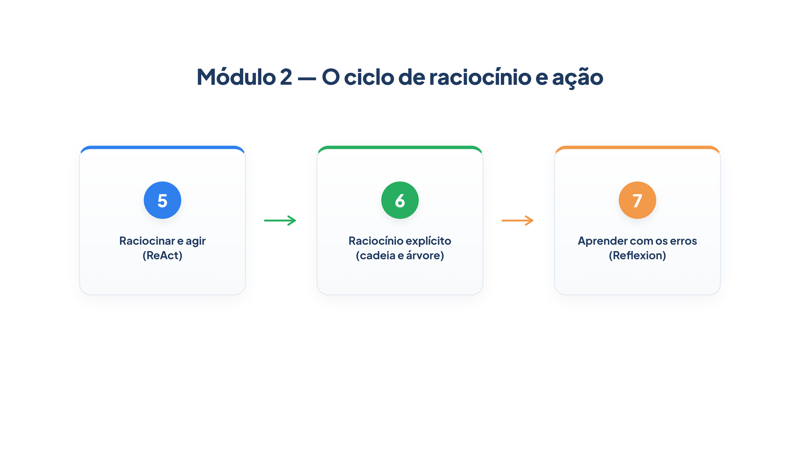

# Módulo 2 — O ciclo de raciocínio e ação

No Módulo 1, você viu que um agente é um ciclo: o modelo decide, a ferramenta executa, o resultado volta. Mas o ciclo ficou como uma caixa fechada. Você viu *o que* o agente fez, e não *por que* o fez. Este módulo abre essa caixa. Ao final dele, você será capaz de:

- escrever o ciclo **Pensamento → Ação → Observação** à mão e reconhecê-lo dentro de qualquer framework;
- fazer o modelo raciocinar em etapas antes de responder, e explorar mais de um caminho quando o problema pede;
- fazer um agente aprender com as próprias falhas entre uma tentativa e outra, sem alterar o modelo.

## Percurso

1. **Capítulo 5 — Raciocinar e agir.** Você implementa o padrão ReAct de duas formas: com um laço escrito por você e com as chamadas de ferramenta do PydanticAI, e compara os dois.
2. **Capítulo 6 — Raciocínio explícito.** Você faz o modelo mostrar o passo a passo (cadeia de pensamento), repete a pergunta e vota na resposta mais frequente, e explora três opções antes de escolher uma (árvore de pensamentos).
3. **Capítulo 7 — Aprender com os erros.** Você monta um ciclo com ator, avaliador e reflexão, em que a lição de uma tentativa que falhou melhora a seguinte.

Os capítulos continuam a numeração do Módulo 1 e reaproveitam a loja *Casa Verde*. Os arquivos `loja.py`, `config.py`, `consulta.py` e `trajetoria.py` desta etapa estendem os do módulo anterior: copie a pasta `codigo/` do Módulo 2 por cima da sua.

> **Nota:** Como antes, o texto gerado por um modelo real varia. Os exemplos que anunciam um *modelo simulado* produzem exatamente a saída mostrada.
