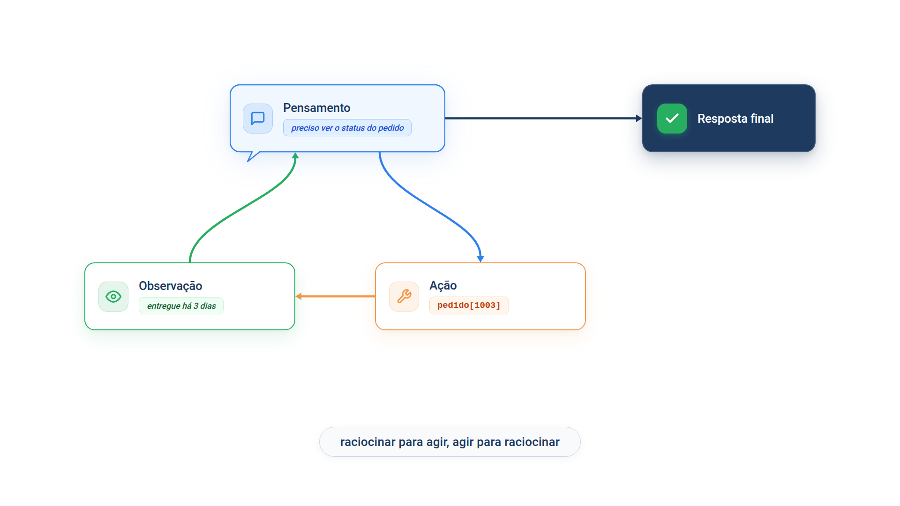

# Capítulo 5 — Raciocinar e agir

No Capítulo 3, você leu a trajetória de um agente: ação, observação, ação, observação, resposta. Faltava uma coluna — o *porquê* de cada ação. Neste capítulo, você acrescenta essa coluna. Você vai implementar o padrão ReAct duas vezes: primeiro escrevendo o laço com as próprias mãos, para enxergar o mecanismo, depois com as chamadas de ferramenta do PydanticAI, que é como se faz na prática.



> **Antes de começar — PydanticAI neste capítulo**
>
> Neste capítulo você usa `Agent`, `.run_sync`, `.run` (a versão assíncrona de `.run_sync`), `.output`, `.override` e `@agente.tool_plain`. Se algum deles não for familiar, revise os Capítulos [0.4](../modulo-00/0.4-o-primeiro-agente-por-dentro.md), [0.5](../modulo-00/0.5-mensagens-e-testes-sem-api.md) e [0.6](../modulo-00/0.6-ferramentas-e-saida-tipada.md). No código também aparecem `lambda`, `with`, `async`/`await` e `asyncio.run`, do [Capítulo 0.2](../modulo-00/0.2-o-python-que-o-livro-assume.md).

## Uma pergunta que exige dois passos

Um cliente da Casa Verde escreve: "Meu pedido 1003 chegou com defeito. Ainda consigo devolver?" Para responder, o agente precisa de dois dados: há quantos dias o pedido foi entregue e qual é o prazo de devolução da loja. Nenhum dos dois está na pergunta.

Para esta etapa, a loja ganhou uma segunda consulta, de políticas, e o pedido 1003 passou a informar `dias_desde_entrega`. A consulta de políticas tem uma particularidade: ela **usa um segundo agente**. São dois papéis:

1. o **agente de atendimento** conversa com o cliente e, quando precisa de uma regra da loja, chama a ferramenta `consultar_politica` passando um `tema`;
2. o **escolhedor** recebe esse tema, compara com a lista de políticas da loja e escolhe a que mais se parece com a necessidade do cliente.

Quem faz a ponte entre os dois é a função `buscar_politica(tema)`, que a ferramenta chama.

### A consulta de políticas: um agente dentro da função

Atualize o `loja.py`. As partes novas são `POLITICAS`, `LISTA_DE_POLITICAS`, `escolhedor` e `buscar_politica`, além do campo `dias_desde_entrega` no pedido 1003:

*loja.py*

```python
from pydantic_ai import Agent

from config import MODELO

PEDIDOS = {
    "1001": {"status": "enviado", "previsao": "12/10", "valor": 189.90},
    "1002": {"status": "em separação", "previsao": "15/10", "valor": 64.50},
    "1003": {"status": "entregue", "previsao": "01/10", "valor": 320.00, "dias_desde_entrega": 3},
}

POLITICAS = {
    "devolucao": "Devolução em até 7 dias após o recebimento, com o produto na embalagem original.",
    "cancelamento": "Cancelamento apenas enquanto o pedido estiver em separação.",
    "frete": "Frete grátis para compras acima de R$ 200.",
}

LISTA_DE_POLITICAS = "\n".join(f"- {tema}: {texto}" for tema, texto in POLITICAS.items())

escolhedor = Agent(
    MODELO,
    instructions=(
        "Você escolhe a política da loja Casa Verde que atende à necessidade do "
        "cliente. As políticas são:\n"
        f"{LISTA_DE_POLITICAS}\n"
        "Responda apenas com o nome do tema mais adequado, sem explicação. "
        "Se nenhuma política servir, responda: nenhuma."
    ),
)


def buscar_pedido(codigo: str) -> dict | None:
    return PEDIDOS.get(codigo)


async def buscar_politica(tema: str) -> str | None:
    resultado = await escolhedor.run(tema)
    escolhido = resultado.output.strip().lower()
    return POLITICAS.get(escolhido)
```

Veja a parte nova por partes:

1. `POLITICAS` guarda o texto oficial de cada política, indexado pelo tema. É a única fonte do que a loja promete.
2. `LISTA_DE_POLITICAS` transforma o dicionário em linhas como `- frete: Frete grátis para compras acima de R$ 200.`: o `f"- {tema}: {texto}"` monta cada linha e `"\n".join(...)` as une com quebras de linha. Essa lista entra nas instruções do escolhedor, para que ele veja as opções e o que cada uma diz.
3. `escolhedor` é um `Agent` comum, sem ferramentas. A instrução pede só o nome do tema mais adequado, ou `nenhuma`.
4. `buscar_politica` pergunta ao escolhedor com `await escolhedor.run(tema)`, limpa a resposta (`.strip()` tira espaços e quebras de linha das pontas; `.lower()` põe tudo em minúsculas) e devolve `POLITICAS.get(escolhido)`: o texto da política, ou `None` se o escolhedor respondeu `nenhuma` ou algo que não é um tema.

Observe a divisão de trabalho: o escolhedor decide **qual** política serve, mas **não escreve** o que ela diz. O texto devolvido é sempre o do dicionário. Assim, mesmo com dois agentes, a observação que chega ao agente de atendimento continua sendo um dado da loja, e não uma frase que um modelo possa ter inventado.

> **Por dentro do PydanticAI — `await agente.run(...)` dentro de uma ferramenta**
>
> **O que é:** a versão assíncrona de `run_sync`. `await escolhedor.run(tema)` executa o agente e devolve o mesmo objeto de resultado, com `.output`.
> **Como funciona aqui:** `buscar_politica` é `async` porque espera a resposta de outro agente. Por isso a ferramenta `consultar_politica`, que a chama, também será `async`.
> **O que o PydanticAI faz por você:** executa a ferramenta `async` com `await` dentro do laço de eventos que já está rodando, então você não chama `asyncio.run` nela.
> **Cuidado:** se `buscar_politica` usasse `escolhedor.run_sync(...)` e fosse chamada de dentro de uma ferramenta do outro agente, o PydanticAI recusaria com um `UserError`, avisando que `run_sync` pode travar a execução. Dentro de uma ferramenta, use `async def` e `await agente.run(...)`.

Há também um custo: cada consulta de política agora gasta uma chamada a mais ao modelo, a do escolhedor. Como `consultar_politica` é uma ferramenta simples (`tool_plain`), ela não tem um `ctx` para repassar `usage=` e somar esse consumo ao total do agente de atendimento. O [Capítulo 9](../modulo-03/09-notas-e-recuperacao-sob-demanda.md) mostra como somar o consumo de um subagente quando isso importa.

Para ver o escolhedor trabalhar sem chamar um modelo real, usamos mais um modelo simulado. Ele segue uma regra simples de palavras-chave, que faz o papel da leitura de significado que um modelo real faria:

*escolhedor_simulado.py*

```python
from pydantic_ai import ModelResponse, TextPart
from pydantic_ai.models.function import AgentInfo, FunctionModel

PALAVRAS = {
    "devolucao": ["devol", "de volta", "arrepend"],
    "cancelamento": ["cancel", "desist"],
    "frete": ["frete", "entrega"],
}


def escolher(mensagens, info: AgentInfo) -> ModelResponse:
    pedido = mensagens[-1].parts[0].content.lower()
    for tema, palavras in PALAVRAS.items():
        for palavra in palavras:
            if palavra in pedido:
                return ModelResponse(parts=[TextPart(tema)])
    return ModelResponse(parts=[TextPart("nenhuma")])


modelo_escolhedor = FunctionModel(escolher)
```

`PALAVRAS` associa cada tema a trechos que o cliente costuma escrever. `escolher` lê o pedido, que é o conteúdo da última mensagem, procura esses trechos e responde com o tema encontrado; se nenhum aparece, responde `nenhuma`. O `FunctionModel` embrulha a função como se fosse um modelo. Agora passe alguns pedidos pela função:

*politica_semelhante.py*

```python
import asyncio

from escolhedor_simulado import modelo_escolhedor
from loja import buscar_politica, escolhedor

PEDIDOS_DO_CLIENTE = [
    "devolucao",
    "quero mandar o produto de volta",
    "até quando posso desistir da compra?",
    "vocês vendem para atacado?",
]


async def principal() -> None:
    for pedido in PEDIDOS_DO_CLIENTE:
        print(f"{pedido} -> {await buscar_politica(pedido)}")


with escolhedor.override(model=modelo_escolhedor):
    asyncio.run(principal())
```

Saída:

```text
devolucao -> Devolução em até 7 dias após o recebimento, com o produto na embalagem original.
quero mandar o produto de volta -> Devolução em até 7 dias após o recebimento, com o produto na embalagem original.
até quando posso desistir da compra? -> Cancelamento apenas enquanto o pedido estiver em separação.
vocês vendem para atacado? -> None
```

O `with escolhedor.override(...)` troca o modelo do escolhedor só dentro do bloco, e `asyncio.run(principal())` é a porta de entrada do programa assíncrono, como no Capítulo 0.2. Os quatro pedidos mostram quatro comportamentos: o tema exato passa direto; "mandar o produto de volta" é associado à política de devolução; "desistir da compra", à de cancelamento; e a pergunta fora do assunto devolve `None`, o sinal de que nenhuma política serve. Com um modelo real, a associação vem do significado das palavras, e não de uma lista fixa, o que torna a ferramenta tolerante a temas escritos de outro jeito.

### O agente de atendimento

Agora o primeiro dos dois agentes. Ele não sabe que existe um escolhedor: vê apenas duas ferramentas.

*consulta.py*

```python
from pydantic_ai import Agent

from config import MODELO
from loja import buscar_pedido, buscar_politica

agente = Agent(
    MODELO,
    instructions=(
        "Você atende clientes da loja Casa Verde. Use as ferramentas para "
        "consultar dados e regras antes de responder; nunca invente. "
        "Responda em até três frases."
    ),
)


@agente.tool_plain
def consultar_pedido(codigo: str) -> str:
    """Consulta o status de um pedido pelo código de quatro dígitos."""
    pedido = buscar_pedido(codigo)
    return str(pedido) if pedido else "Pedido não encontrado."


@agente.tool_plain
async def consultar_politica(tema: str) -> str:
    """Consulta uma política da loja. Temas: devolucao, cancelamento, frete."""
    politica = await buscar_politica(tema)
    return politica or "Tema não encontrado."
```

`consultar_politica` é `async` porque `buscar_politica` é. É aqui que os dois agentes se encontram: o agente de atendimento escolhe o `tema` e chama a ferramenta; a ferramenta passa o tema a `buscar_politica`, que consulta o escolhedor; o texto da política volta pelo mesmo caminho, ou `Tema não encontrado.` se o escolhedor não achou nenhuma.

O arquivo `trajetoria.py` do Módulo 2 também mudou: ele agora distingue o texto que vem *antes* de uma ferramenta (chamado de "Pensamento") do texto final (chamado de "Resposta"). Com isso, execute:

*sem_pensamento.py*

```python
from consulta import agente
from trajetoria import mostrar

resultado = agente.run_sync("Meu pedido 1003 chegou com defeito. Ainda consigo devolver?")
mostrar(resultado)
```

Saída típica:

```text
Pedido      : Meu pedido 1003 chegou com defeito. Ainda consigo devolver?
Ação        : consultar_pedido {'codigo': '1003'}
Ação        : consultar_politica {'tema': 'devolucao'}
Observação  : {'status': 'entregue', 'previsao': '01/10', 'valor': 320.0, 'dias_desde_entrega': 3}
Observação  : Devolução em até 7 dias após o recebimento, com o produto na embalagem original.
Resposta    : Sim, o pedido foi entregue há 3 dias e o prazo é de 7. Você pode devolvê-lo na embalagem original.
```

Esta trajetória mostra só o agente de atendimento: a escolha feita pelo escolhedor acontece dentro de `buscar_politica` e não aparece aqui.

O agente acertou, e muitos modelos pedem as duas consultas de uma vez, como acima. Mas observe o que a trajetória *não* mostra: por que ele escolheu essas duas ferramentas, e o que concluiu de cada resultado. Se a resposta tivesse saído errada, você teria só as ações para investigar. É essa lacuna que o ReAct preenche.

## O padrão Pensamento, Ação, Observação

O **ReAct** (de *Reasoning and Acting*, raciocínio e ação) é um padrão em que o modelo gera, de forma intercalada, uma linha de raciocínio e uma ação. Cada volta tem três registros:

1. **Pensamento:** o que o modelo pretende fazer e por quê;
2. **Ação:** a ferramenta escolhida e seus argumentos;
3. **Observação:** o resultado devolvido pela ferramenta.

O ciclo se repete até o modelo escrever uma **resposta final**. Esse é o ciclo do Capítulo 3, com uma diferença: o raciocínio fica registrado.

Os autores do padrão, em um artigo de 2022, mostraram por que a combinação funciona. O raciocínio ajuda o modelo a criar, acompanhar e atualizar um plano, e a lidar com exceções. A ação deixa o modelo buscar informação em fontes externas. Raciocinar sem agir, a chamada *cadeia de pensamento*, depende só do que o modelo já sabe e pode inventar fatos ou propagar um erro ao longo dos passos. No artigo, ao consultar uma API da Wikipédia, o ReAct reduziu esses problemas em perguntas e verificação de fatos. Em dois testes interativos, superou métodos treinados por imitação e por reforço com diferenças absolutas de 34 e 10 pontos percentuais, usando apenas um ou dois exemplos no prompt.

A regra prática é simples: raciocinar ajuda a agir melhor; observar ajuda a raciocinar sobre fatos, não sobre suposições.

## ReAct à mão

Para ver o mecanismo, vamos escrever o ciclo sem usar as chamadas de ferramenta do framework. O modelo escreve texto em um formato combinado; o nosso código lê o texto, executa a ferramenta e devolve a observação.

*react_manual.py*

```python
import asyncio
import re

from pydantic_ai import Agent

from config import MODELO
from loja import buscar_pedido, buscar_politica

INSTRUCOES = """\
Resolva a tarefa alternando passos. Em cada resposta, escreva exatamente:

Pensamento: <o que você pretende fazer e por quê>
Ação: <ferramenta>[<argumento>]

e pare. As ferramentas são:
- pedido[codigo]: devolve os dados de um pedido;
- politica[tema]: devolve uma política da loja (devolucao, cancelamento, frete).

Quando souber a resposta, escreva:

Pensamento: <resumo do que descobriu>
Resposta final: <resposta ao cliente>

Nunca escreva "Observação:"; ela será fornecida a você.
"""

raciocinador = Agent(MODELO, instructions=INSTRUCOES)

FERRAMENTAS = {
    "pedido": lambda argumento: str(buscar_pedido(argumento)),
    "politica": lambda argumento: str(asyncio.run(buscar_politica(argumento))),
}


def reagir(tarefa: str, max_passos: int = 6) -> str:
    texto = f"Tarefa: {tarefa}\n"
    for _ in range(max_passos):
        passo = raciocinador.run_sync(texto).output
        passo = passo.split("Observação:")[0].strip()
        print(passo)
        texto += passo + "\n"

        if "Resposta final:" in passo:
            return passo.split("Resposta final:")[1].strip()

        achado = re.search(r"Ação:\s*(\w+)\[(.*?)\]", passo)
        if achado is None:
            return "Não consegui decidir o próximo passo."

        nome, argumento = achado.groups()
        if nome in FERRAMENTAS:
            observacao = FERRAMENTAS[nome](argumento)
        else:
            observacao = f"A ferramenta {nome} não existe."
        print(f"Observação: {observacao}")
        texto += f"Observação: {observacao}\n"
    return "Limite de passos atingido."


if __name__ == "__main__":
    reagir("Meu pedido 1003 chegou com defeito. Ainda consigo devolver?")
```

O trecho central é o laço dentro de `reagir`. A cada volta, ele:

1. envia ao modelo o texto acumulado até aqui;
2. lê o passo devolvido; se contiver "Resposta final:", termina;
3. caso contrário, extrai o nome da ferramenta e o argumento com a expressão regular `Ação:\s*(\w+)\[(.*?)\]`;
4. executa a ferramenta, escreve a observação e a acrescenta ao texto, para que o modelo a veja na volta seguinte.

O parâmetro `max_passos` é o ponto de parada do Capítulo 3: sem ele, um modelo que nunca conclui giraria sem fim.

Repare em `asyncio.run(buscar_politica(argumento))` no dicionário `FERRAMENTAS`. `buscar_politica` é `async`, porque consulta o escolhedor, e este laço é uma função comum; então ele a executa com `asyncio.run`, a porta de entrada do Capítulo 0.2. Isso só funciona porque o laço roda fora de qualquer execução de agente: dentro de uma ferramenta, como em `consulta.py`, o caminho é `await`.

Para ter uma saída idêntica à do livro, vamos executar o laço com um modelo simulado que segue o roteiro certo. Trocamos também o modelo do escolhedor por `modelo_escolhedor`, o do `escolhedor_simulado.py`; sem isso, `buscar_politica` tentaria chamar um modelo real:

*react_simulado.py*

```python
from pydantic_ai import ModelResponse, TextPart
from pydantic_ai.models.function import AgentInfo, FunctionModel

import react_manual
from escolhedor_simulado import modelo_escolhedor
from loja import escolhedor


def modelo_roteirizado(mensagens, info: AgentInfo) -> ModelResponse:
    texto = mensagens[-1].parts[0].content
    observacoes = texto.count("Observação:")
    if observacoes == 0:
        passo = (
            "Pensamento: preciso saber há quantos dias o pedido foi entregue.\n"
            "Ação: pedido[1003]"
        )
    elif observacoes == 1:
        passo = (
            "Pensamento: agora preciso do prazo de devolução da loja.\n"
            "Ação: politica[devolucao]"
        )
    else:
        passo = (
            "Pensamento: foram 3 dias e o prazo é de 7, então ainda está no prazo.\n"
            "Resposta final: Sim, você ainda pode devolver: o prazo é de 7 dias e "
            "o pedido foi entregue há 3."
        )
    return ModelResponse(parts=[TextPart(passo)])


with (
    react_manual.raciocinador.override(model=FunctionModel(modelo_roteirizado)),
    escolhedor.override(model=modelo_escolhedor),
):
    resposta = react_manual.reagir("Meu pedido 1003 chegou com defeito. Ainda consigo devolver?")
print("\nCliente recebe:", resposta)
```

Saída:

```text
Pensamento: preciso saber há quantos dias o pedido foi entregue.
Ação: pedido[1003]
Observação: {'status': 'entregue', 'previsao': '01/10', 'valor': 320.0, 'dias_desde_entrega': 3}
Pensamento: agora preciso do prazo de devolução da loja.
Ação: politica[devolucao]
Observação: Devolução em até 7 dias após o recebimento, com o produto na embalagem original.
Pensamento: foram 3 dias e o prazo é de 7, então ainda está no prazo.
Resposta final: Sim, você ainda pode devolver: o prazo é de 7 dias e o pedido foi entregue há 3.

Cliente recebe: Sim, você ainda pode devolver: o prazo é de 7 dias e o pedido foi entregue há 3.
```

Agora a trajetória conta uma história completa. O primeiro pensamento justifica a consulta ao pedido; o segundo mostra que o modelo absorveu o resultado (3 dias) e decidiu buscar o prazo; o terceiro compara os dois números e conclui. Cada observação veio do nosso código, não do modelo: mesmo na política, em que o escolhedor decide qual consultar, o texto devolvido é o do dicionário.

Troque o modelo simulado pelo real executando `python react_manual.py`. O texto dos pensamentos será outro, mas a estrutura — pensamento, ação, observação, e uma resposta final — deve se manter.

### Armadilha: o modelo escreve a observação

Um modelo pode antecipar o resultado e continuar a resposta com uma linha como "Observação: o pedido foi entregue há 30 dias", seguida de conclusões baseadas nela. Se o nosso laço aceitasse esse texto, o raciocínio passaria a se apoiar em um dado inventado, exatamente o problema que a observação deveria evitar.

Dois cuidados protegem contra isso no código: a instrução proíbe o modelo de escrever "Observação:", e a linha `passo.split("Observação:")[0]` descarta qualquer coisa que ele escreva depois desse marcador. Assim, só o nosso código produz observações.

### Faça você mesmo

- **5.1 Execução real:** execute `react_manual.py` com o modelo real. Anote os três pensamentos e confira se a observação de cada passo corresponde ao dado de `loja.py`.
- **5.2 Terceira ferramenta:** acrescente a ferramenta `estoque[produto]`, que devolve a quantidade em estoque de um produto fixo à sua escolha. Atualize `INSTRUCOES` e o dicionário `FERRAMENTAS`, e teste com uma pergunta que a exija.
- **5.3 Ferramenta inexistente:** altere o modelo simulado para pedir `Ação: reembolso[1003]`. Descreva o que o laço faz e como o modelo recebe a notícia.

## ReAct com chamadas de ferramenta

O laço manual serve para entender; na prática, você usa as chamadas de ferramenta do framework. O modelo devolve a escolha da ferramenta em um formato estruturado, com argumentos já validados, e o framework executa o ciclo por você. Falta só pedir o pensamento.

*react_nativo.py*

```python
from pydantic_ai import Agent

from config import MODELO
from consulta import consultar_pedido, consultar_politica
from trajetoria import mostrar

agente = Agent(
    MODELO,
    tools=[consultar_pedido, consultar_politica],
    instructions=(
        "Você atende clientes da loja Casa Verde. Antes de cada chamada de "
        "ferramenta, escreva uma frase explicando por que vai chamá-la. "
        "Nunca invente dados. Responda em até três frases."
    ),
)

if __name__ == "__main__":
    resultado = agente.run_sync("Meu pedido 1003 chegou com defeito. Ainda consigo devolver?")
    mostrar(resultado)
```

O argumento `tools=` registra funções já existentes, uma alternativa ao decorador. A novidade está na instrução: "Antes de cada chamada de ferramenta, escreva uma frase explicando por que vai chamá-la". Os modelos aceitam devolver, na mesma resposta, um texto *e* uma chamada de ferramenta, e o texto é o nosso pensamento.

> **Por dentro do PydanticAI — `Agent(tools=)`**
>
> **O que é:** um argumento do `Agent` que recebe uma lista de funções Python comuns, para que o modelo possa chamá-las como ferramentas.
> **Como funciona aqui:** em `react_nativo.py`, `tools=[consultar_pedido, consultar_politica]` registra as duas funções que já existiam em `consulta.py`. O resultado é o mesmo do decorador `@agente.tool_plain`, só que a função é definida antes e entregue ao agente depois, o que permite reaproveitá-la em mais de um agente.
> **O que o PydanticAI faz por você:** lê o nome da função, a assinatura (`codigo: str`) e a docstring, e monta a descrição que o modelo vê. Como as funções não têm `RunContext`, ele as trata como ferramentas simples.
> **Cuidado:** a docstring e as anotações de tipo viram a "bula" da ferramenta; sem elas, o modelo recebe uma descrição vazia. O código abaixo mostra o que é enviado.

Para ver o que o modelo recebe, execute:

*tools_registro.py*

```python
from pydantic_ai import Agent
from pydantic_ai.models.test import TestModel


def consultar_pedido(codigo: str) -> str:
    """Consulta o status de um pedido pelo código de quatro dígitos."""
    return f"Pedido {codigo}: entregue."


def consultar_politica(tema: str) -> str:
    """Consulta uma política da loja. Temas: devolucao, cancelamento, frete."""
    return f"Política de {tema}."


modelo = TestModel(call_tools=[])
agente = Agent(modelo, tools=[consultar_pedido, consultar_politica])
agente.run_sync("oi")

for ferramenta in modelo.last_model_request_parameters.function_tools:
    print(ferramenta.name, "|", ferramenta.description)
    print("  parâmetros:", list(ferramenta.parameters_json_schema["properties"]))
```

Saída:

```text
consultar_pedido | Consulta o status de um pedido pelo código de quatro dígitos.
  parâmetros: ['codigo']
consultar_politica | Consulta uma política da loja. Temas: devolucao, cancelamento, frete.
  parâmetros: ['tema']
```

Para ver a trajetória com saída garantida, usamos novamente um modelo simulado, agora devolvendo texto e chamada juntos:

*react_nativo_simulado.py*

```python
from pydantic_ai import ModelResponse, TextPart, ToolCallPart
from pydantic_ai.messages import ToolReturnPart
from pydantic_ai.models.function import AgentInfo, FunctionModel

from escolhedor_simulado import modelo_escolhedor
from loja import escolhedor
from react_nativo import agente
from trajetoria import mostrar


def modelo_roteirizado(mensagens, info: AgentInfo) -> ModelResponse:
    retornos = [
        parte
        for mensagem in mensagens
        for parte in mensagem.parts
        if isinstance(parte, ToolReturnPart)
    ]
    if len(retornos) == 0:
        return ModelResponse(parts=[
            TextPart("Vou ver há quantos dias o pedido foi entregue."),
            ToolCallPart("consultar_pedido", {"codigo": "1003"}),
        ])
    if len(retornos) == 1:
        return ModelResponse(parts=[
            TextPart("Agora preciso do prazo de devolução."),
            ToolCallPart("consultar_politica", {"tema": "devolucao"}),
        ])
    return ModelResponse(parts=[TextPart("Sim: o prazo é de 7 dias e o pedido foi entregue há 3.")])


with escolhedor.override(model=modelo_escolhedor):
    resultado = agente.run_sync(
        "Meu pedido 1003 chegou com defeito. Ainda consigo devolver?",
        model=FunctionModel(modelo_roteirizado),
    )
mostrar(resultado)
```

Saída:

```text
Pedido      : Meu pedido 1003 chegou com defeito. Ainda consigo devolver?
Pensamento  : Vou ver há quantos dias o pedido foi entregue.
Ação        : consultar_pedido {'codigo': '1003'}
Observação  : {'status': 'entregue', 'previsao': '01/10', 'valor': 320.0, 'dias_desde_entrega': 3}
Pensamento  : Agora preciso do prazo de devolução.
Ação        : consultar_politica {'tema': 'devolucao'}
Observação  : Devolução em até 7 dias após o recebimento, com o produto na embalagem original.
Resposta    : Sim: o prazo é de 7 dias e o pedido foi entregue há 3.
```

É a mesma trajetória do laço manual, agora produzida pelo framework. Compare os dois lado a lado:

| | ReAct à mão | ReAct com chamadas de ferramenta |
| --- | --- | --- |
| Formato da ação | texto livre lido por expressão regular | argumentos estruturados e validados |
| Quem executa o ciclo | o seu laço | o framework |
| Erro de formato do modelo | você precisa tratar | o framework pede correção ao modelo |
| Pensamento | obrigatório pelo formato | opcional; depende da instrução |

O pensamento na versão nativa é uma convenção da instrução, não uma garantia do formato. Se um modelo ignorar a instrução e chamar a ferramenta sem escrever nada, a ação ainda acontece. Quando o raciocínio visível é requisito — para auditoria, por exemplo —, confirme na trajetória que ele aparece.

> **Nota:** Alguns modelos têm um modo de raciocínio interno, que produz o pensamento em um campo separado do texto. O PydanticAI o habilita pela configuração `thinking`. Voltaremos a ele no Capítulo 6.

### Armadilha: o ciclo que repete a mesma ação

Um agente pode ficar preso pedindo a mesma consulta, por exemplo quando uma ferramenta devolve "Pedido não encontrado" e o modelo insiste no mesmo código. O sintoma é uma trajetória com ações idênticas em sequência. A causa costuma ser uma observação que não diz ao modelo o que fazer em seguida. Duas correções complementares: tornar a mensagem de erro da ferramenta acionável ("Pedido não encontrado; peça ao cliente para conferir o número") e manter o limite de chamadas aprendido no Capítulo 3.

### Faça você mesmo

- **5.4 Pensamento obrigatório:** execute `react_nativo.py` com o modelo real e confirme se cada chamada de ferramenta vem precedida de um pensamento. Se algum faltar, reforce a instrução e repita.
- **5.5 Observação acionável:** altere `consultar_pedido` para que a mensagem de erro oriente o próximo passo. Pergunte pelo pedido 9999 e compare a trajetória antes e depois.
- **5.6 Duas formas, uma tarefa:** escolha uma pergunta que exija três consultas e resolva-a com `react_manual.py` e com `react_nativo.py`. Registre qual das duas foi mais fácil de depurar e por quê.

## Recapitulando

Você agora sabe que o ReAct intercala pensamento, ação e observação, e que essa alternância deixa o raciocínio auditável e ancora cada decisão em um dado real. Você escreveu o ciclo à mão, com leitura de texto, ferramenta e limite de passos, e o refez com chamadas de ferramenta do PydanticAI, comparando as duas formas. Também viu dois defeitos típicos: observações inventadas pelo modelo e ações repetidas sem avanço.

Até aqui, o pensamento foi uma frase curta. Em problemas que exigem cálculo ou comparação, uma frase não basta: o modelo precisa raciocinar em etapas e, às vezes, explorar mais de um caminho. É o assunto do Capítulo 6.

### Fontes do capítulo

- Yao et al. — [ReAct: Synergizing Reasoning and Acting in Language Models](https://arxiv.org/abs/2210.03629) (2022): pensamentos e ações intercalados; ganhos sobre cadeia de pensamento em perguntas e verificação de fatos; resultados interativos de +34% e +10% em ALFWorld e WebShop.
- Google — [Whitepaper "Agents"](https://www.kaggle.com/whitepaper-agents): sequência Pergunta, Pensamento, Ação, Entrada da ação, Observação e Resposta final, repetida N vezes.
- Documentação do PydanticAI: *Agentes*, *Function Tools* e *Mensagens e histórico de bate-papo*.
