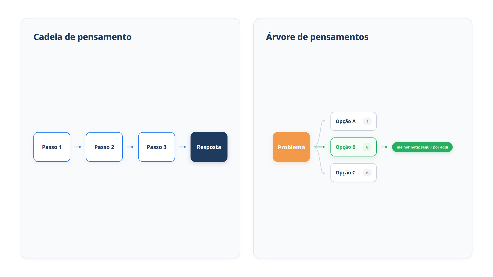

# Capítulo 6 — Raciocínio explícito

No Capítulo 5, o pensamento do agente foi uma frase curta entre duas ações. Isso basta para decidir qual ferramenta chamar, mas não para resolver um cálculo longo nem para escolher entre soluções concorrentes. Neste capítulo, você aprende três técnicas de raciocínio explícito, da mais barata à mais cara: a cadeia de pensamento, a votação entre várias cadeias e a árvore de pensamentos. O ganho prático é saber quando pagar por mais raciocínio — e quando não pagar.



> **Antes de começar — PydanticAI neste capítulo**
>
> Neste capítulo você usa `Agent(output_type=)`, `BaseModel`, `Field`, `ModelSettings`, `.output_tools` e anotações de tipo como `list[str]` e `float`. Se algum não for familiar, revise o [Capítulo 0.6](../modulo-00/0.6-ferramentas-e-saida-tipada.md) (`output_type` e `.output_tools`), o [Capítulo 0.3](../modulo-00/0.3-pydantic-na-pratica.md) (`BaseModel` e `Field`), o [Capítulo 0.4](../modulo-00/0.4-o-primeiro-agente-por-dentro.md) (`ModelSettings`) e o [Capítulo 0.2](../modulo-00/0.2-o-python-que-o-livro-assume.md) (anotações de tipo).

## Cadeia de pensamento: mostre o passo a passo

Considere um pedido de reembolso com mais de uma etapa de cálculo:

> Comprei 3 canecas de R$ 64,50 cada, com 10% de desconto sobre o total das canecas, e 1 vaso de R$ 189,90. Devolvi 2 canecas. O reembolso é proporcional ao valor efetivamente pago por caneca. Qual é o valor do reembolso?

O vaso é irrelevante, o desconto vale para o total e o reembolso é por caneca. Há quatro etapas encadeadas, e um erro em qualquer uma contamina o resultado. Vamos comparar duas formas de perguntar.

*cot.py*

```python
from pydantic import BaseModel

from pydantic_ai import Agent

from config import MODELO

PERGUNTA = (
    "Comprei 3 canecas de R$ 64,50 cada, com 10% de desconto sobre o total das "
    "canecas, e 1 vaso de R$ 189,90. Devolvi 2 canecas. O reembolso é proporcional "
    "ao valor efetivamente pago por caneca. Qual é o valor do reembolso?"
)


class Reembolso(BaseModel):
    passos: list[str]
    valor: float


direto = Agent(
    MODELO,
    output_type=float,
    instructions="Responda apenas com o valor em reais.",
)

raciocinado = Agent(
    MODELO,
    output_type=Reembolso,
    instructions=(
        "Calcule o reembolso. Preencha `passos` com o cálculo, um passo por "
        "linha, e só depois informe `valor`."
    ),
)

if __name__ == "__main__":
    print("Direto:", direto.run_sync(PERGUNTA).output)

    resposta = raciocinado.run_sync(PERGUNTA).output
    for passo in resposta.passos:
        print("-", passo)
    print("Valor:", resposta.valor)
```

Há dois agentes. O `direto` pede apenas um número. O `raciocinado` devolve um objeto `Reembolso`, com os passos do cálculo e o valor. O argumento `output_type` diz ao PydanticAI qual estrutura o modelo deve devolver, e o framework valida a resposta contra ela.

A resposta certa é R$ 116,10: as canecas custam R$ 193,50; com 10% de desconto, R$ 174,15; cada caneca saiu por R$ 58,05; duas canecas dão R$ 116,10. Para uma saída reproduzível, vamos executar o agente `raciocinado` com um modelo simulado que responde corretamente:

*cot_simulado.py*

```python
from pydantic_ai import ModelResponse, ToolCallPart
from pydantic_ai.models.function import AgentInfo, FunctionModel

import cot


def modelo_roteirizado(mensagens, info: AgentInfo) -> ModelResponse:
    nome = info.output_tools[0].name
    return ModelResponse(parts=[ToolCallPart(nome, {
        "passos": [
            "3 canecas x R$ 64,50 = R$ 193,50",
            "Desconto de 10%: 193,50 x 0,90 = R$ 174,15",
            "Valor pago por caneca: 174,15 / 3 = R$ 58,05",
            "Reembolso de 2 canecas: 58,05 x 2 = R$ 116,10",
        ],
        "valor": 116.10,
    })])


with cot.raciocinado.override(model=FunctionModel(modelo_roteirizado)):
    resposta = cot.raciocinado.run_sync(cot.PERGUNTA).output
for passo in resposta.passos:
    print("-", passo)
print("Valor:", resposta.valor)
```

Saída:

```text
- 3 canecas x R$ 64,50 = R$ 193,50
- Desconto de 10%: 193,50 x 0,90 = R$ 174,15
- Valor pago por caneca: 174,15 / 3 = R$ 58,05
- Reembolso de 2 canecas: 58,05 x 2 = R$ 116,10
Valor: 116.1
```

Essa técnica se chama **cadeia de pensamento** (*chain-of-thought*, ou CoT): o modelo produz etapas intermediárias antes da resposta. Ela traz dois benefícios. O primeiro é a precisão: cada etapa é um passo pequeno, e erros ficam menos prováveis do que em um salto único. O segundo é a auditoria: se o valor estiver errado, você vê em qual passo o raciocínio falhou. Com o agente `direto`, você teria só um número para aceitar ou recusar.

> **Nota:** Modelos recentes costumam acertar este exemplo mesmo sem os passos. O ganho de precisão aparece com mais clareza em cálculos mais longos e em modelos menores. O benefício da auditoria, por outro lado, existe sempre.

### Por que a ordem dos campos importa

O modelo gera a resposta da esquerda para a direita, campo por campo. Em `Reembolso`, `passos` vem antes de `valor`, então o valor é escrito *depois* do cálculo. Se você inverter a ordem, o modelo precisará se comprometer com um valor antes de raciocinar, e os passos viram uma justificativa posterior do que ele já decidiu.

```python
class ReembolsoInvertido(BaseModel):
    valor: float
    passos: list[str]
```

Regra geral: em uma saída estruturada, coloque o raciocínio antes da conclusão.

### O raciocínio interno do modelo

Alguns modelos têm um modo de raciocínio próprio, em que pensam antes de responder em um canal separado do texto. No PydanticAI, você o liga com a configuração `thinking`:

```python
from pydantic_ai.settings import ModelSettings

agente = Agent(MODELO, model_settings=ModelSettings(thinking="high"))
```

Os níveis vão de `"minimal"` a `"xhigh"`, e o framework traduz o valor para o provedor em uso. O raciocínio interno consome tokens e aumenta a latência, então use-o onde a qualidade compensa o custo. Quando você precisa do passo a passo como *dado do seu sistema*, para registrar ou exibir, a saída estruturada com `passos` continua sendo a forma mais previsível.

> **Por dentro do PydanticAI — `ModelSettings(thinking=)`**
>
> **O que é:** o campo `thinking` de `ModelSettings` liga e dimensiona o raciocínio interno do modelo. Aceita `True`, `False` ou um nível: `"minimal"`, `"low"`, `"medium"`, `"high"`, `"xhigh"`.
> **Como funciona aqui:** `ModelSettings(thinking="high")` cria um dicionário, `{'thinking': 'high'}`, que `model_settings=` entrega ao `Agent`. `True` liga o raciocínio no esforço padrão do provedor; `False` o desliga.
> **O que o PydanticAI faz por você:** converte o nível para a opção própria de cada provedor (por exemplo, `reasoning_effort` na OpenAI). Se o modelo não aceitar um nível, o framework usa o mais próximo disponível.
> **Cuidado:** `thinking` só tem efeito em modelos com modo de raciocínio. Em outros, ele é ignorado, e você paga a configuração sem ganho.


### Faça você mesmo

- **6.1 Comparação:** execute `cot.py` com o modelo real. Compare o valor do agente `direto` com o do `raciocinado` e confira o resultado com o cálculo à mão.
- **6.2 Problema mais longo:** reescreva `PERGUNTA` com um terceiro item devolvido e um desconto adicional de cupom. Calcule a resposta correta antes de executar, depois verifique os dois agentes.
- **6.3 Ordem invertida:** troque a ordem dos campos de `Reembolso` e repita 6.1. Descreva se os passos mudaram de natureza.

## Votação: várias cadeias, uma resposta

O modelo não dá sempre a mesma resposta para a mesma pergunta. Se uma cadeia de pensamento pode errar de vez em quando, rodar várias cadeias independentes e escolher a resposta que mais se repete torna o erro isolado menos provável. Esta variação da cadeia de pensamento é chamada de *autoconsistência*.

*consistencia.py*

```python
from collections import Counter

from cot import PERGUNTA, raciocinado


def votar(pergunta: str, tentativas: int = 5):
    valores = [round(raciocinado.run_sync(pergunta).output.valor, 2) for _ in range(tentativas)]
    valor, votos = Counter(valores).most_common(1)[0]
    return valor, votos, valores


if __name__ == "__main__":
    valor, votos, valores = votar(PERGUNTA)
    print("Respostas:", valores)
    print(f"Mais votada: R$ {valor:.2f} ({votos} de {len(valores)})")
```

A função `votar` roda o agente `raciocinado` cinco vezes e arredonda cada valor a duas casas, para que 116,1 e 116,10 contem como a mesma resposta. `Counter` conta as repetições, e `most_common(1)` devolve a vencedora.

Para observar o efeito, simulamos um modelo instável, que erra duas das cinco vezes:

*consistencia_simulada.py*

```python
from itertools import cycle

from pydantic_ai import ModelResponse, ToolCallPart
from pydantic_ai.models.function import AgentInfo, FunctionModel

import consistencia
from cot import PERGUNTA, raciocinado

respostas = cycle([116.10, 116.10, 129.00, 116.10, 58.05])


def modelo_instavel(mensagens, info: AgentInfo) -> ModelResponse:
    nome = info.output_tools[0].name
    return ModelResponse(parts=[ToolCallPart(nome, {"passos": ["..."], "valor": next(respostas)})])


with raciocinado.override(model=FunctionModel(modelo_instavel)):
    valor, votos, valores = consistencia.votar(PERGUNTA)
print("Respostas:", valores)
print(f"Mais votada: R$ {valor:.2f} ({votos} de {len(valores)})")
```

Saída:

```text
Respostas: [116.1, 116.1, 129.0, 116.1, 58.05]
Mais votada: R$ 116.10 (3 de 5)
```

Dois erros diferentes (129,00 e 58,05) não se somaram: a resposta certa venceu com três votos. O custo é direto: cinco vezes as chamadas. O número de votos que a vencedora obteve também é um sinal útil: 3 de 5 indica que a pergunta é difícil para o modelo; 5 de 5 indica segurança.

### Armadilha: votar quando não há resposta única

A votação só funciona quando respostas equivalentes se reconhecem como iguais, como um número arredondado. Em textos livres, duas respostas corretas nunca coincidem palavra por palavra, e a contagem perde sentido. Use votação para respostas curtas e verificáveis: números, categorias, sim ou não.

### Faça você mesmo

- **6.4 Votação real:** execute `consistencia.py` com o modelo real e anote quantos votos a vencedora obteve. Aumente `tentativas` para 9 e compare.
- **6.5 Empate:** altere o `cycle` da simulação para produzir 116,10 duas vezes, 129,00 duas vezes e 58,05 uma vez. Descreva o que `most_common` devolve e proponha uma regra para tratar empates.

## Árvore de pensamentos: explorar antes de escolher

Algumas decisões não têm um caminho de cálculo; têm *alternativas*. Um cliente recebeu um sofá com o tecido manchado 12 dias após a entrega, e o prazo de devolução é de 7 dias. Existem várias saídas possíveis: devolver o dinheiro, mandar um técnico, oferecer crédito. Uma cadeia única escolheria a primeira que lhe ocorresse. Uma **árvore de pensamentos** (*tree-of-thoughts*, ou ToT) generaliza a cadeia: o modelo explora várias linhas de raciocínio, avalia cada uma e segue pela melhor. Ela se adapta a problemas de exploração ou de planejamento com antecipação.

Vamos construir uma versão enxuta, de um nível: gerar opções, avaliar cada uma, escolher a de maior nota.

*arvore.py*

```python
from pydantic import BaseModel, Field

from pydantic_ai import Agent

from config import MODELO

CASO = (
    "Cliente recebeu um sofá com o tecido manchado, 12 dias após a entrega. "
    "Quer uma solução. O prazo de devolução da loja é de 7 dias."
)


class Opcao(BaseModel):
    nome: str
    descricao: str


class Opcoes(BaseModel):
    opcoes: list[Opcao]


class Nota(BaseModel):
    justificativa: str
    nota: int = Field(ge=0, le=10)


gerador = Agent(
    MODELO,
    output_type=Opcoes,
    instructions=(
        "Proponha exatamente três soluções distintas para o caso. Cada uma "
        "tem um nome curto e uma descrição de uma frase."
    ),
)

avaliador = Agent(
    MODELO,
    output_type=Nota,
    instructions=(
        "Avalie a solução de 0 a 10 considerando satisfação do cliente, custo "
        "para a loja e coerência com o prazo de devolução de 7 dias. "
        "Escreva a justificativa antes de dar a nota."
    ),
)


def decidir(caso: str):
    avaliadas = []
    for opcao in gerador.run_sync(caso).output.opcoes:
        veredito = avaliador.run_sync(
            f"Caso: {caso}\nSolução: {opcao.nome} — {opcao.descricao}"
        ).output
        avaliadas.append((veredito.nota, opcao, veredito.justificativa))
        print(f"{veredito.nota}/10  {opcao.nome}")
    return max(avaliadas, key=lambda item: item[0])


if __name__ == "__main__":
    nota, opcao, justificativa = decidir(CASO)
    print(f"\nEscolhida: {opcao.nome} ({nota}/10)\n{justificativa}")
```

Há dois agentes com papéis diferentes. O `gerador` produz as ramificações. O `avaliador` dá uma nota de 0 a 10 a cada uma, e `Field(ge=0, le=10)` faz o PydanticAI rejeitar qualquer nota fora dessa faixa. Repare que o avaliador também escreve a justificativa *antes* da nota, pela mesma razão da ordem dos campos na cadeia de pensamento. A função `decidir` percorre as opções, avalia uma a uma e devolve a de maior nota com `max`.

> **Por dentro do PydanticAI — `Field(ge=)`**
>
> **O que é:** um argumento de `Field` que define o menor valor aceito por um campo numérico. `ge` vem de *greater than or equal* (maior ou igual).
> **Como funciona aqui:** em `Nota`, `nota: int = Field(ge=0, le=10)` diz que `nota` precisa ser um inteiro maior ou igual a 0. Ao receber a chamada do avaliador, o Pydantic confere o valor; se for `-1`, a validação falha.
> **O que o PydanticAI faz por você:** a regra entra no schema que o modelo enxerga como formato da resposta, e, se o valor violar o limite, o erro volta ao modelo como pedido de nova tentativa (veja o exemplo mais adiante).
> **Cuidado:** `ge` inclui o próprio limite (0 passa). Para excluí-lo, use `gt`. O limite vale só para números; em texto, o equivalente é `min_length`.

> **Por dentro do PydanticAI — `Field(le=)`**
>
> **O que é:** o par de `ge`: define o maior valor aceito. `le` vem de *less than or equal* (menor ou igual).
> **Como funciona aqui:** em `Nota`, `le=10` aceita 10 e rejeita 11. Juntos, `ge=0` e `le=10` desenham a faixa fechada de 0 a 10 que as instruções do avaliador pedem em texto.
> **O que o PydanticAI faz por você:** a instrução em português só *pede* a faixa; o `le` a *garante*. Uma nota 11 nunca chega à função `decidir`.
> **Cuidado:** a faixa só vale se o tipo for numérico. Em `nota: int`, um `7.5` também é recusado, porque não é inteiro.


Com modelos simulados que devolvem opções e notas fixas:

*arvore_simulada.py*

```python
from pydantic_ai import ModelResponse, ToolCallPart
from pydantic_ai.models.function import AgentInfo, FunctionModel

import arvore


def modelo_gerador(mensagens, info: AgentInfo) -> ModelResponse:
    return ModelResponse(parts=[ToolCallPart(info.output_tools[0].name, {"opcoes": [
        {"nome": "Reembolso integral", "descricao": "Devolver todo o valor do sofá."},
        {"nome": "Reparo do tecido", "descricao": "Enviar um técnico para tratar a mancha."},
        {"nome": "Vale-compra", "descricao": "Oferecer crédito de 30% para uma próxima compra."},
    ]})])


NOTAS = {
    "Reembolso integral": (3, "Atende o cliente, mas ignora o prazo e tem custo alto."),
    "Reparo do tecido": (8, "Resolve o defeito sem violar o prazo e com custo moderado."),
    "Vale-compra": (5, "Custo baixo, mas não resolve a mancha."),
}


def modelo_avaliador(mensagens, info: AgentInfo) -> ModelResponse:
    prompt = mensagens[-1].parts[0].content
    nome = next(n for n in NOTAS if n in prompt)
    nota, justificativa = NOTAS[nome]
    return ModelResponse(parts=[ToolCallPart(info.output_tools[0].name, {
        "justificativa": justificativa, "nota": nota,
    })])


with arvore.gerador.override(model=FunctionModel(modelo_gerador)), \
        arvore.avaliador.override(model=FunctionModel(modelo_avaliador)):
    nota, opcao, justificativa = arvore.decidir(arvore.CASO)
print(f"\nEscolhida: {opcao.nome} ({nota}/10)\n{justificativa}")
```

Saída:

```text
3/10  Reembolso integral
8/10  Reparo do tecido
5/10  Vale-compra

Escolhida: Reparo do tecido (8/10)
Resolve o defeito sem violar o prazo e com custo moderado.
```

A alternativa que a primeira intuição talvez favorecesse, devolver o dinheiro, teve a pior nota porque os critérios incluíam o prazo e o custo. O agente só chegou ao "reparo do tecido" porque comparou as três linhas antes de seguir uma.

Para ver o `Field(ge=, le=)` em ação, o arquivo abaixo declara a mesma classe `Nota`, valida uma nota 11 diretamente e depois faz um avaliador receber 11 do modelo antes de acertar:

*nota_fora_da_faixa.py*

```python
from pydantic import BaseModel, Field, ValidationError

from pydantic_ai import Agent, ModelResponse, ToolCallPart
from pydantic_ai.models.function import AgentInfo, FunctionModel
from pydantic_ai.settings import ModelSettings


class Nota(BaseModel):
    justificativa: str
    nota: int = Field(ge=0, le=10)


try:
    Nota(justificativa="Custo alto.", nota=11)
except ValidationError as erro:
    print(erro.errors()[0]["msg"])

print(ModelSettings(thinking="high"))

chamadas = []


def modelo_distraido(mensagens, info: AgentInfo) -> ModelResponse:
    chamadas.append(len(mensagens))
    nota = 11 if len(chamadas) == 1 else 8
    return ModelResponse(parts=[ToolCallPart(info.output_tools[0].name, {
        "justificativa": "Resolve sem violar o prazo.", "nota": nota,
    })])


avaliador = Agent(FunctionModel(modelo_distraido), output_type=Nota)
resultado = avaliador.run_sync("Caso: sofá manchado")
print("Chamadas ao modelo:", len(chamadas))
print("Nota final:", resultado.output.nota)
```

Saída:

```text
Input should be less than or equal to 10
{'thinking': 'high'}
Chamadas ao modelo: 2
Nota final: 8
```

A primeira linha é a mensagem do Pydantic para `nota=11`. A segunda mostra que `ModelSettings(thinking="high")` é só um dicionário. As duas últimas mostram o ganho do `le`: o modelo simulado errou com 11, o PydanticAI devolveu o erro de validação ao modelo, e a segunda chamada trouxe 8. Sem o limite, o 11 teria chegado a `max` como nota válida.

A árvore completa do artigo original vai além: expande a melhor ramificação em novos passos e volta atrás quando um caminho falha. A versão que escrevemos faz uma única rodada. Ela custa quatro chamadas (uma de geração e três de avaliação) contra uma da cadeia simples.

### Armadilha: critérios vagos no avaliador

Se a instrução do avaliador disser apenas "dê uma nota", as notas refletem o gosto do modelo e variam de uma execução para outra. O sintoma é uma escolha que muda ao repetir o mesmo caso. A correção é listar, na instrução, os critérios e a escala, como fizemos acima. O Capítulo 7 volta a esse tema: um avaliador só é útil quando o que ele mede está explícito.

### Faça você mesmo

- **6.6 Execução real:** execute `arvore.py` com o modelo real três vezes. A opção escolhida mudou? Se mudou, ajuste os critérios do avaliador até estabilizar.
- **6.7 Novo critério:** acrescente à instrução do avaliador um critério de risco de reclamação posterior e verifique se alguma nota muda.
- **6.8 Quatro opções:** altere o gerador para propor quatro soluções. Preveja quantas chamadas ao modelo a decisão passará a custar.

## Qual técnica usar?

Cada técnica acrescenta raciocínio e custo. A tabela resume quando recorrer a cada uma:

| Técnica | Quando usar | Custo aproximado |
| --- | --- | --- |
| Pensamento curto (ReAct) | decidir a próxima ferramenta | 1 chamada por volta |
| Cadeia de pensamento | cálculo ou análise em etapas | 1 chamada, mais tokens |
| Votação entre cadeias | resposta curta e verificável, em que errar é caro | N chamadas |
| Árvore de pensamentos | escolha entre alternativas, com critérios claros | 1 + N chamadas ou mais |

Use a mais barata que resolva o problema. A mesma lógica da escada do Capítulo 4 vale aqui: suba de técnica apenas quando a anterior falhar de modo demonstrável.

## Recapitulando

Você agora sabe fazer o modelo mostrar o raciocínio em uma saída estruturada, colocando os passos antes da conclusão; estabilizar uma resposta numérica votando entre várias cadeias; e comparar alternativas com um gerador e um avaliador. Também sabe o preço de cada técnica e o critério para escolher entre elas.

Todas essas técnicas melhoram uma tentativa. Mas o que o agente faz quando a tentativa falha de uma forma que ele não consegue ver sozinho? O Capítulo 7 fecha o módulo com um ciclo em que o agente recebe a crítica de um avaliador e a transforma em uma lição para a tentativa seguinte.

### Fontes do capítulo

- Google — [Whitepaper "Agents"](https://www.kaggle.com/whitepaper-agents): cadeia de pensamento como raciocínio por etapas intermediárias, com a autoconsistência entre as subtécnicas; árvore de pensamentos como generalização para exploração e antecipação estratégica.
- Documentação do PydanticAI: *Saída* (`output_type`) e a configuração `thinking` de `ModelSettings`.
