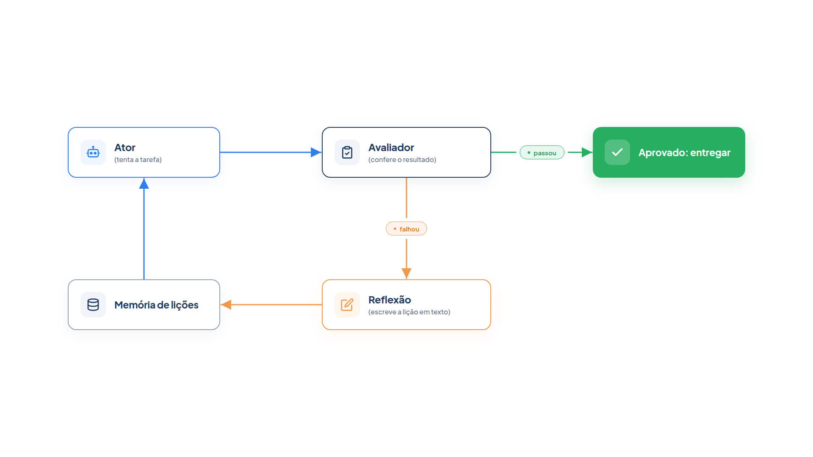

# Capítulo 7 — Aprender com os erros

Os capítulos anteriores fizeram o agente raciocinar melhor dentro de uma tentativa. Neste capítulo, você faz o agente melhorar *entre* tentativas. Quando uma tentativa falha, um avaliador aponta o problema, o agente escreve uma lição em texto e a usa na tentativa seguinte, sem treinar nem alterar o modelo. Ao final, você terá um ciclo com ator, avaliador e reflexão funcionando em poucas dezenas de linhas.



> **Antes de começar — PydanticAI neste capítulo**
>
> Neste capítulo você usa `Agent` (com `instructions=`), `.run_sync` e `.output`, além de `FunctionModel`, `ModelResponse` e `TextPart` nos testes sem API. Se algum deles não for familiar, revise o [Capítulo 0.4](../modulo-00/0.4-o-primeiro-agente-por-dentro.md) e o [Capítulo 0.5](../modulo-00/0.5-mensagens-e-testes-sem-api.md).

## O problema: repetir o mesmo erro

Um agente que tenta de novo, sem mais informação, tende a repetir o erro. Imagine que a Casa Verde exige uma regra que o agente não conhece: toda mensagem ao cliente termina com a assinatura "Equipe Casa Verde". Ninguém a mencionou na tarefa. Se o agente escrever sem a assinatura e for apenas mandado "tentar de novo", ele não tem como descobrir o que faltou.

A saída é transformar o resultado da tentativa em informação utilizável. O padrão **Reflexion** faz isso: o agente reflete, em linguagem natural, sobre o sinal de falha que recebeu, guarda essa reflexão em uma memória e a usa na tentativa seguinte. Os autores do padrão chamam isso de reforço verbal: em vez de ajustar os pesos do modelo, ajusta-se o *texto* que ele lê.

## Três papéis

O padrão separa o trabalho em três papéis:

- **Ator:** gera a tentativa, seja texto, ação ou código;
- **Avaliador:** pontua a tentativa e diz se ela passou;
- **Reflexão:** converte a falha em uma lição curta e acionável.

As lições se acumulam em uma **memória episódica**: um registro das experiências anteriores, que o ator consulta a cada nova tentativa. Reconheceu o conceito? É a memória de curto prazo do Capítulo 3, aplicada a lições em vez de mensagens. O Módulo 3 volta ao tema.

## Construindo o ciclo

Vamos montar o ciclo para uma tarefa curta: escrever ao cliente o status e a previsão do pedido 1002, em até 160 caracteres. O avaliador é código comum, pois as regras são verificáveis.

*reflexion.py*

```python
from pydantic_ai import Agent

from config import MODELO
from loja import buscar_pedido

PEDIDO = buscar_pedido("1002")
TAREFA = (
    "Escreva uma mensagem de até 160 caracteres para o cliente informando o "
    f"status e a previsão de entrega do pedido 1002. Dados: {PEDIDO}"
)

ator = Agent(
    MODELO,
    instructions="Você escreve mensagens de atendimento da loja Casa Verde. Responda apenas com a mensagem.",
)

reflexor = Agent(
    MODELO,
    instructions=(
        "Você recebe uma tarefa, a tentativa feita e as falhas apontadas. "
        "Escreva UMA lição curta, no imperativo, que ajude a próxima tentativa."
    ),
)


def avaliar(mensagem: str) -> list[str]:
    falhas = []
    if len(mensagem) > 160:
        falhas.append(f"a mensagem tem {len(mensagem)} caracteres; o limite é 160")
    if "15/10" not in mensagem:
        falhas.append("a previsão 15/10 não aparece")
    if not mensagem.rstrip().endswith("Equipe Casa Verde"):
        falhas.append("a mensagem não termina com a assinatura padrão da loja")
    return falhas


def resolver(max_tentativas: int = 3) -> str | None:
    licoes: list[str] = []
    for numero in range(1, max_tentativas + 1):
        prompt = TAREFA
        if licoes:
            prompt += "\n\nLições de tentativas anteriores:\n"
            prompt += "\n".join(f"- {licao}" for licao in licoes[-3:])

        tentativa = ator.run_sync(prompt).output
        falhas = avaliar(tentativa)
        print(f"Tentativa {numero}: {tentativa}")

        if not falhas:
            print("Aprovada.")
            return tentativa

        print("Falhas:", "; ".join(falhas))
        licao = reflexor.run_sync(
            f"Tarefa: {TAREFA}\nTentativa: {tentativa}\nFalhas: {'; '.join(falhas)}"
        ).output
        print("Lição:", licao)
        licoes.append(licao)

    print("Sem aprovação após", max_tentativas, "tentativas.")
    return None


if __name__ == "__main__":
    resolver()
```

Leia o arquivo em três blocos.

**Os agentes.** O `ator` escreve a mensagem. O `reflexor` recebe a tarefa, a tentativa e as falhas, e devolve uma lição. Os dois são agentes sem ferramentas, ou seja, chamadas únicas do Capítulo 4.

**O avaliador.** `avaliar` é uma função comum que devolve a lista de falhas, vazia quando a mensagem passa. Ela verifica o limite de caracteres, a presença da previsão e a assinatura. Um avaliador em código é preciso e barato, e você o prefere sempre que a regra for verificável. A regra da assinatura é a "regra oculta": o ator não a conhece até que a falha a revele.

**O laço.** `resolver` faz até `max_tentativas` tentativas. Em cada uma, monta o prompt com a tarefa e as últimas três lições (`licoes[-3:]`), obtém a tentativa, avalia e, em caso de falha, pede uma lição ao reflexor e a guarda. A memória é a lista `licoes`.

Para uma saída reproduzível, usamos modelos simulados: o ator só acerta quando o prompt contém lições.

*reflexion_simulado.py*

```python
from pydantic_ai import ModelResponse, TextPart
from pydantic_ai.models.function import AgentInfo, FunctionModel

import reflexion


def modelo_ator(mensagens, info: AgentInfo) -> ModelResponse:
    prompt = mensagens[-1].parts[0].content
    if "Lições de tentativas anteriores" in prompt:
        texto = "Seu pedido 1002 está em separação e chega em 15/10. Equipe Casa Verde"
    else:
        texto = "Seu pedido 1002 está em separação e chega em 15/10."
    return ModelResponse(parts=[TextPart(texto)])


def modelo_reflexor(mensagens, info: AgentInfo) -> ModelResponse:
    return ModelResponse(parts=[TextPart("Termine toda mensagem com a assinatura 'Equipe Casa Verde'.")])


with reflexion.ator.override(model=FunctionModel(modelo_ator)), \
        reflexion.reflexor.override(model=FunctionModel(modelo_reflexor)):
    reflexion.resolver()
```

Saída:

```text
Tentativa 1: Seu pedido 1002 está em separação e chega em 15/10.
Falhas: a mensagem não termina com a assinatura padrão da loja
Lição: Termine toda mensagem com a assinatura 'Equipe Casa Verde'.
Tentativa 2: Seu pedido 1002 está em separação e chega em 15/10. Equipe Casa Verde
Aprovada.
```

A primeira tentativa atendeu a tarefa, mas violou a regra oculta. O avaliador apontou a falha; o reflexor a transformou em uma lição; a segunda tentativa, já lendo a lição, passou. Nada no modelo mudou: o aprendizado está inteiramente no prompt da segunda tentativa.

Execute `python reflexion.py` com o modelo real. É possível que o ator acerte de primeira por sorte, e você não veja nenhuma reflexão. Nesse caso, acrescente uma regra oculta a `avaliar`, como "não usar a palavra 'infelizmente'", e repita.

### Como o modelo simulado lê o prompt

Em `modelo_ator`, a linha `mensagens[-1].parts[0].content` é o ponto em que um iniciante costuma travar. Para ver o que ela percorre, execute um modelo simulado que apenas imprime o que recebe:

*inspecionando_mensagens.py*

```python
from pydantic_ai import Agent, ModelResponse, TextPart
from pydantic_ai.models.function import AgentInfo, FunctionModel


def modelo_espiao(mensagens, info: AgentInfo) -> ModelResponse:
    print("Mensagens recebidas:", len(mensagens))
    ultima = mensagens[-1]
    print("Tipo da última:", type(ultima).__name__)
    print("Partes:", [type(parte).__name__ for parte in ultima.parts])
    print("Conteúdo:", ultima.parts[0].content)
    return ModelResponse(parts=[TextPart("ok")])


agente = Agent(FunctionModel(modelo_espiao), instructions="Seja breve.")
print(agente.run_sync("Olá, loja").output)
```

Saída:

```text
Mensagens recebidas: 1
Tipo da última: ModelRequest
Partes: ['UserPromptPart']
Conteúdo: Olá, loja
ok
```

O `FunctionModel` chama sua função a cada rodada com a lista `mensagens` (o histórico da conversa) e um `AgentInfo`. Na primeira rodada, a lista tem uma só mensagem, um `ModelRequest`, e `parts[0]` é o `UserPromptPart` com o texto que você passou a `run_sync`. Por isso `modelo_ator` encontra ali a frase "Lições de tentativas anteriores" quando `resolver` a coloca no prompt. A função devolve um `ModelResponse` com um `TextPart`, e esse texto vira o `.output` do agente.

Dois detalhes ajudam a evitar confusão. As `instructions` do agente não aparecem em `parts`: ficam no atributo `instructions` do `ModelRequest`. E `.override(model=...)`, usado em `reflexion_simulado.py`, troca o modelo só dentro do bloco `with`; o `reflexion.py` continua com o modelo real fora dele.

### Por que a lição vale mais que a falha bruta

Compare duas formas de dar o retorno ao ator: "falhou" e "Termine toda mensagem com a assinatura 'Equipe Casa Verde'". A primeira informa o resultado; a segunda diz o que fazer. Os autores do padrão descrevem a reflexão como um sinal de gradiente "semântico": uma direção concreta de melhoria, no lugar de um número. Por isso o reflexor existe como um agente à parte: sua função é traduzir falhas em ações.

### Faça você mesmo

- **7.1 Execução real:** execute `reflexion.py` com o modelo real. Se o ator acertar de primeira, acrescente uma regra oculta ao avaliador até provocar uma falha. Anote a lição que o reflexor escreveu.
- **7.2 Segunda regra:** adicione a `avaliar` a regra "a mensagem deve começar com 'Olá'". Preveja quantas tentativas serão necessárias e confira.
- **7.3 Sem reflexão:** altere `resolver` para não incluir as lições no prompt. Descreva o que acontece com as tentativas e por quê.

## Limites do padrão

O Reflexion não é um truque gratuito, e conhecer seus limites evita decepção.

### O avaliador define o teto

O ciclo só melhora o que o avaliador consegue enxergar. Com um avaliador em código, como o nosso, o sinal é confiável. Quando a regra não é verificável por código — por exemplo, "o tom é cordial" —, o avaliador passa a ser outro modelo, e o ciclo herda os erros dele: o artigo original reconhece que o método depende da capacidade de autoavaliação do modelo e não oferece garantia formal de sucesso.

### A memória cresce

Cada falha acrescenta uma lição. Sem controle, o prompt do ator incha, o que custa tokens e dilui a atenção do modelo. Nosso código usa uma janela deslizante simples, `licoes[-3:]`, que mantém só as três mais recentes. O Módulo 3 trata de estratégias melhores.

### O ciclo precisa parar

`max_tentativas` é o ponto de parada de sempre. Sem ele, uma tarefa impossível, ou um avaliador mal escrito que reprova tudo, geraria tentativas e chamadas sem fim. Quando as tentativas esgotam, `resolver` devolve `None`, e o código que a chamou decide o que fazer: escalar para uma pessoa, por exemplo.

### Quando vale a pena

Nos experimentos do artigo, agentes com reflexão superaram a linha de base em decisões sequenciais, em perguntas de raciocínio e em programação. Em programação, atingiram 91% de acerto no teste HumanEval, contra 80% do melhor resultado anterior com o GPT-4. Em todos os casos havia um sinal de avaliação claro: o resultado de um ambiente, uma checagem, testes. Use o padrão onde esse sinal existir.

### Faça você mesmo

- **7.4 Janela de lições:** altere `max_tentativas` para 5 e adicione quatro regras ocultas ao avaliador. Observe se a janela de três lições é suficiente e descreva o que se perde quando uma lição sai dela.
- **7.5 Tarefa impossível:** adicione uma regra contraditória (por exemplo, limite de 20 caracteres) e execute. Descreva o que `resolver` devolve e como o código chamador deveria reagir.
- **7.6 Avaliador por modelo:** reescreva `avaliar` para que um terceiro agente julgue se a mensagem é cordial, devolvendo uma lista de falhas. Compare a estabilidade do veredito com a das regras em código ao repetir a mesma mensagem cinco vezes.

## Recapitulando

Você agora sabe fazer um agente aprender com a experiência sem alterar o modelo: o ator tenta, o avaliador confere, o reflexor transforma a falha em lição e a lição entra na tentativa seguinte, guardada em uma memória episódica. Também conhece os limites do padrão: o avaliador define o teto, a memória cresce e o ciclo precisa de um ponto de parada.

Com isso, o Módulo 2 está completo. Você escreveu o ciclo de raciocínio e ação, aprendeu a pagar por mais raciocínio apenas quando compensa e fechou o ciclo de correção. Um problema comum a todas as técnicas, porém, ficou em segundo plano: tudo o que o agente lê — instruções, observações, lições, histórico — ocupa um espaço finito. O próximo módulo trata de como gerenciar esse espaço, que é o centro da engenharia de contexto e de memória.

### Fontes do capítulo

- Shinn et al. — [Reflexion: Language Agents with Verbal Reinforcement Learning](https://arxiv.org/abs/2303.11366) (2023): ator, avaliador e autorreflexão; memória episódica de reflexões; limitações; resultados em HumanEval, ALFWorld e HotPotQA.
- Documentação do PydanticAI: *Agentes* e *Saída*.
