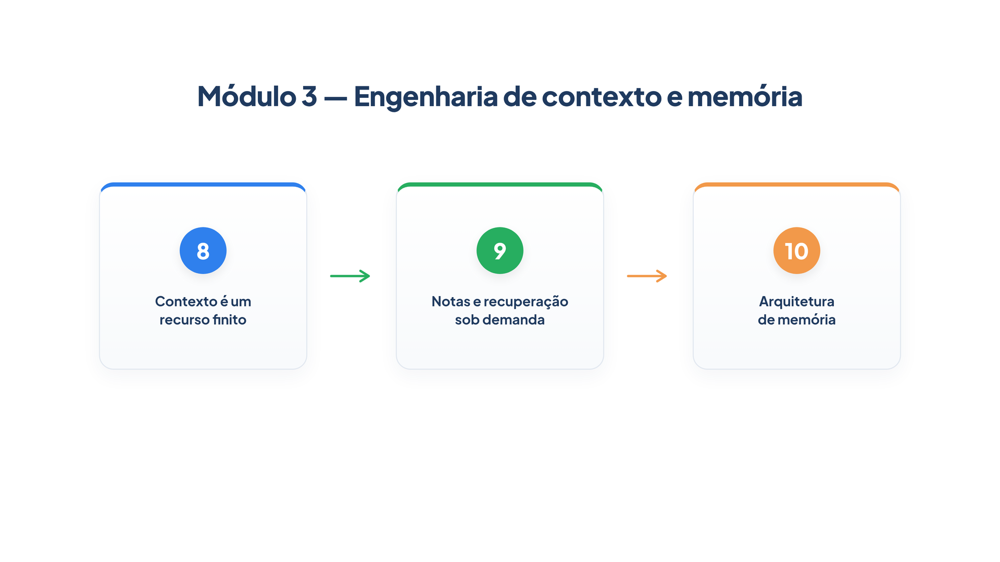

# Módulo 3 — Engenharia de contexto e memória

Tudo o que um agente lê antes de decidir — instruções, histórico, resultados de ferramentas, lições, notas — ocupa um espaço limitado e disputa a atenção do modelo. Este módulo trata desse espaço como o recurso escasso que ele é. Ao final dele, você será capaz de:

- medir o crescimento do contexto e contê-lo com poda e resumo;
- guardar informação fora da janela, com anotações, recuperação sob demanda e subagentes;
- desenhar a memória de um agente em camadas, de curto e de longo prazo, com extração e consolidação de fatos.

## Percurso

1. **Capítulo 8 — Contexto é um recurso finito.** Você mede como o contexto cresce a cada turno e o reduz limpando resultados antigos e resumindo a conversa, com processadores de histórico.
2. **Capítulo 9 — Notas e recuperação sob demanda.** Você dá ao agente um caderno de notas, uma lista leve com ferramenta de detalhe e um subagente que devolve apenas resumos.
3. **Capítulo 10 — Arquitetura de memória.** Você organiza a memória nos quatro tipos da arquitetura CoALA e implementa as camadas de curto e longo prazo.

Os arquivos `config.py`, `loja.py` e `trajetoria.py` do Módulo 3 estendem os do módulo anterior; use a pasta `codigo/` deste módulo. Vários exemplos usam modelos simulados, com um arquivo de apoio, `modelo_atendente.py`, que você pode ignorar: ele existe apenas para que as saídas sejam reproduzíveis.

> **Nota:** Os números de tokens mostrados nas saídas vêm do modelo simulado. Com um modelo real, os valores exatos serão outros, mas a forma da curva — crescimento linear sem poda, estabilização com poda — é a mesma.
