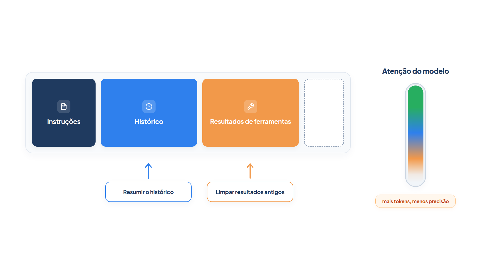

# Capítulo 8 — Contexto é um recurso finito

Nos módulos anteriores, o agente leu a pergunta, chamou ferramentas e respondeu. Funcionou porque as conversas eram curtas. Neste capítulo, você descobre o que acontece quando elas não são: o contexto que o modelo lê cresce a cada volta, fica caro e passa a prejudicar a qualidade das respostas. Você aprende a medir esse crescimento e a contê-lo com duas técnicas de poda, uma leve e outra mais agressiva.



> **Antes de começar — PydanticAI neste capítulo**
>
> Neste capítulo você usa `.run`, `.input_tokens`, `ModelMessage`, `ModelRequest`, `async def` e `await`. Se algum deles não for familiar, revise o [Capítulo 0.4](../modulo-00/0.4-o-primeiro-agente-por-dentro.md) (`.run`, `.input_tokens`), o [Capítulo 0.5](../modulo-00/0.5-mensagens-e-testes-sem-api.md) (`ModelMessage`, `ModelRequest`) e o [Capítulo 0.2](../modulo-00/0.2-o-python-que-o-livro-assume.md) (`async def`, `await`).

## O que entra na janela de contexto

O **contexto** é o conjunto de tokens que o modelo recebe em cada chamada: as instruções, a descrição das ferramentas, o histórico de mensagens e os resultados de ferramentas. A **janela de contexto** é o limite de tokens que cabe em uma chamada. Um agente que roda em ciclo gera, a cada volta, mais dados que *poderiam* ser úteis na volta seguinte. A **engenharia de contexto** é a prática de curar o que entra nessa janela, a cada chamada, para manter só o que ajuda.

A palavra "curar" importa. Não basta caber na janela. Estudos com testes de recuperação de informação em textos longos mostram o fenômeno chamado *context rot* (deterioração do contexto): à medida que o número de tokens cresce, a capacidade do modelo de recuperar com precisão uma informação daquele contexto diminui. A causa está na arquitetura dos modelos atuais, em que cada token se relaciona com todos os outros; com mais tokens, essas relações ficam sobrecarregadas. Pense no contexto como um orçamento de atenção: cada token novo consome uma parte dele.

O princípio que decorre disso orienta o resto do módulo: **procure o menor conjunto de tokens de alto sinal que torne provável o resultado desejado**.

## Medindo o crescimento

Antes de podar, vamos medir. A Casa Verde agora devolve, junto com o status do pedido, o rastreio completo, com uma linha por movimentação. Veja a nova versão do atendente. Ela cria o agente por meio de uma função, `criar_agente`, para que possamos montar variações dele nas próximas seções.

*atendimento.py*

```python
from pydantic_ai import Agent

from config import MODELO
from loja import buscar_pedido, buscar_rastreio


def consultar_pedido(codigo: str) -> str:
    """Consulta o status e o rastreio de um pedido pelo código de quatro dígitos."""
    pedido = buscar_pedido(codigo)
    if pedido is None:
        return "Pedido não encontrado."
    return f"{pedido}\n{buscar_rastreio(codigo)}"


def criar_agente(**opcoes) -> Agent:
    return Agent(
        MODELO,
        instructions=(
            "Você atende clientes da loja Casa Verde. Consulte o pedido antes de "
            "responder e nunca invente dados. Responda em até duas frases."
        ),
        tools=[consultar_pedido],
        **opcoes,
    )


agente = criar_agente()
```

O arquivo `loja.py` do Módulo 3 ganhou a função `buscar_rastreio`, que devolve doze linhas de movimentação por pedido. Para observar o crescimento com saída reproduzível, usamos um modelo simulado que consulta o pedido citado na pergunta e responde com a primeira linha do resultado, e uma função auxiliar que conduz uma conversa e imprime o tamanho do contexto a cada turno.

*sessao.py*

```python
from pydantic_ai.models.function import FunctionModel

from modelo_atendente import modelo_atendente

PERGUNTAS = [
    "Onde está o pedido 1001?",
    "E o pedido 1002?",
    "E o pedido 1003?",
    "Voltando ao 1001, quando chega?",
    "E o 1002, quando chega?",
]


def conversar(agente, perguntas=PERGUNTAS):
    historico = []
    for numero, pergunta in enumerate(perguntas, start=1):
        resultado = agente.run_sync(
            pergunta, model=FunctionModel(modelo_atendente), message_history=historico
        )
        historico = resultado.all_messages()
        print(f"Turno {numero}: {len(historico):2d} mensagens, {resultado.usage.input_tokens} tokens de entrada")
    return historico
```

*crescimento.py*

```python
from atendimento import agente
from sessao import conversar

conversar(agente)
```

(O arquivo `modelo_atendente.py`, que simula o modelo, está na pasta `codigo/` do módulo. Ele não ensina nada novo; você pode ignorá-lo.)

Saída:

```text
Turno 1:  4 mensagens, 273 tokens de entrada
Turno 2:  8 mensagens, 608 tokens de entrada
Turno 3: 12 mensagens, 945 tokens de entrada
Turno 4: 16 mensagens, 1283 tokens de entrada
Turno 5: 20 mensagens, 1620 tokens de entrada
```

Cada turno carrega todo o histórico anterior, então o custo cresce em linha reta: de 273 para 1.620 tokens em cinco perguntas. Os números absolutos são pequenos aqui; em uma conversa real, com resultados de ferramentas maiores, o mesmo padrão chega ao limite da janela.

Perceba também *o que* pesa. A maior parte do contexto são as linhas de rastreio devolvidas pela ferramenta. O modelo precisou delas apenas no turno em que foram consultadas.

> **Nota:** `resultado.usage.input_tokens` soma os tokens de entrada de todas as chamadas ao modelo feitas durante aquele turno (aqui, duas). Com um modelo real, os números diferem, mas a curva é a mesma.

### Faça você mesmo

- **8.1 Mais um turno:** acrescente duas perguntas a `PERGUNTAS` e preveja os tokens do turno 7 antes de executar. Confira a previsão.
- **8.2 Rastreio menor:** reduza `buscar_rastreio` para três linhas por pedido. Descreva como mudou a inclinação da curva.

## Poda leve: limpar resultados antigos

A forma mais segura de aliviar o contexto é esquecer os resultados de ferramentas que o agente já usou. Uma vez que a ferramenta foi chamada e o modelo respondeu com base nela, ele raramente precisa ver o resultado bruto de novo.

O PydanticAI oferece um ponto de intervenção exato para isso: o *processador de histórico*. Ele é uma função que recebe a lista de mensagens antes de cada chamada ao modelo e devolve a lista que o modelo realmente verá. Você o registra com `ProcessHistory`.

*limpeza.py*

```python
from dataclasses import replace

from pydantic_ai import ModelMessage, ModelRequest
from pydantic_ai.capabilities import ProcessHistory
from pydantic_ai.messages import ToolReturnPart, UserPromptPart

from atendimento import criar_agente
from sessao import conversar

TURNOS_RECENTES = 1


def inicio_do_turno(mensagens: list[ModelMessage], turnos: int) -> int:
    """Índice da mensagem em que começa o N-ésimo turno, contando do fim."""
    encontrados = 0
    for indice in range(len(mensagens) - 1, -1, -1):
        mensagem = mensagens[indice]
        if isinstance(mensagem, ModelRequest) and any(
            isinstance(parte, UserPromptPart) for parte in mensagem.parts
        ):
            encontrados += 1
            if encontrados == turnos:
                return indice
    return 0


def limpar_resultados(mensagens: list[ModelMessage]) -> list[ModelMessage]:
    corte = inicio_do_turno(mensagens, TURNOS_RECENTES + 1)
    limpas = []
    for indice, mensagem in enumerate(mensagens):
        if indice < corte and isinstance(mensagem, ModelRequest):
            partes = [
                replace(parte, content="[resultado omitido]")
                if isinstance(parte, ToolReturnPart)
                else parte
                for parte in mensagem.parts
            ]
            mensagem = replace(mensagem, parts=partes)
        limpas.append(mensagem)
    return limpas


agente_enxuto = criar_agente(capabilities=[ProcessHistory(limpar_resultados)])

if __name__ == "__main__":
    conversar(agente_enxuto)
```

Duas funções fazem o trabalho.

`inicio_do_turno` localiza onde começa um *turno*: a sequência que se inicia com a mensagem do cliente e vai até a resposta do atendente, incluindo as chamadas de ferramenta no meio. Ela anda do fim para o começo e devolve o índice do N-ésimo turno.

`limpar_resultados` usa esse índice como linha de corte. Em todas as mensagens anteriores ao corte, substitui o conteúdo de cada resultado de ferramenta por `[resultado omitido]`. O restante, incluindo as perguntas, as respostas e as próprias chamadas, permanece.

> **Por dentro do PydanticAI — `ProcessHistory`**
>
> **O que é:** uma *capability* (extensão que você pluga no agente) que executa uma função sua sobre a lista de mensagens antes de cada chamada ao modelo.
> **Como funciona aqui:** em `criar_agente`, `capabilities=[ProcessHistory(limpar_resultados)]` registra a função. Ela recebe a lista de `ModelMessage` e devolve a lista que o modelo vai ler. Pode ser `def` comum, como `limpar_resultados`, ou `async def`, como `compactar`.
> **O que o PydanticAI faz por você:** chama o processador a cada volta do ciclo e grava o resultado no histórico da execução. Por isso o `historico[0]` do exemplo da compactação já começa pelo resumo.
> **Cuidado:** a função roda em toda chamada ao modelo, não uma vez por turno. Uma pergunta com ferramenta dispara duas chamadas, e o processador roda duas vezes.

Para ver isso acontecer, o arquivo abaixo só observa o que o processador recebe, sem alterar nada. A ferramenta faz o agente chamar o modelo duas vezes em uma única pergunta.

*historico_espiao.py*

```python
from pydantic_ai import Agent, ModelMessage
from pydantic_ai.capabilities import ProcessHistory
from pydantic_ai.models.test import TestModel


def espiar(mensagens: list[ModelMessage]) -> list[ModelMessage]:
    print(f"O modelo vai receber {len(mensagens)} mensagens")
    return mensagens


agente = Agent(TestModel(), capabilities=[ProcessHistory(espiar)])


@agente.tool_plain
def consultar_pedido(codigo: str) -> str:
    return "Pedido enviado."


resultado = agente.run_sync("Onde está o pedido 1001?")
print(f"Histórico final: {len(resultado.all_messages())} mensagens")
```

Saída:

```text
O modelo vai receber 1 mensagens
O modelo vai receber 3 mensagens
Histórico final: 4 mensagens
```

Na primeira chamada só existe a pergunta. Na segunda, a lista já inclui a chamada da ferramenta e o seu resultado.

Compare com a curva anterior:

```text
Turno 1:  4 mensagens, 273 tokens de entrada
Turno 2:  8 mensagens, 608 tokens de entrada
Turno 3: 12 mensagens, 623 tokens de entrada
Turno 4: 16 mensagens, 637 tokens de entrada
Turno 5: 20 mensagens, 648 tokens de entrada
```

A partir do turno 3, o custo praticamente para de crescer: 648 tokens no turno 5, contra 1.620 sem a poda. O número de mensagens continua o mesmo; o que encolheu foi o peso de cada uma.

### Armadilha: separar a chamada do seu resultado

Repare que nunca removemos uma chamada de ferramenta nem o seu resultado: só trocamos o *conteúdo* do resultado. Os provedores de modelo exigem que toda chamada de ferramenta tenha o resultado correspondente. Se um processador apagar um lado do par, a chamada seguinte ao modelo falha. A regra é: ao podar, esvazie o conteúdo, mas preserve a estrutura, e corte em fronteiras de turno.

### Faça você mesmo

- **8.3 Turnos recentes:** altere `TURNOS_RECENTES` para 2 e execute. Descreva a mudança nos tokens e explique por quê.
- **8.4 Resultado conciso:** em vez de `[resultado omitido]`, substitua o conteúdo pela primeira linha do resultado. Compare os tokens com os da versão original.
- **8.5 Quando não limpar:** cite um caso do atendimento da Casa Verde em que o agente precisaria reler um resultado antigo, e diga como a poda leve atrapalharia.

## Compactação: resumir o que ficou para trás

Quando a conversa é longa, limpar resultados não basta: as perguntas e respostas também se acumulam. A **compactação** pega o histórico antigo, resume-o e o substitui pelo resumo, mantendo o início do trabalho em poucas linhas e as últimas trocas intactas.

*compactacao.py*

```python
from dataclasses import replace

from pydantic_ai import Agent, ModelMessage, ModelRequest, ModelResponse, TextPart
from pydantic_ai.capabilities import ProcessHistory
from pydantic_ai.messages import ToolReturnPart, UserPromptPart

from atendimento import criar_agente
from config import MODELO
from limpeza import inicio_do_turno
from sessao import conversar

LIMITE_MENSAGENS = 8
MANTER_TURNOS = 2

resumidor = Agent(
    MODELO,
    instructions=(
        "Resuma a conversa de atendimento abaixo para que outro atendente possa "
        "continuar. Preserve os códigos de pedido citados, os status e datas "
        "informados, pedidos do cliente ainda sem resposta e decisões tomadas. "
        "Descarte cumprimentos e dados repetidos. Use no máximo 6 linhas."
    ),
)


def transcrever(mensagens: list[ModelMessage]) -> str:
    linhas = []
    for mensagem in mensagens:
        for parte in mensagem.parts:
            if isinstance(parte, UserPromptPart):
                linhas.append(f"Cliente: {parte.content}")
            elif isinstance(parte, ToolReturnPart):
                linhas.append(f"Sistema: {str(parte.content).splitlines()[0]}")
            elif isinstance(parte, TextPart):
                linhas.append(f"Atendente: {parte.content}")
    return "\n".join(linhas)


async def compactar(mensagens: list[ModelMessage]) -> list[ModelMessage]:
    if len(mensagens) <= LIMITE_MENSAGENS:
        return mensagens
    corte = inicio_do_turno(mensagens, MANTER_TURNOS)
    if corte == 0:
        return mensagens

    resumo = (await resumidor.run(transcrever(mensagens[:corte]))).output
    primeira = mensagens[corte]
    nota = UserPromptPart(f"[Resumo da conversa até aqui]\n{resumo}")
    return [replace(primeira, parts=[nota, *primeira.parts])] + mensagens[corte + 1 :]


agente_compacto = criar_agente(capabilities=[ProcessHistory(compactar)])

if __name__ == "__main__":
    conversar(agente_compacto)
```

Siga o fluxo de `compactar`:

1. Se a conversa tem até `LIMITE_MENSAGENS` mensagens, devolve-a sem alteração.
2. Calcula o `corte` com a função `inicio_do_turno` do arquivo anterior, preservando os dois turnos mais recentes.
3. Transforma as mensagens anteriores ao corte em uma transcrição de texto (`transcrever`) e pede ao `resumidor` um resumo.
4. Cria uma nota com o resumo e a coloca no início da primeira mensagem preservada.
5. Devolve essa mensagem seguida do restante da conversa.

O `resumidor` é uma chamada única (Capítulo 4), sem ferramentas. É possível usar um modelo menor e mais barato para ele. A função é `async` porque chama `resumidor.run`, a versão assíncrona de `run_sync`.

Com um modelo simulado que devolve um resumo fixo:

*compactacao_simulada.py*

```python
from pydantic_ai import ModelResponse, TextPart
from pydantic_ai.models.function import AgentInfo, FunctionModel

import compactacao
from sessao import conversar


def modelo_resumidor(mensagens, info: AgentInfo) -> ModelResponse:
    texto = (
        "Pedido 1001 enviado, previsão 12/10. Pedido 1002 em separação, previsão 15/10. "
        "Pedido 1003 entregue. Nenhuma pendência."
    )
    return ModelResponse(parts=[TextPart(texto)])


with compactacao.resumidor.override(model=FunctionModel(modelo_resumidor)):
    historico = conversar(compactacao.agente_compacto)
print()
print(historico[0].parts[0].content)
```

Saída:

```text
Turno 1:  4 mensagens, 273 tokens de entrada
Turno 2:  8 mensagens, 608 tokens de entrada
Turno 3:  8 mensagens, 653 tokens de entrada
Turno 4:  8 mensagens, 655 tokens de entrada
Turno 5:  8 mensagens, 654 tokens de entrada

[Resumo da conversa até aqui]
Pedido 1001 enviado, previsão 12/10. Pedido 1002 em separação, previsão 15/10. Pedido 1003 entregue. Nenhuma pendência.
```

Agora *as duas coisas* param de crescer: o número de mensagens fica em 8 e o custo em torno de 650 tokens. A última linha mostra o resultado da compactação: o histórico passa a começar com o resumo.

### O que a compactação pode perder

O resumo é uma compressão com perda. A compactação agressiva demais descarta detalhes sutis cuja importância só aparece depois: um número de pedido, uma preferência dita de passagem, uma promessa feita ao cliente. Por isso, a instrução do `resumidor` enumera o que *deve* sobreviver. Um procedimento seguro para calibrar essa instrução é começar maximizando a **revocação** (o resumo não pode esquecer nada relevante), e só depois refinar a **precisão** (cortar o supérfluo).

### Faça você mesmo

- **8.6 Resumo real:** execute `compactacao.py` com o modelo real e leia o resumo gerado. Aponte uma informação do histórico que o resumo perdeu ou distorceu.
- **8.7 Instrução melhor:** acrescente à instrução do `resumidor` a regra de preservar as promessas feitas ao cliente. Escreva uma pergunta de teste que dependa dessa regra.
- **8.8 Gatilho por tamanho:** reescreva `compactar` para decidir pelo tamanho do texto transcrito (por exemplo, mais de 2.000 caracteres) em vez do número de mensagens. Explique a vantagem.

## Qual das duas técnicas usar?

| Situação | Técnica |
| --- | --- |
| Resultados de ferramentas grandes e já consumidos | Limpar resultados (primeira escolha: simples e seguro) |
| Conversa longa, com vai e volta frequente | Compactação por resumo |
| As duas ocorrem | Limpar primeiro; compactar quando ainda for preciso |

Comece pela poda leve. Só recorra à compactação quando a leve não bastar, porque o resumo é a única das duas técnicas que pode perder informação importante.

## Recapitulando

Você agora sabe que o contexto é um recurso finito: cresce a cada turno, custa mais e perde precisão conforme enche. Você mediu esse crescimento, reduziu-o limpando resultados antigos de ferramentas e o estancou resumindo a conversa, usando processadores de histórico, e aprendeu os dois cuidados principais: não separar chamadas de seus resultados e dizer ao resumo o que ele não pode esquecer.

As duas técnicas descartam informação. Mas e se o agente precisar dela de novo, horas ou sessões depois? O Capítulo 9 mostra como o agente guarda o que importa *fora* da janela e como busca dados só quando precisa deles.

### Fontes do capítulo

- Anthropic — [Effective Context Engineering for AI Agents](https://www.anthropic.com/engineering/effective-context-engineering-for-ai-agents): definição de engenharia de contexto; *context rot* e orçamento de atenção; compactação, incluindo a limpeza de resultados de ferramentas como forma leve; calibração do resumo por revocação e depois precisão.
- Documentação do PydanticAI: *Mensagens e histórico de bate-papo* (processadores de histórico).
