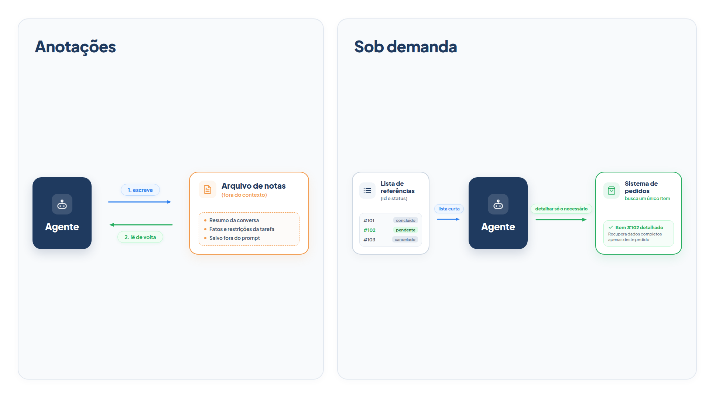

# Capítulo 9 — Notas e recuperação sob demanda

No Capítulo 8, você podou o contexto: limpou resultados antigos e resumiu a conversa. As duas técnicas *descartam* informação. Neste capítulo, você aprende o complemento: guardar o que importa *fora* da janela e trazê-lo de volta só quando necessário. Serão três recursos — anotações persistentes, recuperação sob demanda e subagentes — todos baseados na mesma ideia: o agente não precisa carregar tudo na cabeça se souber onde encontrar.



> **Antes de começar — PydanticAI neste capítulo**
>
> Neste capítulo você usa `Agent(deps_type=)`, `.deps`, `RunContext` e `RunContext[...]`, `@tool`, `.tool`, `@instructions` e `.instructions`. Se algum deles não for familiar, revise o [Capítulo 0.6](../modulo-00/0.6-ferramentas-e-saida-tipada.md) (ferramentas) e o [Capítulo 0.7](../modulo-00/0.7-dependencias-e-contexto.md) (dependências e contexto). A classe `Caderno` é um `@dataclass`, assunto do [Capítulo 0.2](../modulo-00/0.2-o-python-que-o-livro-assume.md).

## Anotações: memória fora da janela

Compactar uma conversa é uma boa forma de continuar, mas o resumo é produzido por um modelo, no momento do corte, e pode esquecer algo. Há uma alternativa: o próprio agente escreve **notas** enquanto trabalha, em um lugar fora do contexto, e as relê quando precisa. Pense em um atendente humano que anota no sistema o que combinou com o cliente. No próximo contato, ele abre as notas em vez de reler toda a conversa.

Vamos dar ao atendente da Casa Verde um caderno em arquivo e uma ferramenta para escrever nele.

*notas.py*

```python
import json
from dataclasses import dataclass
from pathlib import Path

from pydantic_ai import Agent, RunContext

from config import MODELO


@dataclass
class Caderno:
    arquivo: Path

    def ler(self) -> list[str]:
        if not self.arquivo.exists():
            return []
        return json.loads(self.arquivo.read_text())

    def anotar(self, texto: str) -> None:
        notas = self.ler() + [texto]
        self.arquivo.write_text(json.dumps(notas, ensure_ascii=False))


agente = Agent(
    MODELO,
    deps_type=Caderno,
    instructions=(
        "Você atende clientes da loja Casa Verde. Use `anotar` para registrar "
        "decisões, promessas e preferências do cliente que precisem ser "
        "lembradas em atendimentos futuros. Responda em até duas frases."
    ),
)


@agente.instructions
def notas_anteriores(ctx: RunContext[Caderno]) -> str:
    notas = ctx.deps.ler()
    if not notas:
        return ""
    return "Notas de atendimentos anteriores:\n" + "\n".join(f"- {nota}" for nota in notas)


@agente.tool
def anotar(ctx: RunContext[Caderno], texto: str) -> str:
    """Guarda uma nota curta para ser lembrada em atendimentos futuros."""
    ctx.deps.anotar(texto)
    return "Nota registrada."
```

Há três novidades neste arquivo.

A primeira é `deps_type=Caderno`. Uma *dependência* é um objeto que você entrega ao agente em cada execução, sem que ele apareça no prompt. Aqui, ela leva o caminho do arquivo de notas. Quem quiser trocar o arquivo por um banco de dados, em produção, só muda a classe `Caderno`.

A segunda é `@agente.tool`, que difere de `@agente.tool_plain` por receber o `RunContext`, de onde a ferramenta lê `ctx.deps`. A função `anotar` usa isso para chegar ao caderno.

A terceira é `@agente.instructions`, uma *instrução dinâmica*: uma função executada a cada chamada ao modelo, cujo texto devolvido é acrescentado às instruções. A nossa lê o caderno e, se houver notas, as injeta. É assim que as notas voltam à janela: por escolha do código, a cada chamada.

Vamos executar duas sessões independentes, com o histórico de mensagens vazio na segunda. O modelo simulado da primeira sessão anota o combinado; o da segunda imprime as instruções que recebeu.

*notas_simulado.py*

```python
import tempfile
from pathlib import Path

from pydantic_ai import ModelResponse, TextPart, ToolCallPart
from pydantic_ai.messages import ToolReturnPart
from pydantic_ai.models.function import AgentInfo, FunctionModel

from notas import Caderno, agente


def primeira_sessao(mensagens, info: AgentInfo) -> ModelResponse:
    if isinstance(mensagens[-1].parts[-1], ToolReturnPart):
        return ModelResponse(parts=[TextPart("Combinado: reenviaremos o pedido 1002 em 20/10.")])
    return ModelResponse(parts=[ToolCallPart("anotar", {
        "texto": "Cliente Lia: reenvio do pedido 1002 combinado para 20/10, entregar à tarde."
    })])


def segunda_sessao(mensagens, info: AgentInfo) -> ModelResponse:
    print("Instruções recebidas pelo modelo:")
    print(mensagens[-1].instructions)
    return ModelResponse(parts=[TextPart("O reenvio do pedido 1002 está marcado para 20/10, à tarde.")])


caderno = Caderno(Path(tempfile.mkdtemp()) / "notas.json")

print("== Sessão 1")
print(agente.run_sync("Preciso que reenviem o pedido 1002 no dia 20, à tarde.",
                      model=FunctionModel(primeira_sessao), deps=caderno).output)

print("\n== Sessão 2 (histórico vazio)")
print(agente.run_sync("Quando vai ser o reenvio?",
                      model=FunctionModel(segunda_sessao), deps=caderno).output)
```

Saída:

```text
== Sessão 1
Combinado: reenviaremos o pedido 1002 em 20/10.

== Sessão 2 (histórico vazio)
Instruções recebidas pelo modelo:
Você atende clientes da loja Casa Verde. Use `anotar` para registrar decisões, promessas e preferências do cliente que precisem ser lembradas em atendimentos futuros. Responda em até duas frases.

Notas de atendimentos anteriores:
- Cliente Lia: reenvio do pedido 1002 combinado para 20/10, entregar à tarde.
O reenvio do pedido 1002 está marcado para 20/10, à tarde.
```

Na segunda sessão, o histórico está vazio, mas a nota escrita na primeira chegou ao modelo pelas instruções. Ele respondeu sobre o reenvio sem que ninguém repetisse a informação. Uma nota custa poucas dezenas de tokens, e o resumo da conversa inteira custaria muito mais.

Essa técnica é a **anotação estruturada**: o agente escreve notas persistidas fora da janela, que são trazidas de volta em momentos posteriores. É adequada a trabalhos com marcos claros, em que o agente precisa lembrar o progresso, os compromissos e as dependências ao longo de muitas chamadas.

### O que vale a pena anotar

Notas ruins são tão ruins quanto resumos ruins. Escreva na instrução o que anotar: decisões, promessas, preferências, pendências. E o que *não* anotar: o conteúdo bruto de resultados de ferramentas, que o agente pode consultar de novo. Notas curtas e datáveis envelhecem melhor que parágrafos.

### Faça você mesmo

- **9.1 Execução real:** execute duas sessões consecutivas com o modelo real e o mesmo `Caderno`. Na primeira, peça um reenvio; na segunda, pergunte pelo combinado. Abra o arquivo de notas e leia o que o agente escreveu.
- **9.2 Nota por cliente:** altere `Caderno` para receber o nome do cliente e gravar um arquivo por cliente. Explique por que isso é necessário em um atendimento real.
- **9.3 Poda de notas:** acrescente a `Caderno` um limite de 20 notas, descartando as mais antigas. Aponte um risco dessa política.

## Recuperação sob demanda

Há outra forma de não carregar tudo: em vez de pôr todos os dados na janela de antemão, o agente mantém *referências leves* (códigos, caminhos, links) e usa ferramentas para carregar os dados só quando precisa deles. Esta é a recuperação *just-in-time*, ou sob demanda. É como um bibliotecário: ele não decora os livros; conhece o catálogo e busca o volume certo.

Considere a cliente Lia, que tem 40 pedidos. Vamos comparar duas formas de entregar esses dados ao agente.

*sob_demanda.py*

```python
from pydantic_ai import Agent

from config import MODELO
from loja import PEDIDOS_POR_CLIENTE


def listar_pedidos(cliente: str) -> str:
    """Lista os pedidos de um cliente (código, status e data). Para ver os itens, use detalhar_pedido."""
    pedidos = PEDIDOS_POR_CLIENTE.get(cliente, {})
    return "\n".join(f"{codigo} | {p['status']} | {p['data']}" for codigo, p in pedidos.items())


def detalhar_pedido(cliente: str, codigo: str) -> str:
    """Devolve todos os dados de um único pedido do cliente."""
    pedido = PEDIDOS_POR_CLIENTE.get(cliente, {}).get(codigo)
    return str(pedido) if pedido else "Pedido não encontrado."


def despejar_tudo(cliente: str) -> str:
    return "\n".join(f"{codigo}: {p}" for codigo, p in PEDIDOS_POR_CLIENTE[cliente].items())


agente = Agent(
    MODELO,
    tools=[listar_pedidos, detalhar_pedido],
    instructions=(
        "Você atende clientes da loja Casa Verde. Liste os pedidos do cliente e "
        "detalhe apenas o necessário para responder. Responda em até duas frases."
    ),
)

if __name__ == "__main__":
    print("Tudo no contexto :", len(despejar_tudo("lia")), "caracteres")
    print("Só a lista       :", len(listar_pedidos("lia")), "caracteres")
    print("Um pedido        :", len(detalhar_pedido("lia", "2006")), "caracteres")
```

Saída:

```text
Tudo no contexto : 10429 caracteres
Só a lista       : 989 caracteres
Um pedido        : 257 caracteres
```

`despejar_tudo` coloca os 40 pedidos, com todos os itens, no contexto: mais de 10 mil caracteres. A abordagem sob demanda funciona em dois níveis. `listar_pedidos` devolve só código, status e data, cerca de 1.000 caracteres. Se a pergunta exigir os itens de um pedido, o agente chama `detalhar_pedido` para aquele código e paga mais 257 caracteres. Uma pergunta como "qual foi o último pedido entregue?" nem precisa do segundo nível.

Repare em um detalhe do desenho: a listagem não é apenas curta; ela contém *sinais* que permitem decidir. O status e a data dizem ao agente quais pedidos merecem uma segunda olhada. As referências carregam informação sobre si mesmas, como o nome e a data de um arquivo sugerem seu conteúdo. Isso permite uma **divulgação progressiva**: o agente descobre o que é relevante camada por camada e mantém na janela só o necessário.

A descrição da ferramenta `listar_pedidos` diz explicitamente "Para ver os itens, use detalhar_pedido". Esse tipo de pista orienta o modelo no uso em dois passos, e é parte do design da ferramenta que o Capítulo 2 pediu.

### O preço da recuperação sob demanda

A estratégia tem um custo: explorar em tempo de execução é mais lento do que ter os dados prontos, e exige boas ferramentas e boas descrições para o modelo não se perder. Por isso, muitos agentes combinam as duas abordagens, uma **estratégia híbrida**: carregam de antemão o que é pequeno e quase sempre necessário, como a política de devolução nas instruções, e deixam o restante sob demanda.

### Faça você mesmo

- **9.4 Duas perguntas:** com o modelo real, pergunte "Qual foi o último pedido entregue?" e "O que tinha no pedido 2006?". Registre quais ferramentas o agente chamou em cada caso.
- **9.5 Sinal a mais:** acrescente o valor do pedido à linha de `listar_pedidos`. Explique que pergunta ele passa a responder sem o segundo nível.
- **9.6 Híbrido:** passe a política de devolução (de `POLITICAS`) para as instruções do agente e remova qualquer consulta a ela. Descreva o que você ganha e o que perde.

## Subagentes: um contexto limpo para cada tarefa

A terceira técnica evita que uma exploração longa suje o contexto do agente principal. Um **subagente** é um agente chamado por outro para uma tarefa focada, com a sua própria janela. Ele pode ler muito, pesquisar à vontade e devolver só um resumo curto. O agente principal vê apenas o resumo.

*subagente.py*

```python
from pydantic_ai import Agent, RunContext
from pydantic_ai.messages import ToolReturnPart

from config import MODELO
from sob_demanda import detalhar_pedido, listar_pedidos

investigador = Agent(
    MODELO,
    tools=[listar_pedidos, detalhar_pedido],
    instructions=(
        "Investigue o histórico de pedidos do cliente e responda a pergunta "
        "em no máximo duas frases, citando só os códigos relevantes."
    ),
)

principal = Agent(
    MODELO,
    instructions=(
        "Você atende clientes da loja Casa Verde. Para perguntas sobre o "
        "histórico de compras, use `investigar_historico`. Responda em até duas frases."
    ),
)


@principal.tool
async def investigar_historico(ctx: RunContext[None], pergunta: str) -> str:
    """Investiga o histórico de pedidos da cliente 'lia' e devolve um resumo curto."""
    resultado = await investigador.run(pergunta, usage=ctx.usage)
    lido = sum(
        len(str(parte.content))
        for mensagem in resultado.all_messages()
        for parte in mensagem.parts
        if isinstance(parte, ToolReturnPart)
    )
    print(f"O subagente leu {lido} caracteres; o agente principal recebe {len(resultado.output)}.")
    return resultado.output
```

A ferramenta `investigar_historico` do agente `principal` chama o `investigador` com `await investigador.run(...)` e devolve apenas a saída final dele. O argumento `usage=ctx.usage` soma o consumo do subagente ao total da execução, para que o custo não se esconda. O `print` existe só para tornar visível a diferença entre o que o subagente leu e o que passou adiante.

### Por que `usage=ctx.usage` importa

Duas observações sobre `subagente.py`. Primeiro, `RunContext[None]` indica que este agente não tem dependências: `ctx.deps` seria `None`, mas `ctx.usage` continua disponível. Segundo, o argumento `usage=ctx.usage` não é decoração. Veja a diferença com um subagente simulado, que gasta uma requisição:

*uso_do_subagente.py*

```python
from pydantic_ai import Agent, ModelResponse, RunContext, TextPart, ToolCallPart
from pydantic_ai.models.function import FunctionModel
from pydantic_ai.models.test import TestModel

sub = Agent(TestModel(custom_output_text="Pedido 2006 em separação."))
principal = Agent(
    FunctionModel(
        lambda mensagens, info: (
            ModelResponse(parts=[TextPart("Pronto.")])
            if len(mensagens) > 1
            else ModelResponse(parts=[ToolCallPart("consultar", {"pergunta": "status?"})])
        )
    )
)


@principal.tool
async def consultar(ctx: RunContext[None], pergunta: str) -> str:
    await sub.run(pergunta, usage=ctx.usage)  # sem usage=, o consumo do subagente some do total
    return "ok"


print("Requisições contadas:", principal.run_sync("Oi").usage.requests)
```

Saída:

```text
Requisições contadas: 3
```

O agente principal fez duas requisições (pedir a ferramenta e responder) e o subagente fez uma: o total é 3. Se você apagar `usage=ctx.usage` e executar de novo, o resultado cai para 2. O subagente continua gastando, mas o gasto some da conta, e limites como `UsageLimits` deixam de enxergá-lo. Esse é o tipo de erro que só aparece na fatura.

Com modelos simulados (o investigador consulta a lista e dois pedidos, o principal repassa a resposta):

*subagente_simulado.py*

```python
from pydantic_ai import ModelResponse, TextPart, ToolCallPart
from pydantic_ai.messages import ToolReturnPart
from pydantic_ai.models.function import AgentInfo, FunctionModel

import subagente


def modelo_investigador(mensagens, info: AgentInfo) -> ModelResponse:
    retornos = sum(
        isinstance(parte, ToolReturnPart) for m in mensagens for parte in m.parts
    )
    if retornos == 0:
        return ModelResponse(parts=[ToolCallPart("listar_pedidos", {"cliente": "lia"})])
    if retornos == 1:
        return ModelResponse(parts=[ToolCallPart("detalhar_pedido", {"cliente": "lia", "codigo": "2002"})])
    if retornos == 2:
        return ModelResponse(parts=[ToolCallPart("detalhar_pedido", {"cliente": "lia", "codigo": "2006"})])
    return ModelResponse(parts=[TextPart("Os pedidos 2002 e 2006 estão em separação.")])


def modelo_principal(mensagens, info: AgentInfo) -> ModelResponse:
    if isinstance(mensagens[-1].parts[-1], ToolReturnPart):
        return ModelResponse(parts=[TextPart("Dois pedidos seus estão em separação: 2002 e 2006.")])
    return ModelResponse(parts=[ToolCallPart("investigar_historico", {"pergunta": "Quais pedidos estão em separação?"})])


with subagente.investigador.override(model=FunctionModel(modelo_investigador)):
    resultado = subagente.principal.run_sync(
        "Quais dos meus pedidos ainda estão em separação?",
        model=FunctionModel(modelo_principal),
    )
print(resultado.output)
```

Saída:

```text
O subagente leu 1503 caracteres; o agente principal recebe 42.
Dois pedidos seus estão em separação: 2002 e 2006.
```

O investigador leu 1.503 caracteres, entre a lista e os dois detalhes, e entregou 42. O agente principal manteve um contexto enxuto e livre das ferramentas de busca. Em tarefas reais, o subagente pode gastar dezenas de milhares de tokens explorando e devolver algo na faixa de 1.000 a 2.000, e o agente principal se concentra em sintetizar. É uma separação de preocupações: o detalhe da busca fica isolado.

Este é o primeiro contato com um agente chamando outro. O Módulo 7 trata disso em profundidade, com padrões de coordenação, custos e riscos.

### Faça você mesmo

- **9.7 Pergunta ao subagente:** execute `subagente.py` com o modelo real e a pergunta "Quais pedidos meus foram entregues em setembro?". Leia a mensagem impressa e compare os caracteres lidos com os devolvidos.
- **9.8 Resumo de duas frases:** altere a instrução do investigador para pedir um máximo de uma frase. Descreva o que muda para o agente principal.

## Escolhendo a técnica

As cinco técnicas dos Capítulos 8 e 9 respondem a necessidades diferentes:

| Necessidade | Técnica |
| --- | --- |
| Resultados antigos pesam e já foram usados | Limpar resultados |
| Conversa longa com muito vai e volta | Compactação por resumo |
| Lembrar combinados entre sessões ou depois de cortes | Anotações |
| Muitos dados, de que só uma parte importa por pergunta | Recuperação sob demanda |
| Exploração longa que não deve poluir o contexto principal | Subagente |

Na prática, você as combina. Um atendente pode limpar resultados antigos, anotar compromissos, listar pedidos sob demanda e delegar investigações longas, tudo no mesmo agente.

## Recapitulando

Você agora sabe guardar informação fora da janela com anotações que o agente escreve e o código reinjeta em cada chamada por uma instrução dinâmica. Sabe carregar dados só quando necessários, com uma lista leve e uma ferramenta de detalhe, e isolar explorações longas em subagentes que devolvem apenas o essencial. Também viu como dependências (`deps_type`) levam objetos externos, como o caderno, para dentro das ferramentas.

As notas, porém, são só uma forma de memória. Um agente de produção precisa decidir *o que* lembrar, *por quanto tempo* e *onde guardar*, e distinguir o que aconteceu na conversa atual do que ele sabe sobre o cliente. O Capítulo 10 organiza essas decisões em uma arquitetura de memória.

### Fontes do capítulo

- Anthropic — [Effective Context Engineering for AI Agents](https://www.anthropic.com/engineering/effective-context-engineering-for-ai-agents): anotação estruturada; recuperação *just-in-time* e divulgação progressiva; abordagem híbrida; arquiteturas de subagentes que devolvem resumos de 1.000 a 2.000 tokens; guia sobre quando usar cada técnica.
- Documentação do PydanticAI: *Dependências*, *Instruções* e *Function Tools*.
