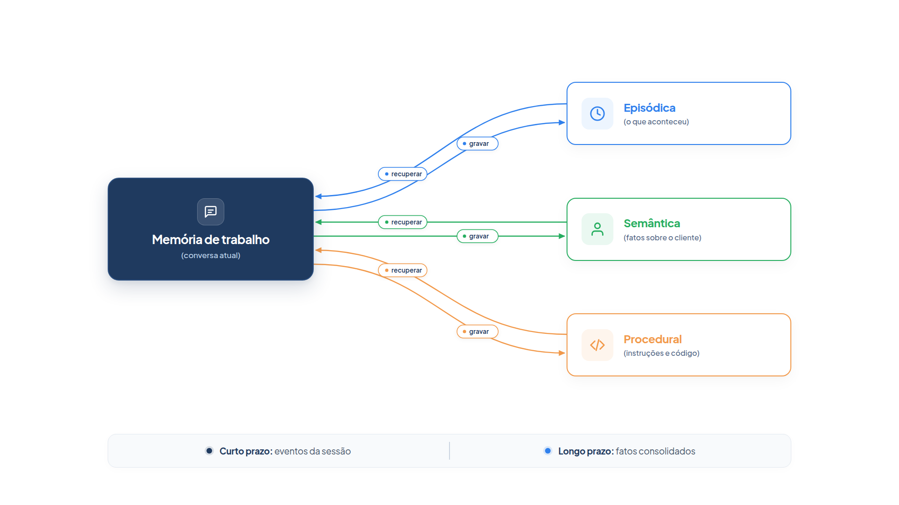

# Capítulo 10 — Arquitetura de memória

No Capítulo 9, você deu ao agente um caderno de notas. Funciona, mas é uma única gaveta onde tudo se mistura: promessas, preferências, pendências. Um agente que atende milhares de clientes precisa de mais critério: o que ele *lembra* da conversa atual, o que *aprendeu* sobre cada cliente, o que *sabe* sobre a loja e o que *sabe fazer*. Neste capítulo, você organiza essas respostas em uma arquitetura de memória e implementa as duas camadas essenciais para produção: a de curto prazo e a de longo prazo.



> **Antes de começar — PydanticAI neste capítulo**
>
> Neste capítulo você usa `ModelMessagesTypeAdapter`, `.dump_json`, `.validate_json` e `.part_kind`. Se algum deles não for familiar, revise os [Capítulo 0.3](../modulo-00/0.3-pydantic-na-pratica.md) (`.dump_json` e `.validate_json`) e [Capítulo 0.5](../modulo-00/0.5-mensagens-e-testes-sem-api.md) (`ModelMessagesTypeAdapter` e `.part_kind`).

## Quatro tipos de memória

Uma referência para desenhar a memória de qualquer agente é a arquitetura **CoALA** (*Cognitive Architectures for Language Agents*, arquiteturas cognitivas para agentes de linguagem), proposta em um artigo de 2023. Ela separa a memória de um agente em quatro tipos, inspirados na ciência cognitiva:

- **Memória de trabalho:** o que está ativo na decisão atual — a pergunta do cliente, o resultado da última ferramenta, o objetivo em andamento. Persiste entre as chamadas ao modelo de uma mesma execução.
- **Memória episódica:** as experiências de decisões anteriores — trajetórias de execuções passadas, históricos de conversa.
- **Memória semântica:** o conhecimento sobre o mundo e sobre o próprio agente — fatos, regras, preferências do cliente.
- **Memória procedural:** como agir. Tem duas formas: o conhecimento implícito nos pesos do modelo e o conhecimento explícito escrito no código e nas instruções do agente.

Você já usou todos os quatro, sem nomeá-los:

| Tipo       | Na Casa Verde                                               | Onde você viu                    |
| ---------- | ----------------------------------------------------------- | -------------------------------- |
| Trabalho   | mensagens da conversa em curso e resultados das ferramentas | `message_history`, Capítulo 3    |
| Episódica  | lições de tentativas anteriores; sessões antigas            | `licoes`, Capítulo 7             |
| Semântica  | preferências do cliente; política de devolução              | `POLITICAS`, notas do Capítulo 9 |
| Procedural | instruções e ferramentas do agente                          | `instructions=`, Capítulo 2      |

A tabela é útil porque cada tipo pede um tratamento diferente. Há uma diferença de risco importante: gravar na memória episódica ou semântica é relativamente seguro, pois um fato errado se corrige. Reescrever a memória procedural — as instruções e o código do próprio agente — é bem mais arriscado, porque um erro pode introduzir defeitos ou permitir que o agente contorne as intenções de quem o projetou. Nos exemplos deste livro, as instruções ficam sob controle humano.

## Curto prazo e longo prazo

Em produção, o mais útil é separar duas camadas, como faz o serviço de memória do Amazon Bedrock AgentCore:

- **Memória de curto prazo:** guarda as interações cruas de uma sessão, evento por evento: cada pergunta do cliente e cada resposta do agente. Permite recarregar a conversa tal como aconteceu, mesmo que o serviço reinicie ou o cliente volte no dia seguinte.
- **Memória de longo prazo:** guarda informação *estruturada e extraída* das interações, que sobrevive a várias sessões: resumos, fatos, preferências. Preserva só o essencial. Se o cliente diz qual a sua marca preferida, o agente a guarda e pode sugeri-la em outra conversa.

A ponte entre as duas camadas é um processo de **extração e consolidação**. Depois que a conversa é gravada na memória de curto prazo, um processo, em segundo plano, extrai os fatos relevantes e os consolida com o que já se sabe. Rodar em segundo plano evita atrasar o atendimento em curso. Na recuperação, o agente consulta a memória de longo prazo por busca, de preferência semântica, para trazer só o que se relaciona à pergunta.

Vamos implementar uma versão local dessa arquitetura, em um arquivo, para enxergar cada peça.

## Curto prazo: guardar a sessão

A memória de curto prazo guarda as mensagens da sessão. O PydanticAI oferece um conversor entre a lista de mensagens e JSON, `ModelMessagesTypeAdapter`, que preserva todos os campos.

*memoria.py* (primeira parte)

```python
import json
import re
from dataclasses import dataclass
from pathlib import Path

from pydantic import BaseModel

from pydantic_ai import Agent, ModelMessage, ModelMessagesTypeAdapter, RunContext

from config import MODELO


class Fato(BaseModel):
    chave: str
    valor: str


class Fatos(BaseModel):
    fatos: list[Fato]


class Memoria:
    def __init__(self, pasta: Path):
        self.pasta = pasta
        pasta.mkdir(parents=True, exist_ok=True)

    # Curto prazo: eventos crus de uma sessão.
    def salvar_sessao(self, sessao_id: str, mensagens: list[ModelMessage]) -> None:
        (self.pasta / f"sessao_{sessao_id}.json").write_bytes(
            ModelMessagesTypeAdapter.dump_json(mensagens)
        )

    def carregar_sessao(self, sessao_id: str) -> list[ModelMessage]:
        arquivo = self.pasta / f"sessao_{sessao_id}.json"
        if not arquivo.exists():
            return []
        return ModelMessagesTypeAdapter.validate_json(arquivo.read_bytes())
```

A classe `Memoria` guarda tudo em uma pasta. `salvar_sessao` converte a lista de mensagens em JSON e a grava em um arquivo cujo nome inclui o identificador da sessão. `carregar_sessao` faz o caminho inverso. Com isso, a conversa sobrevive a um reinício do programa: você recarrega as mensagens e passa o resultado como `message_history`, como no Capítulo 3.

O identificador da sessão é a chave de tudo. Em um serviço real, ele é o que o cliente carrega entre as visitas.

### O que acontece com um arquivo de sessão inválido

`validate_json` não devolve qualquer coisa: ele confere cada mensagem contra o formato esperado e lança `ValidationError` se algo não bater. Isso protege o agente de um arquivo de sessão corrompido ou editado à mão. O exemplo abaixo grava duas mensagens em JSON, recarrega e depois tenta carregar um JSON em que o tipo da parte (`part_kind`) não existe.

*sessao_corrompida.py*

```python
from pydantic import ValidationError

from pydantic_ai import ModelMessagesTypeAdapter, ModelRequest, ModelResponse, TextPart, UserPromptPart

mensagens = [
    ModelRequest(parts=[UserPromptPart("Prefiro receber à tarde.")]),
    ModelResponse(parts=[TextPart("Anotado: entregas à tarde.")]),
]

dados = ModelMessagesTypeAdapter.dump_json(mensagens)
print(dados[:60])
print([m.kind for m in ModelMessagesTypeAdapter.validate_json(dados)])

try:
    ModelMessagesTypeAdapter.validate_json(b'[{"kind": "request", "parts": [{"part_kind": "inexistente"}]}]')
except ValidationError as erro:
    print("Arquivo inválido:", erro.error_count(), "erro")
    print(erro.errors()[0]["type"])
```

Saída:

```text
b'[{"parts":[{"content":"Prefiro receber \xc3\xa0 tarde.","timestamp'
['request', 'response']
Arquivo inválido: 1 erro
union_tag_invalid
```

O JSON é gravado como bytes (`dump_json` devolve `bytes`, por isso o `b'...'` e o `\xc3\xa0` no lugar do "à", que em UTF-8 ocupa dois bytes). Na recarga, cada mensagem volta como `request` ou `response`. No arquivo inválido, o `part_kind` `inexistente` não corresponde a nenhum tipo de parte; o Pydantic recusa com o erro `union_tag_invalid`. Em produção, capture `ValidationError` em `carregar_sessao` e decida: começar uma sessão vazia ou avisar a equipe.

## Longo prazo: extrair, consolidar, recuperar

O histórico cru é pesado e cheio de conversa fiada. A memória de longo prazo guarda só **fatos**: uma chave estável (como `periodo_entrega_preferido`) e um valor (`tarde`). A chave estável é uma decisão importante de projeto, e mostraremos o motivo adiante.

*memoria.py* (segunda parte, continuação da classe `Memoria`)

```python
    # Longo prazo: fatos consolidados sobre o cliente.
    def fatos(self, cliente: str) -> dict[str, str]:
        arquivo = self.pasta / f"fatos_{cliente}.json"
        return json.loads(arquivo.read_text()) if arquivo.exists() else {}

    def consolidar(self, cliente: str, novos: list[Fato]) -> list[str]:
        atuais = self.fatos(cliente)
        mudancas = []
        for fato in novos:
            if fato.chave not in atuais:
                mudancas.append(f"novo: {fato.chave} = {fato.valor}")
            elif atuais[fato.chave] != fato.valor:
                mudancas.append(f"atualizado: {fato.chave} = {fato.valor} (antes: {atuais[fato.chave]})")
            atuais[fato.chave] = fato.valor
        (self.pasta / f"fatos_{cliente}.json").write_text(json.dumps(atuais, ensure_ascii=False))
        return mudancas

    def recuperar(self, cliente: str, consulta: str, k: int = 3) -> list[str]:
        palavras = set(re.findall(r"\w+", consulta.lower()))
        pontuados = []
        for chave, valor in self.fatos(cliente).items():
            texto = set(re.findall(r"\w+", f"{chave.replace('_', ' ')} {valor}".lower()))
            pontos = len(palavras & texto)
            if pontos:
                pontuados.append((pontos, f"{chave}: {valor}"))
        return [fato for _, fato in sorted(pontuados, reverse=True)[:k]]
```

Os três métodos cobrem as três operações do longo prazo:

- `fatos` lê o arquivo de fatos do cliente: um dicionário de chave para valor.
- `consolidar` incorpora novos fatos aos existentes. Um fato com chave nova é acrescentado; um fato com chave já conhecida e valor diferente *substitui* o anterior. A função devolve a lista de mudanças, útil para registro e auditoria.
- `recuperar` busca os `k` fatos mais relacionados a uma consulta, pontuando-os pelo número de palavras em comum.

Aqui está o motivo da chave estável. Se o cliente disser "prefiro a tarde" hoje e "agora só consigo de manhã" no mês que vem, os dois fatos tratam do mesmo assunto, e o segundo deve substituir o primeiro. Com a mesma chave, `consolidar` faz isso sozinho. Sem chaves estáveis, a memória acumularia fatos contraditórios, e o agente não saberia qual vale.

### O extrator: de conversa para fatos

Quem produz os fatos é um agente, o *extrator*. Ele lê a transcrição da sessão e devolve uma lista de `Fato`.

*memoria.py* (terceira parte)

```python
@dataclass
class Contexto:
    memoria: Memoria
    cliente: str


extrator = Agent(
    MODELO,
    output_type=Fatos,
    instructions=(
        "Leia a conversa de atendimento e extraia fatos duráveis sobre o cliente: "
        "preferências, restrições e informações de entrega. Ignore dados de pedidos, "
        "que o sistema já guarda. Use chaves curtas em snake_case e estáveis, como "
        "periodo_entrega_preferido. Devolva uma lista vazia se não houver nada."
    ),
)

atendente = Agent(
    MODELO,
    deps_type=Contexto,
    instructions=(
        "Você atende clientes da loja Casa Verde. Antes de combinar entrega ou "
        "recomendar algo, use `lembrar` para consultar as preferências do cliente. "
        "Responda em até duas frases."
    ),
)


@atendente.tool
def lembrar(ctx: RunContext[Contexto], tema: str) -> str:
    """Consulta a memória de longo prazo sobre o cliente. Use palavras-chave do tema."""
    achados = ctx.deps.memoria.recuperar(ctx.deps.cliente, tema)
    return "\n".join(achados) if achados else "Nada registrado sobre esse tema."


def transcrever(mensagens: list[ModelMessage]) -> str:
    linhas = []
    for mensagem in mensagens:
        for parte in mensagem.parts:
            conteudo = getattr(parte, "content", None)
            if isinstance(conteudo, str) and parte.part_kind in ("user-prompt", "text"):
                papel = "Cliente" if parte.part_kind == "user-prompt" else "Atendente"
                linhas.append(f"{papel}: {conteudo}")
    return "\n".join(linhas)


def encerrar_sessao(memoria: Memoria, cliente: str, sessao_id: str, mensagens: list[ModelMessage]) -> list[str]:
    memoria.salvar_sessao(sessao_id, mensagens)
    novos = extrator.run_sync(transcrever(mensagens)).output.fatos
    return memoria.consolidar(cliente, novos)
```

Três peças merecem atenção.

A instrução do `extrator` define a política de memória: guardar *fatos duráveis* sobre o cliente e *ignorar* dados que o sistema de pedidos já guarda. Esse é o "o que lembrar", decisão que determina a qualidade de tudo o mais.

A ferramenta `lembrar` entrega a memória ao atendente sob demanda, do mesmo modo que a recuperação do Capítulo 9: o agente consulta quando precisa, e não carrega todos os fatos em cada chamada. Os fatos chegam por `ctx.deps`, o objeto `Contexto` com a memória e o identificador do cliente.

`encerrar_sessao` junta as camadas: grava a sessão (curto prazo), extrai os fatos e os consolida (longo prazo). Em produção, essa função rodaria em segundo plano depois que a conversa terminasse.

## Observando as camadas funcionarem

Vamos percorrer três sessões da cliente Lia com modelos simulados, que produzem a saída abaixo exatamente.

*memoria_simulado.py*

```python
import tempfile
from pathlib import Path

from pydantic_ai import ModelResponse, TextPart, ToolCallPart
from pydantic_ai.messages import ToolReturnPart
from pydantic_ai.models.function import AgentInfo, FunctionModel

import memoria
from memoria import Contexto, Memoria
from trajetoria import mostrar

def extrator_sessao(fato_chave, fato_valor):
    def modelo(mensagens, info: AgentInfo) -> ModelResponse:
        return ModelResponse(parts=[ToolCallPart(info.output_tools[0].name, {
            "fatos": [{"chave": fato_chave, "valor": fato_valor}]
        })])
    return modelo


def atendente_com_memoria(mensagens, info: AgentInfo) -> ModelResponse:
    if isinstance(mensagens[-1].parts[-1], ToolReturnPart):
        return ModelResponse(parts=[TextPart("Combinado: entrega à tarde, como você prefere.")])
    return ModelResponse(parts=[
        TextPart("Vou conferir suas preferências de entrega."),
        ToolCallPart("lembrar", {"tema": "período de entrega"}),
    ])


def atendente_simples(mensagens, info: AgentInfo) -> ModelResponse:
    return ModelResponse(parts=[TextPart("Anotado: entregas à tarde.")])


mem = Memoria(Path(tempfile.mkdtemp()))
ctx = Contexto(mem, "lia")

print("== Sessão 1: a cliente informa uma preferência")
r1 = memoria.atendente.run_sync("Prefiro receber à tarde, de manhã não tem ninguém.",
                                model=FunctionModel(atendente_simples), deps=ctx)
with memoria.extrator.override(model=FunctionModel(extrator_sessao("periodo_entrega_preferido", "tarde"))):
    print(memoria.encerrar_sessao(mem, "lia", "s1", r1.all_messages()))

print("\n== Sessão 2: histórico vazio, mas a memória lembra")
r2 = memoria.atendente.run_sync("Quero combinar a entrega do pedido 1002.",
                                model=FunctionModel(atendente_com_memoria), deps=ctx)
mostrar(r2)

print("\n== Sessão 3: a preferência muda")
with memoria.extrator.override(model=FunctionModel(extrator_sessao("periodo_entrega_preferido", "manhã"))):
    print(memoria.encerrar_sessao(mem, "lia", "s3", r2.all_messages()))
print(mem.fatos("lia"))

print("\n== Curto prazo: retomar a sessão s1 depois de reiniciar")
retomada = mem.carregar_sessao("s1")
print("Mensagens recuperadas:", len(retomada), "| iguais às originais:", retomada == r1.all_messages())
```

Saída:

```text
== Sessão 1: a cliente informa uma preferência
['novo: periodo_entrega_preferido = tarde']

== Sessão 2: histórico vazio, mas a memória lembra
Pedido      : Quero combinar a entrega do pedido 1002.
Pensamento  : Vou conferir suas preferências de entrega.
Ação        : lembrar {'tema': 'período de entrega'}
Observação  : periodo_entrega_preferido: tarde
Resposta    : Combinado: entrega à tarde, como você prefere.

== Sessão 3: a preferência muda
['atualizado: periodo_entrega_preferido = manhã (antes: tarde)']
{'periodo_entrega_preferido': 'manhã'}

== Curto prazo: retomar a sessão s1 depois de reiniciar
Mensagens recuperadas: 2 | iguais às originais: True
```

Leia as quatro partes da saída:

1. **Sessão 1.** A cliente expressou uma preferência. Ao encerrar, o extrator produziu um fato, e a consolidação o registrou como novo.
2. **Sessão 2.** O histórico estava vazio: ninguém repetiu a preferência. Mesmo assim, o atendente consultou `lembrar`, recebeu `periodo_entrega_preferido: tarde` e combinou a entrega certa. A memória de longo prazo cruzou a fronteira entre sessões.
3. **Sessão 3.** A preferência mudou. A mesma chave recebeu um valor novo, e a consolidação reportou `atualizado`, em vez de acrescentar um fato contraditório.
4. **Curto prazo.** A sessão `s1` foi recarregada do arquivo, idêntica à original.

### Armadilha: a busca ingênua falha

Observe a consulta `período de entrega` com acento e a chave `periodo_entrega_preferido` sem acento. O programa só encontrou o fato porque a palavra `entrega` coincide; `período` e `periodo` são palavras diferentes para o nosso `recuperar`. A contagem de palavras em comum é uma busca ingênua: não reconhece sinônimos, acentos nem variações, e erraria "horário de entrega" ou "quando receber". Em produção, a recuperação usa **busca semântica**, que compara o *significado* da consulta com o dos fatos, em geral por meio de vetores numéricos chamados *embeddings*. A interface `recuperar(cliente, consulta, k)` permanece a mesma; muda só o miolo.

### Cuidados com a memória de longo prazo

- **Privacidade.** A memória guarda dados pessoais. Registre só o que o atendimento precisa, defina por quanto tempo guardar e dê ao cliente uma forma de pedir a exclusão. Nos serviços gerenciados, os metadados associados aos eventos podem não receber a mesma proteção do conteúdo: não coloque neles informação sensível.
- **Fatos errados.** O extrator é um modelo e pode extrair algo que o cliente não disse. Mantenha o registro de mudanças que `consolidar` devolve e revise amostras.
- **Fatos velhos.** Uma preferência de dois anos atrás pode ter deixado de valer. Guarde a data de cada fato quando a idade importar.

### Faça você mesmo

- **10.1 Mais uma sessão:** acrescente ao script uma quarta sessão em que a cliente informa que o portão tem interfone. Use a chave `acesso_portaria` e confira o conteúdo de `mem.fatos("lia")`.
- **10.2 Dois clientes:** crie um `Contexto` para o cliente `"caio"`, com um fato diferente. Verifique que `lembrar` de um não devolve fatos do outro.
- **10.3 Acentos:** altere `recuperar` para ignorar acentos, comparando `período` com `periodo`. Dica: a função `unicodedata.normalize` com a forma `"NFD"` separa os acentos das letras.
- **10.4 Data do fato:** altere `Fato` e `consolidar` para guardar a data da última atualização de cada fato. Mostre uma forma de usar essa data em `recuperar`.
- **10.5 Execução real:** execute duas sessões com o modelo real e uma pasta de memória fixa. Abra `fatos_lia.json` e avalie se os fatos extraídos refletem o que a cliente disse.

## Recapitulando

Você agora sabe organizar a memória de um agente em quatro tipos — trabalho, episódica, semântica e procedural — e a reconhecer cada um no que construiu nos capítulos anteriores. Implementou as duas camadas de produção: a memória de curto prazo, que guarda as mensagens de cada sessão em JSON, e a memória de longo prazo, que extrai fatos, os consolida por chave estável e os devolve ao agente por busca sob demanda. Também conhece os limites: a busca por palavras é ingênua, e a memória exige cuidados com privacidade, erro e idade dos fatos.

Com isso, o Módulo 3 está completo. Você mede e poda o contexto, guarda o que importa fora da janela, busca dados sob demanda e mantém uma memória que dura além da conversa. Falta a capacidade que torna os agentes realmente úteis no mundo: agir sobre sistemas. O próximo módulo trata do uso de ferramentas — como especificar o contrato de uma ferramenta, projetar a interface entre o agente e o computador e escolher entre ações em formato estruturado e em código.

### Fontes do capítulo

- Sumers et al. — [Cognitive Architectures for Language Agents](https://arxiv.org/pdf/2309.02427) (2023): memória de trabalho, episódica, semântica e procedural; o maior risco de reescrever a memória procedural.
- AWS — [Bedrock AgentCore: Memory types](https://docs.aws.amazon.com/bedrock-agentcore/latest/devguide/memory-types.html): memória de curto prazo (eventos por sessão, identificador de sessão, metadados) e de longo prazo (extração e consolidação assíncronas, busca semântica).
- Documentação do PydanticAI: *Mensagens e histórico de bate-papo* (`ModelMessagesTypeAdapter`), *Dependências* e *Saída*.
