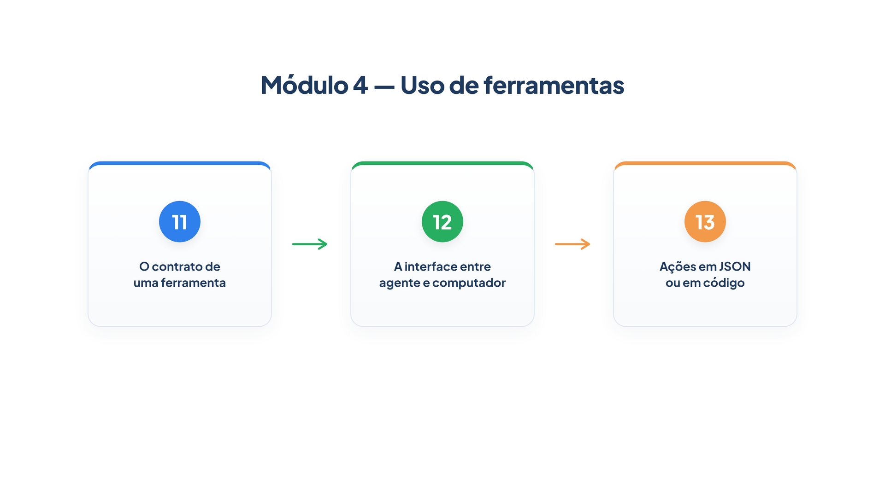

# Módulo 4 — Uso de ferramentas

Um agente sem ferramentas só conversa. É a capacidade de consultar sistemas e agir sobre eles que o torna capaz de assumir trabalho humano — e é também onde a maior parte dos erros acontece. Este módulo trata a ferramenta como o que ela é: o ponto de contato entre o modelo e o mundo. Ao final dele, você será capaz de:

- escrever o contrato de uma ferramenta de modo que o modelo acerte o uso e o esquema valide o resto;
- projetar a interface entre agente e computador, com erros que orientam, formato enxuto e uma bancada de testes;
- decidir entre ações estruturadas em JSON e ações escritas em código, e conhecer o custo de executar código gerado por um modelo.

## Percurso

1. **Capítulo 11 — O contrato de uma ferramenta.** Você examina o que o modelo realmente enxerga, restringe valores para que o contrato valide os argumentos e retira do contrato o que o código já sabe.
2. **Capítulo 12 — A interface entre agente e computador.** Você escreve erros que ensinam, torna o uso incorreto mais difícil e monta uma bancada para testar as ferramentas. Também conhece o Toolformer, que mostra o uso de ferramentas como capacidade aprendida.
3. **Capítulo 13 — Ações em JSON ou em código.** Você compara um agente que chama ferramentas com um que escreve código, constrói um executor restrito e aprende por que ele não substitui um sandbox.

Os arquivos `config.py`, `loja.py` e `trajetoria.py` do Módulo 4 estendem os do módulo anterior; use a pasta `codigo/` deste módulo. A `trajetoria.py` agora também exibe os erros de validação que o modelo recebe.

> **Nota:** Os exemplos de saída garantida usam modelos simulados. Os que dependem de um modelo real estão indicados como tal, e o texto exato muda de execução para execução.
