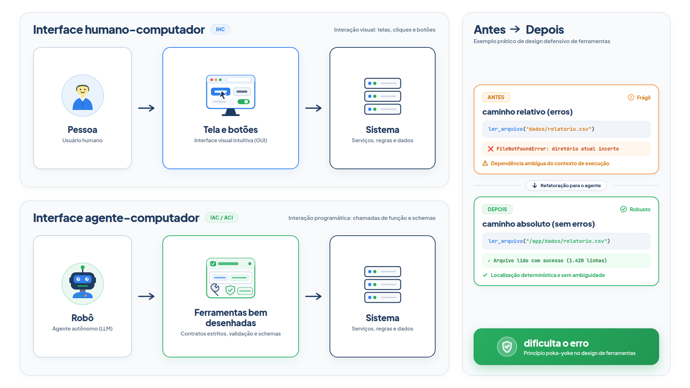

# Capítulo 12 — A interface entre agente e computador

No Capítulo 11, você escreveu contratos claros. Mas um contrato só descreve a *entrada* da ferramenta. O que a ferramenta devolve e como ela reage a um uso incorreto também fazem parte do desenho, e é onde muitos agentes tropeçam. Neste capítulo, você passa a tratar cada ferramenta como uma **interface entre agente e computador**, com o mesmo cuidado que se dá a uma interface para pessoas. Você vai escrever erros que ensinam, tornar o uso incorreto mais difícil e montar uma pequena bancada para testar suas ferramentas com perguntas reais.



> **Antes de começar — PydanticAI neste capítulo**
>
> Neste capítulo você usa `ModelRetry` para devolver ao modelo uma mensagem de erro escrita por você. Se ele não for familiar, revise o [Capítulo 0.6](../modulo-00/0.6-ferramentas-e-saida-tipada.md).

## Ferramentas merecem o cuidado de um prompt

Equipes dedicam muito esforço às interfaces entre pessoas e computadores: telas, botões, mensagens de erro. As interfaces entre agentes e computadores, chamadas **ACI** (*agent-computer interface*), merecem a mesma atenção. A diferença é o leitor: quem lê a descrição e o resultado de uma ferramenta é um modelo.

A Anthropic relata que, ao construir um agente para resolver problemas reais de código, gastou mais tempo otimizando as *ferramentas* do que o prompt geral. Um achado ilustra o método: o modelo errava ao usar caminhos relativos de arquivos depois de mudar de diretório. A correção foi trocar o argumento da ferramenta para exigir caminhos absolutos, e o modelo passou a usá-la sem erros.

Note o que aconteceu: ninguém "ensinou melhor" o modelo. Mudou-se a ferramenta para que o erro deixasse de ser possível. Esse é o princípio do capítulo.

Duas perguntas ajudam a avaliar qualquer ferramenta, colocando-se no lugar do modelo:

- É óbvio como usá-la, a partir da descrição e dos parâmetros? Ou é preciso pensar muito?
- Um desenvolvedor júnior, lendo só a docstring, saberia usá-la bem? Escreva a descrição como se fosse para ele, com exemplos de uso, casos de borda e formato esperado.

## Um erro que ensina

Vamos tomar a ferramenta de consulta de pedido e testá-la com um cliente que escreve o código com `#`: "Cadê o meu pedido #1001?". O modelo, que copia fielmente o que o cliente digitou, chama a ferramenta com `"#1001"`. Veja duas versões.

*aci.py*

```python
import re

from pydantic_ai import Agent, ModelRetry

from config import MODELO
from loja import buscar_pedido

agente_v1 = Agent(MODELO)


@agente_v1.tool_plain
def consultar_pedido(codigo: str) -> str:
    """Consulta o status de um pedido."""
    pedido = buscar_pedido(codigo)
    return str(pedido) if pedido else "Pedido não encontrado."


agente_v2 = Agent(MODELO)


@agente_v2.tool_plain
def consultar_pedido(codigo: str) -> str:
    """Consulta o status de um pedido. O código tem 4 dígitos, sem '#' nem espaços (exemplo: 1001)."""
    if not re.fullmatch(r"\d{4}", codigo):
        raise ModelRetry(f"Código inválido: '{codigo}'. Envie só os 4 dígitos, como 1001.")
    pedido = buscar_pedido(codigo)
    if pedido is None:
        return f"Nenhum pedido com o código {codigo}. Peça ao cliente para conferir o número."
    return str(pedido)
```

A versão 2 faz três coisas de forma diferente:

1. **A descrição inclui o formato e um exemplo:** "4 dígitos, sem '#' nem espaços (exemplo: 1001)".
2. **Um código malformado levanta `ModelRetry`.** Essa exceção, do PydanticAI, devolve ao modelo uma mensagem de erro e o convida a tentar de novo, como o erro de validação do Capítulo 11, mas com o texto que *você* escolhe.
3. **O "não encontrado" diz o que fazer em seguida:** "Peça ao cliente para conferir o número".

Para ver a diferença com saída garantida, simulamos um modelo que copia `#1001`, corrige se receber um erro e responde com base no resultado:

*aci_simulado.py*

```python
from pydantic_ai import ModelResponse, TextPart, ToolCallPart
from pydantic_ai.messages import RetryPromptPart, ToolReturnPart
from pydantic_ai.models.function import AgentInfo, FunctionModel

from aci import agente_v1, agente_v2
from trajetoria import mostrar


def modelo_roteirizado(mensagens, info: AgentInfo) -> ModelResponse:
    partes = [parte for m in mensagens for parte in m.parts]
    retornos = [p for p in partes if isinstance(p, ToolReturnPart)]
    if retornos:
        if retornos[-1].content.startswith("Pedido não encontrado"):
            return ModelResponse(parts=[TextPart("Não encontrei o seu pedido.")])
        return ModelResponse(parts=[TextPart("Seu pedido 1001 já foi enviado.")])
    if any(isinstance(p, RetryPromptPart) for p in partes):
        return ModelResponse(parts=[ToolCallPart("consultar_pedido", {"codigo": "1001"})])
    return ModelResponse(parts=[ToolCallPart("consultar_pedido", {"codigo": "#1001"})])


pergunta = "Cadê o meu pedido #1001?"

print("== Ferramenta v1: o erro não diz o que fazer")
mostrar(agente_v1.run_sync(pergunta, model=FunctionModel(modelo_roteirizado)))

print("\n== Ferramenta v2: o erro orienta a correção")
mostrar(agente_v2.run_sync(pergunta, model=FunctionModel(modelo_roteirizado)))
```

Saída:

```text
== Ferramenta v1: o erro não diz o que fazer
Pedido      : Cadê o meu pedido #1001?
Ação        : consultar_pedido {'codigo': '#1001'}
Observação  : Pedido não encontrado.
Resposta    : Não encontrei o seu pedido.

== Ferramenta v2: o erro orienta a correção
Pedido      : Cadê o meu pedido #1001?
Ação        : consultar_pedido {'codigo': '#1001'}
Erro        : Código inválido: '#1001'. Envie só os 4 dígitos, como 1001.
Ação        : consultar_pedido {'codigo': '1001'}
Observação  : {'status': 'enviado', 'previsao': '12/10', 'valor': 189.9}
Resposta    : Seu pedido 1001 já foi enviado.
```

Na versão 1, a mensagem "Pedido não encontrado." era verdadeira e inútil: o pedido existia, e o erro estava no formato. O agente desistiu e deu ao cliente uma resposta errada. Na versão 2, o mesmo erro de formato virou uma instrução; o modelo corrigiu e acertou.

A lição vale para todo retorno de erro: **escreva a mensagem para o modelo agir**. Diga o que estava errado, o que seria certo e, quando fizer sentido, o próximo passo.

### Armadilha: o `ModelRetry` tem limite

A correção da versão 2 aconteceu em uma volta extra, e isso não é acaso: por padrão, cada ferramenta aceita **uma** nova tentativa. Se o modelo errar de novo depois do `ModelRetry`, o PydanticAI desiste e levanta `UnexpectedModelBehavior`. Para ver isso sem chave de API, use o `TestModel`, que chama a ferramenta com argumentos inventados, e uma ferramenta que sempre recusa:

*limite_de_tentativas.py*

```python
from pydantic_ai import Agent, ModelRetry
from pydantic_ai.exceptions import UnexpectedModelBehavior
from pydantic_ai.models.test import TestModel

agente = Agent(TestModel(call_tools=["consultar_pedido"]))


@agente.tool_plain
def consultar_pedido(codigo: str) -> str:
    """Consulta o status de um pedido."""
    raise ModelRetry("Código inválido. Envie só os 4 dígitos, como 1001.")


try:
    agente.run_sync("Cadê o meu pedido #1001?")
except UnexpectedModelBehavior as erro:
    print("Falhou:", erro)
```

Saída:

```text
Falhou: Tool 'consultar_pedido' exceeded max retries count of 1. Consider raising the retry limit, or see the docs on tool retries: https://pydantic.dev/docs/ai/tools-toolsets/tools-advanced/#tool-retries
```

A mensagem diz o diagnóstico: o limite (`1`) foi excedido. Em produção, capture essa exceção em vez de deixar a conversa cair. Se a ferramenta realmente precisar de mais voltas de correção, aumente o limite com `retries=` no decorador, como em `@agente.tool_plain(retries=3)`. Mais voltas custam tokens, então só aumente depois de melhorar a mensagem de erro.

### Faça você mesmo

- **12.1 Ferramenta de política:** escreva uma ferramenta que consulta a política por tema livre e, se o tema não existir, devolve uma mensagem listando os temas válidos. Teste com um modelo simulado que pede "garantia".
- **12.2 Pedido inexistente:** na `agente_v2`, o que o modelo deveria dizer ao cliente quando recebe "Nenhum pedido com o código 1005"? Escreva a frase e ajuste a mensagem da ferramenta para induzi-la.
- **12.3 Dois erros diferentes:** acrescente à ferramenta uma mensagem própria para o caso em que o cliente digita letras no lugar do número. Confira que ela é distinta da mensagem de formato.

## Poka-yoke: dificultar o erro

O termo vem da manufatura japonesa: *poka-yoke* significa um dispositivo que torna o erro difícil ou impossível, como o conector que só encaixa de um jeito. Aplicado a ferramentas, significa alterar os argumentos para tornar mais difícil cometer erros. O caso dos caminhos absolutos é um poka-yoke: em vez de pedir ao modelo que "tome cuidado com o diretório atual", elimina-se a possibilidade de errar.

No nosso exemplo, há duas escolhas.

- **Rigidez:** exigir o formato certo e devolver o erro orientador, como a versão 2. O modelo corrige em uma volta a mais.
- **Tolerância:** aceitar `#1001` e limpar o código dentro da ferramenta. Não há volta a mais, mas a ferramenta passa a esconder o formato esperado, e erros reais, como "1 0 0 1", podem passar despercebidos.

Nenhuma é sempre melhor. Prefira a rigidez quando um valor errado pode causar dano (cancelar o pedido errado) e a tolerância quando o custo de uma volta extra é alto e o risco é nulo (uma consulta). O recurso do Capítulo 11 de restringir o tipo com `Literal` e `pattern` é outro poka-yoke: o modelo nem consegue enviar um valor fora da lista.

### Faça você mesmo

- **12.4 Versão tolerante:** altere a versão 2 para aceitar `#1001` e `pedido 1001`, extraindo os quatro dígitos. Liste um caso de entrada que a versão tolerante aceitaria e que seria melhor recusar.
- **12.5 Ação de risco:** escreva `cancelar_pedido(codigo)` com a abordagem rígida e justifique, em duas frases, por que escolheu essa abordagem.

## O formato do que a ferramenta devolve

O resultado da ferramenta é lido pelo modelo na próxima volta. Três cuidados tornam essa leitura mais fácil:

- **Devolva só o necessário.** Um resultado enorme consome o contexto, como você viu no Capítulo 8. A lista de pedidos do Capítulo 9, com código, status e data, é um exemplo de resultado enxuto.
- **Prefira formatos próximos do texto que o modelo já viu com frequência.** Uma linha por pedido, separada por `|`, é mais natural que um bloco com muito escape ou formatação.
- **Evite sobrecarga de formatação.** Se o modelo precisar contar linhas ou escapar aspas só para formatar a resposta, ele tem mais chances de errar.

Por fim, há o tamanho do espaço para raciocinar. Se a ferramenta pede ao modelo que escreva algo extenso e estruturado, como um relatório, dê a ele espaço para "pensar" antes de se comprometer com o formato final.

### Faça você mesmo

- **12.6 Resultado enxuto:** compare o tamanho do retorno de `consultar_pedido` com o de uma versão que devolve apenas `status` e `previsao`. Explique em que perguntas a versão enxuta basta.
- **12.7 Formato natural:** reescreva uma ferramenta que devolve um dicionário aninhado para devolver linhas de texto. Compare qual versão um modelo real leu melhor em três perguntas.

## Testando ferramentas com uma bancada

Como saber se uma ferramenta está boa? Executando muitos exemplos de entrada e olhando os erros que o modelo comete. Uma **bancada de testes** automatiza isso: ela roda uma lista de perguntas, confere a ferramenta e os argumentos escolhidos e conta os acertos.

*bancada.py*

```python
from pydantic_ai import ToolCallPart
from pydantic_ai.messages import RetryPromptPart

CASOS = [
    ("Onde está o pedido 1001?", "consultar_pedido", {"codigo": "1001"}),
    ("Cadê o #1002?", "consultar_pedido", {"codigo": "1002"}),
    ("Qual o prazo de devolução?", "consultar_politica", {"tema": "devolucao"}),
    ("O frete é grátis?", "consultar_politica", {"tema": "frete"}),
]


def avaliar(agente, casos=CASOS, **opcoes) -> float:
    acertos = 0
    for pergunta, ferramenta, argumentos in casos:
        mensagens = agente.run_sync(pergunta, **opcoes).all_messages()
        chamadas = [
            (parte.tool_name, parte.args_as_dict())
            for mensagem in mensagens
            for parte in mensagem.parts
            if isinstance(parte, ToolCallPart)
        ]
        erros = sum(
            isinstance(parte, RetryPromptPart) for mensagem in mensagens for parte in mensagem.parts
        )
        primeira = chamadas[0] if chamadas else None
        ok = primeira == (ferramenta, argumentos)
        acertos += ok
        detalhe = "" if ok else f" (esperado {ferramenta}{argumentos}, recebeu {primeira})"
        print(f"{'OK  ' if ok else 'ERRO'} {pergunta}{detalhe} | correções pedidas: {erros}")
    taxa = acertos / len(casos)
    print(f"Acerto na primeira chamada: {acertos}/{len(casos)}")
    return taxa
```

Cada caso é uma tupla: a pergunta, a ferramenta esperada e os argumentos esperados. Para cada um, `avaliar` roda o agente, extrai as chamadas de ferramenta da trajetória e compara a *primeira* com o esperado. A primeira chamada é a que revela o julgamento do modelo; as seguintes podem ser correções. A função também conta quantas correções o contrato precisou pedir.

Execute-a com o modelo real passando `avaliar(agente_claro)`. Para ver a saída sem chave de API, usamos um modelo simulado que comete um erro conhecido: escreve `#1002` com o `#`.

*bancada_simulada.py*

```python
from pydantic_ai import ModelResponse, TextPart, ToolCallPart
from pydantic_ai.messages import RetryPromptPart, ToolReturnPart
from pydantic_ai.models.function import AgentInfo, FunctionModel

from bancada import avaliar
from contrato import agente_claro

PRIMEIRAS = {
    "Onde está o pedido 1001?": ("consultar_pedido", {"codigo": "1001"}),
    "Cadê o #1002?": ("consultar_pedido", {"codigo": "#1002"}),
    "Qual o prazo de devolução?": ("consultar_politica", {"tema": "devolucao"}),
    "O frete é grátis?": ("consultar_politica", {"tema": "frete"}),
}


def modelo_com_defeito(mensagens, info: AgentInfo) -> ModelResponse:
    partes = [parte for m in mensagens for parte in m.parts]
    if any(isinstance(p, ToolReturnPart) for p in partes):
        return ModelResponse(parts=[TextPart("ok")])
    if any(isinstance(p, RetryPromptPart) for p in partes):
        return ModelResponse(parts=[ToolCallPart("consultar_pedido", {"codigo": "1002"})])
    pergunta = mensagens[0].parts[-1].content
    nome, argumentos = PRIMEIRAS[pergunta]
    return ModelResponse(parts=[ToolCallPart(nome, argumentos)])


avaliar(agente_claro, model=FunctionModel(modelo_com_defeito))
```

Saída:

```text
OK   Onde está o pedido 1001? | correções pedidas: 0
ERRO Cadê o #1002? (esperado consultar_pedido{'codigo': '1002'}, recebeu ('consultar_pedido', {'codigo': '#1002'})) | correções pedidas: 1
OK   Qual o prazo de devolução? | correções pedidas: 0
OK   O frete é grátis? | correções pedidas: 0
Acerto na primeira chamada: 3/4
```

A bancada achou o problema: o caso "#1002" erra na primeira chamada, e o contrato precisou pedir uma correção. Isso aponta para melhorar a descrição ou o formato da ferramenta. É assim que se itera: rode, leia os erros, ajuste o contrato, rode de novo. Você pode acrescentar à lista cada falha encontrada em produção, e a bancada passa a protegê-lo contra regressões.

Esta é uma versão mínima do que o Módulo 9 aborda em profundidade, com vocabulário próprio (tarefas, tentativas, avaliadores) e estratégias de avaliação mais completas.

### Faça você mesmo

- **12.8 Seus casos:** acrescente seis casos à `CASOS`, incluindo uma pergunta ambígua e uma que não exige ferramenta. Defina o que "esperado" significa nesse último caso.
- **12.9 Antes e depois:** execute a bancada com o modelo real antes e depois de melhorar a descrição de uma ferramenta. Compare as taxas.
- **12.10 Mais de uma execução:** modelos variam. Altere `avaliar` para rodar cada caso três vezes e informar quantos acertos houve em cada caso.

## Ferramentas como capacidade aprendida

Até aqui tratamos o uso de ferramentas como algo que o seu código organiza em torno de um modelo: você descreve, o modelo pede, você executa. Mas o uso de ferramentas também é uma *capacidade que o próprio modelo aprende*.

Um artigo de 2023, o **Toolformer**, mostrou que um modelo de linguagem pode ensinar a si mesmo a usar ferramentas. Os modelos acertam bem muitas tarefas com poucos exemplos, mas tropeçam em coisas simples, como aritmética e consulta de fatos recentes. O Toolformer foi treinado para decidir *quais* APIs chamar, *quando* chamar, *quais argumentos* passar e *como incorporar* o resultado à continuação do texto. O método é autossupervisionado: o modelo propõe chamadas de API em vários pontos de um texto, executa-as e mantém apenas as que *reduzem o erro* de prever as palavras seguintes. As ferramentas incluíam uma calculadora, um sistema de perguntas e respostas, um buscador, um tradutor e um calendário. Com isso, um modelo relativamente pequeno melhorou muito seu desempenho sem exemplos específicos, em muitas tarefas competindo com modelos maiores, sem perder a habilidade geral com texto.

O que isso muda para quem constrói agentes?

- **O modelo importa.** A competência em chamar ferramentas depende de como ele foi treinado. Escolha modelos treinados para isso, e use os de pequeno porte só depois de medir, como no Capítulo 2.
- **O formato importa.** Como o modelo aprendeu a usar ferramentas em formatos específicos, contratos próximos desses formatos — nomes claros, JSON Schema, exemplos — funcionam melhor que invenções.
- **A capacidade e o contrato se somam.** O modelo traz o *julgamento* de quando e como chamar; o seu contrato e as suas mensagens de erro fornecem o *contexto* para que o julgamento acerte.

## Recapitulando

Você agora sabe tratar uma ferramenta como uma interface para um leitor que é um modelo: escrever descrições com formato e exemplo, devolver erros que orientam a correção, tornar o uso incorreto difícil em vez de pedir cuidado, devolver resultados enxutos e testar tudo com uma bancada de casos. Também conhece a origem do uso de ferramentas como capacidade aprendida e o que isso significa para as suas escolhas.

Até aqui, toda ação do agente foi uma chamada estruturada: o modelo escolhe uma ferramenta e passa argumentos. Há uma alternativa, em que o modelo escreve *código* que usa as ferramentas. Ela é mais expressiva, e também mais perigosa. O Capítulo 13 compara as duas formas e mostra como decidir entre elas.

### Fontes do capítulo

- Anthropic — [Building Effective Agents](https://www.anthropic.com/engineering/building-effective-agents) (apêndice sobre engenharia de prompt das ferramentas): ACI; docstring como para um desenvolvedor júnior; teste com muitos exemplos; poka-yoke e o caso dos caminhos absolutos; formato próximo do texto natural.
- Schick et al. — [Toolformer: Language Models Can Teach Themselves to Use Tools](https://arxiv.org/pdf/2302.04761) (2023): uso de ferramentas aprendido de forma autossupervisionada; filtragem de chamadas pela redução do erro; calculadora, perguntas e respostas, busca, tradução e calendário.
- Documentação do PydanticAI: *Function Tools* e `ModelRetry`.
