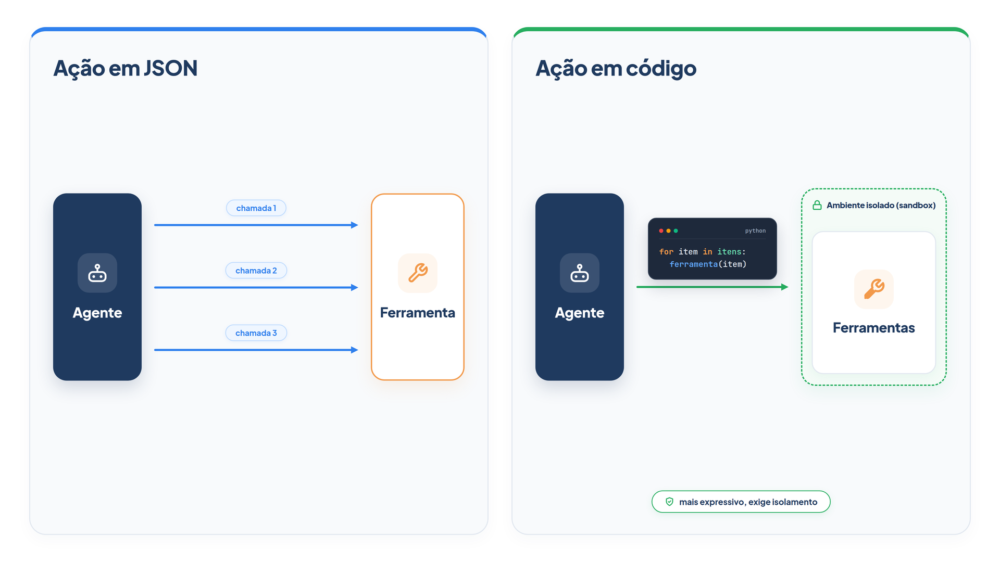

# Capítulo 13 — Ações em JSON ou em código

Em todos os exemplos até aqui, o modelo agiu de uma única forma: pediu uma ferramenta pelo nome, com argumentos em formato estruturado, e o seu código a executou. Há uma segunda forma: o modelo *escreve um trecho de código* que usa as ferramentas, e o seu programa o executa. Neste capítulo, você implementa as duas, compara-as em um mesmo problema e entende o preço da segunda: executar código que um modelo escreveu. No fim, você terá um critério para escolher.



> **Antes de começar — PydanticAI neste capítulo**
>
> Neste capítulo você usa `Agent`, `.run_sync`, `.tool_plain`, `ModelRetry` e `FunctionModel`, além de `.usage` e `.tool_calls` para contar as chamadas. Se algum deles não for familiar, revise o [Capítulo 0.4](../modulo-00/0.4-o-primeiro-agente-por-dentro.md), o [Capítulo 0.5](../modulo-00/0.5-mensagens-e-testes-sem-api.md) e o [Capítulo 0.6](../modulo-00/0.6-ferramentas-e-saida-tipada.md).

## Duas formas de agir

A biblioteca de agentes *smolagents*, da Hugging Face, oferece as duas formas como dois tipos de agente, e os nomes ajudam a fixar a distinção:

- **`ToolCallingAgent`:** o modelo escreve cada ação como um objeto estruturado, quase sempre JSON, com o nome da ferramenta e os argumentos. É o que você tem feito com o PydanticAI.
- **`CodeAgent`:** o modelo escreve as ações em código Python, que chama as ferramentas, usa variáveis, laços e condicionais, e é executado em seguida.

Pesquisas citadas pela documentação do smolagents sustentam que escrever ações em código é um modo mais natural e flexível de agir. O argumento é direto: as linguagens de programação foram criadas para expressar ações que um computador executa, então um agente que programa tem à sua disposição uma linguagem feita para isso. Quatro vantagens são apontadas:

- **Composição:** é possível aninhar ações e definir funções reutilizáveis, algo impraticável em JSON.
- **Gestão de objetos:** o resultado de uma ação fica em uma variável e pode ser usado depois; em JSON não há onde guardá-lo.
- **Generalidade:** código expressa qualquer coisa que um computador faça.
- **Presença nos dados de treino:** os modelos viram muito código de qualidade ao serem treinados.

Vamos ver o que isso significa na prática.

## O mesmo problema, duas formas

A cliente Lia tem 40 pedidos. Pergunta: "Quantas canecas há, no total, nos pedidos da lia que estão em separação?" Para responder, o agente precisa listar os pedidos, escolher os que estão em separação, consultar os itens de cada um e somar.

Primeiro, as ferramentas, agora devolvendo objetos Python em vez de texto. O PydanticAI as serializa para JSON quando o agente é do tipo estruturado.

*ferramentas.py*

```python
from loja import PEDIDOS_POR_CLIENTE


def listar_pedidos(cliente: str) -> list[dict]:
    """Lista os pedidos de um cliente. Cada item tem `codigo`, `status` e `data`."""
    pedidos = PEDIDOS_POR_CLIENTE.get(cliente, {})
    return [{"codigo": c, "status": p["status"], "data": p["data"]} for c, p in pedidos.items()]


def detalhar_pedido(cliente: str, codigo: str) -> dict:
    """Devolve os dados de um pedido: `status`, `data` e `itens` (texto, como '3x caneca; ...')."""
    pedido = PEDIDOS_POR_CLIENTE.get(cliente, {}).get(codigo)
    return pedido if pedido else {"erro": "Pedido não encontrado."}
```

Agora os dois agentes. O de ações em JSON já conhecemos. O de código recebe uma única ferramenta, `executar_codigo`, e a instrução descreve as funções que o código pode chamar.

*agentes_de_acao.py*

```python
from pydantic_ai import Agent, ModelRetry

from config import MODELO
from executor import ErroDeExecucao, executar
from ferramentas import detalhar_pedido, listar_pedidos

FERRAMENTAS = {"listar_pedidos": listar_pedidos, "detalhar_pedido": detalhar_pedido}

agente_json = Agent(
    MODELO,
    tools=[listar_pedidos, detalhar_pedido],
    instructions="Você atende clientes da loja Casa Verde. Use as ferramentas e responda em uma frase.",
)

INSTRUCOES_CODIGO = """\
Você atende clientes da loja Casa Verde. Para consultar dados, escreva código
Python e execute-o com `executar_codigo`. Use print() para ver resultados.
Funções disponíveis:

- listar_pedidos(cliente: str) -> list[dict]: itens com `codigo`, `status` e `data`.
- detalhar_pedido(cliente: str, codigo: str) -> dict: `status`, `data` e `itens`
  (texto, como '3x caneca; ...').

Você pode usar variáveis, laços, condicionais e operações com texto, números e
listas. Não há imports nem acesso a arquivos. Imprima só o resultado final.
Responda ao cliente em uma frase.
"""

agente_codigo = Agent(MODELO, instructions=INSTRUCOES_CODIGO)


@agente_codigo.tool_plain
def executar_codigo(codigo: str) -> str:
    """Executa um trecho de Python e devolve o que ele imprimiu com print()."""
    try:
        return executar(codigo, FERRAMENTAS) or "(sem saída: use print para mostrar o resultado)"
    except ErroDeExecucao as erro:
        raise ModelRetry(str(erro)) from None
```

Dois pontos de atenção neste arquivo. Primeiro, `executar` e `ErroDeExecucao` vêm de um módulo que escreveremos na próxima seção, o *executor*, responsável por rodar o código com restrições. Segundo, quando o código falha, a exceção vira `ModelRetry`, e o modelo recebe o erro para corrigir o código, o mesmo mecanismo do Capítulo 12.

Para comparar sem chave de API, simulamos um modelo para cada forma, ambos com o roteiro correto. O de JSON lista os pedidos e, em seguida, consulta *em paralelo* os dez que estão em separação; o de código escreve um único trecho.

*comparacao.py*

```python
from pydantic_ai import ModelResponse, TextPart, ToolCallPart
from pydantic_ai.messages import ToolReturnPart
from pydantic_ai.models.function import AgentInfo, FunctionModel

from agentes_de_acao import agente_codigo, agente_json
from loja import PEDIDOS_POR_CLIENTE

PERGUNTA = "Quantas canecas há, no total, nos pedidos da lia que estão em separação?"
EM_SEPARACAO = [c for c, p in PEDIDOS_POR_CLIENTE["lia"].items() if p["status"] == "em separação"]

CODIGO = """\
total = 0
for pedido in listar_pedidos("lia"):
    if pedido["status"] == "em separação":
        detalhes = detalhar_pedido("lia", pedido["codigo"])
        total += int(detalhes["itens"].split("x")[0])
print(total)
"""


def modelo_json(mensagens, info: AgentInfo) -> ModelResponse:
    retornos = sum(isinstance(p, ToolReturnPart) for m in mensagens for p in m.parts)
    if retornos == 0:
        return ModelResponse(parts=[ToolCallPart("listar_pedidos", {"cliente": "lia"})])
    if retornos == 1:
        return ModelResponse(parts=[
            ToolCallPart("detalhar_pedido", {"cliente": "lia", "codigo": c}) for c in EM_SEPARACAO
        ])
    return ModelResponse(parts=[TextPart("Há 30 canecas nos pedidos em separação.")])


def modelo_codigo(mensagens, info: AgentInfo) -> ModelResponse:
    if any(isinstance(p, ToolReturnPart) for m in mensagens for p in m.parts):
        return ModelResponse(parts=[TextPart("Há 30 canecas nos pedidos em separação.")])
    return ModelResponse(parts=[ToolCallPart("executar_codigo", {"codigo": CODIGO})])


def medir(agente, modelo):
    resultado = agente.run_sync(PERGUNTA, model=FunctionModel(modelo))
    caracteres = sum(
        len(p.model_response_str())
        for m in resultado.all_messages()
        for p in m.parts
        if isinstance(p, ToolReturnPart)
    )
    return resultado, caracteres


for nome, agente, modelo in [("JSON  ", agente_json, modelo_json), ("Código", agente_codigo, modelo_codigo)]:
    resultado, caracteres = medir(agente, modelo)
    print(f"{nome}: {resultado.usage.requests} chamadas ao modelo, "
          f"{resultado.usage.tool_calls} chamadas de ferramenta, "
          f"{caracteres} caracteres de resultado no contexto")
```

Saída:

```text
JSON  : 3 chamadas ao modelo, 11 chamadas de ferramenta, 4671 caracteres de resultado no contexto
Código: 2 chamadas ao modelo, 1 chamadas de ferramenta, 2 caracteres de resultado no contexto
```

Leia a diferença em três números.

**Chamadas ao modelo.** O agente de JSON usou três: uma para listar, uma para pedir os dez detalhes, uma para responder. O de código usou duas: uma para escrever o programa, outra para responder. O laço rodou *dentro* da execução do código, não no ciclo do agente.

**Chamadas de ferramenta.** O de JSON fez 11 pedidos individuais; o de código fez só uma, `executar_codigo`. As 11 consultas de dados aconteceram dentro dela.

**Contexto.** O de JSON colocou 4.671 caracteres de dados no contexto do modelo, os 40 pedidos e os 10 detalhes, e depois deixou que o modelo somasse de cabeça. O de código colocou 2 caracteres: o número 30, calculado pelo programa. Os dados intermediários nunca entraram na janela de contexto. Releia o Capítulo 8: o código acabou de resolver, de graça, o problema dos resultados grandes.

Há ainda um ganho de correção: a soma foi feita por código, que não erra a aritmética, e não por um modelo que poderia errar ao somar dez parcelas.

### Por dentro da medição

A função `medir` de `comparacao.py` percorre as mensagens da execução para somar o que cada ferramenta devolveu. Se essa estrutura for nova, o exemplo abaixo faz a mesma coisa em miniatura, com uma ferramenta de soma, e imprime cada peça. Lembrete: `.tool_calls` é um atributo de `resultado.usage`, apresentado no [Capítulo 0.6](../modulo-00/0.6-ferramentas-e-saida-tipada.md).

*anatomia_da_medicao.py*

```python
from pydantic_ai import Agent, ModelResponse, TextPart, ToolCallPart
from pydantic_ai.messages import ToolReturnPart
from pydantic_ai.models.function import AgentInfo, FunctionModel

agente = Agent(instructions="Some os números pedidos.")


@agente.tool_plain
def somar(a: int, b: int) -> dict:
    return {"total": a + b}


def modelo(mensagens, info: AgentInfo) -> ModelResponse:
    if any(isinstance(p, ToolReturnPart) for m in mensagens for p in m.parts):
        return ModelResponse(parts=[TextPart("Deu 5.")])
    return ModelResponse(parts=[ToolCallPart("somar", {"a": 2, "b": 3})])


resultado = agente.run_sync("Some 2 e 3.", model=FunctionModel(modelo))

for mensagem in resultado.all_messages():
    for parte in mensagem.parts:
        print(type(parte).__name__)
        if isinstance(parte, ToolReturnPart):
            print("  content            =", parte.content)
            print("  model_response_str =", parte.model_response_str())

print(resultado.usage.requests, resultado.usage.tool_calls)
```

Saída:

```text
UserPromptPart
ToolCallPart
ToolReturnPart
  content            = {'total': 5}
  model_response_str = {"total":5}
TextPart
2 1
```

`resultado.all_messages()` devolve a conversa inteira, e cada mensagem tem uma lista de partes (`parts`). A parte `ToolReturnPart` guarda o retorno de uma ferramenta: `content` é o objeto Python que a função devolveu, e `model_response_str()` é o texto que o modelo de fato recebe, aqui o dicionário já serializado em JSON, sem espaços. É o tamanho desse texto que `comparacao.py` soma em "caracteres de resultado no contexto". Já `usage.requests` conta as idas ao modelo (2: pedir a ferramenta e responder) e `usage.tool_calls` conta as ferramentas executadas (1).

> **Nota:** Esses números vêm de modelos simulados com roteiro ideal. Um modelo real pode escrever um código diferente ou precisar de uma correção. A comparação mostra a *estrutura* dos dois caminhos, não uma garantia de desempenho.

### Faça você mesmo

- **13.1 Outra pergunta:** escreva o código que responderia "Qual é o código do pedido mais antigo que ainda está em separação?". Execute-o com `executar(codigo, FERRAMENTAS)` e confira o resultado.
- **13.2 Comparação ampliada:** adapte `comparacao.py` para a pergunta "Quantos pedidos da lia foram entregues?". Preveja os números antes de executar.
- **13.3 Quando JSON basta:** descreva uma pergunta do atendimento da Casa Verde em que o agente de JSON e o de código usariam o mesmo número de chamadas ao modelo.

## O preço: executar código escrito por um modelo

O agente de código tem uma vantagem clara e um risco igualmente claro. Executar um código que um modelo escreveu é entregar a ele muito mais poder sobre o seu sistema. A documentação do smolagents enumera as formas pelas quais isso pode dar errado:

- **Erro simples do modelo.** Modelos ainda são imperfeitos e podem gerar um comando danoso tentando ajudar. O risco é baixo, mas já foi observado.
- **Ataque à cadeia de suprimentos.** Rodar um modelo não confiável ou comprometido pode produzir código malicioso.
- **Injeção de prompt.** Um agente que navega na web pode chegar a uma página com instruções maliciosas, que entram na sua memória e se transformam em código.
- **Exploração de agentes públicos.** Um agente exposto ao público pode receber entradas criadas para abusar da execução de código.

Uma vez executado, o código malicioso pode danificar o sistema de arquivos, abusar de recursos e de APIs e comprometer a rede. Na escala de autonomia, os agentes de código dão ao modelo muito mais poder que as demais configurações, e o risco cresce junto.

### Um executor restrito

Uma primeira camada de defesa é não rodar o código com o interpretador comum, mas com um executor que só aceita um subconjunto da linguagem. O nosso lê o código como árvore sintática (*AST*), recusa tudo o que não está em uma lista de construções permitidas e roda o resto com um conjunto mínimo de funções.

*executor.py*

```python
import ast
import builtins
import io
import sys
from collections.abc import Callable
from contextlib import redirect_stdout

NOS_PERMITIDOS = (
    ast.Module, ast.Expr, ast.Assign, ast.AugAssign, ast.For, ast.While, ast.If,
    ast.Break, ast.Continue, ast.Pass,
    ast.Name, ast.Load, ast.Store, ast.Constant, ast.List, ast.Tuple, ast.Dict, ast.Set,
    ast.BinOp, ast.UnaryOp, ast.BoolOp, ast.Compare, ast.IfExp, ast.Call, ast.keyword,
    ast.Attribute, ast.Subscript, ast.Slice,
    ast.ListComp, ast.DictComp, ast.SetComp, ast.GeneratorExp, ast.comprehension,
    ast.JoinedStr, ast.FormattedValue,
    ast.operator, ast.unaryop, ast.boolop, ast.cmpop,
)
NOMES_SEGUROS = [
    "len", "sum", "min", "max", "sorted", "range", "print", "str", "int", "float",
    "round", "enumerate", "zip", "list", "dict", "set", "abs", "bool",
]
METODOS_PROIBIDOS = {"format", "format_map"}


class ErroDeExecucao(Exception):
    pass


def validar(arvore: ast.AST) -> None:
    for no in ast.walk(arvore):
        if not isinstance(no, NOS_PERMITIDOS):
            raise ErroDeExecucao(f"Construção não permitida: {type(no).__name__}")
        if isinstance(no, ast.Attribute) and (no.attr.startswith("_") or no.attr in METODOS_PROIBIDOS):
            raise ErroDeExecucao(f"Acesso não permitido ao atributo '{no.attr}'")
        if isinstance(no, ast.Name) and no.id.startswith("_"):
            raise ErroDeExecucao(f"Nome não permitido: '{no.id}'")


def executar(codigo: str, ferramentas: dict[str, Callable], max_linhas: int = 10_000) -> str:
    try:
        arvore = ast.parse(codigo)
    except SyntaxError as erro:
        raise ErroDeExecucao(f"Sintaxe inválida: {erro.msg} (linha {erro.lineno})") from None
    validar(arvore)

    ambiente = {"__builtins__": {nome: getattr(builtins, nome) for nome in NOMES_SEGUROS}, **ferramentas}
    contagem = {"linhas": 0}

    def rastrear(quadro, evento, argumento):
        if evento == "line":
            contagem["linhas"] += 1
            if contagem["linhas"] > max_linhas:
                raise ErroDeExecucao("Limite de operações excedido.")
        return rastrear

    saida = io.StringIO()
    compilado = compile(arvore, "<agente>", "exec")
    sys.settrace(rastrear)
    try:
        with redirect_stdout(saida):
            exec(compilado, ambiente)
    except ErroDeExecucao:
        raise
    except Exception as erro:
        raise ErroDeExecucao(f"{type(erro).__name__}: {erro}") from None
    finally:
        sys.settrace(None)
    return saida.getvalue().strip()
```

O executor tem quatro defesas, cada uma na sua parte do código:

1. **Lista de construções permitidas.** `validar` percorre toda a árvore e recusa qualquer nó que não esteja em `NOS_PERMITIDOS`. Fora da lista ficam `import`, definição de funções e classes, `try`, `with` e outras.
2. **Atributos e nomes internos.** Recusa qualquer atributo ou nome que comece com `_`, porta de entrada comum para escapar das restrições, e os métodos `format` e `format_map`, que permitem acessar atributos por texto.
3. **Funções mínimas.** O código roda com um conjunto fechado de funções (`len`, `sum`, `print` e poucas mais), além das ferramentas que você entrega. Não há `open`, `eval` nem `exec`.
4. **Limite de operações.** `rastrear` conta as linhas executadas e interrompe o programa depois de `max_linhas`, para barrar laços infinitos.

Vamos ver as defesas em ação, com sete tentativas:

*ataques.py*

```python
from executor import ErroDeExecucao, executar

TENTATIVAS = {
    "código legítimo": "total = 0\nfor n in range(4):\n    total += n\nprint(total)",
    "importar módulo": "import os\nprint(os.listdir('.'))",
    "acessar atributo interno": "print(().__class__)",
    "abrir arquivo": "print(open('segredo.txt').read())",
    "truque com format": "print('{0.__class__}'.format(1))",
    "definir função": "def f():\n    return 1\nprint(f())",
    "laço infinito": "while True:\n    pass",
}

for nome, codigo in TENTATIVAS.items():
    try:
        print(f"{nome:26s} -> executado: {executar(codigo, {})}")
    except ErroDeExecucao as erro:
        print(f"{nome:26s} -> bloqueado: {erro}")
```

Saída:

```text
código legítimo            -> executado: 6
importar módulo            -> bloqueado: Construção não permitida: Import
acessar atributo interno   -> bloqueado: Acesso não permitido ao atributo '__class__'
abrir arquivo              -> bloqueado: NameError: name 'open' is not defined
truque com format          -> bloqueado: Acesso não permitido ao atributo 'format'
definir função             -> bloqueado: Construção não permitida: FunctionDef
laço infinito              -> bloqueado: Limite de operações excedido.
```

O código legítimo rodou, e as seis tentativas de abuso foram contidas. Repare no "truque com format": `'{0.__class__}'.format(1)` esconde o acesso proibido *dentro de um texto*, onde a lista de nós não o veria. Foi preciso pensar nele de forma específica. Esse é o ponto fraco de toda proteção por lista: você precisa antecipar cada truque.

### Armadilha: confiar no executor local

**Este executor é didático. Não o use em produção para código de fontes não confiáveis.** Nenhum interpretador local restrito é completamente seguro: um atacante determinado, ou um modelo malicioso, pode encontrar uma brecha. O nosso, por exemplo, não limita memória: `"a" * 10**10` passa pela validação e tenta alocar 10 GB. Pacotes aparentemente inofensivos que você libere podem abrir outras portas. A própria documentação do smolagents, que investiu em um executor local bem mais elaborado que o nosso, afirma que a única forma de rodar código de um modelo com isolamento robusto é a execução remota.

### Isolamento de verdade: sandbox

Um *sandbox* é um ambiente isolado, separado do seu sistema, onde o código roda com recursos e permissões limitados. As opções incluem contêineres Docker e serviços como E2B, Modal e Blaxel. Há duas arquiteturas:

- **Só o trecho de código no sandbox.** O agente, o modelo e as ferramentas ficam no seu ambiente; apenas o código gerado é enviado e executado no isolamento. É mais simples e não exige levar chaves de API para o sandbox, mas não suporta bem sistemas com vários agentes.
- **O sistema inteiro no sandbox.** Agente, modelo e ferramentas rodam isolados. Dá melhor isolamento e suporta multiagentes, mas exige mais montagem e pode exigir levar chaves de API para dentro.

Boas práticas para qualquer sandbox: limitar memória e CPU, impor tempo máximo de execução, rodar com o mínimo de privilégios, desativar o acesso à rede quando não for necessário, guardar segredos em variáveis de ambiente, manter poucas dependências com versões fixas e sempre limpar os recursos ao final.

### Faça você mesmo

- **13.4 Novo ataque:** pense em uma tentativa de abuso que o executor ainda não bloqueia, como consumir memória, e escreva-a. Execute-a com cuidado, com `max_linhas` baixo, e proponha uma defesa.
- **13.5 Nova construção:** acrescente ao executor a permissão para `try`/`except`, sem permitir acesso a nada novo. Teste com um código que use um índice inexistente.
- **13.6 O que você precisaria:** liste cinco medidas que um sandbox de produção deveria ter para executar o código do agente de pedidos, usando as boas práticas acima.

## Qual forma escolher?

A comparação resume as forças de cada abordagem:

| Critério | Ações em JSON | Ações em código |
| --- | --- | --- |
| Expressividade | uma ferramenta por chamada | laços, condicionais, variáveis e composição |
| Dados intermediários | entram no contexto | ficam no programa |
| Auditoria e controle | cada ação é visível e pode ser aprovada ou recusada | o programa inteiro precisa ser inspecionado |
| Superfície de risco | restrita às ferramentas que você registrou | exige executor e isolamento |
| Esforço de montagem | baixo | alto, por causa do sandbox |

Uma regra prática decorre dela:

- **Prefira JSON quando as ações são poucas, simples ou arriscadas.** Cancelar um pedido, enviar um e-mail ou mover dinheiro merecem uma ferramenta específica, com contrato claro, validação e, se for o caso, aprovação humana. O Módulo 8 trata disso.
- **Considere código quando o problema exige composição.** Percorrer muitos itens, agregar resultados, combinar dados de várias fontes: nesses casos, o código reduz voltas do ciclo e tira os dados intermediários do contexto, *se* você tem um sandbox.
- **Combine.** Um agente pode ter ferramentas JSON para as ações de escrita, que mudam o mundo, e um executor de código isolado só para leitura e análise de dados.

Seguindo a escada do Capítulo 4, comece com JSON. Só adote código quando as chamadas se multiplicarem a ponto de justificar o trabalho de isolamento.

### Faça você mesmo

- **13.7 Decisão em quatro casos:** para cada caso, escolha JSON ou código, ou uma combinação, e justifique: (a) cancelar um pedido; (b) calcular a média de valor dos pedidos de um cliente nos últimos seis meses; (c) enviar um e-mail de confirmação; (d) cruzar pedidos, estoque e transportadora para achar atrasos.
- **13.8 Híbrido:** monte, no papel, um agente híbrido para a Casa Verde. Liste quais ferramentas seriam JSON, o que seria feito em código e onde ficaria o limite de isolamento.

## Recapitulando

Você agora conhece as duas formas de um agente agir: chamadas estruturadas, em JSON, e código executado. Comparou-as em um mesmo problema e viu o ganho do código: menos voltas, dados intermediários fora do contexto e aritmética exata. Também viu o seu custo: executar código escrito por um modelo exige um executor restrito, e mesmo ele não substitui um sandbox. Sabe, enfim, escolher: JSON para ações poucas e de risco, código para composição, com isolamento, ou uma combinação dos dois.

Com isso, o Módulo 4 está completo: você escreve contratos de ferramenta claros, trata cada ferramenta como uma interface para um leitor que é um modelo e decide entre ações em JSON e em código. Até aqui, o conhecimento do agente veio das instruções e das ferramentas. O próximo módulo trata de outra fonte de conhecimento: como dar ao agente informação que ele não tem, por meio de prompts melhores, de recuperação de documentos (RAG) e de ajuste fino do modelo, e como escolher entre as três.

### Fontes do capítulo

- Hugging Face — [Documentação do smolagents](https://huggingface.co/docs/smolagents/index), incluindo os guias conceituais e o tutorial de execução segura: `CodeAgent` e `ToolCallingAgent`; vantagens das ações em código (composição, gestão de objetos, generalidade, presença nos dados de treino); riscos da execução de código gerado; executor local restrito, limites e sandboxes (Docker, E2B, Modal, Blaxel); boas práticas de isolamento.
- Anthropic — [Effective Context Engineering for AI Agents](https://www.anthropic.com/engineering/effective-context-engineering-for-ai-agents): uso de código para analisar grandes volumes de dados sem carregá-los no contexto.
- Documentação do PydanticAI: *Function Tools* e `ModelRetry`.
