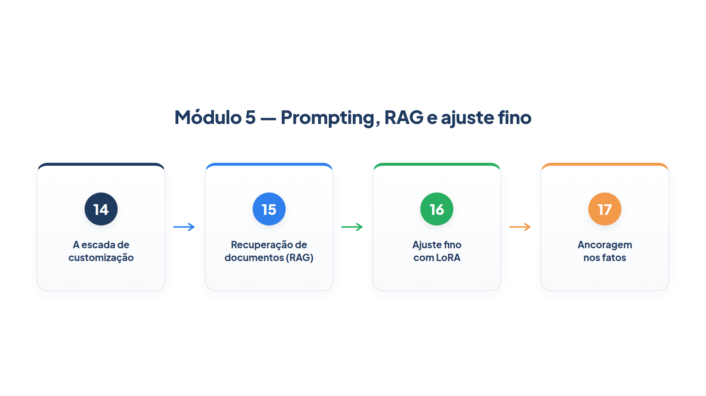

# Módulo 5 — Prompting, RAG e ajuste fino

Um agente só é tão bom quanto o que ele sabe e o quanto se comporta como a sua empresa espera. Quando o modelo erra um prazo, usa o tom errado ou ignora uma convenção, a tentação é "treinar o modelo". Quase sempre existe um remédio mais barato. Este módulo ensina a diagnosticar o tipo de falha e a escolher entre três remédios: melhorar o prompt, recuperar documentos e ajustar o modelo. Ao final dele, você será capaz de:

- classificar uma falha do agente como falta de conhecimento ou de comportamento, e escolher o remédio mais simples que a resolve;
- montar um sistema de recuperação de documentos (RAG), do índice à resposta com citações;
- explicar o que é o ajuste fino com LoRA, quanto ele economiza e quando não o usar;
- verificar se uma resposta está ancorada nos fatos recuperados antes de entregá-la.

## Percurso

1. **Capítulo 14 — A escada de customização.** Você aprende a progressão prompt, RAG e ajuste fino, e monta uma bancada que diagnostica o tipo de falha de um agente.
2. **Capítulo 15 — Recuperação de documentos (RAG).** Você constrói um índice de políticas da loja, uma busca e um agente que responde citando as fontes.
3. **Capítulo 16 — Ajuste fino com LoRA.** Você calcula quanto o LoRA reduz o treinamento, prepara um conjunto de dados e conhece os limites do ajuste fino.
4. **Capítulo 17 — Ancoragem nos fatos.** Você acrescenta um verificador que compara a resposta com os trechos recuperados e recusa o que não tem apoio.

Os arquivos `config.py` e `trajetoria.py` são os mesmos do Módulo 4. Os demais exemplos do módulo usam uma base de políticas fictícia da Casa Verde, em `documentos.py`.

> **Nota:** Neste módulo, parte dos exemplos precisa de um modelo real para mostrar o efeito (por exemplo, a diferença entre o agente com e sem RAG). Quando a saída é exata, ela vem de um modelo simulado, e o texto avisa. Nenhum treinamento é executado aqui: o Capítulo 16 trabalha com a aritmética e a preparação de dados, que você consegue reproduzir em qualquer máquina.
