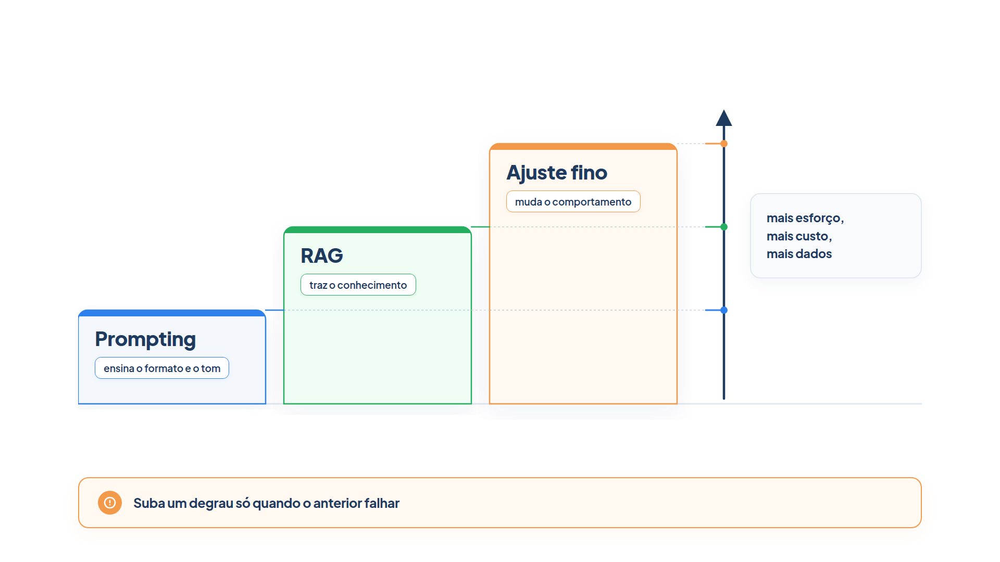

# Capítulo 14 — A escada de customização

Até aqui, o conhecimento do agente veio de duas fontes: o que o modelo aprendeu no treinamento e o que você escreveu nas instruções e nas ferramentas. Quando o agente erra, a pergunta é: o que mudar? Este capítulo oferece um critério. Você conhece uma escada de remédios, da mais barata à mais cara, aprende a escrever um prompt completo e monta uma pequena bancada que diagnostica *que tipo* de falha o agente tem.



> **Antes de começar — PydanticAI neste capítulo**
>
> Neste capítulo você usa `Agent`, `.run_sync`, `.output` e o argumento `instructions`. Se algum deles não for familiar, revise o [Capítulo 0.4](../modulo-00/0.4-o-primeiro-agente-por-dentro.md). Para o `FunctionModel`, o `ModelResponse` e o `TextPart`, que simulam um modelo sem API, veja o [Capítulo 0.5](../modulo-00/0.5-mensagens-e-testes-sem-api.md).

## Uma escada, não um menu

Existem várias formas de adaptar um modelo de linguagem ao seu caso. A AWS as organiza em uma escada de oito passos, em que cada degrau aumenta o esforço, o custo e a necessidade de dados, e também o controle e a especificidade que você obtém. Os degraus se agrupam em três categorias:

- **Usar:** não modificar o modelo. Inclui chamá-lo como está e otimizar o prompt.
- **Potencializar:** acrescentar recursos ao modelo, como dados externos (RAG), cache e destilação.
- **Treinar:** modificar o modelo, com ajuste fino, pré-treinamento contínuo ou um modelo próprio.

A recomendação é a mesma da escada do Capítulo 4: comece pela abordagem mais simples e vá mais fundo apenas quando necessário. A maior parte das aplicações nunca passa do terceiro degrau, a recuperação de documentos.

Neste módulo, interessam os três degraus que resolvem a maioria dos problemas de um agente: **prompting**, **RAG** e **ajuste fino**.

| Degrau | O que ele muda | Falha que ele resolve |
| --- | --- | --- |
| Prompting | as instruções que o modelo lê | formato, tom e raciocínio errados, com o conhecimento certo |
| RAG | os dados que o modelo recebe na hora | conhecimento ausente, privado ou que muda |
| Ajuste fino | os pesos do próprio modelo | comportamento ou estilo que prompt e RAG não alcançam |

## Primeiro, diagnosticar

Antes de escolher um remédio, é preciso saber qual é a doença. Uma resposta ruim pode ter causas diferentes. Considere dois defeitos do atendente da Casa Verde:

- Ao perguntarem o prazo de devolução, ele inventa "30 dias". O modelo **não tem o dado**: a política da loja não está em lugar nenhum do que ele lê.
- Ao avisar que um pedido foi enviado, ele não termina a mensagem com a assinatura "Equipe Casa Verde". O modelo **não conhece a convenção**.

Os dois são "respostas erradas", mas pedem remédios diferentes. A primeira é falta de conhecimento (RAG); a segunda é falta de instrução (prompt). Uma bancada com casos rotulados mostra a proporção de cada tipo.

*diagnostico.py*

```python
from pydantic_ai import Agent

from config import MODELO

ASSINATURA = "Equipe Casa Verde"

CASOS = [
    ("Qual é o prazo de devolução?", "conhecimento", lambda r: "7 dias" in r),
    ("O frete é grátis a partir de que valor?", "conhecimento", lambda r: "200" in r),
    ("Avise que o pedido 1001 foi enviado.", "formato", lambda r: r.rstrip().endswith(ASSINATURA)),
    ("Avise que o pedido 1002 está em separação.", "formato", lambda r: r.rstrip().endswith(ASSINATURA)),
]

SUGESTAO = {
    "conhecimento": "o modelo não tem o dado: recuperação (RAG)",
    "formato": "o modelo não conhece a convenção: melhore o prompt",
}


def diagnosticar(agente: Agent, **opcoes) -> dict[str, int]:
    falhas: dict[str, int] = {}
    totais: dict[str, int] = {}
    for pergunta, tipo, passou in CASOS:
        resposta = agente.run_sync(pergunta, **opcoes).output
        totais[tipo] = totais.get(tipo, 0) + 1
        if not passou(resposta):
            falhas[tipo] = falhas.get(tipo, 0) + 1
            print(f"FALHOU [{tipo}] {pergunta}\n        -> {resposta}")
    print()
    for tipo, total in totais.items():
        print(f"{tipo:12s}: {falhas.get(tipo, 0)} de {total} falharam")
    for tipo in falhas:
        print(f"Sugestão para {tipo}: {SUGESTAO[tipo]}")
    return falhas
```

Cada caso é uma tupla com a pergunta, o tipo de falha que ele sonda e uma função que decide se a resposta passou. As funções são **avaliadores em código**, simples e exatas: conferem a presença de "7 dias", de "200" e da assinatura. A função `diagnosticar` roda os casos, conta as falhas por tipo e sugere o remédio.

Para ter uma saída garantida, vamos usar um modelo simulado que responde como um modelo sem conhecimento da loja e sem a convenção:

*diagnostico_simulado.py*

```python
from pydantic_ai import Agent, ModelResponse, TextPart
from pydantic_ai.models.function import AgentInfo, FunctionModel

from diagnostico import diagnosticar

RESPOSTAS = {
    "Qual é o prazo de devolução?": "O prazo costuma ser de 30 dias.",
    "O frete é grátis a partir de que valor?": "Depende da região e da promoção vigente.",
    "Avise que o pedido 1001 foi enviado.": "Olá! Seu pedido 1001 já foi enviado e logo chega até você.",
    "Avise que o pedido 1002 está em separação.": "Seu pedido 1002 está sendo separado.",
}


def modelo_basico(mensagens, info: AgentInfo) -> ModelResponse:
    return ModelResponse(parts=[TextPart(RESPOSTAS[mensagens[-1].parts[-1].content])])


diagnosticar(Agent(), model=FunctionModel(modelo_basico))
```

Saída:

```text
FALHOU [conhecimento] Qual é o prazo de devolução?
        -> O prazo costuma ser de 30 dias.
FALHOU [conhecimento] O frete é grátis a partir de que valor?
        -> Depende da região e da promoção vigente.
FALHOU [formato] Avise que o pedido 1001 foi enviado.
        -> Olá! Seu pedido 1001 já foi enviado e logo chega até você.
FALHOU [formato] Avise que o pedido 1002 está em separação.
        -> Seu pedido 1002 está sendo separado.

conhecimento: 2 de 2 falharam
formato     : 2 de 2 falharam
Sugestão para conhecimento: o modelo não tem o dado: recuperação (RAG)
Sugestão para formato: o modelo não conhece a convenção: melhore o prompt
```

Os dois grupos falham por motivos diferentes, e a bancada sugere um remédio para cada. O que importa neste exemplo é a *ferramenta de diagnóstico*, e não o modelo falso: com um modelo real, você substitui a última linha por `diagnosticar(Agent(MODELO))` e vê a sua própria distribuição de falhas. Ela é o primeiro passo de qualquer decisão sobre customização, e o Módulo 9 a desenvolve em avaliações completas.

> **Nota:** O argumento `Agent()` sem modelo só funciona aqui porque o `FunctionModel` o substitui. Com um modelo real, passe `MODELO`.

### O que a função do modelo simulado recebe

Na linha `mensagens[-1].parts[-1].content` de `modelo_basico`, o `FunctionModel` chama a sua função a cada requisição, passando a lista de mensagens da conversa e um `AgentInfo`. Para ver o que há dentro dessa lista, este programa só imprime:

*funcao_do_modelo_simulado.py*

```python
from pydantic_ai import Agent, ModelResponse, TextPart
from pydantic_ai.models.function import AgentInfo, FunctionModel


def espiao(mensagens, info: AgentInfo) -> ModelResponse:
    print("mensagens:", len(mensagens))
    print("última mensagem:", type(mensagens[-1]).__name__)
    print("última parte:", type(mensagens[-1].parts[-1]).__name__)
    print("conteúdo:", mensagens[-1].parts[-1].content)
    return ModelResponse(parts=[TextPart("ok")])


resultado = Agent().run_sync("Qual é o prazo de devolução?", model=FunctionModel(espiao))
print("saída:", resultado.output)
```

Saída:

```text
mensagens: 1
última mensagem: ModelRequest
última parte: UserPromptPart
conteúdo: Qual é o prazo de devolução?
saída: ok
```

Com um agente sem instruções e uma só pergunta, a lista tem uma mensagem, uma `ModelRequest`, e a sua última parte é a pergunta do usuário (`UserPromptPart`). Por isso `mensagens[-1].parts[-1].content` devolve o texto da pergunta, e o dicionário `RESPOSTAS` o usa como chave. Note também que `model=FunctionModel(...)` foi passado ao `run_sync`: esse argumento troca o modelo só naquela chamada, e é o que `**opcoes` repassa em `diagnosticar`.

### Faça você mesmo

- **14.1 Seu diagnóstico:** execute `diagnosticar(Agent(MODELO))` com o modelo real. Anote quantas falhas de cada tipo apareceram.
- **14.2 Mais casos:** acrescente quatro casos à lista, dois de cada tipo, com avaliadores em código. Um dos casos de formato deve verificar o limite de 160 caracteres.
- **14.3 Um terceiro tipo:** proponha um tipo de falha que não é de conhecimento nem de formato, como "o agente executa uma ação que não deveria", e escreva um caso e um avaliador para ele.

## Degraus 1 e 2: usar e instruir

O primeiro degrau é chamar o modelo como está. Funciona para tarefas gerais, como resumir e traduzir, quando a precisão sem customização já é aceitável. Você sobe quando a saída é genérica, tem o formato errado ou não segue as convenções do domínio.

O segundo degrau é a **engenharia de prompts**: otimizar o que o modelo lê, sem mexer em seus pesos. Os instrumentos são as instruções do sistema, exemplos dentro do prompt (*few-shot*) e raciocínio em etapas, que você viu no Capítulo 6. Um prompt eficaz tem cinco blocos:

1. **Instruções claras:** verbos de ação e escopo bem definido.
2. **Contexto suficiente:** a situação, as dependências e as restrições.
3. **Requisitos específicos:** o que o agente deve e não deve fazer.
4. **Formato de saída:** como a resposta deve ser escrita.
5. **Indicadores de qualidade:** o comportamento esperado e os casos de borda.

Aplicados ao atendente, e com dois exemplos, ficam assim:

*prompt_em_blocos.py*

```python
from pydantic_ai import Agent

from config import MODELO

BLOCOS = {
    "Instruções": (
        "Você é o atendente virtual da loja Casa Verde. Responda dúvidas de clientes "
        "sobre pedidos, entregas e trocas."
    ),
    "Contexto": (
        "Os clientes escrevem pelo chat do site, em geral pelo celular. A loja vende "
        "utensílios e decoração para a casa."
    ),
    "Requisitos": (
        "Seja cordial e direto. Não prometa nada que a loja não tenha confirmado. "
        "Nunca invente prazos, valores ou políticas."
    ),
    "Formato de saída": (
        "Escreva no máximo duas frases e termine sempre com a assinatura 'Equipe Casa Verde'."
    ),
    "Exemplos": (
        "Cliente: Meu pedido já saiu?\n"
        "Atendente: Seu pedido foi enviado e chega até 12/10. Equipe Casa Verde\n\n"
        "Cliente: Posso trocar a cor do vaso?\n"
        "Atendente: Posso verificar a troca para você; me informe o código do pedido. Equipe Casa Verde"
    ),
}


def montar_prompt(blocos: dict[str, str]) -> str:
    return "\n\n".join(f"# {titulo}\n{texto}" for titulo, texto in blocos.items())


def estimar_tokens(texto: str) -> int:
    return len(texto) // 4


INSTRUCOES = montar_prompt(BLOCOS)
agente_com_prompt = Agent(MODELO, instructions=INSTRUCOES)

if __name__ == "__main__":
    print(INSTRUCOES)
    print(f"\nTamanho aproximado: {estimar_tokens(INSTRUCOES)} tokens")
```

Saída:

```text
# Instruções
Você é o atendente virtual da loja Casa Verde. Responda dúvidas de clientes sobre pedidos, entregas e trocas.

# Contexto
Os clientes escrevem pelo chat do site, em geral pelo celular. A loja vende utensílios e decoração para a casa.

# Requisitos
Seja cordial e direto. Não prometa nada que a loja não tenha confirmado. Nunca invente prazos, valores ou políticas.

# Formato de saída
Escreva no máximo duas frases e termine sempre com a assinatura 'Equipe Casa Verde'.

# Exemplos
Cliente: Meu pedido já saiu?
Atendente: Seu pedido foi enviado e chega até 12/10. Equipe Casa Verde

Cliente: Posso trocar a cor do vaso?
Atendente: Posso verificar a troca para você; me informe o código do pedido. Equipe Casa Verde

Tamanho aproximado: 181 tokens
```

O prompt resolve a falha de formato do diagnóstico: com a assinatura descrita e exemplificada, os dois casos de formato devem passar. Execute `diagnosticar(agente_com_prompt)` com o modelo real para conferir. Já as falhas de conhecimento persistem, e é o esperado: nenhum prompt contém a política de devolução, e um prompt que tentasse conter *todas* as políticas cresceria sem controle.

`estimar_tokens` usa a regra prática de quatro caracteres por token para aproximar o tamanho. Ela é só uma estimativa, mas serve para acompanhar o crescimento do prompt.

### Sinais de que é hora de subir

Fique no segundo degrau enquanto o modelo *tem* o conhecimento e só precisa de orientação sobre formato, tom ou caminho de raciocínio. Suba quando:

- o prompt passa de cerca de 2.000 tokens;
- as alucinações persistem apesar de instruções claras;
- falta ao modelo o conhecimento necessário.

O terceiro sinal é o do nosso diagnóstico: faltam os dados, e nenhum prompt os cria.

### Faça você mesmo

- **14.4 Antes e depois:** execute `diagnosticar` com `Agent(MODELO)` e com `agente_com_prompt`. Compare as falhas de formato.
- **14.5 Prompt demais:** acrescente ao prompt, em um bloco, o texto das oito políticas de `documentos.py` (cerca de 300 palavras). Meça `estimar_tokens`, rode o diagnóstico e descreva a vantagem e o problema dessa estratégia.
- **14.6 Seu prompt em blocos:** reescreva as instruções de um agente seu nos cinco blocos. Identifique qual bloco estava ausente.

## Degrau 3 e acima: o resto da escada

Quando o modelo não tem o conhecimento, o terceiro degrau é a **recuperação de documentos** (RAG, do inglês *retrieval-augmented generation*): entregar ao modelo, na hora da pergunta, os trechos relevantes de uma base externa. É o assunto do Capítulo 15. A AWS a recomenda quando o modelo precisa acessar dados privados, atualizados com frequência ou específicos do domínio, como documentos internos, políticas e catálogos.

Acima dele, a escada continua. A tabela resume os oito degraus:

| Degrau | Técnica | Esforço | Dados | Tempo típico |
| --- | --- | --- | --- | --- |
| 1 | Usar o modelo como está | mínimo | nenhum | horas |
| 2 | Engenharia de prompts | baixo | nenhum | dias |
| 3 | RAG | baixo a médio | documentos | dias a semanas |
| 4 | Cache de prompts | baixo | nenhum | dias |
| 5 | Destilação de modelos | médio | gerados sinteticamente | semanas |
| 6 | Ajuste fino | médio | milhares a dezenas de milhares de exemplos | semanas |
| 7 | Pré-treinamento contínuo | alto | bilhões de tokens ou mais | semanas a meses |
| 8 | Modelo próprio | muito alto | corpus proprietário grande | meses |

Em linhas gerais, os degraus 4 e 5 tratam de custo e latência, não de qualidade: o cache evita recalcular a parte fixa do prompt, e a *destilação* transfere o comportamento de um modelo grande para um menor e mais barato. O ajuste fino, o degrau 6, muda o comportamento do modelo e é o assunto do Capítulo 16. Os degraus 7 e 8 servem a indústrias muito especializadas e a quem tem grandes volumes de dados proprietários; para a maioria, os degraus de 1 a 7 bastam, e os de 1 a 3 costumam bastar sozinhos.

### Três erros comuns

A AWS cita três enganos frequentes:

1. **Servir um modelo grande em produção sem destilar.** Valide a qualidade com o modelo grande e destile para um menor antes de escalar.
2. **Escolher o pré-treinamento contínuo "porque temos muitos dados".** Volume não justifica o degrau. Se os dados são referência factual, como especificações e documentos, o RAG é mais barato, porque a informação muda.
3. **Pular para o ajuste fino "porque o RAG é lento".** O ajuste fino muda comportamento, não velocidade. Se a latência é o problema, corrija a divisão dos documentos, use busca híbrida ou o cache de prompts.

### Combinar, em vez de escolher

Os remédios não competem entre si. A combinação mais comum em produção é **ajuste fino mais RAG**: o ajuste cuida do comportamento e do formato, e o RAG fornece o conhecimento que muda depressa. Outra é destilar um modelo já ajustado, para obter o comportamento certo com a latência de produção.

### Faça você mesmo

- **14.7 Qual degrau?:** para cada situação, indique o degrau mais baixo que resolveria e justifique em uma frase: (a) o agente responde em inglês quando o cliente escreve em português; (b) o agente cita o prazo de entrega do ano passado; (c) o agente entende o pedido, mas explica de forma seca e impessoal, mesmo com um bom prompt e a política recuperada; (d) a conta de tokens está alta porque todo atendimento reenvia as mesmas 3.000 palavras de instruções.
- **14.8 Um erro, uma correção:** escolha um dos três erros comuns e descreva uma situação da Casa Verde em que você teria vontade de cometê-lo. Qual seria a alternativa mais barata?

## Recapitulando

Você agora sabe que as formas de adaptar um modelo formam uma escada, do prompt ao modelo próprio, em que cada degrau custa mais e que se deve subir apenas quando o anterior falhar. Escreveu um prompt em cinco blocos e montou uma bancada que classifica as falhas em conhecimento ou formato, indicando o remédio de cada uma. Também conhece os três erros mais comuns e o valor de combinar remédios.

O diagnóstico do atendente apontou duas falhas de conhecimento: o prazo de devolução e o valor do frete grátis. O Capítulo 15 as resolve, construindo uma base de documentos que o agente consulta antes de responder.

### Fontes do capítulo

- AWS — [The Generative AI Customization Spectrum](https://aws.amazon.com/blogs/machine-learning/the-generative-ai-customization-spectrum-from-prompt-engineering-to-custom-models-on-aws/): os oito passos e as categorias Usar, Potencializar e Treinar; estrutura do prompt eficaz em cinco blocos; sinais para subir de degrau; tabela de esforço, dados e tempo; os três erros comuns; combinação de ajuste fino e RAG.
- Documentação do PydanticAI: *Agentes* e *Instruções*.
