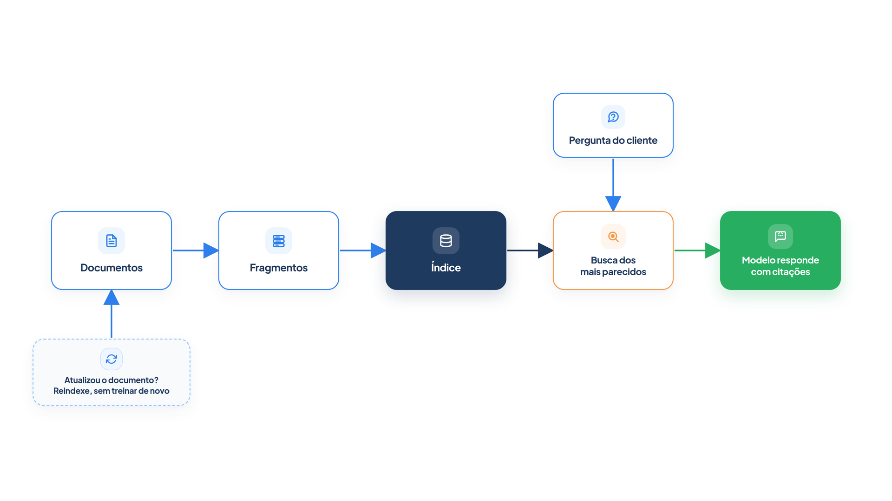

# Capítulo 15 — Recuperação de documentos (RAG)

O diagnóstico do Capítulo 14 apontou o problema do atendente: ele não sabe o prazo de devolução nem o valor do frete grátis, e nenhum prompt resolve isso sem crescer sem controle. Neste capítulo, você constrói a solução: uma base de documentos, um índice de busca e um agente que consulta a base antes de responder, citando de onde tirou cada informação. Ao final, você terá um sistema de recuperação (RAG) completo, em poucas dezenas de linhas, e saberá onde ele costuma falhar.



> **Antes de começar — PydanticAI neste capítulo**
>
> Neste capítulo você usa `Agent`, `tools=`, `instructions=`, `.run_sync` e `.output`, além de `FunctionModel` nos exemplos simulados. Se algum deles não for familiar, revise os Capítulos [0.4](../modulo-00/0.4-o-primeiro-agente-por-dentro.md), [0.5](../modulo-00/0.5-mensagens-e-testes-sem-api.md) e [0.6](../modulo-00/0.6-ferramentas-e-saida-tipada.md).

## Memória do modelo e memória externa

Um modelo de linguagem guarda conhecimento nos seus pesos, adquirido no treinamento. Os pesquisadores chamam isso de **memória paramétrica**. Ela tem três limites: é difícil de atualizar, não mostra de onde veio cada informação e pode produzir "alucinações", respostas plausíveis, mas falsas.

O **RAG**, de *retrieval-augmented generation* (geração aumentada por recuperação), combina essa memória com uma **memória não paramétrica**: uma base externa de documentos, consultada na hora da pergunta. O artigo que propôs o método, de 2020, mostrou que essa combinação gera respostas mais específicas e factuais que um modelo que só usa a própria memória, e acrescentou duas vantagens: o conhecimento pode ser revisado e ampliado diretamente, trocando os documentos, e o que o modelo consultou pode ser inspecionado.

O fluxo tem cinco etapas, e o desenho acima as resume:

1. **Documentos:** a base de conhecimento, aqui as políticas da loja.
2. **Fragmentos:** os documentos divididos em pedaços do tamanho de uma resposta.
3. **Índice:** cada fragmento convertido em um vetor numérico, para busca por semelhança.
4. **Busca:** a pergunta é convertida do mesmo modo, e os fragmentos mais parecidos são recuperados.
5. **Resposta:** o modelo recebe a pergunta e os fragmentos, e responde com base neles, citando-os.

Vamos construir cada etapa.

## Documentos e fragmentos

A base da Casa Verde está em `documentos.py`, uma lista de oito políticas, cada uma com `id`, `titulo` e `texto`. Veja o formato de uma entrada:

```python
{
    "id": "devolucao",
    "titulo": "Política de devolução",
    "texto": (
        "O cliente pode devolver qualquer produto em até 7 dias corridos após o "
        "recebimento, desde que esteja na embalagem original e sem sinais de uso. "
        "Em caso de arrependimento, o frete da devolução é por conta da loja. "
        "O reembolso é feito em até 10 dias úteis após o recebimento do produto "
        "no centro de distribuição."
    ),
}
```

As demais cobrem defeitos, cancelamento, frete, pagamento, troca, embalagem de presente e privacidade. Cada política já é curta o bastante para ser um fragmento. Documentos longos, porém, precisam ser divididos, e a divisão (*chunking*) importa: pedaços grandes demais diluem a informação, e pedaços pequenos demais perdem o contexto. Uma técnica comum é repetir um trecho no começo do fragmento seguinte, a *sobreposição*, para que uma ideia cortada ao meio apareça inteira em pelo menos um deles.

A função `dividir`, em `indice.py`, faz isso. Veja-a em ação sobre a política de devolução:

*fragmentos.py*

```python
from documentos import DOCUMENTOS
from indice import dividir

texto = DOCUMENTOS[0]["texto"]
print("Texto:", len(texto), "caracteres\n")
for numero, trecho in enumerate(dividir(texto, tamanho=120, sobreposicao=30), start=1):
    print(f"{numero}: {trecho!r}")
```

Saída:

```text
Texto: 310 caracteres

1: 'O cliente pode devolver qualquer produto em até 7 dias corridos após o recebimento, desde que esteja na embalagem origin'
2: 'que esteja na embalagem original e sem sinais de uso. Em caso de arrependimento, o frete da devolução é por conta da loj'
3: 'a devolução é por conta da loja. O reembolso é feito em até 10 dias úteis após o recebimento do produto no centro de dis'
4: 'to do produto no centro de distribuição.'
```

Cada fragmento começa com os 30 últimos caracteres do anterior (veja "que esteja na embalagem origin..." no fim do primeiro e no começo do segundo). A divisão aqui corta no meio de palavras, o que um sistema real evitaria cortando em frases ou parágrafos, mas o princípio é o mesmo. A escolha de `tamanho` e `sobreposicao` é um dos ajustes que mais afetam a qualidade de um RAG, e deve ser testada com perguntas reais.

### Faça você mesmo

- **15.1 Outro tamanho:** execute `fragmentos.py` com `tamanho=80` e `sobreposicao=20`. Descreva o que acontece com a frase "O reembolso é feito em até 10 dias úteis".
- **15.2 Sem sobreposição:** execute com `sobreposicao=0`. Encontre uma informação importante que ficou dividida entre dois fragmentos.

## O índice e a busca por semelhança

Para buscar por semelhança, cada texto vira um **vetor**: uma lista de números em que textos parecidos geram vetores próximos. A semelhança entre dois vetores se mede pelo **cosseno** do ângulo entre eles, que vai de 0 (nada em comum) a 1 (idênticos). A conversão de texto em vetor se chama *embedding*.

Um sistema real usa um modelo de embeddings, que captura o *significado* do texto. Para que você execute tudo sem rede nem chave de API, vamos começar com um vetor mais simples: a contagem das palavras de cada texto, depois de remover acentos e palavras comuns. Ele só reconhece palavras iguais, e logo veremos o limite dessa escolha.

*indice.py*

```python
import math
import re
import unicodedata
import zlib
from dataclasses import dataclass

DIMENSOES = 1024
PALAVRAS_VAZIAS = {
    "de", "da", "do", "das", "dos", "a", "o", "as", "os", "e", "em", "no", "na", "para",
    "que", "um", "uma", "com", "por", "se", "ao", "ou", "pelo", "pela", "é", "são",
}


def palavras(texto: str) -> list[str]:
    sem_acento = unicodedata.normalize("NFD", texto.lower())
    sem_acento = "".join(c for c in sem_acento if unicodedata.category(c) != "Mn")
    return [p for p in re.findall(r"\w+", sem_acento) if p not in PALAVRAS_VAZIAS]


def embedar_lexico(textos: list[str]) -> list[list[float]]:
    """Vetor de contagem de palavras (com hash), normalizado. Offline e determinístico."""
    vetores = []
    for texto in textos:
        vetor = [0.0] * DIMENSOES
        for palavra in palavras(texto):
            vetor[zlib.crc32(palavra.encode()) % DIMENSOES] += 1.0
        norma = math.sqrt(sum(x * x for x in vetor)) or 1.0
        vetores.append([x / norma for x in vetor])
    return vetores


@dataclass
class Fragmento:
    id: str
    titulo: str
    texto: str


class Indice:
    def __init__(self, fragmentos: list[Fragmento], embedar=embedar_lexico):
        self.fragmentos = fragmentos
        self.embedar = embedar
        self.vetores = embedar([f"{f.titulo}. {f.texto}" for f in fragmentos])

    def buscar(self, pergunta: str, k: int = 2) -> list[tuple[float, Fragmento]]:
        consulta = self.embedar([pergunta])[0]
        pontos = [
            (sum(a * b for a, b in zip(consulta, vetor)), fragmento)
            for vetor, fragmento in zip(self.vetores, self.fragmentos)
        ]
        return sorted(pontos, key=lambda par: par[0], reverse=True)[:k]


def dividir(texto: str, tamanho: int, sobreposicao: int) -> list[str]:
    """Divide um texto em trechos de `tamanho` caracteres, repetindo `sobreposicao` no começo do seguinte."""
    passo = tamanho - sobreposicao
    return [texto[inicio : inicio + tamanho] for inicio in range(0, len(texto), passo)]
```

O arquivo tem três partes.

`embedar_lexico` transforma cada texto em um vetor de 1.024 posições. Cada palavra cai em uma posição, escolhida por uma função de hash, e o vetor soma quantas vezes as palavras apareceram. Depois, divide por sua norma, para que o produto escalar entre dois vetores seja o cosseno.

A classe `Indice` calcula, na criação, o vetor de cada fragmento (título e texto juntos). O método `buscar` calcula o vetor da pergunta, mede a semelhança com todos os fragmentos e devolve os `k` melhores, com a pontuação.

Vamos consultar o índice com três perguntas:

*busca.py*

```python
from documentos import DOCUMENTOS
from indice import Fragmento, Indice

FRAGMENTOS = [Fragmento(d["id"], d["titulo"], d["texto"]) for d in DOCUMENTOS]
indice = Indice(FRAGMENTOS)

PERGUNTAS = [
    "Posso devolver o produto depois de 10 dias?",
    "Quanto custa o frete para o interior?",
    "Como faço para estornar o dinheiro da compra?",
]

if __name__ == "__main__":
    for pergunta in PERGUNTAS:
        print(pergunta)
        for pontos, fragmento in indice.buscar(pergunta, k=2):
            print(f"  {pontos:.2f}  {fragmento.id}")
```

Saída:

```text
Posso devolver o produto depois de 10 dias?
  0.35  devolucao
  0.14  cancelamento
Quanto custa o frete para o interior?
  0.32  frete
  0.14  devolucao
Como faço para estornar o dinheiro da compra?
  0.09  pagamento
  0.07  frete
```

Nas duas primeiras perguntas, o fragmento certo lidera com folga: 0,35 contra 0,14, e 0,32 contra 0,14. Na terceira, nada se destaca, e as pontuações são baixas.

### Armadilha: a busca que só reconhece palavras iguais

Por que a terceira pergunta falha? "Estornar o dinheiro" significa o mesmo que "reembolsar", mas nenhuma dessas palavras está nos documentos. Para o nosso vetor de palavras, "estornar" e "reembolso" são coisas sem relação. O sintoma é uma busca que acerta quando o cliente usa o vocabulário da loja e erra quando usa o seu.

A causa é o tipo de vetor. Um **modelo de embeddings** de verdade é treinado para aproximar textos de significado parecido, mesmo com palavras diferentes, e resolveria o caso. O índice foi escrito para aceitar essa troca: o parâmetro `embedar` é uma função que recebe uma lista de textos e devolve uma lista de vetores. O PydanticAI oferece a classe `Embedder`, que se conecta a modelos de embeddings de vários provedores:

*embeddings_modelo.py*

```python
from pydantic_ai import Embedder
from pydantic_ai.embeddings import TestEmbeddingModel

from busca import FRAGMENTOS
from indice import Indice

# Em produção: Embedder("openai:text-embedding-3-small"). Aqui, um modelo de teste, sem rede.
embedder = Embedder(TestEmbeddingModel(dimensions=16))


def embedar(textos: list[str]) -> list[list[float]]:
    resultado = embedder.embed_documents_sync(textos)
    return [list(vetor) for vetor in resultado.embeddings]


indice_semantico = Indice(FRAGMENTOS, embedar=embedar)
achados = indice_semantico.buscar("Posso devolver o produto?", k=2)
print("Índice criado e consultado com o Embedder:", len(achados), "fragmentos devolvidos")
```

Saída:

```text
Índice criado e consultado com o Embedder: 2 fragmentos devolvidos
```

O `TestEmbeddingModel` é um modelo de mentira, que só confirma que a ligação funciona; não é semântico. Para ter busca semântica real, substitua-o por um modelo de embeddings de um provedor, como indica o comentário. Mais nada muda no restante do código.

> **Por dentro do PydanticAI — `Embedder`**
>
> **O que é:** a classe do PydanticAI que transforma textos em vetores, sem que você escreva a chamada de cada provedor.
> **Como funciona aqui:** em `embeddings_modelo.py`, `Embedder(TestEmbeddingModel(dimensions=16))` cria o objeto com o modelo que fará a conversão. A função `embedar` chama `embed_documents_sync(textos)`, que recebe a lista de textos e devolve um resultado; `resultado.embeddings` é a lista de vetores, na mesma ordem dos textos. É exatamente o formato que o parâmetro `embedar` de `Indice` espera.
> **O que o PydanticAI faz por você:** troca de provedor mudando só o argumento, como em `Embedder("openai:text-embedding-3-small")`, e entrega sempre o mesmo tipo de resultado.
> **Cuidado:** o resultado não é a lista de vetores, e sim um objeto. Esquecer o `.embeddings` e passar o resultado direto ao `Indice` quebra o cálculo de semelhança. Para perguntas, o `Embedder` também tem `embed_query_sync`; aqui usamos só `embed_documents_sync`.

> **Por dentro do PydanticAI — `TestEmbeddingModel`**
>
> **O que é:** um modelo de embeddings falso, feito para testes, que funciona sem rede e sem chave de API.
> **Como funciona aqui:** `TestEmbeddingModel(dimensions=16)` entrega a `Embedder` um modelo que devolve vetores de 16 números. O exemplo abaixo mostra o que ele devolve.
> **O que o PydanticAI faz por você:** respeita o tamanho pedido e devolve o mesmo formato de resultado de um modelo real, então o restante do código não percebe a diferença.
> **Cuidado:** todos os vetores saem iguais (todas as posições valem 1.0), qualquer que seja o texto. Por isso a busca com ele não distingue fragmentos e serve só para testar a ligação. Um modelo real também fixa as próprias dimensões; nunca misture vetores de tamanhos diferentes no mesmo índice.

*embeddings_dimensoes.py*

```python
from pydantic_ai import Embedder
from pydantic_ai.embeddings import TestEmbeddingModel

embedder = Embedder(TestEmbeddingModel(dimensions=4))
resultado = embedder.embed_documents_sync(["Política de devolução", "Frete grátis"])

print("Tipo do resultado:", type(resultado).__name__)
print("Textos enviados  :", resultado.inputs)
print("Vetores          :", resultado.embeddings)
```

Saída:

```text
Tipo do resultado: EmbeddingResult
Textos enviados  : ['Política de devolução', 'Frete grátis']
Vetores          : [[1.0, 1.0, 1.0, 1.0], [1.0, 1.0, 1.0, 1.0]]
```

Dois textos diferentes, o mesmo vetor, com quatro posições, como pedido em `dimensions=4`.

> **Por dentro do PydanticAI — `TestEmbeddingModel(dimensions=)`**
>
> **O que é:** o argumento que define quantos números tem cada vetor devolvido, ou seja, a dimensão do embedding.
> **Como funciona aqui:** em `embeddings_modelo.py`, `dimensions=16` gera vetores de 16 posições. No exemplo acima, `dimensions=4` gerou vetores de 4 posições, como você viu em `Vetores`. Sem o argumento, o padrão é 8.
> **O que o PydanticAI faz por você:** cria vetores do tamanho pedido, para você testar a ligação com o índice com a dimensão que quiser.
> **Cuidado:** em modelos reais, a dimensão é uma característica do modelo, não uma escolha sua. Vetores de dimensões diferentes não podem ser comparados entre si: se você trocar de modelo, recrie o índice inteiro.

Mesmo com bons embeddings, a recuperação falha às vezes. Uma prática útil é a **busca híbrida**, que combina a semelhança semântica com a busca por palavras exatas, boa para códigos, nomes e termos técnicos. A AWS lista a busca híbrida entre as correções para um RAG lento ou impreciso, junto com a revisão da divisão em fragmentos e o cache de prompts.

### Faça você mesmo

- **15.3 Mais perguntas:** acrescente cinco perguntas à `busca.py`, com vocabulário da loja e fora dele. Para cada uma, diga se o fragmento certo lidera e com que folga.
- **15.4 Pontuação baixa:** pergunte "Vocês aceitam Pix?" e observe a pontuação de `pagamento`. Explique por que uma pergunta curta tende a pontuar baixo contra um texto longo.
- **15.5 Mais um documento:** acrescente uma nona política (por exemplo, sobre montagem de móveis) a `documentos.py` e crie uma pergunta que a recupere.

## O agente que consulta e cita

Falta ligar a busca ao agente. A forma mais direta é uma ferramenta: o agente decide quando consultar a base. Foi o que você aprendeu no Capítulo 2, e a documentação do PydanticAI lembra que as ferramentas de função são, na prática, o "R" do RAG: elas ampliam o que o modelo sabe pedindo informação extra.

*rag.py*

```python
from pydantic_ai import Agent

from busca import indice
from config import MODELO

LIMIAR = 0.2


def buscar_politicas(pergunta: str) -> str:
    """Busca na base de políticas da loja. Devolve até 2 trechos, cada um com o seu id entre colchetes."""
    achados = [(p, f) for p, f in indice.buscar(pergunta, k=2) if p >= LIMIAR]
    if not achados:
        return "Nenhum trecho relevante encontrado."
    return "\n".join(f"[{f.id}] {f.texto}" for _, f in achados)


agente_rag = Agent(
    MODELO,
    tools=[buscar_politicas],
    instructions=(
        "Você atende clientes da loja Casa Verde. Responda apenas com base nos "
        "trechos devolvidos por `buscar_politicas`, citando o id do trecho entre "
        "colchetes, como [devolucao]. Se os trechos não responderem à pergunta, "
        "diga que não sabe e ofereça encaminhar a um atendente. Máximo de três frases."
    ),
)

redator = Agent(
    MODELO,
    instructions=(
        "Responda à pergunta do cliente usando apenas o contexto fornecido, citando "
        "o id do trecho entre colchetes. Se o contexto não bastar, diga que não sabe."
    ),
)


def responder_com_pipeline(pergunta: str) -> str:
    achados = [(p, f) for p, f in indice.buscar(pergunta, k=2) if p >= LIMIAR]
    contexto = "\n".join(f"[{f.id}] {f.texto}" for _, f in achados) or "(sem trechos relevantes)"
    return redator.run_sync(f"Contexto:\n{contexto}\n\nPergunta: {pergunta}").output
```

Quatro decisões de projeto aparecem neste arquivo.

**A ferramenta devolve identificadores.** Cada trecho vem precedido do seu `id` entre colchetes, e a instrução manda o modelo citá-lo. As citações dão ao leitor a origem de cada afirmação, que é a vantagem de auditoria do RAG.

**O limiar descarta o ruído.** `LIMIAR = 0.2` ignora fragmentos pouco parecidos. Sem ele, a ferramenta sempre devolveria algo, e o modelo tentaria responder com trechos irrelevantes. Com ele, uma pergunta sem resposta na base recebe "Nenhum trecho relevante encontrado". Esse é um parâmetro a calibrar: alto demais, e perguntas legítimas e curtas, como a do Pix, ficam sem resposta; baixo demais, e o ruído passa.

**A instrução fecha o caminho da invenção.** "Responda apenas com base nos trechos" e "se não responderem, diga que não sabe" instruem o modelo a preferir o silêncio ao palpite.

**Há duas formas de ligar a busca ao modelo.** `agente_rag` usa a busca como ferramenta: o *agente* decide quando e com que consulta pesquisar. `responder_com_pipeline` faz o mesmo em um *workflow*: o código sempre busca e entrega o contexto ao `redator`. Revise o Capítulo 1: quem decide? O pipeline é mais previsível e barato, com uma única chamada ao modelo, e serve quando toda pergunta precisa da base. A ferramenta é mais flexível, pois o agente pode consultar várias vezes, reformular a consulta ou nem consultar, ao custo de mais chamadas.

Para uma saída garantida, usamos um modelo simulado que consulta a base e responde citando o trecho:

*rag_simulado.py*

```python
from pydantic_ai import ModelResponse, TextPart, ToolCallPart
from pydantic_ai.messages import ToolReturnPart
from pydantic_ai.models.function import AgentInfo, FunctionModel

from rag import agente_rag
from trajetoria import mostrar


def modelo_roteirizado(mensagens, info: AgentInfo) -> ModelResponse:
    if any(isinstance(p, ToolReturnPart) for m in mensagens for p in m.parts):
        return ModelResponse(parts=[TextPart(
            "Sim, você pode devolver em até 7 dias corridos após o recebimento, "
            "com o produto na embalagem original [devolucao]."
        )])
    return ModelResponse(parts=[
        TextPart("Vou consultar a política de devolução."),
        ToolCallPart("buscar_politicas", {"pergunta": "prazo para devolver o produto"}),
    ])


mostrar(agente_rag.run_sync("Posso devolver o produto?", model=FunctionModel(modelo_roteirizado)))
```

Saída:

```text
Pedido      : Posso devolver o produto?
Pensamento  : Vou consultar a política de devolução.
Ação        : buscar_politicas {'pergunta': 'prazo para devolver o produto'}
Observação  : [devolucao] O cliente pode devolver qualquer produto em até 7 dias corridos após o recebimento, desde que esteja na embalagem original e sem sinais de uso. Em caso de arrependimento, o frete da devolução é por conta da loja. O reembolso é feito em até 10 dias úteis após o recebimento do produto no centro de distribuição.
Resposta    : Sim, você pode devolver em até 7 dias corridos após o recebimento, com o produto na embalagem original [devolucao].
```

É a trajetória do Capítulo 5: pensamento, ação (a busca), observação (o trecho com o `id`) e resposta. A diferença está na observação: o dado que o modelo usa vem de um documento seu, e não do treinamento. Execute o `diagnosticar` do Capítulo 14 com `agente_rag` e o modelo real: as falhas de conhecimento devem sumir.

### O conhecimento muda sem treinar

A segunda vantagem do RAG é a atualização. Se a loja passar o prazo de devolução de 7 para 14 dias, basta mudar o documento e reconstruir o índice:

*atualizacao.py*

```python
from copy import deepcopy

from documentos import DOCUMENTOS
from indice import Fragmento, Indice

PERGUNTA = "Em quantos dias posso devolver o produto?"


def montar(documentos):
    return Indice([Fragmento(d["id"], d["titulo"], d["texto"]) for d in documentos])


antes = montar(DOCUMENTOS).buscar(PERGUNTA, k=1)[0][1]
print("Antes :", antes.texto[:62], "...")

novos = deepcopy(DOCUMENTOS)
novos[0]["texto"] = novos[0]["texto"].replace("7 dias corridos", "14 dias corridos")

depois = montar(novos).buscar(PERGUNTA, k=1)[0][1]
print("Depois:", depois.texto[:63], "...")
```

Saída:

```text
Antes : O cliente pode devolver qualquer produto em até 7 dias corrido ...
Depois: O cliente pode devolver qualquer produto em até 14 dias corrido ...
```

Nenhum modelo foi retreinado. O agente passou a responder com o novo prazo porque o *dado* mudou. Com o conhecimento nos pesos, a mesma mudança exigiria um novo ajuste fino.

### Quando o RAG não basta

A AWS indica os sinais de que o RAG deixou de ser suficiente: a latência da recuperação ultrapassa o que o produto aceita, o contexto transborda de tantos trechos, ou o modelo, mesmo com os trechos certos, não consegue raciocinar sobre eles. Nos dois primeiros casos, ajuste a divisão, o número de trechos e o cache antes de pensar em treinar. O terceiro é o território do ajuste fino, o assunto do Capítulo 16.

### Faça você mesmo

- **15.6 Agente contra pipeline:** faça cinco perguntas, uma delas sem resposta na base, ao `agente_rag` e a `responder_com_pipeline`, com o modelo real. Compare o número de chamadas ao modelo e as respostas.
- **15.7 Regulando o limiar:** execute `buscar_politicas` com `LIMIAR` em 0.1, 0.2 e 0.35 sobre as perguntas da `busca.py` e do exercício 15.4. Registre quando o limiar descarta uma resposta útil e quando deixa passar ruído.
- **15.8 Política atualizada:** altere o prazo de troca de 15 para 20 dias, reconstrua o índice e confirme, com o agente real, que a resposta mudou.
- **15.9 Pergunta sem resposta:** pergunte "Vocês vendem sofás?" ao agente. Descreva o que ele responde e se o comportamento segue a instrução.

## Recapitulando

Você agora sabe construir um RAG de ponta a ponta: dividir os documentos em fragmentos, convertê-los em vetores, buscar os mais parecidos com a pergunta, entregá-los ao agente por uma ferramenta e exigir que ele cite o que usou. Viu o limite da busca por palavras iguais e como trocá-la por embeddings reais sem mexer no resto. Também viu que o conhecimento passa a ser atualizado trocando documentos, e não retreinando o modelo, e que o limiar de relevância decide quando o agente deve admitir que não sabe.

O RAG resolve o *conhecimento*. Mas ainda há falhas que ele não toca: um tom que nunca soa certo, um formato difícil de descrever em prompt, um comportamento sutil que só aparece em milhares de exemplos. Para elas, o último degrau do módulo é o ajuste fino, e o Capítulo 16 mostra como o LoRA o torna viável.

### Fontes do capítulo

- Lewis et al. — [Retrieval-Augmented Generation for Knowledge-Intensive NLP Tasks](https://arxiv.org/abs/2005.11401) (2020): combinação de memória paramétrica e não paramétrica; atualização e inspeção do conhecimento; respostas mais específicas e factuais.
- AWS — [The Generative AI Customization Spectrum](https://aws.amazon.com/blogs/machine-learning/the-generative-ai-customization-spectrum-from-prompt-engineering-to-custom-models-on-aws/): quando usar RAG, sinais de que não basta e correções para um RAG lento, como divisão em fragmentos, busca híbrida e cache de prompts.
- AWS — [Agentic AI Patterns: Agent RAG](https://docs.aws.amazon.com/prescriptive-guidance/latest/agentic-ai-patterns/basic-reasoning-agents.html): o agente que recupera antes de gerar, ancorando a resposta em informação atualizada e específica do domínio.
- Documentação do PydanticAI: *Function Tools* (ferramentas de função como o "R" do RAG) e `Embedder`.
