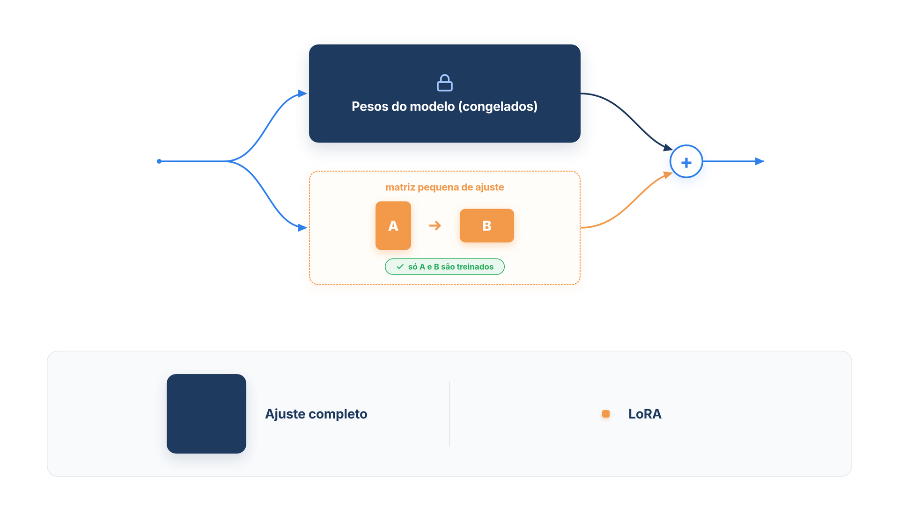

# Capítulo 16 — Ajuste fino com LoRA

O prompt resolveu o formato, e o RAG resolveu o conhecimento. Resta um terceiro tipo de falha: um comportamento que o modelo não adota, por mais que o prompt peça e por mais que o RAG entregue os fatos certos — um tom que nunca soa como o da sua marca, um estilo de raciocínio, uma convenção sutil. Para ele existe o **ajuste fino** (*fine-tuning*), que altera o próprio modelo. Neste capítulo, você entende por que o ajuste completo é caro, como o LoRA o torna viável, e prepara a parte do processo que sempre fica com você: os dados.



> **Antes de começar — PydanticAI neste capítulo**
>
> Este capítulo não usa `Agent` nem outro símbolo do PydanticAI: o ajuste fino acontece fora do agente, no treinamento do modelo. Os exemplos são Python e Pydantic puros. Se a anotação `str | None` ou o retorno `tuple[list[dict], dict[str, int]]` não forem familiares, revise o [Capítulo 0.2](../modulo-00/0.2-o-python-que-o-livro-assume.md); para o `BaseModel` da seção sobre validação do JSONL, veja o [Capítulo 0.3](../modulo-00/0.3-pydantic-na-pratica.md).

## O que o ajuste fino muda

No ajuste fino, você pega um modelo já treinado e continua o treinamento com exemplos do seu domínio, em pares de entrada e saída desejada. Os pesos do modelo mudam, e o novo comportamento passa a fazer parte dele de forma permanente, sem precisar estar no prompt.

Isso o torna a ferramenta certa para um tipo específico de problema: o modelo *tem* o conhecimento, mas o tom, o formato ou o estilo de raciocínio da tarefa não correspondem, mesmo depois de bons prompts e de RAG. Revise a tabela do Capítulo 14: prompting muda o que o modelo lê; RAG muda os dados que ele recebe; ajuste fino muda o próprio modelo.

Há três usos que parecem ajuste fino, mas não são:

- **Ensinar fatos que mudam.** Preços, prazos e políticas mudam, e o conhecimento gravado nos pesos fica desatualizado. É trabalho para o RAG.
- **Acelerar respostas.** O ajuste fino muda comportamento, não velocidade. Se a latência é o problema, o caminho é outro: cache de prompts, busca híbrida ou um modelo menor.
- **Compensar um prompt mal escrito.** Antes de treinar, esgote os degraus anteriores e meça (Capítulo 14).

## Por que o ajuste completo é caro

Um modelo é um conjunto enorme de números, os **pesos** ou **parâmetros**, organizados em matrizes. No *ajuste completo*, todos eles são atualizados. O custo é duplo: você precisa de memória para treinar todos os parâmetros, junto com o estado do otimizador, e acaba com uma cópia inteira do modelo para cada tarefa. Para um modelo de 175 bilhões de parâmetros, implantar uma instância ajustada por tarefa é proibitivo.

O **LoRA** (*Low-Rank Adaptation*, adaptação de baixo posto), de 2021, propõe o seguinte: congelar os pesos originais e treinar apenas uma pequena correção. Para cada matriz de pesos `W` que se quer adaptar, a correção é escrita como o produto de duas matrizes bem menores, `B` e `A`:

```text
W_novo = W + B × A
```

Se `W` tem dimensão `d × k`, então `B` tem `d × r` e `A` tem `r × k`, e `r` (o *posto*) é um número pequeno, como 1, 4 ou 8. A hipótese do artigo é que a mudança nos pesos durante a adaptação tem baixo "posto intrínseco", ou seja, pode ser descrita com poucas dimensões. Só `A` e `B` são treinadas. No começo, `B` é zero, de modo que o modelo parte exatamente do comportamento original.

Vamos medir a economia. O cálculo é só aritmética, e usa as dimensões do GPT-3 175B.

*lora_conta.py*

```python
D_MODELO = 12_288  # dimensão das matrizes de atenção do GPT-3 175B
CAMADAS = 96  # número de camadas do GPT-3 175B
PARAMETROS_TOTAIS = 175_000_000_000


def parametros_completos(d: int, k: int) -> int:
    return d * k


def parametros_lora(d: int, k: int, r: int) -> int:
    return r * (d + k)


print("Uma matriz de atenção de 12.288 x 12.288:")
completo = parametros_completos(D_MODELO, D_MODELO)
print(f"  ajuste completo: {completo:,} parâmetros")
for r in (1, 2, 4, 8):
    lora = parametros_lora(D_MODELO, D_MODELO, r)
    print(f"  LoRA com r={r}: {lora:>9,} parâmetros ({completo / lora:,.0f}x menos)")

r = 4
matrizes_por_camada = 2  # as projeções de consulta (Wq) e valor (Wv)
total_lora = CAMADAS * matrizes_por_camada * parametros_lora(D_MODELO, D_MODELO, r)
print(f"\nModelo inteiro, r={r}, Wq e Wv em {CAMADAS} camadas:")
print(f"  parâmetros treináveis: {total_lora:,}")
print(f"  redução sobre o ajuste completo: {PARAMETROS_TOTAIS / total_lora:,.0f}x")
```

Saída:

```text
Uma matriz de atenção de 12.288 x 12.288:
  ajuste completo: 150,994,944 parâmetros
  LoRA com r=1:    24,576 parâmetros (6,144x menos)
  LoRA com r=2:    49,152 parâmetros (3,072x menos)
  LoRA com r=4:    98,304 parâmetros (1,536x menos)
  LoRA com r=8:   196,608 parâmetros (768x menos)

Modelo inteiro, r=4, Wq e Wv em 96 camadas:
  parâmetros treináveis: 18,874,368
  redução sobre o ajuste completo: 9,272x
```

Leia a saída em duas escalas. Em *uma* matriz, o ajuste completo treina 151 milhões de parâmetros, e o LoRA com `r=4` treina 98 mil: 1.536 vezes menos. No *modelo inteiro*, adaptando só as matrizes de consulta e de valor das 96 camadas, o LoRA treina cerca de 19 milhões de parâmetros contra 175 bilhões, uma redução de aproximadamente 9.000 vezes. É a ordem de grandeza que o artigo reporta: cerca de 10.000 vezes menos parâmetros treináveis no GPT-3 175B.

Note a fórmula `r * (d + k)`: o custo do LoRA cresce *linearmente* com as dimensões, enquanto o do ajuste completo, `d * k`, cresce com o produto. Quanto maior o modelo, maior a economia.

### O que a redução significa na prática

O artigo documenta cinco vantagens:

- **Menos memória.** Como não é preciso guardar o estado do otimizador para os parâmetros congelados, a memória de treinamento no GPT-3 175B cai de 1,2 TB para 350 GB, cerca de três vezes menos.
- **Arquivos minúsculos.** Com `r=4`, adaptando consulta e valor, o ponto de salvamento cai de 350 GB para 35 MB.
- **Troca de tarefas barata.** Um mesmo modelo base serve a muitas tarefas: troca-se apenas o par `A`, `B` de cada uma. Cem tarefas ocupam cerca de 354 GB, e não 35 TB.
- **Sem custo extra na inferência.** Como a correção é linear, `B × A` pode ser somada a `W` antes da implantação, e o modelo ajustado responde tão rápido quanto o original. Isso o diferencia dos *adapters*, que acrescentam camadas e latência.
- **Qualidade equivalente.** Nos modelos testados (RoBERTa, DeBERTa, GPT-2 e GPT-3), o LoRA teve desempenho igual ou melhor que o ajuste completo.

Há uma limitação, e vale conhecê-la: depois de somar `B × A` a `W`, não é simples processar no mesmo lote entradas de tarefas diferentes, que usam `A` e `B` diferentes. Dá para evitar a soma e escolher o módulo dinamicamente, ao custo de alguma latência.

> **Nota:** O número de camadas (96) é a arquitetura do GPT-3 175B e não foi extraído do artigo; as dimensões de 12.288 e a ordem de grandeza da redução, sim. Os valores servem para entender a escala, e não para prever o custo de um modelo específico.

### Faça você mesmo

- **16.1 Seu modelo:** altere `D_MODELO`, `CAMADAS` e `PARAMETROS_TOTAIS` para um modelo de 7 bilhões de parâmetros (dimensão 4.096 e 32 camadas) e calcule a redução com `r=8`. Compare com o resultado do GPT-3.
- **16.2 O posto:** com `r=64`, calcule a redução de uma matriz. A que ponto o LoRA deixa de compensar? Escreva a fórmula do posto em que o LoRA ocupa metade do espaço do ajuste completo.
- **16.3 Mais matrizes:** altere o cálculo para adaptar quatro matrizes de atenção por camada (consulta, chave, valor e saída). Preveja o novo total antes de executar.

## A parte que fica com você: os dados

O LoRA reduz o custo do treinamento, mas não elimina a necessidade de bons exemplos. A AWS situa o ajuste fino eficiente em parâmetros (PEFT, como o LoRA) na faixa de alguns milhares de exemplos rotulados; o ajuste completo pede dezenas de milhares. Existem ainda variantes que usam pares de respostas preferidas e rejeitadas (DPO) ou uma função de recompensa que pontua as saídas (ajuste por reforço).

O formato típico é um arquivo JSONL, com uma conversa por linha, em que cada exemplo mostra uma entrada e a resposta ideal. A qualidade do ajuste depende de cada linha: um conjunto com exemplos inconsistentes ensina inconsistência. Veja um preparador pequeno, com as verificações que valem em qualquer conjunto:

*dataset_ajuste.py*

```python
import json
import re

ASSINATURA = "Equipe Casa Verde"
MINIMO_RECOMENDADO = 1000

CONVERSAS = [
    ("Meu pedido já saiu?", f"Seu pedido foi enviado e chega até 12/10. {ASSINATURA}"),
    ("Posso trocar a cor do vaso?", f"Posso verificar a troca; me informe o código do pedido. {ASSINATURA}"),
    ("Onde está meu pedido?", f"Pode me passar o código do pedido para eu consultar? {ASSINATURA}"),
    ("Meu pedido já saiu?", f"Seu pedido foi enviado e chega até 12/10. {ASSINATURA}"),
    ("Liguem para 11 98765-4321", f"Retornaremos para o número informado. {ASSINATURA}"),
    ("Quero cancelar o pedido.", "Claro, vou cancelar para você."),
    ("", f"Como posso ajudar? {ASSINATURA}"),
]


def validar(pergunta: str, resposta: str) -> str | None:
    if not pergunta.strip():
        return "pergunta vazia"
    if not resposta.rstrip().endswith(ASSINATURA):
        return "sem a assinatura padrão"
    if re.search(r"\d{2}\s?9?\d{4}-\d{4}", pergunta + resposta):
        return "contém telefone (dado pessoal)"
    return None


def montar(conversas) -> tuple[list[dict], dict[str, int]]:
    exemplos, descartes, vistos = [], {}, set()
    for pergunta, resposta in conversas:
        motivo = validar(pergunta, resposta)
        if motivo is None and (pergunta, resposta) in vistos:
            motivo = "duplicada"
        if motivo:
            descartes[motivo] = descartes.get(motivo, 0) + 1
            continue
        vistos.add((pergunta, resposta))
        exemplos.append({"messages": [
            {"role": "system", "content": "Você é o atendente virtual da loja Casa Verde."},
            {"role": "user", "content": pergunta},
            {"role": "assistant", "content": resposta},
        ]})
    return exemplos, descartes


exemplos, descartes = montar(CONVERSAS)
print(f"Conversas recebidas: {len(CONVERSAS)}")
print(f"Exemplos válidos   : {len(exemplos)}")
for motivo, quantidade in descartes.items():
    print(f"  descartado ({motivo}): {quantidade}")
if len(exemplos) < MINIMO_RECOMENDADO:
    print(f"Atenção: o ajuste costuma pedir pelo menos alguns milhares de exemplos; você tem {len(exemplos)}.")
print("\nPrimeira linha do arquivo JSONL:")
print(json.dumps(exemplos[0], ensure_ascii=False))
```

Saída:

```text
Conversas recebidas: 7
Exemplos válidos   : 3
  descartado (duplicada): 1
  descartado (contém telefone (dado pessoal)): 1
  descartado (sem a assinatura padrão): 1
  descartado (pergunta vazia): 1
Atenção: o ajuste costuma pedir pelo menos alguns milhares de exemplos; você tem 3.

Primeira linha do arquivo JSONL:
{"messages": [{"role": "system", "content": "Você é o atendente virtual da loja Casa Verde."}, {"role": "user", "content": "Meu pedido já saiu?"}, {"role": "assistant", "content": "Seu pedido foi enviado e chega até 12/10. Equipe Casa Verde"}]}
```

A função `validar` aplica três filtros: recusa perguntas vazias, respostas que violam a convenção que se quer ensinar (a assinatura) e conversas com dado pessoal, aqui um telefone detectado por uma expressão regular. `montar` ainda descarta duplicatas, que fariam o modelo "decorar" um exemplo, e escreve cada exemplo no formato de mensagens com papéis (`system`, `user`, `assistant`).

Das sete conversas, só três servem. Esse desperdício é típico: dados reais de atendimento têm falhas, e a limpeza é a maior parte do trabalho de um ajuste fino. O aviso final é sensato: três exemplos não ensinam nada a um modelo.

Dois cuidados completam o preparo. Separe uma parte dos exemplos para *validação*, que não entra no treinamento, e use-a para medir se o ajuste ajudou. E aplique a bancada do Capítulo 14, com os mesmos casos, antes e depois: o ajuste só se justifica se o número de falhas de formato ou de comportamento cair de forma mensurável.

### Validando o arquivo JSONL com Pydantic

A função `validar` olha o *conteúdo* das conversas. Antes disso, vale conferir a *estrutura* de cada linha do JSONL: um `role` escrito errado ou uma conversa sem resposta do assistente costuma só aparecer no meio do treinamento, depois de horas de custo. O Pydantic faz essa conferência declarando o formato como classes.

*dataset_pydantic.py*

```python
import json
from typing import Literal

from pydantic import BaseModel, ValidationError, field_validator


class Mensagem(BaseModel):
    role: Literal["system", "user", "assistant"]
    content: str

    @field_validator("content")
    @classmethod
    def nao_vazio(cls, valor: str) -> str:
        if not valor.strip():
            raise ValueError("conteúdo vazio")
        return valor


class Exemplo(BaseModel):
    messages: list[Mensagem]

    @field_validator("messages")
    @classmethod
    def termina_no_assistente(cls, valor: list[Mensagem]) -> list[Mensagem]:
        if not valor or valor[-1].role != "assistant":
            raise ValueError("a última mensagem deve ser do assistant")
        return valor


LINHAS = [
    '{"messages": [{"role": "user", "content": "Meu pedido já saiu?"}, {"role": "assistant", "content": "Foi enviado. Equipe Casa Verde"}]}',
    '{"messages": [{"role": "usuario", "content": "Oi"}, {"role": "assistant", "content": "Olá. Equipe Casa Verde"}]}',
    '{"messages": [{"role": "user", "content": "Oi"}]}',
    '{"messages": [{"role": "user", "content": "  "}, {"role": "assistant", "content": "Olá. Equipe Casa Verde"}]}',
]

for numero, linha in enumerate(LINHAS, start=1):
    try:
        exemplo = Exemplo.model_validate_json(linha)
        print(f"linha {numero}: ok ({len(exemplo.messages)} mensagens)")
    except ValidationError as erro:
        for problema in erro.errors():
            print(f"linha {numero}: {problema['loc']} -> {problema['msg']}")
```

Saída:

```text
linha 1: ok (2 mensagens)
linha 2: ('messages', 0, 'role') -> Input should be 'system', 'user' or 'assistant'
linha 3: ('messages',) -> Value error, a última mensagem deve ser do assistant
linha 4: ('messages', 0, 'content') -> Value error, conteúdo vazio
```

`Exemplo.model_validate_json` lê o texto JSON de uma linha e a valida contra as classes `Exemplo` e `Mensagem`. O tipo `Literal["system", "user", "assistant"]` aceita só esses três valores, e `list[Mensagem]` exige que cada item da lista seja uma mensagem válida. Os métodos marcados com `@field_validator` acrescentam regras próprias: se lançam `ValueError`, o Pydantic o converte em um erro de validação.

Quando algo falha, o Pydantic lança `ValidationError`, e `erro.errors()` devolve uma lista de problemas. Em cada um, `loc` mostra o caminho até o campo defeituoso (na linha 2, `('messages', 0, 'role')` é o campo `role` da primeira mensagem) e `msg` explica o motivo. Esse caminho aponta o defeito sem que você precise procurá-lo. Veja mais sobre `BaseModel` e validadores no [Capítulo 0.3](../modulo-00/0.3-pydantic-na-pratica.md).

### Faça você mesmo

- **16.4 Nova regra:** acrescente a `validar` uma regra que recuse respostas com mais de 160 caracteres. Teste com uma resposta longa.
- **16.5 E-mail:** acrescente uma regra que detecte e-mails (algo como `\S+@\S+`) como dado pessoal. Escreva duas conversas para testá-la.
- **16.6 Separar a validação:** escreva uma função que embaralhe os exemplos válidos com uma semente fixa e separe 20% para validação. Explique por que a semente fixa importa.
- **16.7 Seus dados:** descreva de onde viriam os exemplos de um ajuste fino real para a Casa Verde e três problemas de qualidade que você esperaria encontrar.

## Ajustar ou não ajustar

Reúna os critérios do capítulo em uma decisão. O ajuste fino se justifica quando todas estas condições valem:

1. A falha é de **comportamento** (tom, formato, estilo de raciocínio), e não de conhecimento.
2. Você já esgotou o **prompt** e o **RAG**, e o diagnóstico do Capítulo 14 mostra a falha persistente.
3. Você tem, ou consegue produzir, **milhares de exemplos** de qualidade que mostram o comportamento desejado.
4. O comportamento é **estável**: não muda toda semana, pois cada mudança exigiria um novo treinamento.

Se o modelo não compreende a terminologia ou os conceitos do seu domínio, a AWS indica um degrau mais alto, o pré-treinamento contínuo, que depende de volumes muito maiores de dados. Se o problema é custo ou latência, a indicação é a destilação ou o cache de prompts.

Por fim, lembre-se da combinação mais comum em produção: **ajuste fino para o comportamento e RAG para o conhecimento**. O primeiro dá ao agente a voz da marca; o segundo, os fatos atualizados.

### Faça você mesmo

- **16.8 Cinco decisões:** para cada caso, responda "ajustar" ou "não ajustar" e justifique: (a) o atendente erra o prazo de devolução; (b) o atendente responde de forma correta, mas formal demais, e já tem um bom prompt, tem mil exemplos de respostas no tom certo e o tom não muda há anos; (c) a resposta demora três segundos; (d) o modelo não entende o jargão de logística que a empresa usa em todos os documentos; (e) a política de frete muda todo mês.
- **16.9 Um plano de medição:** descreva, em cinco linhas, como você mediria se um ajuste fino melhorou o atendente: casos de teste, métricas, conjunto de validação e o resultado que justificaria manter o ajuste.

## Recapitulando

Você agora entende o ajuste fino como o degrau que muda o próprio modelo, indicado para comportamento e não para conhecimento. Viu por que o ajuste completo custa tanto e como o LoRA, ao congelar os pesos e treinar duas matrizes pequenas, reduz os parâmetros treináveis em ordens de grandeza, com arquivos pequenos, troca barata de tarefas e nenhuma latência extra. Calculou essa redução, preparou e filtrou um conjunto de exemplos e reuniu os critérios para decidir quando ajustar.

Falta um cuidado que vale para qualquer das três técnicas: mesmo com prompt bom, RAG e um modelo ajustado, o agente pode afirmar algo que os documentos não dizem. O Capítulo 17 fecha o módulo com a verificação que impede isso: comparar a resposta com os fatos recuperados antes de entregá-la.

### Fontes do capítulo

- Hu et al. — [LoRA: Low-Rank Adaptation of Large Language Models](https://arxiv.org/pdf/2106.09685) (2021): congelamento dos pesos e matrizes de baixo posto `B` e `A`; redução de cerca de 10.000 vezes nos parâmetros treináveis e de três vezes na memória no GPT-3 175B; ponto de salvamento de 350 GB para 35 MB; ausência de latência extra; troca de tarefas por substituição de `A` e `B`; limitação de lotes com tarefas diferentes.
- AWS — [The Generative AI Customization Spectrum](https://aws.amazon.com/blogs/machine-learning/the-generative-ai-customization-spectrum-from-prompt-engineering-to-custom-models-on-aws/): quando usar o ajuste fino; volumes de dados de PEFT e do ajuste completo; DPO e ajuste por reforço; erro de ajustar "porque o RAG é lento"; combinação com RAG.
