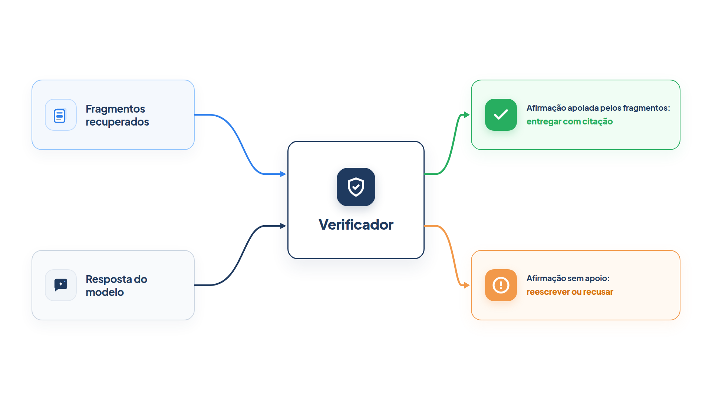

# Capítulo 17 — Ancoragem nos fatos

O RAG entrega ao agente os documentos certos, e a instrução pede que ele responda só com base neles. Mas pedir não é garantir: o modelo pode misturar um fato do documento com um que ele "lembra" do treinamento, ou arredondar um prazo, ou completar uma lacuna com um palpite plausível. Neste capítulo, você acrescenta uma etapa que confere a resposta contra os trechos recuperados *antes* de entregá-la ao cliente. Essa etapa se chama ancoragem, e o resultado é um agente que só afirma o que consegue apoiar em uma fonte.



> **Antes de começar — PydanticAI neste capítulo**
>
> Neste capítulo você usa `Agent`, `instructions`, `output_type`, `.run_sync` e `.output`, além de `BaseModel` e de uma `dataclass`. Se algum deles não for familiar, revise o [Capítulo 0.4](../modulo-00/0.4-o-primeiro-agente-por-dentro.md), o [Capítulo 0.6](../modulo-00/0.6-ferramentas-e-saida-tipada.md) (`output_type`) e o [Capítulo 0.3](../modulo-00/0.3-pydantic-na-pratica.md) (`BaseModel`). Os modelos simulados (`FunctionModel`, `ModelResponse`, `ToolCallPart`) e o `override` usados em `ancoragem_simulada.py` são ensinados no [Capítulo 0.5](../modulo-00/0.5-mensagens-e-testes-sem-api.md); a `dataclass` com `field(default_factory=list)`, no [Capítulo 0.2](../modulo-00/0.2-o-python-que-o-livro-assume.md).

## O que é ancorar

Em IA generativa, **ancoragem** (*grounding*) é a capacidade de conectar a saída do modelo a fontes de informação verificáveis. Ao dar ao modelo acesso a fontes de dados específicas, a ancoragem prende a saída a esses dados e reduz a chance de ele inventar conteúdo. Isso importa onde a precisão e a confiabilidade pesam, como em atendimento, em finanças e em saúde. A ancoragem traz três benefícios:

- reduz as alucinações, ou seja, os conteúdos que não são factuais;
- prende as respostas às suas fontes de dados;
- dá **auditabilidade**: o leitor vê os vínculos entre cada afirmação e a fonte que a sustenta.

O RAG do Capítulo 15 já é uma forma de ancoragem, pois entrega as fontes ao modelo. O que falta é *conferir* que a resposta as respeitou.

## Como um serviço gerenciado faz

Vale ver como um serviço pronto estrutura a ancoragem, porque o desenho serve de modelo para o seu. A plataforma de IA do Google Cloud permite ancorar um modelo em seus próprios dados, indexados em um repositório de busca gerenciado, ou em outras fontes, como o Google Search, o Google Maps ou o Elasticsearch. Na configuração com dados próprios, a requisição ao modelo inclui uma ferramenta de recuperação apontando para o repositório. Em Python, com o SDK do Google, ela se parece com isto (trecho da documentação, que exige uma conta e um repositório e por isso não é executado aqui):

```python
tool = Tool(
    retrieval=Retrieval(
        vertex_ai_search=VertexAISearch(datastore=DATASTORE_PATH)
    )
)
response = client.models.generate_content(
    model="gemini-2.5-flash",
    contents="Qual é o prazo para renovar a habilitação?",
    config=GenerateContentConfig(tools=[tool]),
)
```

O mais instrutivo é a *resposta*. Quando a ancoragem funciona, a resposta traz, junto do texto, um bloco de metadados de ancoragem (`groundingMetadata`), com estes elementos:

- **`retrievalQueries`:** as consultas que o serviço fez ao repositório;
- **`groundingChunks`:** a lista de resultados do índice que sustentam a resposta, cada um com um título e um endereço;
- **`groundingSupport`:** uma lista de afirmações da resposta, cada uma com o trecho de texto (`segment`, que marca os índices de início e fim), os índices dos fragmentos que a sustentam (`supportChunkIndices`) e uma pontuação de confiança de 0 a 1 (`confidenceScore`), que indica quanto a afirmação está ancorada naqueles fragmentos. A documentação observa que essa pontuação não está disponível a partir do Gemini 2.5.

Há ainda uma nuance importante: **a ancoragem pode faltar**. A documentação avisa que os metadados podem não vir por vários motivos, entre eles a baixa relevância das fontes ou a informação incompleta na resposta do modelo, e, nesse caso, a resposta não está ancorada. O sistema, portanto, não promete que todo texto vem de uma fonte: ele *informa* quando vem e de qual.

Destaque os três conceitos que o serviço oferece, porque você os reproduzirá a seguir: **fragmentos** recuperados, **afirmações** da resposta ligadas a eles e uma **medida de apoio** que permite decidir o que fazer.

## Construindo a sua ancoragem

Nosso desenho tem três etapas, e cada uma corresponde a um elemento acima:

1. **Recuperar** os fragmentos da base, com o limiar de relevância do Capítulo 15 (os `groundingChunks`).
2. **Redigir** um rascunho de resposta com base neles.
3. **Verificar** o rascunho: um agente divide a resposta em afirmações e, para cada uma, indica o fragmento que a sustenta, ou nenhum (os `groundingSupport`). A fração de afirmações apoiadas é a **medida de apoio** (o `confidenceScore`).

Com a medida, o código decide: entrega o rascunho se tudo estiver apoiado, entrega só a parte apoiada se houver afirmações sem fonte e recusa se nada se sustentar.

*ancoragem.py*

```python
from dataclasses import dataclass, field

from pydantic import BaseModel

from pydantic_ai import Agent

from config import MODELO
from rag import LIMIAR, indice


class Afirmacao(BaseModel):
    texto: str
    trecho_id: str | None


class Verificacao(BaseModel):
    afirmacoes: list[Afirmacao]


@dataclass
class Resposta:
    texto: str
    citacoes: list[str] = field(default_factory=list)
    suporte: float = 0.0
    revisada: bool = False


redator = Agent(
    MODELO,
    instructions=(
        "Responda ao cliente usando o contexto fornecido, citando o id do trecho "
        "entre colchetes. Seja breve."
    ),
)

verificador = Agent(
    MODELO,
    output_type=Verificacao,
    instructions=(
        "Divida a resposta em afirmações. Para cada afirmação, informe o id do "
        "trecho que a sustenta ou null se nenhum dos trechos fornecidos a sustenta. "
        "Considere apenas os trechos fornecidos, nunca o seu conhecimento próprio."
    ),
)

RECUSA = "Não encontrei essa informação nas políticas da loja. Posso encaminhar você a um atendente."


def suporte_de(verificacao: Verificacao) -> float:
    if not verificacao.afirmacoes:
        return 0.0
    apoiadas = sum(1 for a in verificacao.afirmacoes if a.trecho_id)
    return apoiadas / len(verificacao.afirmacoes)


def responder_ancorado(pergunta: str, minimo: float = 1.0) -> Resposta:
    achados = [(p, f) for p, f in indice.buscar(pergunta, k=2) if p >= LIMIAR]
    if not achados:
        return Resposta(RECUSA)

    contexto = "\n".join(f"[{f.id}] {f.texto}" for _, f in achados)
    rascunho = redator.run_sync(f"Contexto:\n{contexto}\n\nPergunta: {pergunta}").output
    verificacao = verificador.run_sync(f"Trechos:\n{contexto}\n\nResposta:\n{rascunho}").output
    suporte = suporte_de(verificacao)
    citacoes = sorted({a.trecho_id for a in verificacao.afirmacoes if a.trecho_id})

    if suporte >= minimo:
        return Resposta(rascunho, citacoes, suporte)

    apoiadas = [a.texto for a in verificacao.afirmacoes if a.trecho_id]
    if not apoiadas:
        return Resposta(RECUSA, [], suporte)
    return Resposta(" ".join(apoiadas), citacoes, suporte, revisada=True)
```

Percorra o arquivo.

**Os modelos de dados.** `Afirmacao` liga um texto a um `trecho_id`, que pode ser `None`. `Verificacao` é a lista delas, e a saída estruturada do verificador (Capítulo 6). `Resposta` é o que o cliente recebe, junto de metadados: as citações, a medida de apoio e se a resposta foi revisada.

> **Armadilha — `str | None` não é opcional**
>
> Em `Afirmacao`, `trecho_id: str | None` diz que o valor pode ser texto ou `None`, mas **não** dá um valor padrão: o campo continua obrigatório. Compare com um campo que tem padrão:

*afirmacao_opcional.py*

```python
from pydantic import BaseModel, ValidationError


class Afirmacao(BaseModel):
    texto: str
    trecho_id: str | None


class AfirmacaoComPadrao(BaseModel):
    texto: str
    trecho_id: str | None = None


print(Afirmacao(texto="Prazo de 7 dias", trecho_id=None))

try:
    Afirmacao(texto="Prazo de 7 dias")
except ValidationError as erro:
    print(erro.errors()[0]["type"], erro.errors()[0]["loc"])

print(AfirmacaoComPadrao(texto="Prazo de 7 dias"))
```

Saída:

```text
texto='Prazo de 7 dias' trecho_id=None
missing ('trecho_id',)
texto='Prazo de 7 dias' trecho_id=None
```

Sem o `= None`, omitir `trecho_id` gera o erro `missing`; com ele, o campo passa a ser opcional. No verificador isso é desejável: o modelo é forçado a se pronunciar sobre cada afirmação e a escrever `null` de forma explícita quando não há fonte, em vez de esquecer o campo. Se você quiser tolerar a omissão, escreva `trecho_id: str | None = None`.


**O verificador.** Sua instrução faz a pergunta certa: qual *dos trechos fornecidos* sustenta cada afirmação? A frase "nunca o seu conhecimento próprio" é essencial. Sem ela, o verificador aprovaria afirmações verdadeiras no mundo, mas ausentes dos documentos, que são justamente o que queremos barrar.

**A função `responder_ancorado`.** Faz a recuperação com o limiar; se nada passa, recusa sem nem chamar o modelo. Caso contrário, redige, verifica e calcula `suporte_de`. O parâmetro `minimo` é o rigor: com 1,0, a resposta só sai intacta se *toda* afirmação tiver apoio. Se não, há duas saídas. Havendo afirmações apoiadas, o código as entrega sozinhas, marcadas como `revisada`. Não havendo nenhuma, recusa.

Este é um desenho de **workflow** (Capítulo 1), com uma cadeia de etapas e uma decisão no final, e o verificador age como o avaliador do Capítulo 6: gera, avalia e decide. O Módulo 6 dá nome a esses padrões.

Para uma saída garantida, vamos usar modelos simulados. O redator escreve uma resposta com uma afirmação do documento e outra inventada (o reembolso "em 24 horas"), e o verificador reconhece que só a primeira tem apoio.

*ancoragem_simulada.py*

```python
from pydantic_ai import ModelResponse, TextPart, ToolCallPart
from pydantic_ai.models.function import AgentInfo, FunctionModel

import ancoragem


def modelo_redator(mensagens, info: AgentInfo) -> ModelResponse:
    return ModelResponse(parts=[TextPart(
        "Você pode devolver em até 7 dias corridos [devolucao]. "
        "O reembolso cai na sua conta em 24 horas."
    )])


def modelo_verificador(mensagens, info: AgentInfo) -> ModelResponse:
    return ModelResponse(parts=[ToolCallPart(info.output_tools[0].name, {"afirmacoes": [
        {"texto": "Você pode devolver em até 7 dias corridos [devolucao].", "trecho_id": "devolucao"},
        {"texto": "O reembolso cai na sua conta em 24 horas.", "trecho_id": None},
    ]})])


with ancoragem.redator.override(model=FunctionModel(modelo_redator)), \
        ancoragem.verificador.override(model=FunctionModel(modelo_verificador)):
    for pergunta in ["Posso devolver o produto depois de 10 dias?", "Qual a cor do sofá?"]:
        resposta = ancoragem.responder_ancorado(pergunta)
        print(pergunta)
        print("  texto    :", resposta.texto)
        print("  citações :", resposta.citacoes)
        print(f"  suporte  : {resposta.suporte:.2f} | revisada: {resposta.revisada}")
```

Saída:

```text
Posso devolver o produto depois de 10 dias?
  texto    : Você pode devolver em até 7 dias corridos [devolucao].
  citações : ['devolucao']
  suporte  : 0.50 | revisada: True
Qual a cor do sofá?
  texto    : Não encontrei essa informação nas políticas da loja. Posso encaminhar você a um atendente.
  citações : []
  suporte  : 0.00 | revisada: False
```

Na primeira pergunta, o rascunho trazia a invenção sobre o prazo do reembolso. O verificador a marcou sem fonte, a medida de apoio ficou em 0,50 e a resposta foi revisada: o cliente recebeu apenas a parte sustentada, com a citação `[devolucao]`. A fabricação não chegou até ele. Na segunda pergunta, nenhum fragmento passou do limiar, e o agente recusou, sem inventar uma cor.

A correspondência com o serviço gerenciado é direta:

| No serviço do Google | No nosso código |
| --- | --- |
| `groundingChunks` | os fragmentos recuperados (`achados`) |
| `groundingSupport` | as `afirmacoes` e seus `trecho_id` |
| `confidenceScore` | `suporte_de`, a fração de afirmações apoiadas |
| ausência de metadados (não ancorada) | a `RECUSA` e a resposta `revisada` |

### Faça você mesmo

- **17.1 Uma resposta inventada:** altere `modelo_redator` para escrever "O frete da devolução é de R$ 15,00" sobre a pergunta de devolução. Ajuste `modelo_verificador` e confirme que a resposta é revisada.
- **17.2 Rigor ajustável:** execute com `minimo=0.5` e `minimo=1.0`. Descreva a diferença no comportamento para o caso do exercício 17.1.
- **17.3 Execução real:** execute `responder_ancorado` com o modelo real em cinco perguntas, uma delas fora da base. Imprima a medida de apoio e as citações de cada uma.
- **17.4 Citações para o cliente:** altere `Resposta` para guardar, além do id, o título da política, e escreva uma função que formate "Fonte: Política de devolução".

## Os limites da ancoragem

A ancoragem reduz as alucinações, mas não as elimina. Conheça os quatro limites.

**O verificador também é um modelo.** Ele pode aprovar o que não deveria ou reprovar o que estava certo. Trate-o como qualquer componente de IA: dê-lhe uma instrução precisa, teste-o com casos conhecidos e meça seus erros. Com a bancada do Capítulo 12 e as avaliações do Módulo 9, você consegue montar casos em que a resposta certa é "sem apoio" e verificar se ele os pega.

**Apoiado não é o mesmo que verdadeiro.** A ancoragem liga a resposta aos *documentos*. Se o documento estiver desatualizado ou errado, a resposta será fiel a um erro. Cuide dos documentos com o mesmo rigor, e use o ciclo de atualização do Capítulo 15.

**A revisão pode deixar a resposta incoerente.** Ao entregar só as afirmações apoiadas, o texto pode perder o contexto que ligava uma frase a outra. Para respostas longas, vale mais reescrever com as afirmações apoiadas do que concatená-las.

**Cada verificação custa uma chamada ao modelo.** Rode a verificação onde o erro é caro, como prazos, valores e políticas, e pule-a onde não é, como cumprimentos. Um verificador mais barato e rápido costuma bastar, se medido.

### Faça você mesmo

- **17.5 Documento errado:** altere o prazo de devolução em `documentos.py` para um valor errado e execute a pergunta com o modelo real. Descreva por que a ancoragem não protege o cliente nesse caso.
- **17.6 Casos para o verificador:** escreva cinco pares de (resposta, trechos) em que você sabe o veredito correto de cada afirmação, incluindo duas afirmações verdadeiras no mundo, mas ausentes dos trechos. Execute o `verificador` e conte os acertos.
- **17.7 Quando pular a verificação:** proponha uma regra simples, em código, para decidir se uma resposta exige verificação (por exemplo, a presença de números ou datas).

## Recapitulando

Você agora sabe ancorar as respostas do agente: recuperar os fragmentos, redigir com base neles, verificar afirmação por afirmação quais têm apoio e decidir pela medida de apoio se entrega, revisa ou recusa. Viu como um serviço gerenciado estrutura isso, com fragmentos, afirmações ligadas a eles e uma pontuação, e reproduziu o desenho no código. Também conhece os limites: o verificador pode errar, apoiado não é verdadeiro e a verificação tem custo.

Com isso, o Módulo 5 está completo. Diante de uma falha do agente, você diagnostica o tipo (conhecimento ou comportamento), escolhe o remédio mais simples, constrói uma base com RAG, sabe quando e por que o ajuste fino com LoRA se justifica e verifica as respostas antes de entregá-las. O próximo módulo volta à estrutura do próprio agente. O ancorador que você escreveu é uma cadeia de etapas, com um avaliador no fim; esses desenhos têm nomes e regras de uso. O Módulo 6 apresenta os padrões de orquestração de um único agente: encadeamento, roteamento, paralelização, avaliador-otimizador e orquestrador-trabalhadores.

### Fontes do capítulo

- Google — [Grounding overview](https://docs.cloud.google.com/vertex-ai/generative-ai/docs/grounding/overview) e [Grounding with Vertex AI Search (Agent Search)](https://docs.cloud.google.com/vertex-ai/generative-ai/docs/grounding/grounding-with-vertex-ai-search): definição de ancoragem e seus benefícios; ferramenta de recuperação; estrutura de `groundingMetadata` com `retrievalQueries`, `groundingChunks` e `groundingSupport` (`segment`, `supportChunkIndices`, `confidenceScore`); ausência de ancoragem por baixa relevância.
- Lewis et al. — [Retrieval-Augmented Generation for Knowledge-Intensive NLP Tasks](https://arxiv.org/abs/2005.11401) (2020): possibilidade de inspecionar o conhecimento acessado.
- Documentação do PydanticAI: *Saída* (`output_type`) e `override` para testes.
