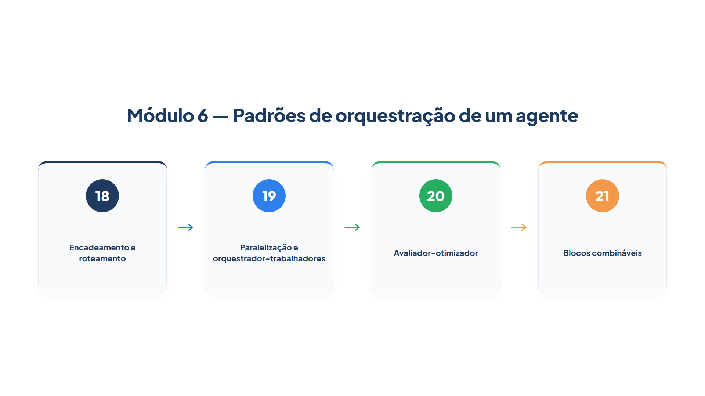

# Módulo 6 — Padrões de orquestração de um agente

Até aqui, você construiu agentes que raciocinam, lembram, usam ferramentas e consultam documentos. Cada um deles, porém, rodava sozinho, em uma chamada. Problemas reais pedem uma estrutura em volta do modelo: etapas em ordem, decisões de caminho, trabalho simultâneo, revisão. Neste módulo, você aprende os padrões que organizam essa estrutura, todos ainda com um único sistema agente, sem a complexidade de várias entidades autônomas conversando. Ao final dele, você será capaz de:

- encadear etapas com verificações entre elas, e rotear cada mensagem ao especialista certo;
- executar tarefas independentes em paralelo e dividir um problema em subtarefas que só aparecem na hora;
- fazer um redator melhorar o próprio trabalho a partir das críticas de um avaliador;
- montar tudo isso a partir de blocos combináveis, com um estado compartilhado, e escolher o padrão certo para cada problema.

## Percurso

1. **Capítulo 18 — Encadeamento e roteamento.** Você divide uma tarefa em etapas com portas de verificação e envia cada mensagem a um agente especialista.
2. **Capítulo 19 — Paralelização e orquestrador-trabalhadores.** Você roda análises independentes ao mesmo tempo e deixa um orquestrador decidir, na hora, quantas subtarefas um pedido tem.
3. **Capítulo 20 — Avaliador-otimizador.** Você constrói o ciclo em que um agente avalia e outro reescreve, até a aprovação ou um limite.
4. **Capítulo 21 — Blocos combináveis.** Você cria blocos sequencial, paralelo, repetição e roteamento, no estilo dos agentes de fluxo do Google ADK, e monta um atendimento completo com eles.

Os padrões vêm do guia da Anthropic sobre agentes eficazes, que os chama de *workflows*; os blocos do último capítulo vêm da documentação do Google Agent Development Kit (ADK). Os arquivos `loja.py`, `documentos.py`, `indice.py`, `busca.py`, `rag.py` e `trajetoria.py` desta pasta são os dos módulos anteriores. O `config.py` ganhou um modelo menor e mais barato, `MODELO_RAPIDO`, para as etapas simples.

> **Nota:** Todos os exemplos de saída deste módulo usam modelos simulados, definidos em `modelos_simulados.py`: `texto(...)` devolve um texto, e `saida(...)` devolve uma saída estruturada. Eles permitem observar a *estrutura* de cada padrão — a ordem das etapas, o número de chamadas, o tempo — de forma exata. Com um modelo real, as respostas variam, mas essa estrutura permanece.
