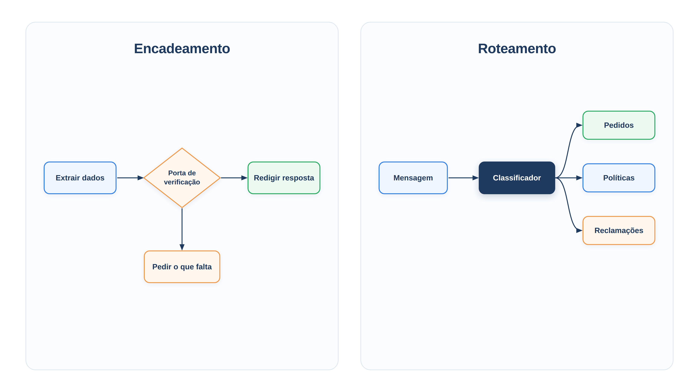

# Capítulo 18 — Encadeamento e roteamento

No Capítulo 4, você viu que um workflow é um caminho de código que usa o modelo em alguns passos. Naquele momento, o exemplo era simples. Neste capítulo, você aprende os dois primeiros padrões de workflow que aparecem em quase todo sistema real: o **encadeamento**, que quebra uma tarefa em etapas com verificações entre elas, e o **roteamento**, que envia cada mensagem ao agente mais adequado. Ao final, você terá um atendimento que extrai dados, confere antes de gastar chamadas e distribui o trabalho entre especialistas.



> **Antes de começar — PydanticAI neste capítulo**
>
> Neste capítulo você usa `Agent`, `instructions`, `output_type`, `.run_sync`, `.output` e `.override`. Se algum deles não for familiar, revise o [Capítulo 0.4](../modulo-00/0.4-o-primeiro-agente-por-dentro.md) (o agente), o [Capítulo 0.5](../modulo-00/0.5-mensagens-e-testes-sem-api.md) (modelos simulados e `.override`) e o [Capítulo 0.6](../modulo-00/0.6-ferramentas-e-saida-tipada.md) (`output_type` e saída tipada). O `BaseModel` e o `Literal` de `Reclamacao` e `Rota` estão no [Capítulo 0.3](../modulo-00/0.3-pydantic-na-pratica.md).

## Cinco padrões, um ponto de partida

O guia da Anthropic sobre agentes eficazes descreve cinco padrões de workflow, e este módulo os percorre:

- **encadeamento** (*prompt chaining*): uma sequência de chamadas, cada uma processando a saída da anterior;
- **roteamento** (*routing*): classificar a entrada e encaminhá-la a um tratamento especializado;
- **paralelização** (*parallelization*): executar tarefas independentes ao mesmo tempo;
- **orquestrador-trabalhadores** (*orchestrator-workers*): um modelo central divide o trabalho e delega;
- **avaliador-otimizador** (*evaluator-optimizer*): um modelo gera, outro avalia, em ciclo.

O ponto de partida de todos eles é o que você já construiu: um modelo ampliado com recuperação, ferramentas e memória. Os padrões acrescentam *estrutura em volta* dele, decidida pelo seu código. É a diferença entre workflow e agente do Capítulo 1: aqui, quem escolhe o caminho é você.

## Encadeamento: dividir para acertar

Considere uma reclamação de cliente: "O pedido 1001 está atrasado e preciso dele hoje!" Para responder bem, a loja precisa extrair o código do pedido e o problema, consultar o pedido e redigir uma resposta cordial. Um único prompt poderia tentar tudo de uma vez. O encadeamento troca isso por etapas, em que cada chamada ao modelo faz uma tarefa mais fácil e *o seu código confere o resultado* entre uma etapa e outra.

*encadeamento.py*

```python
from typing import Literal

from pydantic import BaseModel

from pydantic_ai import Agent

from config import MODELO
from loja import buscar_pedido


class Reclamacao(BaseModel):
    codigo_pedido: str | None
    problema: str
    urgencia: Literal["baixa", "media", "alta"]


extrator = Agent(
    MODELO,
    output_type=Reclamacao,
    instructions=(
        "Extraia da mensagem do cliente o código do pedido (4 dígitos, ou null se "
        "não houver), o problema relatado e a urgência."
    ),
)

redator = Agent(
    MODELO,
    instructions=(
        "Escreva uma resposta cordial de até três frases a uma reclamação, "
        "usando apenas os dados fornecidos. Termine com 'Equipe Casa Verde'."
    ),
)


def atender(mensagem: str) -> str:
    reclamacao = extrator.run_sync(mensagem).output

    if reclamacao.codigo_pedido is None:  # porta de verificação 1
        return "Para ajudar, preciso do código do pedido. Pode me informar? Equipe Casa Verde"

    pedido = buscar_pedido(reclamacao.codigo_pedido)
    if pedido is None:  # porta de verificação 2
        return f"Não encontrei o pedido {reclamacao.codigo_pedido}. Pode conferir o número? Equipe Casa Verde"

    return redator.run_sync(
        f"Reclamação: {reclamacao.problema}\n"
        f"Urgência: {reclamacao.urgencia}\n"
        f"Dados do pedido: {pedido}"
    ).output
```

A função `atender` é a cadeia. Veja a estrutura:

1. O **extrator** transforma texto livre em um objeto `Reclamacao`, uma saída estruturada que o código consegue inspecionar (Capítulo 6).
2. A **porta 1** verifica se há um código de pedido. Se não houver, a cadeia termina ali, com um pedido de informação, e nenhuma outra chamada ao modelo é feita.
3. A **porta 2** consulta o pedido. Se ele não existir, a cadeia termina com um aviso.
4. Só então o **redator** é chamado, com os dados já conferidos.

Uma **porta de verificação** (*gate*, em inglês) é uma checagem programática em uma etapa intermediária. Ela garante que o processo continua no caminho certo e impede que uma etapa construa sobre o erro da anterior. Para ver a cadeia agir, usamos modelos simulados: o extrator procura um código de quatro dígitos na mensagem, e o redator responde com um texto fixo.

*encadeamento_simulado.py*

```python
import re

import encadeamento
import modelos_simulados as sim


def extrair(mensagens):
    texto = sim.prompt_do_usuario(mensagens)
    achado = re.search(r"\d{4}", texto)
    return {
        "codigo_pedido": achado.group() if achado else None,
        "problema": "pedido atrasado",
        "urgencia": "alta",
    }


MENSAGENS = [
    "O pedido 1001 está atrasado e preciso dele hoje!",
    "Meu pedido está atrasado!",
    "O pedido 9999 está atrasado!",
]

with encadeamento.extrator.override(model=sim.saida(extrair, "extrator")), \
        encadeamento.redator.override(model=sim.texto(
            "Seu pedido 1001 foi enviado e chega em 12/10. Equipe Casa Verde", "redator")):
    for mensagem in MENSAGENS:
        sim.CHAMADAS.clear()
        print(mensagem)
        print("  ->", encadeamento.atender(mensagem))
        print("  chamadas ao modelo:", sim.CHAMADAS)
```

Saída:

```text
O pedido 1001 está atrasado e preciso dele hoje!
  -> Seu pedido 1001 foi enviado e chega em 12/10. Equipe Casa Verde
  chamadas ao modelo: ['extrator', 'redator']
Meu pedido está atrasado!
  -> Para ajudar, preciso do código do pedido. Pode me informar? Equipe Casa Verde
  chamadas ao modelo: ['extrator']
O pedido 9999 está atrasado!
  -> Não encontrei o pedido 9999. Pode conferir o número? Equipe Casa Verde
  chamadas ao modelo: ['extrator']
```

Na primeira mensagem, a cadeia inteira rodou, com duas chamadas. Nas outras duas, as portas interromperam o processo depois de *uma* chamada, poupando o redator e dando ao cliente uma resposta útil e correta. Sem as portas, o redator teria recebido `None` ou um pedido inexistente e tentado improvisar.

O encadeamento é ideal quando a tarefa se decompõe com facilidade em subtarefas fixas. O ganho é de precisão: cada chamada fica mais simples, e você troca latência, porque são mais chamadas em série, por acerto. Outros exemplos clássicos são gerar um texto de marketing e depois traduzi-lo, e escrever o esboço de um documento, validá-lo e só então expandi-lo.

### Armadilha: erros que se acumulam

Em uma cadeia, o erro de uma etapa contamina as seguintes. Dois cuidados reduzem o problema. O primeiro são as portas, como as do exemplo: cada uma é um ponto em que o erro é barrado em vez de passar adiante. O segundo é a *tipagem* das saídas intermediárias. O extrator devolve um `Reclamacao` validado pelo PydanticAI, e não um texto que o código precisaria interpretar; uma urgência fora de `baixa`, `media` ou `alta` é rejeitada antes de chegar à etapa seguinte.

### Por dentro da rejeição: o que acontece com uma urgência inválida

"Rejeitada" quer dizer duas coisas em camadas. Primeiro, o Pydantic recusa o valor: `Reclamacao` lança `ValidationError`. Segundo, o agente captura esse erro, devolve ao modelo a descrição do problema e pede uma nova tentativa (por padrão, uma). Se a resposta continuar inválida, o PydanticAI lança `UnexpectedModelBehavior` e a cadeia para ali, antes do redator. O exemplo abaixo é independente do `encadeamento.py`: repete a classe `Reclamacao` e usa um modelo simulado que sempre devolve `"urgentíssima"`.

*urgencia_invalida.py*

```python
from typing import Literal

from pydantic import BaseModel, ValidationError

from pydantic_ai import Agent

import modelos_simulados as sim


class Reclamacao(BaseModel):
    codigo_pedido: str | None
    problema: str
    urgencia: Literal["baixa", "media", "alta"]


dados = {"codigo_pedido": "1001", "problema": "atraso", "urgencia": "urgentíssima"}

try:
    Reclamacao(**dados)
except ValidationError as erro:
    print("Pydantic:", erro.errors()[0]["type"], erro.errors()[0]["loc"])

extrator = Agent(sim.saida(dados, "extrator"), output_type=Reclamacao)
try:
    extrator.run_sync("O pedido 1001 está atrasado!")
except Exception as erro:
    print("Agente:", type(erro).__name__)
print("chamadas ao modelo:", len(sim.CHAMADAS))
```

Saída:

```text
Pydantic: literal_error ('urgencia',)
Agente: UnexpectedModelBehavior
chamadas ao modelo: 2
```

O `literal_error` aponta o campo (`urgencia`) e o motivo (valor fora do `Literal`). As duas chamadas são a tentativa original e a repetição; como o modelo simulado insiste no erro, o agente desiste. Com um modelo real, a segunda tentativa costuma corrigir o valor. Em produção, trate `UnexpectedModelBehavior` na função `atender` para devolver uma resposta segura, em vez de deixar a exceção chegar ao cliente.

### Faça você mesmo

- **18.1 Terceira porta:** acrescente uma porta que verifique o status do pedido: se for `"entregue"`, a resposta deve dizer que o pedido já foi entregue, sem chamar o redator. Teste com o pedido 1003.
- **18.2 Contando chamadas:** execute a cadeia simulada com as três mensagens e, em um papel, calcule quantas chamadas teria feito uma versão sem portas. Confira com a saída.
- **18.3 Etapa extra:** acrescente, depois do redator, uma etapa que traduza a resposta para inglês, só quando a mensagem do cliente estiver em inglês. Defina como o código detecta o idioma.
- **18.4 Urgência inválida:** faça o extrator simulado devolver `"urgentíssima"` como urgência. Descreva o que acontece e por que o erro aparece antes do redator.

## Roteamento: o especialista certo para cada mensagem

Uma mesma loja recebe perguntas de natureza muito diferente: status de pedido, regras de devolução, reclamações. Um único agente generalista precisaria de uma instrução enorme e de todas as ferramentas, e cada ajuste para um tipo de mensagem poderia piorar os outros. O **roteamento** resolve isso classificando a entrada e entregando-a a um agente especializado, com instruções e ferramentas só para aquele tipo.

*roteamento.py*

```python
from typing import Literal

from pydantic import BaseModel

from pydantic_ai import Agent

from config import MODELO, MODELO_RAPIDO
from rag import agente_rag

Categoria = Literal["pedido", "politica", "reclamacao", "outro"]


class Rota(BaseModel):
    categoria: Categoria


classificador = Agent(
    MODELO_RAPIDO,
    output_type=Rota,
    instructions=(
        "Classifique a mensagem do cliente: `pedido` (status ou rastreio de um "
        "pedido), `politica` (regras de devolução, troca, frete ou pagamento), "
        "`reclamacao` (insatisfação ou defeito) ou `outro`."
    ),
)

agente_pedidos = Agent(
    MODELO,
    instructions="Você informa o status de pedidos da Casa Verde com base nos dados fornecidos.",
)

agente_reclamacoes = Agent(
    MODELO,
    instructions=(
        "Você acolhe reclamações com empatia, pede desculpas uma vez e explica o "
        "próximo passo. Não prometa reembolso."
    ),
)

agente_geral = Agent(
    MODELO,
    instructions="Você responde com cordialidade e encaminha para um atendente humano.",
)

ESPECIALISTAS = {
    "pedido": agente_pedidos,
    "politica": agente_rag,
    "reclamacao": agente_reclamacoes,
    "outro": agente_geral,
}


def atender(mensagem: str) -> tuple[str, str]:
    categoria = classificador.run_sync(mensagem).output.categoria
    resposta = ESPECIALISTAS[categoria].run_sync(mensagem).output
    return categoria, resposta
```

Cada parte do arquivo cumpre um papel.

**O classificador** devolve uma `Rota`, cujo único campo é uma `Categoria`, um `Literal` com as opções permitidas. Pelo Capítulo 11, isso significa que o modelo só pode escolher uma das quatro. Repare no modelo usado: `MODELO_RAPIDO`. Classificar é uma tarefa fácil, e um modelo menor e mais barato basta. É uma forma de roteamento *de modelo*: reservar o modelo mais capaz para as etapas que o exigem, como defendia o procedimento de escolha do Capítulo 2.

**Os especialistas** são agentes com instruções próprias. O de políticas é o `agente_rag` do Capítulo 15, com a sua base de documentos. O de reclamações tem uma instrução sobre empatia e uma proibição explícita de prometer reembolso. Nenhum precisa saber nada dos outros.

**A função `atender`** é o roteador: classifica e delega. O dicionário `ESPECIALISTAS` guarda a correspondência entre categoria e agente. Para acrescentar um tipo de tratamento, você adiciona uma entrada e uma categoria.

Executamos com modelos simulados: o classificador devolve a categoria esperada de cada pergunta, e cada especialista identifica a si mesmo na resposta.

*roteamento_simulado.py*

```python
from contextlib import ExitStack

import modelos_simulados as sim
import roteamento

PERGUNTAS = {
    "Onde está o pedido 1001?": "pedido",
    "Qual é o prazo de devolução?": "politica",
    "O vaso chegou quebrado, estou muito chateada.": "reclamacao",
    "Vocês têm loja física?": "outro",
}


def classificar(mensagens):
    return {"categoria": PERGUNTAS[sim.prompt_do_usuario(mensagens)]}


with ExitStack() as pilha:
    pilha.enter_context(roteamento.classificador.override(model=sim.saida(classificar)))
    for categoria, agente in roteamento.ESPECIALISTAS.items():
        pilha.enter_context(agente.override(model=sim.texto(f"[especialista: {categoria}]")))

    for pergunta in PERGUNTAS:
        categoria, resposta = roteamento.atender(pergunta)
        print(f"{pergunta:48s} -> {categoria:10s} {resposta}")
```

Saída:

```text
Onde está o pedido 1001?                         -> pedido     [especialista: pedido]
Qual é o prazo de devolução?                     -> politica   [especialista: politica]
O vaso chegou quebrado, estou muito chateada.    -> reclamacao [especialista: reclamacao]
Vocês têm loja física?                           -> outro      [especialista: outro]
```

(O `ExitStack` apenas reúne várias substituições de modelo em um único bloco `with`.) Cada mensagem chegou ao especialista da sua categoria. O roteamento permite a **separação de preocupações**: cada agente se concentra em um tipo de entrada, com instruções curtas e ajustáveis sem efeito colateral nos demais.

Ele funciona bem quando há categorias distintas, que se tratam melhor separadamente, e quando a classificação é acurada, seja pelo modelo, seja por um método tradicional.

### Armadilha: o classificador que erra

Um classificador não é perfeito. O erro tem um custo particular no roteamento: a mensagem vai a um especialista que não sabe tratá-la, e a resposta sai errada com toda a confiança. Há três defesas:

- **Uma categoria "outro".** Ela dá ao modelo uma saída honesta para o que não reconhece, em vez de forçá-lo a escolher mal. O generalista a recebe e encaminha para uma pessoa.
- **Instruções com exemplos de fronteira.** Se "estou chateada com o atraso" pode ser reclamação ou pedido, diga ao classificador qual vence.
- **Medição.** Trate o classificador como a ferramenta do Capítulo 12: monte uma bancada com mensagens reais e a categoria esperada, e acompanhe o acerto. O Módulo 9 aprofunda.

### Faça você mesmo

- **18.5 Nova categoria:** acrescente a categoria `"cancelamento"` com um especialista que só cancela pedidos em separação. Atualize o classificador, o dicionário e a simulação.
- **18.6 Mensagem ambígua:** escreva três mensagens que caberiam em duas categorias. Decida a categoria correta de cada uma e ajuste a instrução do classificador para refletir a decisão.
- **18.7 Bancada do roteador:** escreva dez mensagens com a categoria esperada e uma função que calcule o acerto de `classificador`. Execute com o modelo real.
- **18.8 Roteamento de modelo:** altere o roteador para mandar mensagens curtas (até 60 caracteres) ao `MODELO_RAPIDO` e as longas ao `MODELO`. Descreva um risco dessa regra.

## Combinando os dois

Os padrões se compõem. O roteador do exemplo poderia mandar as reclamações para uma cadeia (extrair, conferir, redigir) em vez de um agente único; e uma etapa da cadeia poderia ser um roteador. Essa composição é o assunto do Capítulo 21. Antes dela, vêm os padrões que lidam com *simultaneidade*, *delegação* e *revisão*.

## Recapitulando

Você agora sabe encadear etapas, cada uma mais simples que a tarefa inteira, com portas de verificação que barram o erro e poupam chamadas, e usar saídas tipadas para que o código confira o que passa de uma etapa à outra. Sabe também rotear mensagens a especialistas por meio de um classificador com categorias restritas, reservar modelos menores para etapas fáceis e proteger o sistema contra classificações erradas com uma categoria "outro" e uma bancada.

Os dois padrões executam as etapas *uma depois da outra*. Quando as tarefas são independentes, esperar é desperdício. O Capítulo 19 mostra como executá-las ao mesmo tempo, e como delegar quando não se sabe, de antemão, quantas tarefas existem.

### Fontes do capítulo

- Anthropic — [Building Effective Agents](https://www.anthropic.com/engineering/building-effective-agents): os cinco padrões de workflow; encadeamento com portas de verificação e a troca de latência por precisão; roteamento com separação de preocupações e escolha de modelo por dificuldade; o modelo ampliado como ponto de partida.
- Documentação do PydanticAI: *Saída* e *Agentes*.
