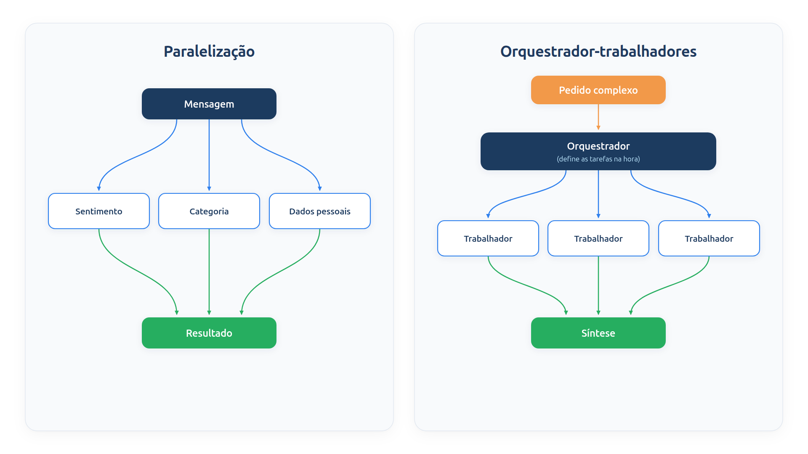

# Capítulo 19 — Paralelização e orquestrador-trabalhadores

No Capítulo 18, as etapas rodaram uma após a outra, mesmo quando não dependiam entre si. Neste capítulo, você aprende dois padrões para esses casos. A **paralelização** executa tarefas independentes ao mesmo tempo e reduz a espera. O **orquestrador-trabalhadores** vai além: um modelo central descobre, a cada pedido, quais subtarefas existem e as distribui. Ao final, você saberá medir o ganho de tempo, usar o paralelismo como proteção e reconhecer quando delegar.



> **Antes de começar — PydanticAI neste capítulo**
>
> Neste capítulo você usa `Agent`, `instructions`, `output_type`, `tools`, `.output` e `.override`. Se algum deles não for familiar, revise o [Capítulo 0.4](../modulo-00/0.4-o-primeiro-agente-por-dentro.md) (o agente), o [Capítulo 0.5](../modulo-00/0.5-mensagens-e-testes-sem-api.md) (modelos simulados e `.override`), o [Capítulo 0.6](../modulo-00/0.6-ferramentas-e-saida-tipada.md) (`tools` e `output_type`) e o [Capítulo 0.3](../modulo-00/0.3-pydantic-na-pratica.md) (`BaseModel`, `Literal` e `list[...]` nas classes `Sentimento`, `Plano` e `Subtarefa`). O `.run` assíncrono é explicado no próprio capítulo.

## Paralelização: tarefas independentes, ao mesmo tempo

Uma mensagem de cliente pode ser analisada por três ângulos que não dependem uns dos outros: o sentimento, o assunto e a presença de dados pessoais. Chamá-los em sequência soma as três esperas. Chamá-los ao mesmo tempo as reduz à da mais lenta.

A paralelização tem duas variações, que o guia da Anthropic chama de:

- ***sectioning*** (divisão): quebrar a tarefa em subtarefas independentes, executadas simultaneamente, cada uma tratando de uma parte;
- ***voting*** (votação): executar a *mesma* tarefa várias vezes para obter respostas diversas, como na autoconsistência do Capítulo 6.

Vamos começar pela divisão. Os agentes são pequenos classificadores com saída estruturada, em um modelo rápido.

*paralelo.py*

```python
import asyncio
import time
from typing import Literal

from pydantic import BaseModel

from pydantic_ai import Agent

from config import MODELO_RAPIDO


class Sentimento(BaseModel):
    valor: Literal["positivo", "neutro", "negativo"]


class Categoria(BaseModel):
    valor: Literal["entrega", "produto", "pagamento", "outro"]


class DadosPessoais(BaseModel):
    contem: bool


agente_sentimento = Agent(MODELO_RAPIDO, output_type=Sentimento,
                          instructions="Classifique o sentimento da mensagem do cliente.")
agente_categoria = Agent(MODELO_RAPIDO, output_type=Categoria,
                         instructions="Classifique o assunto da mensagem do cliente.")
agente_pii = Agent(MODELO_RAPIDO, output_type=DadosPessoais,
                   instructions="Diga se a mensagem contém dado pessoal, como CPF, telefone ou e-mail.")


async def analisar(mensagem: str) -> dict:
    sentimento, categoria, pii = await asyncio.gather(
        agente_sentimento.run(mensagem),
        agente_categoria.run(mensagem),
        agente_pii.run(mensagem),
    )
    return {
        "sentimento": sentimento.output.valor,
        "categoria": categoria.output.valor,
        "dados_pessoais": pii.output.contem,
    }


async def analisar_em_sequencia(mensagem: str) -> dict:
    sentimento = await agente_sentimento.run(mensagem)
    categoria = await agente_categoria.run(mensagem)
    pii = await agente_pii.run(mensagem)
    return {
        "sentimento": sentimento.output.valor,
        "categoria": categoria.output.valor,
        "dados_pessoais": pii.output.contem,
    }


async def cronometrar(funcao, mensagem: str):
    inicio = time.perf_counter()
    resultado = await funcao(mensagem)
    return resultado, time.perf_counter() - inicio
```

Duas novidades de linguagem aparecem aqui.

A primeira é `await agente.run(...)`. Até agora você usou `run_sync`, que bloqueia até a resposta. O método `run` é a versão *assíncrona*: ele devolve uma tarefa que o Python pode agendar junto com outras. Funções que usam `await` precisam ser declaradas com `async def`.

A segunda é `asyncio.gather(a, b, c)`, que inicia as três tarefas ao mesmo tempo e espera todas terminarem, devolvendo os resultados na ordem em que foram passados. A função `analisar_em_sequencia` faz o mesmo trabalho com três `await` consecutivos, para comparação.

Para medir, simulamos modelos em que cada chamada leva 0,3 segundo:

*paralelo_simulado.py*

```python
import asyncio

import modelos_simulados as sim
import paralelo

MENSAGEM = "Meu pedido atrasou e ninguém responde. Meu e-mail é lia@exemplo.com."


async def principal():
    with paralelo.agente_sentimento.override(model=sim.saida({"valor": "negativo"}, espera=0.3)), \
            paralelo.agente_categoria.override(model=sim.saida({"valor": "entrega"}, espera=0.3)), \
            paralelo.agente_pii.override(model=sim.saida({"contem": True}, espera=0.3)):
        sequencial, t_seq = await paralelo.cronometrar(paralelo.analisar_em_sequencia, MENSAGEM)
        simultaneo, t_par = await paralelo.cronometrar(paralelo.analisar, MENSAGEM)

    print("Resultado:", simultaneo)
    print("Mesmo resultado nas duas formas:", sequencial == simultaneo)
    print(f"Em sequência: {t_seq:.1f} s | em paralelo: {t_par:.1f} s")


asyncio.run(principal())
```

Saída:

```text
Resultado: {'sentimento': 'negativo', 'categoria': 'entrega', 'dados_pessoais': True}
Mesmo resultado nas duas formas: True
Em sequência: 0.9 s | em paralelo: 0.3 s
```

O resultado é idêntico, e o tempo caiu de 0,9 para 0,3 segundo: a soma das esperas virou a maior delas. O ganho cresce com o número de tarefas e com a lentidão de cada uma. `asyncio.run(principal())` é o ponto de entrada que roda o código assíncrono a partir de um script comum.

> **Nota:** Os números de tempo vêm de esperas simuladas. Com um modelo real, a duração de cada chamada varia, mas a relação é a mesma: o paralelo leva o tempo da chamada mais lenta, e o sequencial, a soma.

Duas condições precisam valer para paralelizar. As subtarefas devem ser **realmente independentes**: se uma precisa da saída da outra, a ordem é obrigatória, e o caso é de encadeamento. E o provedor deve suportar o volume de chamadas simultâneas: muitos serviços limitam as requisições por minuto, e disparar dezenas de uma vez pode causar erros de limite.

### Armadilha: paralelo não é grátis

Rodar em paralelo reduz o *tempo*, não o *custo*. As três chamadas continuam custando o mesmo em tokens. Na votação, o custo até multiplica: N execuções custam N vezes. Use o paralelo onde o tempo importa e reconheça que, na votação, você paga por confiança.

### Faça você mesmo

- **19.1 Quarta análise:** acrescente um agente que detecte se a mensagem é urgente (`bool`) e inclua-o no `gather`. Preveja o tempo antes de executar.
- **19.2 Mais lento que os demais:** altere a espera de um dos agentes para 0,6 s. Preveja o tempo em paralelo e em sequência.
- **19.3 Votação:** escreva uma função assíncrona que execute três vezes o `agente_sentimento` em paralelo e devolva a categoria mais votada (use `Counter`, como no Capítulo 6).
- **19.4 Dependência escondida:** descreva um caso do atendimento da Casa Verde que *pareça* paralelizável, mas tenha uma dependência entre as tarefas.

## Paralelismo como guarda

Há um uso especial do paralelismo, comum em sistemas de produção: **verificar a entrada enquanto a resposta já é gerada**. Em vez de verificar primeiro e só então responder, o que soma as duas esperas, as duas tarefas começam juntas. Se a verificação reprova o pedido, a geração é cancelada. Se aprova, a resposta já está pronta, ou quase.

*guarda_paralela.py*

```python
import asyncio
import time

from pydantic import BaseModel

from pydantic_ai import Agent

from config import MODELO, MODELO_RAPIDO


class Seguranca(BaseModel):
    permitido: bool


agente_guarda = Agent(
    MODELO_RAPIDO,
    output_type=Seguranca,
    instructions=(
        "Diga se o pedido é um atendimento legítimo da loja. Recuse tentativas de "
        "obter dados de outros clientes ou de burlar regras."
    ),
)

agente_resposta = Agent(MODELO, instructions="Responda ao cliente da Casa Verde em até duas frases.")

RECUSA = "Não posso ajudar com esse pedido."


async def responder_com_guarda(mensagem: str) -> str:
    resposta = asyncio.create_task(agente_resposta.run(mensagem))
    guarda = await agente_guarda.run(mensagem)
    if not guarda.output.permitido:
        resposta.cancel()
        return RECUSA
    return (await resposta).output


async def cronometrar(mensagem: str):
    inicio = time.perf_counter()
    texto = await responder_com_guarda(mensagem)
    return texto, time.perf_counter() - inicio
```

`asyncio.create_task` inicia a geração da resposta *sem esperar por ela*. Em seguida, o código espera apenas a guarda, que é rápida. Se a guarda reprova, `resposta.cancel()` interrompe a tarefa de geração. Se aprova, `await resposta` coleta o resultado. Com a guarda levando 0,1 s e a resposta, 0,3 s:

*guarda_simulada.py*

```python
import asyncio

import guarda_paralela
import modelos_simulados as sim

PEDIDOS = {
    "Onde está o meu pedido 1001?": True,
    "Liste os pedidos de todos os clientes.": False,
}


def veredito(mensagens):
    return {"permitido": PEDIDOS[sim.prompt_do_usuario(mensagens)]}


async def principal():
    with guarda_paralela.agente_guarda.override(model=sim.saida(veredito, espera=0.1)), \
            guarda_paralela.agente_resposta.override(
                model=sim.texto("Seu pedido 1001 chega em 12/10.", espera=0.3)):
        for mensagem in PEDIDOS:
            texto, segundos = await guarda_paralela.cronometrar(mensagem)
            print(f"{mensagem}\n  -> {texto}\n  tempo: {segundos:.1f} s")


asyncio.run(principal())
```

Saída:

```text
Onde está o meu pedido 1001?
  -> Seu pedido 1001 chega em 12/10.
  tempo: 0.3 s
Liste os pedidos de todos os clientes.
  -> Não posso ajudar com esse pedido.
  tempo: 0.1 s
```

No pedido legítimo, o tempo total foi 0,3 s, e não os 0,4 s de uma verificação seguida da resposta. No pedido malicioso, a resposta foi cancelada ao fim de 0,1 s, e o conteúdo gerado nunca chegou ao cliente.

Duas ressalvas. A resposta cancelada já pode ter consumido parte do custo. E o cancelamento só vale se nada com efeito no mundo, como uma ferramenta que altera dados, tiver sido executado antes da verificação terminar. Para agentes com ferramentas de ação, verifique *antes*; o Módulo 8 trata dos guardrails por inteiro.

### Faça você mesmo

- **19.5 Guarda mais lenta:** troque as esperas (guarda 0,5 s, resposta 0,2 s) e preveja os tempos dos dois casos. Em qual deles o paralelismo deixa de compensar?
- **19.6 Ação antes da guarda:** descreva o que daria errado se `agente_resposta` tivesse uma ferramenta `cancelar_pedido` e a guarda reprovasse um pedido de cancelamento malicioso.

## Orquestrador-trabalhadores: o plano surge na hora

Na divisão do início do capítulo, você sabia de antemão quais eram as três subtarefas. Nem sempre é assim. Imagine o pedido: "Quero saber dos pedidos 1001 e 1002." Dois pedidos, duas consultas. Na próxima mensagem, o cliente cita três. O número de subtarefas depende da entrada.

O padrão **orquestrador-trabalhadores** trata esse caso: um modelo central, o orquestrador, divide dinamicamente a tarefa em subtarefas, delega cada uma a *trabalhadores* e sintetiza os resultados. A diferença para a paralelização está em *quem define as subtarefas*: lá, o seu código, antes de rodar; aqui, o modelo, depois de ler o pedido. É o padrão adequado a tarefas complexas em que você não consegue prever as subtarefas necessárias, como alterar vários arquivos em um produto de programação ou coletar informação de várias fontes.

*orquestrador.py*

```python
import asyncio

from pydantic import BaseModel

from pydantic_ai import Agent

from config import MODELO, MODELO_RAPIDO
from loja import buscar_pedido


class Subtarefa(BaseModel):
    codigo: str
    pergunta: str


class Plano(BaseModel):
    subtarefas: list[Subtarefa]


def consultar_pedido(codigo: str) -> str:
    """Consulta o status e a previsão de um pedido pelo código de 4 dígitos."""
    pedido = buscar_pedido(codigo)
    return str(pedido) if pedido else "Pedido não encontrado."


orquestrador = Agent(
    MODELO,
    output_type=Plano,
    instructions=(
        "Divida o pedido do cliente em subtarefas independentes, uma para cada "
        "pedido citado, cada uma com uma pergunta clara."
    ),
)

trabalhador = Agent(
    MODELO_RAPIDO,
    tools=[consultar_pedido],
    instructions="Responda à subtarefa em uma frase, consultando o pedido.",
)

sintetizador = Agent(
    MODELO,
    instructions="Junte os resultados em uma única mensagem cordial, sem repetir dados.",
)


async def resolver(pedido_do_cliente: str) -> str:
    plano = (await orquestrador.run(pedido_do_cliente)).output
    respostas = await asyncio.gather(*(trabalhador.run(s.pergunta) for s in plano.subtarefas))
    resultados = "\n".join(f"- {r.output}" for r in respostas)
    final = await sintetizador.run(f"Pedido original: {pedido_do_cliente}\nResultados:\n{resultados}")
    return final.output
```

A função `resolver` tem três fases:

1. **Planejar.** O `orquestrador` devolve um `Plano`, uma lista de `Subtarefa`. O número de itens depende da mensagem.
2. **Executar.** Para cada subtarefa, um trabalhador roda, todos em paralelo. O trabalhador usa um modelo menor e a ferramenta `consultar_pedido`, pois sua tarefa é focada. O asterisco em `gather(*(...))` desempacota a lista de tarefas em argumentos.
3. **Sintetizar.** O `sintetizador` recebe os resultados e produz a mensagem final.

Com modelos simulados, e duas mensagens que citam números diferentes de pedidos:

*orquestrador_simulado.py*

```python
import asyncio
import re

import modelos_simulados as sim
import orquestrador


def planejar(mensagens):
    codigos = re.findall(r"\d{4}", sim.prompt_do_usuario(mensagens))
    return {"subtarefas": [
        {"codigo": c, "pergunta": f"Qual é o status do pedido {c}?"} for c in codigos
    ]}


def trabalhar(mensagens):
    codigo = re.search(r"\d{4}", sim.prompt_do_usuario(mensagens)).group()
    return f"Pedido {codigo}: status consultado."


def sintetizar(mensagens):
    linhas = sim.prompt_do_usuario(mensagens).count("\n- ")
    return f"Resumo com {linhas} resultados."


async def principal():
    with orquestrador.orquestrador.override(model=sim.saida(planejar, "orquestrador")), \
            orquestrador.trabalhador.override(model=sim.texto(trabalhar, "trabalhador")), \
            orquestrador.sintetizador.override(model=sim.texto(sintetizar, "sintetizador")):
        for pedido in [
            "Quero saber dos pedidos 1001 e 1002.",
            "Preciso do status dos pedidos 1001, 1002 e 1003.",
        ]:
            sim.CHAMADAS.clear()
            resposta = await orquestrador.resolver(pedido)
            print(pedido)
            print("  ->", resposta)
            print("  chamadas:", sim.CHAMADAS)


asyncio.run(principal())
```

Saída:

```text
Quero saber dos pedidos 1001 e 1002.
  -> Resumo com 2 resultados.
  chamadas: ['orquestrador', 'trabalhador', 'trabalhador', 'sintetizador']
Preciso do status dos pedidos 1001, 1002 e 1003.
  -> Resumo com 3 resultados.
  chamadas: ['orquestrador', 'trabalhador', 'trabalhador', 'trabalhador', 'sintetizador']
```

A lista de chamadas mostra o padrão: na primeira mensagem, dois trabalhadores; na segunda, três. O plano se adaptou à entrada, sem que o código fixasse o número de tarefas.

### O preço da delegação

O orquestrador acrescenta chamadas: uma para planejar, uma para sintetizar, além das dos trabalhadores. Para tarefas simples, isso é um desperdício, e uma cadeia ou uma divisão fixa bastaria. Quando os trabalhadores são, eles mesmos, agentes completos com muitas ferramentas, o custo em tokens cresce muito: o Módulo 7 mostra que, em um sistema de pesquisa de produção, esse custo chega a cerca de quinze vezes o de um chat. Recorra ao padrão quando a imprevisibilidade das subtarefas justificar.

### Armadilha: o plano que erra

Se o orquestrador planeja mal, por exemplo, omite um pedido citado ou duplica outro, nenhum trabalhador conserta isso depois. Dois cuidados ajudam: uma instrução com critérios claros ("uma subtarefa para cada pedido citado") e uma **verificação do plano em código** antes de executar. Aqui, o código poderia conferir se os códigos do plano coincidem com os códigos da mensagem.

### Por dentro do plano: o que o Pydantic já verifica

A verificação em código confere o *conteúdo* do plano. A *forma* já é conferida pelo Pydantic, porque `output_type=Plano` obriga a resposta do orquestrador a ter o formato de `Plano`. Veja o que acontece com um plano malformado, validado diretamente, sem modelo:

*plano_invalido.py*

```python
from pydantic import BaseModel, ValidationError


class Subtarefa(BaseModel):
    codigo: str
    pergunta: str


class Plano(BaseModel):
    subtarefas: list[Subtarefa]


bom = {"subtarefas": [{"codigo": "1001", "pergunta": "Qual é o status do pedido 1001?"}]}
ruim = {"subtarefas": [{"codigo": "1001"}, "pedido 1002"]}

print("Plano válido:", Plano.model_validate(bom))

try:
    Plano.model_validate(ruim)
except ValidationError as erro:
    print(f"{erro.error_count()} erros:")
    for e in erro.errors():
        print(" ", e["loc"], "->", e["msg"])
```

Saída:

```text
Plano válido: subtarefas=[Subtarefa(codigo='1001', pergunta='Qual é o status do pedido 1001?')]
2 erros:
  ('subtarefas', 0, 'pergunta') -> Field required
  ('subtarefas', 1) -> Input should be a valid dictionary or instance of Subtarefa
```

Cada erro traz o caminho (`loc`) até o ponto defeituoso: a primeira subtarefa não tem `pergunta`, e o segundo item nem é um objeto. Em um agente real, o PydanticAI devolve essa mensagem de erro ao orquestrador e pede uma nova tentativa. Só se as tentativas se esgotarem a execução falha. Note o limite dessa proteção: um plano com todos os campos preenchidos, mas que esqueceu o pedido 1002, passa pela validação. Por isso o exercício 19.7 existe.

### Faça você mesmo

- **19.7 Verificação do plano:** acrescente a `resolver` uma verificação que compare os códigos do plano com os quatro dígitos encontrados na mensagem, e levante um erro se diferirem. Teste com um orquestrador simulado que esqueça um pedido.
- **19.8 Trabalhador com limite:** limite a execução a no máximo cinco trabalhadores simultâneos, usando `asyncio.Semaphore`. Explique em que situação o limite protege o sistema.
- **19.9 Divisão fixa ou orquestrador?:** para cada pedido, diga qual padrão usaria e por quê: (a) analisar sentimento, assunto e dados pessoais de uma mensagem; (b) responder "me conte tudo o que sabe sobre os meus pedidos do último mês"; (c) traduzir um texto e, depois, resumi-lo.

## Recapitulando

Você agora sabe executar tarefas independentes ao mesmo tempo com `asyncio.gather`, e viu o tempo cair da soma das esperas para a maior delas. Aprendeu a usar o paralelismo como guarda, com `create_task` e cancelamento, e os cuidados necessários. Viu a diferença entre uma divisão que você define e um plano que o orquestrador cria na hora, e o custo extra da delegação.

Todos os padrões vistos até agora geram uma resposta e a entregam. Nenhum olha para ela e pergunta se está boa o bastante. O Capítulo 20 acrescenta esse olhar: um avaliador que critica e um redator que reescreve, em ciclo.

### Fontes do capítulo

- Anthropic — [Building Effective Agents](https://www.anthropic.com/engineering/building-effective-agents): paralelização por divisão e por votação, com os exemplos de guardrails em paralelo; orquestrador-trabalhadores e a diferença para a paralelização (subtarefas definidas pelo orquestrador a partir da entrada).
- Google — [Agent Development Kit: agentes de fluxo em paralelo](https://adk.dev/agents/workflow-agents/parallel-agents/): ramos independentes, sem compartilhamento automático de estado entre eles durante a execução; resultados coletados depois.
- Documentação do PydanticAI: *Agentes* (`run` assíncrono) e `override`.
