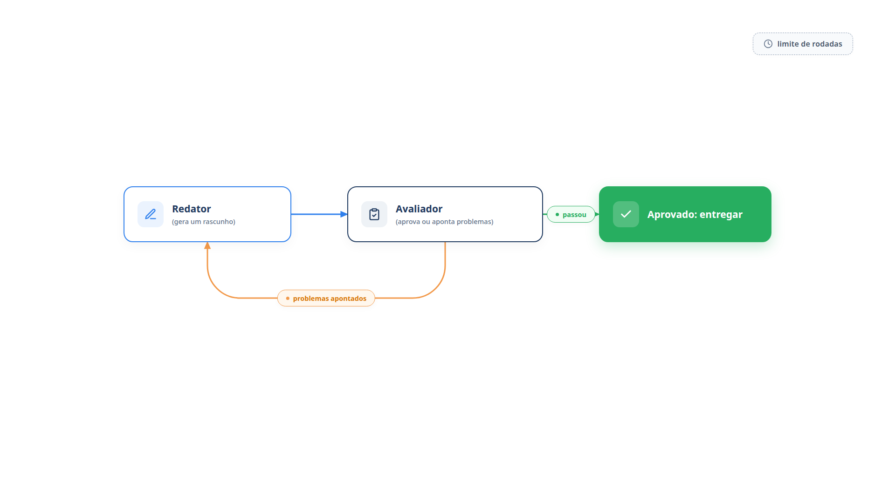

# Capítulo 20 — Avaliador-otimizador

Os padrões dos capítulos anteriores geram uma resposta e a entregam. Mas há tarefas em que a primeira versão raramente é a melhor: uma resposta a uma reclamação delicada, uma tradução com nuances, uma busca que precisa de várias rodadas. Para elas, existe o padrão **avaliador-otimizador**: um agente gera, outro avalia e aponta problemas, e o primeiro reescreve, em ciclo, até a aprovação ou um limite de rodadas. Ao final do capítulo, você terá esse ciclo funcionando e saberá quando ele vale o custo.



> **Antes de começar — PydanticAI neste capítulo**
>
> Neste capítulo você usa `Agent`, `instructions`, `output_type`, `.run_sync`, `.output` e `.override`. Se algum deles não for familiar, revise o [Capítulo 0.4](../modulo-00/0.4-o-primeiro-agente-por-dentro.md) (o agente, `.run_sync` e `.output`), o [Capítulo 0.5](../modulo-00/0.5-mensagens-e-testes-sem-api.md) (modelos simulados e `.override`), o [Capítulo 0.6](../modulo-00/0.6-ferramentas-e-saida-tipada.md) (`output_type`) e o [Capítulo 0.3](../modulo-00/0.3-pydantic-na-pratica.md) (`BaseModel`, `list[str]` e `bool` na classe `Avaliacao`).

## Gerar, avaliar, reescrever

Você já conhece a ideia. No Capítulo 7, o Reflexion usou um ator, um avaliador em código e uma reflexão que guardava lições entre tentativas. O avaliador-otimizador é um parente próximo, com duas diferenças de ênfase. Primeiro, o avaliador costuma ser *outro modelo*, capaz de julgar critérios que o código não verifica, como empatia e clareza. Segundo, a crítica volta *direto* ao redator, na mesma tarefa, sem uma etapa de reflexão nem memória entre tarefas.

O Google ADK oferece o mesmo desenho como um agente de laço (`LoopAgent`): um redator e um crítico em sequência, repetidos até que o crítico sinalize que acabou ou que se atinja um número máximo de iterações. Um ponto da sua documentação vale como regra: o laço não decide sozinho quando parar. Você precisa implementar o critério de término.

Vamos escrever o ciclo para as respostas a reclamações da Casa Verde. Os critérios do avaliador definem o que é uma boa resposta, e por isso são o coração do padrão.

*avaliador_otimizador.py*

```python
from dataclasses import dataclass

from pydantic import BaseModel

from pydantic_ai import Agent

from config import MODELO


class Avaliacao(BaseModel):
    problemas: list[str]
    aprovado: bool


@dataclass
class Resultado:
    texto: str
    aprovado: bool
    rodadas: int


redator = Agent(
    MODELO,
    instructions=(
        "Você escreve respostas a reclamações de clientes da Casa Verde: empáticas, "
        "claras, sem prometer o que a loja não confirmou."
    ),
)

avaliador = Agent(
    MODELO,
    output_type=Avaliacao,
    instructions=(
        "Avalie a resposta pelos critérios: (1) reconhece o problema com empatia; "
        "(2) informa um próximo passo concreto; (3) não promete reembolso nem prazo "
        "não confirmado; (4) tem no máximo quatro frases. Liste os problemas "
        "encontrados antes de decidir `aprovado`; aprove só se não houver nenhum."
    ),
)


def melhorar(reclamacao: str, max_rodadas: int = 3) -> Resultado:
    rascunho = redator.run_sync(reclamacao).output
    for rodada in range(1, max_rodadas + 1):
        avaliacao = avaliador.run_sync(f"Reclamação: {reclamacao}\nResposta: {rascunho}").output
        print(f"Rodada {rodada}: {'aprovado' if avaliacao.aprovado else 'reprovado'}")
        if avaliacao.aprovado:
            return Resultado(rascunho, True, rodada)
        for problema in avaliacao.problemas:
            print("  -", problema)
        problemas = "\n".join(f"- {p}" for p in avaliacao.problemas)
        rascunho = redator.run_sync(
            f"Reclamação: {reclamacao}\nSua resposta anterior: {rascunho}\n"
            f"Problemas apontados:\n{problemas}\nReescreva corrigindo os problemas."
        ).output
    return Resultado(rascunho, False, max_rodadas)
```

Leia a função `melhorar` como um laço de quatro passos:

1. O redator escreve o **primeiro rascunho**.
2. A cada rodada, o avaliador recebe a reclamação e o rascunho e devolve uma `Avaliacao`: a lista de `problemas` e a decisão `aprovado`. Os problemas vêm *antes* da decisão, pelo mesmo motivo da ordem dos campos no Capítulo 6: o veredito é consequência da análise.
3. Se `aprovado`, o ciclo termina e devolve o texto com o número de rodadas.
4. Se não, o redator recebe o rascunho anterior e a lista de problemas e **reescreve**. A crítica volta como instrução concreta.

O parâmetro `max_rodadas` é o ponto de parada. Se o limite é atingido sem aprovação, o resultado volta com `aprovado=False`, e quem chamou decide o que fazer: escalar a uma pessoa, por exemplo. Sem esse limite, um avaliador exigente demais e um redator que não consegue satisfazê-lo girariam sem fim.

Para uma execução reproduzível, simulamos um redator que, no primeiro rascunho, promete reembolso e prazo, e que só corrige o texto quando recebe os problemas, e um avaliador que reprova a promessa.

*avaliador_otimizador_simulado.py*

```python
import avaliador_otimizador as ao
import modelos_simulados as sim

RECLAMACAO = "O vaso chegou quebrado e ninguém me respondeu."


def redigir(mensagens):
    if "Problemas apontados" in sim.prompt_do_usuario(mensagens):
        return ("Sinto muito pelo vaso quebrado e pela demora. Vou abrir uma solicitação "
                "de troca agora, e nossa equipe retornará por e-mail com os próximos passos.")
    return "Garantimos o reembolso total em 24 horas. Obrigado pelo contato."


def avaliar(mensagens):
    if "reembolso total" in sim.prompt_do_usuario(mensagens):
        return {"problemas": ["não reconhece o problema com empatia",
                              "promete reembolso e prazo não confirmados"],
                "aprovado": False}
    return {"problemas": [], "aprovado": True}


with ao.redator.override(model=sim.texto(redigir)), ao.avaliador.override(model=sim.saida(avaliar)):
    resultado = ao.melhorar(RECLAMACAO)

print(f"\nAprovado: {resultado.aprovado} em {resultado.rodadas} rodadas")
print(resultado.texto)
```

Saída:

```text
Rodada 1: reprovado
  - não reconhece o problema com empatia
  - promete reembolso e prazo não confirmados
Rodada 2: aprovado

Aprovado: True em 2 rodadas
Sinto muito pelo vaso quebrado e pela demora. Vou abrir uma solicitação de troca agora, e nossa equipe retornará por e-mail com os próximos passos.
```

O primeiro rascunho violava dois critérios, e o avaliador os apontou. O redator, com a crítica em mãos, produziu uma versão que reconhece o problema, propõe um próximo passo concreto e não promete reembolso nem prazo. Na segunda rodada, o avaliador aprovou. Esse é o ganho do padrão: a melhoria vem de uma crítica *articulada*, e não de uma nova tentativa às cegas.

### Por que `Avaliacao` valida e `Resultado` não

O arquivo `avaliador_otimizador.py` define duas classes parecidas, mas com papéis diferentes. `Avaliacao` é um `BaseModel`: ela recebe dados vindos *de fora*, a resposta do modelo, e por isso precisa validá-los. `Resultado` é uma `dataclass` comum: ela só agrupa valores que o seu próprio código já produziu e não confere nada. Execute a comparação:

*avaliacao_validada.py*

```python
from dataclasses import dataclass

from pydantic import BaseModel, ValidationError


class Avaliacao(BaseModel):
    problemas: list[str]
    aprovado: bool


@dataclass
class Resultado:
    texto: str
    aprovado: bool
    rodadas: int


print(Avaliacao.model_validate({"problemas": [], "aprovado": "true"}))

try:
    Avaliacao.model_validate({"problemas": "sem empatia", "aprovado": "talvez"})
except ValidationError as erro:
    for e in erro.errors():
        print(e["loc"], "->", e["msg"])

print(Resultado("ok", "talvez", "duas"))
```

Saída:

```text
problemas=[] aprovado=True
('problemas',) -> Input should be a valid list
('aprovado',) -> Input should be a valid boolean, unable to interpret input
Resultado(texto='ok', aprovado='talvez', rodadas='duas')
```

A primeira chamada mostra que `"true"` vira o `bool` `True`. A segunda mostra que um texto no lugar da lista, ou `"talvez"` no lugar de `bool`, levanta `ValidationError`, com o campo (`loc`) e o motivo (`msg`). No agente, é isso que protege o laço: se o avaliador devolver um veredito mal formado, o PydanticAI percebe o erro de validação e pede ao modelo uma nova saída, em vez de deixar um `aprovado` inválido chegar ao `if avaliacao.aprovado`. A última linha mostra o contraste: a `dataclass` aceita `"duas"` como número de rodadas sem reclamar. Use `BaseModel` para o que atravessa a fronteira do modelo e `dataclass` para o que circula dentro do seu código.

### Quando o padrão se encaixa

Duas condições sinalizam um bom encaixe:

- as respostas do modelo **melhoram de forma demonstrável** quando se lhe dá um retorno articulado, como um revisor humano faria; e
- o modelo **consegue dar esse retorno**, ou seja, há um avaliador capaz de julgar pelos critérios que você definiu.

Exemplos clássicos: a tradução literária, em que um segundo olhar capta nuances que o primeiro perdeu, e buscas complexas, que exigem várias rodadas para completar a informação. Em nosso caso, o tom de uma resposta a uma reclamação.

Quando *não* usar: se a primeira versão basta na maioria dos casos, o ciclo só soma custo; se os critérios não podem ser escritos com clareza, o avaliador julgará por gosto, e o redator perseguirá um alvo que se move; e se a regra é verificável por código, como o limite de 160 caracteres do Capítulo 7, prefira um avaliador em código, que é mais barato e exato. A melhor combinação costuma ser os dois: código para o que é mecânico, modelo para o que é de juízo.

### Armadilha: o avaliador que muda de ideia

Um avaliador baseado em modelo pode ser inconsistente. Duas formas de falhar merecem atenção:

- **Complacente:** aprova tudo na primeira rodada, e o ciclo vira um custo inútil. Teste o avaliador com respostas ruins conhecidas e confira se as reprova.
- **Perfeccionista:** encontra um novo defeito a cada rodada, e o redator oscila entre versões sem convergir. O sintoma é um ciclo que quase sempre esgota o limite. A correção está nos critérios: liste-os de forma fechada, como na instrução acima, para que o avaliador não invente critérios novos.

Registre as rodadas e os problemas de cada execução, como o `print` do exemplo faz. Eles são o seu instrumento de diagnóstico.

### Faça você mesmo

- **20.1 Execução real:** execute `melhorar` com o modelo real e a reclamação do exemplo. Anote o número de rodadas e os problemas de cada uma.
- **20.2 Limite baixo:** execute com `max_rodadas=1`. Descreva o `Resultado` quando a resposta não é aprovada e proponha uma ação para o código chamador.
- **20.3 Novo critério:** acrescente à instrução do avaliador o critério "(5) usa o nome do produto citado pelo cliente". Escreva uma reclamação que o exercite.
- **20.4 Um avaliador em código:** acrescente, antes do avaliador por modelo, uma verificação em código do critério (4), "no máximo quatro frases", contando os pontos finais. Explique por que a ordem importa para o custo.
- **20.5 Testando o avaliador:** escreva cinco respostas, três ruins e duas boas, e execute o `avaliador` sobre elas. Calcule quantas ele classifica corretamente.

## Registrando a evolução

Em muitos casos, vale guardar todos os rascunhos, e não apenas o último. Eles permitem auditar o ciclo, depurar um avaliador que erra e, mais adiante, usar os pares (rascunho reprovado, rascunho aprovado) como exemplos para ajuste fino (Capítulo 16). Uma pequena mudança em `melhorar` guarda a história:

```python
historico = []
...
historico.append({"rodada": rodada, "rascunho": rascunho, "problemas": avaliacao.problemas})
```

Os agentes de produção costumam registrar também o custo de cada rodada. Um ciclo que sempre precisa de três rodadas custa três vezes mais que o previsto, e esse é um sinal para melhorar o primeiro rascunho, por exemplo, com os critérios da avaliação já incluídos na instrução do redator.

### Faça você mesmo

- **20.6 Histórico completo:** altere `Resultado` para guardar a lista `historico` e escreva uma função que a imprima formatada.
- **20.7 Critérios no redator:** copie os quatro critérios para a instrução do redator e compare, com o modelo real, quantas rodadas o ciclo passa a precisar em cinco reclamações.

## Recapitulando

Você agora sabe montar o ciclo em que um redator gera e um avaliador critica, com a crítica voltando ao redator como instrução, e um limite de rodadas que garante o término. Conhece os sinais de encaixe, os critérios fechados que mantêm o avaliador estável e as formas de falhar: o avaliador complacente e o perfeccionista. Também sabe quando preferir um avaliador em código e como guardar o histórico das rodadas.

Você aprendeu os cinco padrões separados. Em um sistema real, eles aparecem *juntos*: uma mensagem é roteada, a rota segue uma cadeia, uma etapa da cadeia roda em paralelo, e o final passa por um avaliador. O Capítulo 21 fecha o módulo com blocos que se encaixam, para montar essas combinações sem repetir o código de controle.

### Fontes do capítulo

- Anthropic — [Building Effective Agents](https://www.anthropic.com/engineering/building-effective-agents): padrão avaliador-otimizador; critérios de avaliação claros e iteração com valor mensurável; os dois sinais de bom encaixe; exemplos de tradução literária e busca em várias rodadas.
- Google — [Agent Development Kit: agentes de laço](https://adk.dev/agents/workflow-agents/loop-agents/): o `LoopAgent` com redator e crítico; término por número máximo de iterações ou por sinal de um subagente; o laço não decide sozinho quando parar.
- Documentação do PydanticAI: *Saída* (`output_type`).
