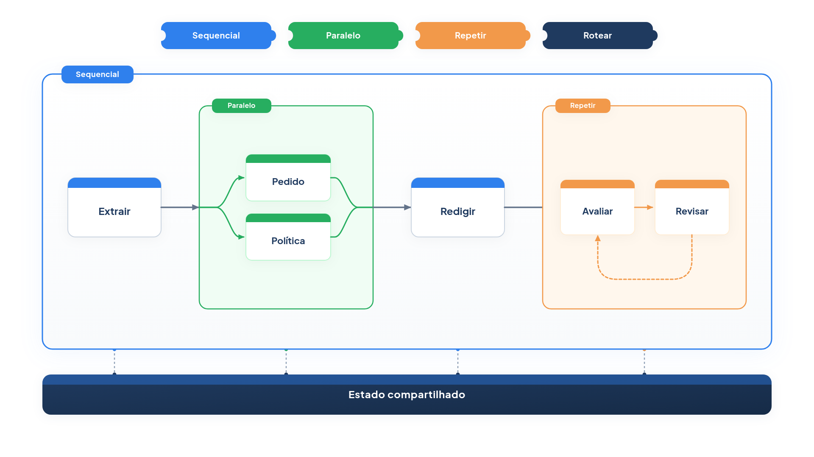

# Capítulo 21 — Blocos combináveis

Os cinco padrões que você aprendeu raramente aparecem sozinhos. Um atendimento real roteia a mensagem, segue uma cadeia, consulta dados em paralelo e revisa a resposta. Se cada combinação fosse escrita à mão, com `if`, `for` e `gather` misturados à lógica do negócio, o código ficaria difícil de ler e de mudar. Neste capítulo, você cria um pequeno conjunto de **blocos** que se encaixam, no estilo dos agentes de fluxo do Google Agent Development Kit (ADK), e monta com eles o atendimento completo da Casa Verde. No fim, você terá uma tabela para escolher o padrão certo.



> **Antes de começar — PydanticAI neste capítulo**
>
> Neste capítulo você usa `Agent`, `instructions`, `output_type`, `.run`, `.output` e `.override`. Se algum deles não for familiar, revise o [Capítulo 0.4](../modulo-00/0.4-o-primeiro-agente-por-dentro.md) (o agente e `.output`), o [Capítulo 0.5](../modulo-00/0.5-mensagens-e-testes-sem-api.md) (modelos simulados e `.override`), o [Capítulo 0.6](../modulo-00/0.6-ferramentas-e-saida-tipada.md) (`output_type`) e o [Capítulo 0.3](../modulo-00/0.3-pydantic-na-pratica.md) (`BaseModel` nas classes `Rota` e `Avaliacao`).
>
> Aqui o agente roda com `await ag.run(...)`, a versão assíncrona de `.run_sync`, porque as etapas são funções `async`. O Capítulo [0.2](../modulo-00/0.2-o-python-que-o-livro-assume.md) explica `async`/`await` e as anotações `Callable` e `Awaitable` usadas em `Estado` e `Etapa`.

## Blocos determinísticos, decisões do modelo

A documentação do ADK define *agentes de fluxo* (*workflow agents*) como componentes que orquestram a execução de outros agentes, controlando *como e quando* eles rodam, com padrões de fluxo determinísticos e previsíveis, sem depender de um modelo de IA para decidir a orquestração. Há três:

- **`SequentialAgent`:** executa os subagentes em ordem, um depois do outro;
- **`ParallelAgent`:** executa os subagentes ao mesmo tempo, em ramos independentes;
- **`LoopAgent`:** repete os subagentes até uma condição de término, com um número máximo de iterações.

Os agentes de um fluxo se comunicam por um **estado de sessão** compartilhado: cada subagente grava o resultado em uma chave (a `output_key`), e os seguintes o leem. E há o quarto elemento, o **roteamento dirigido por um LLM**: um agente coordenador, com subagentes descritos por texto, decide a quem transferir o controle.

Essa divisão traz uma ideia útil: o *esqueleto* do fluxo é determinístico e previsível, e as *decisões* são do modelo, só onde precisam ser. É o que você tem feito desde o Capítulo 1, agora com nomes e peças reutilizáveis.

## Quatro blocos e um estado

Vamos construir os blocos em poucas linhas. Cada **etapa** é uma função assíncrona que recebe o **estado**, um dicionário compartilhado, e o modifica. Os blocos combinam etapas e devolvem outra etapa, de modo que se aninham livremente.

*blocos.py*

```python
import asyncio
from collections.abc import Awaitable, Callable
from typing import Any

from pydantic_ai import Agent

Estado = dict[str, Any]
Etapa = Callable[[Estado], Awaitable[None]]

REGISTRO: list[str] = []


def agente(nome: str, ag: Agent, entrada: Callable[[Estado], str], saida: str) -> Etapa:
    """Etapa que chama um agente e guarda a saída no estado."""

    async def etapa(estado: Estado) -> None:
        REGISTRO.append(nome)
        resultado = await ag.run(entrada(estado))
        estado[saida] = resultado.output

    return etapa


def codigo(nome: str, funcao: Callable[[Estado], Any], saida: str) -> Etapa:
    """Etapa determinística: roda uma função comum e guarda o resultado no estado."""

    async def etapa(estado: Estado) -> None:
        REGISTRO.append(nome)
        estado[saida] = funcao(estado)

    return etapa


def sequencial(*etapas: Etapa) -> Etapa:
    async def etapa(estado: Estado) -> None:
        for passo in etapas:
            await passo(estado)

    return etapa


def paralelo(*etapas: Etapa) -> Etapa:
    async def etapa(estado: Estado) -> None:
        await asyncio.gather(*(passo(estado) for passo in etapas))

    return etapa


def repetir(*etapas: Etapa, maximo: int, parar: Callable[[Estado], bool]) -> Etapa:
    async def etapa(estado: Estado) -> None:
        for _ in range(maximo):
            for passo in etapas:
                await passo(estado)
                if parar(estado):
                    return

    return etapa


def rotear(escolher: Callable[[Estado], Awaitable[str]], rotas: dict[str, Etapa]) -> Etapa:
    async def etapa(estado: Estado) -> None:
        chave = await escolher(estado)
        REGISTRO.append(f"rota:{chave}")
        await rotas[chave](estado)

    return etapa
```

Os blocos e suas correspondências com o ADK:

| Bloco | O que faz | Equivalente no ADK |
| --- | --- | --- |
| `agente` | chama um agente e grava a saída no estado | um agente com `output_key` |
| `codigo` | roda uma função comum e grava no estado | um agente customizado (código) |
| `sequencial` | roda as etapas em ordem | `SequentialAgent` |
| `paralelo` | roda as etapas ao mesmo tempo | `ParallelAgent` |
| `repetir` | repete as etapas até `parar` ou `maximo` | `LoopAgent` (`max_iterations` e sinal de término) |
| `rotear` | uma função, em geral um LLM, escolhe a rota | roteamento por LLM (`transfer_to_agent`) |

O que torna isto simples é o **estado**: o dicionário que todas as etapas leem e escrevem. É o mesmo papel do estado de sessão do ADK. Dois detalhes de projeto merecem atenção:

- Em `repetir`, a condição `parar` é verificada *depois de cada etapa*, e não apenas no fim de cada volta. Assim, um avaliador que aprova interrompe o laço na hora, sem executar a etapa de revisão. É o equivalente do sinal de término de um subagente no `LoopAgent`.
- Em `paralelo`, as etapas rodam em ramos independentes, mas escrevem no mesmo dicionário. Dê a cada uma uma *chave própria*, para que nenhuma sobrescreva o resultado da outra. A documentação do ADK faz a mesma recomendação para os ramos paralelos.

Os blocos são tão curtos que você pode lê-los de uma vez. Isso é proposital: entender o controle de fluxo é mais importante que escondê-lo.

### Faça você mesmo

- **21.1 Bloco `esperar`:** escreva um bloco `com_limite_de_tempo(etapa, segundos)` que cancele uma etapa que passe do tempo (use `asyncio.wait_for`) e registre `"tempo esgotado"` no estado.
- **21.2 Bloco `se`:** escreva um bloco `se(condicao, etapa)` que só execute a etapa quando a função `condicao(estado)` for verdadeira. Em que padrão do Capítulo 18 ele se parece?
- **21.3 Ramos paralelos com a mesma chave:** descreva o que acontece se duas etapas de `paralelo` gravarem na mesma chave do estado, e como evitar.

## O atendimento completo

Agora montamos o atendimento da Casa Verde com os blocos. O fluxo é:

1. **Rotear** a mensagem: reclamação ou outro assunto.
2. Se for reclamação: **em paralelo**, buscar o pedido e a política relevante (duas etapas de código); depois **redigir** a resposta; depois **repetir** a avaliação e a revisão até a aprovação ou duas voltas.
3. Se for outro assunto: um agente generalista responde.

*fluxo_casa_verde.py*

```python
import re
from typing import Literal

from pydantic import BaseModel

from pydantic_ai import Agent

from blocos import agente, codigo, paralelo, repetir, rotear, sequencial
from busca import indice
from config import MODELO, MODELO_RAPIDO
from loja import buscar_pedido


class Rota(BaseModel):
    categoria: Literal["reclamacao", "outro"]


class Avaliacao(BaseModel):
    problemas: list[str]
    aprovado: bool


classificador = Agent(MODELO_RAPIDO, output_type=Rota, instructions="Classifique a mensagem do cliente.")
redator = Agent(MODELO, instructions="Responda à reclamação com empatia, em até quatro frases.")
avaliador = Agent(MODELO, output_type=Avaliacao, instructions="Avalie a resposta e liste os problemas.")
generalista = Agent(MODELO, instructions="Responda com cordialidade e encaminhe a um atendente.")


async def escolher_rota(estado) -> str:
    resultado = await classificador.run(estado["mensagem"])
    return resultado.output.categoria


def buscar_dados_do_pedido(estado):
    achado = re.search(r"\d{4}", estado["mensagem"])
    return buscar_pedido(achado.group()) if achado else None


def buscar_politica_relevante(estado):
    pontos, fragmento = indice.buscar(estado["mensagem"], k=1)[0]
    return fragmento.texto if pontos >= 0.2 else None


def prompt_do_redator(estado):
    texto = f"Reclamação: {estado['mensagem']}\nPedido: {estado['pedido']}\nPolítica: {estado['politica']}"
    if estado.get("avaliacao") and not estado["avaliacao"].aprovado:
        problemas = "; ".join(estado["avaliacao"].problemas)
        texto += f"\nResposta anterior: {estado['resposta']}\nCorrija: {problemas}"
    return texto


fluxo_reclamacao = sequencial(
    paralelo(
        codigo("buscar_pedido", buscar_dados_do_pedido, "pedido"),
        codigo("buscar_politica", buscar_politica_relevante, "politica"),
    ),
    agente("redigir", redator, prompt_do_redator, "resposta"),
    repetir(
        agente("avaliar", avaliador, lambda e: f"Resposta: {e['resposta']}", "avaliacao"),
        agente("revisar", redator, prompt_do_redator, "resposta"),
        maximo=2,
        parar=lambda e: e["avaliacao"].aprovado,
    ),
)

fluxo = rotear(escolher_rota, {
    "reclamacao": fluxo_reclamacao,
    "outro": agente("generalista", generalista, lambda e: e["mensagem"], "resposta"),
})
```

O arquivo se divide em três partes.

**Agentes e funções de apoio.** Quatro agentes (classificador, redator, avaliador, generalista) e três funções comuns: `escolher_rota`, que usa o classificador para decidir a rota (roteamento por LLM), e duas buscas que não precisam de modelo, a do pedido e a da política.

**O fluxo da reclamação.** Leia `fluxo_reclamacao` de dentro para fora. O `paralelo` roda duas etapas de código, cada uma gravando em sua chave (`pedido` e `politica`). O `sequencial` encadeia: primeiro o paralelo, depois `redigir` e, por fim, o `repetir`. Dentro do `repetir`, `avaliar` e `revisar` se alternam até o avaliador aprovar ou até duas voltas. A função `prompt_do_redator` monta a entrada do redator a partir do estado, incluindo a crítica quando há.

**O fluxo completo.** `rotear` escolhe entre o fluxo da reclamação e uma etapa simples do generalista. Os blocos se encaixam como peças: o fluxo completo é, ele mesmo, uma etapa.

Os cinco padrões estão ali: **roteamento** (`rotear`), **encadeamento** (`sequencial`), **paralelização** (`paralelo`) e **avaliador-otimizador** (`repetir` com avaliador e revisor). Só o orquestrador-trabalhadores não aparece, porque o plano aqui é fixo.

Vamos executar com modelos simulados: o classificador escolhe `reclamacao`, o redator promete algo indevido na primeira versão e se corrige quando recebe a crítica, e o avaliador reprova a promessa.

*fluxo_simulado.py*

```python
import asyncio
from contextlib import ExitStack

import blocos
import fluxo_casa_verde as f
import modelos_simulados as sim


def redigir(mensagens):
    if "Corrija:" in sim.prompt_do_usuario(mensagens):
        return "Sinto muito pela demora com o pedido 1001. Ele já foi enviado e chega em 12/10."
    return "Garantimos entrega imediata e reembolso total."


def avaliar(mensagens):
    if "Garantimos" in sim.prompt_do_usuario(mensagens):
        return {"problemas": ["promete reembolso e prazo não confirmados"], "aprovado": False}
    return {"problemas": [], "aprovado": True}


async def principal():
    estado = {"mensagem": "O pedido 1001 está atrasado e ninguém responde!"}
    with ExitStack() as pilha:
        pilha.enter_context(f.classificador.override(model=sim.saida({"categoria": "reclamacao"})))
        pilha.enter_context(f.redator.override(model=sim.texto(redigir)))
        pilha.enter_context(f.avaliador.override(model=sim.saida(avaliar)))
        await f.fluxo(estado)

    print("Ordem das etapas:", blocos.REGISTRO)
    print("Pedido encontrado:", estado["pedido"])
    print("Resposta final:", estado["resposta"])


asyncio.run(principal())
```

Saída:

```text
Ordem das etapas: ['rota:reclamacao', 'buscar_pedido', 'buscar_politica', 'redigir', 'avaliar', 'revisar', 'avaliar']
Pedido encontrado: {'status': 'enviado', 'previsao': '12/10', 'valor': 189.9}
Resposta final: Sinto muito pela demora com o pedido 1001. Ele já foi enviado e chega em 12/10.
```

O registro de etapas é a radiografia do fluxo. A rota escolhida foi `reclamacao`. As duas buscas começaram juntas (o registro lista ambas antes do `redigir`). O redator escreveu a primeira versão, e a avaliação a reprovou. A revisão corrigiu, e a segunda avaliação aprovou, e o laço terminou *sem* executar uma segunda revisão, porque o `parar` é verificado após cada etapa.

Agora, uma mensagem fora do assunto, que toma a outra rota:

*fluxo_simulado_outro.py*

```python
import asyncio
from contextlib import ExitStack

import blocos
import fluxo_casa_verde as f
import modelos_simulados as sim


async def principal():
    estado = {"mensagem": "Vocês têm loja física?"}
    with ExitStack() as pilha:
        pilha.enter_context(f.classificador.override(model=sim.saida({"categoria": "outro"})))
        pilha.enter_context(f.generalista.override(model=sim.texto("Vou encaminhar você a um atendente.")))
        await f.fluxo(estado)
    print("Ordem das etapas:", blocos.REGISTRO)
    print("Resposta final:", estado["resposta"])


asyncio.run(principal())
```

Saída:

```text
Ordem das etapas: ['rota:outro', 'generalista']
Resposta final: Vou encaminhar você a um atendente.
```

Só duas etapas: o roteamento e o generalista. A mensagem simples não pagou o preço da cadeia, do paralelo e do ciclo de revisão, que é uma das razões para rotear.

> **Nota:** O registro `REGISTRO` é uma lista global, usada aqui para tornar a ordem visível. Em um sistema real, você a trocaria por um registro de execução associado a cada atendimento, para auditar e medir cada etapa.

### Por que `Rota` usa `Literal`

No classificador, `categoria: Literal["reclamacao", "outro"]` limita a resposta a exatamente esses dois textos. O `rotear` usa o valor como chave de `rotas`, então um texto inesperado causaria um `KeyError` no meio do fluxo. Com `Literal`, o Pydantic recusa o valor antes disso. Veja a validação isolada, sem modelo:

*rota_literal.py*

```python
from typing import Literal

from pydantic import BaseModel, ValidationError


class Rota(BaseModel):
    categoria: Literal["reclamacao", "outro"]


print(Rota(categoria="reclamacao"))

try:
    Rota(categoria="reclamação")
except ValidationError as erro:
    print(erro.errors()[0]["type"])
    print(erro.errors()[0]["msg"])
```

Saída:

```text
categoria='reclamacao'
literal_error
Input should be 'reclamacao' or 'outro'
```

O segundo uso trouxe um acento a mais e foi rejeitado. Dentro do agente, esse erro de validação é devolvido ao modelo para ele tentar de novo, em vez de chegar ao `rotear`. Se você acrescentar uma rota (exercício 21.4), acrescente também o valor ao `Literal`.

### Faça você mesmo

- **21.4 Nova rota:** acrescente a categoria `"pedido"` ao classificador e uma rota que consulte o pedido e responda com um agente simples. Escreva a simulação.
- **21.5 Ordem das buscas:** acrescente uma terceira busca em paralelo, a do histórico do cliente (uma função de código à sua escolha). Confira no registro que as três começam antes do `redigir`.
- **21.6 Limite de voltas:** altere `maximo` para 1 e faça o avaliador simulado reprovar sempre. Descreva o estado final e como o fluxo deveria avisar que a resposta não foi aprovada.
- **21.7 Mais um bloco:** escreva um bloco `registrar(etapa, nome)` que meça o tempo de cada etapa e o guarde em `estado["tempos"]`. Use-o ao redor de `redigir`.

## Escolhendo o padrão

Para fechar o módulo, a tabela reúne os cinco padrões e o critério de escolha, seguindo a regra da escada do Capítulo 4: comece pelo mais simples que resolva.

| Padrão | Use quando | Custo ou risco |
| --- | --- | --- |
| Encadeamento | a tarefa se decompõe em etapas fixas e cada uma fica mais fácil | latência (etapas em série); erros que se acumulam |
| Roteamento | há categorias distintas, mais bem tratadas separadamente | classificação errada leva ao especialista errado |
| Paralelização | as subtarefas são independentes, ou você quer várias perspectivas | custo igual ou maior; limites de requisições |
| Orquestrador-trabalhadores | você não consegue prever as subtarefas | chamadas extras de planejamento e síntese; plano errado |
| Avaliador-otimizador | há critérios claros e a iteração melhora o resultado de forma mensurável | custo por rodada; avaliador inconsistente |

Dois lembretes da escada. Primeiro, se uma única chamada com bom prompt e recuperação resolve, não construa nada disso. Segundo, se o *número de passos* não puder ser previsto e você confia no modelo para decidir, o caso é de agente (Capítulo 1), com limites, e não de workflow. Os blocos deste capítulo cobrem o primeiro lado: o caminho é seu.

### Para além dos blocos simples

Quando o fluxo ganha muitos ramos, ciclos e estados, os blocos em cadeia podem ficar difíceis de acompanhar. Nesse ponto, vale considerar uma modelagem em *grafo*, em que cada etapa é um nó e as transições são arestas explícitas. O PydanticAI instala o `pydantic-graph` para isso, e o ADK, em sua versão 2.0, passou a recomendar fluxos baseados em grafos como alternativa mais flexível. Este livro fica com os blocos, porque eles mostram o controle de fluxo sem esconder nada.

### Faça você mesmo

- **21.8 Um padrão para cada caso:** para cada situação, escolha o padrão (ou a combinação) e justifique em uma frase: (a) extrair os dados de um formulário e gerar um e-mail de confirmação; (b) responder perguntas de três tipos bem distintos (preço, prazo, política); (c) revisar um contrato em busca de cláusulas de risco por três critérios independentes; (d) escrever uma carta de desculpas que precisa passar por um revisor de tom; (e) "faça um relatório com tudo o que a loja vendeu para a cliente Lia".
- **21.9 Desenhe, depois escreva:** desenhe em papel o fluxo de um atendimento de *troca de produto*, com ao menos um roteamento e um paralelo. Escreva os blocos correspondentes, sem executar.

## Recapitulando

Você agora sabe montar fluxos a partir de quatro blocos (sequencial, paralelo, repetição e roteamento) e de um estado compartilhado, no estilo dos agentes de fluxo do ADK, mantendo o esqueleto determinístico e as decisões com o modelo onde fazem falta. Montou um atendimento que combina quatro dos cinco padrões e leu o registro de etapas para conferir a ordem de execução. E tem agora uma tabela para escolher o padrão mais simples que resolve cada problema.

Com isso, o Módulo 6 está completo. Todos os padrões vistos têm algo em comum: o *seu código* conduz o caminho, e há um único sistema agente por trás. O próximo módulo muda de escala. Ele apresenta a orquestração *multi-agente*, em que vários agentes, cada um com seu contexto e suas ferramentas, colaboram: um gerente que delega, agentes que passam a execução uns aos outros, supervisores e colaboradores, e os protocolos que permitem a agentes de sistemas diferentes conversar.

### Fontes do capítulo

- Google — [Agent Development Kit: agentes de fluxo](https://adk.dev/agents/workflow-agents/) e as páginas de agentes [sequenciais](https://adk.dev/agents/workflow-agents/sequential-agents/), [de laço](https://adk.dev/agents/workflow-agents/loop-agents/) e [em paralelo](https://adk.dev/agents/workflow-agents/parallel-agents/): `SequentialAgent`, `ParallelAgent` e `LoopAgent`; fluxo determinístico sem depender de um modelo para orquestrar; estado de sessão e `output_key`; término do laço por `max_iterations` ou por sinal de um subagente; ramos paralelos independentes; roteamento por LLM com `transfer_to_agent`; recomendação de fluxos em grafo na versão 2.0.
- Anthropic — [Building Effective Agents](https://www.anthropic.com/engineering/building-effective-agents): os cinco padrões e quando usar cada um; a recomendação de começar pela solução mais simples.
- Documentação do PydanticAI: *Agentes* (`run` assíncrono).
