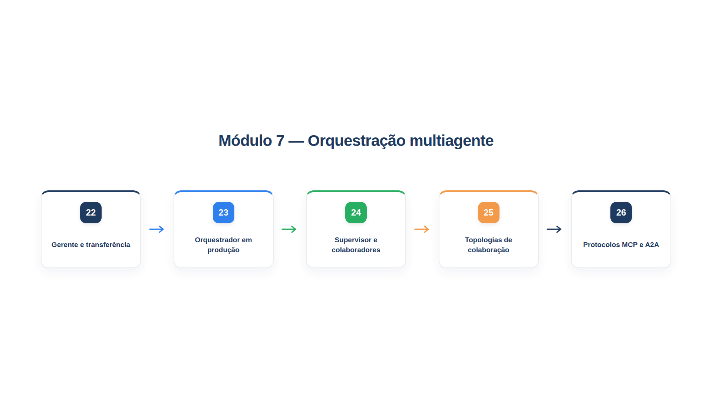

# Módulo 7 — Orquestração multiagente

No Módulo 6, o seu código conduziu o caminho, e cada etapa chamava um modelo ou um agente. Este módulo muda de escala: vários agentes, cada um com instruções, ferramentas e contexto próprios, colaboram em uma mesma tarefa. A pergunta deixa de ser "qual etapa vem agora?" e passa a ser "quem fala com o cliente, quem decide e como os agentes se passam o trabalho?". Ao final dele, você será capaz de:

- escolher entre um gerente que delega e agentes que transferem a conversa entre si;
- projetar um orquestrador com subagentes, controlando custo e instruções de delegação;
- montar uma equipe com um supervisor e colaboradores, em dois modos de operação;
- reconhecer as topologias de colaboração mais comuns e aplicar cada uma;
- conectar agentes a ferramentas com MCP e entender o que o A2A propõe para a conversa entre agentes.

## Percurso

1. **Capítulo 22 — Gerente e transferência.** Você implementa os dois modelos básicos de multiagente: o gerente, que usa outros agentes como ferramentas, e a transferência, em que um agente passa a conversa a outro.
2. **Capítulo 23 — Orquestrador em produção.** Você constrói um líder com subagentes, escreve instruções de delegação completas e mede o que o multiagente custa e quando ele compensa.
3. **Capítulo 24 — Supervisor e colaboradores.** Você monta uma equipe com um supervisor, até dez colaboradores e dois modos: coordenar as respostas ou apenas rotear.
4. **Capítulo 25 — Topologias de colaboração.** Você vê a hierarquia, o diamante, o ponto a ponto, a colaboração com misturador e o laço adaptativo.
5. **Capítulo 26 — Protocolos: MCP e A2A.** Você conecta um agente a um servidor MCP e conhece o modelo de conversa entre agentes do A2A.

Os arquivos `config.py`, `loja.py`, `trajetoria.py` e `modelos_simulados.py` são os do módulo anterior; o último ganhou o parâmetro `tipo`, para agentes com mais de um tipo de saída, e a função `chamar_ferramentas`. Os arquivos `documentos.py`, `indice.py` e `busca.py` vêm do Módulo 5. Os capítulos 22 a 26 exigem os pacotes `fastmcp` e `pydantic-ai-slim[mcp]`, instalados com `pip install fastmcp "pydantic-ai-slim[mcp]"`.

> **Nota:** Como no módulo anterior, as saídas mostradas vêm de modelos simulados, para que a *estrutura* de cada arquitetura (quem chamou quem, quantas chamadas) seja exata. Com modelos reais, o texto varia, mas essa estrutura se mantém.

## Antes de dividir em vários agentes

Uma advertência vale para todo o módulo, e vem do guia da OpenAI para construir agentes: maximize primeiro as capacidades de **um** agente. Vários agentes dão uma separação intuitiva de conceitos, mas acrescentam complexidade e custo, e muitas vezes um único agente com ferramentas basta. Dividir se justifica em dois sinais:

- **Lógica complexa.** O prompt acumula muitas condicionais (vários `if-então-senão`), e os modelos de prompt ficam difíceis de escalar. Cada trecho lógico pode virar um agente.
- **Excesso de ferramentas.** O problema não é só o número, mas a semelhança e a sobreposição: há implementações que lidam bem com mais de 15 ferramentas bem definidas e outras que se perdem com menos de 10 que se parecem. Se melhorar nomes, parâmetros e descrições, como no Capítulo 11, não resolve, divida.

Antes disso, uma alternativa barata é usar *modelos de prompt* com variáveis de política, em vez de manter prompts separados para cada caso de uso. Lembre-se da escada do Capítulo 4: suba um degrau só quando o anterior falhar.
