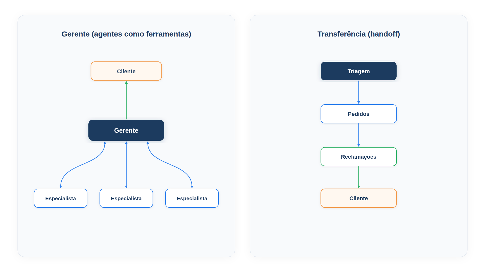

# Capítulo 22 — Gerente e transferência

Quando você divide um atendimento em vários agentes, surge a primeira decisão de arquitetura: quem fala com o cliente? Há duas respostas, e elas definem dois padrões. No **gerente**, um agente central conversa com o cliente e usa os demais como ferramentas. Na **transferência** (*handoff*), os agentes são pares, e cada um pode passar a conversa adiante, de modo que o último a receber a conversa é quem responde. Neste capítulo, você implementa os dois e aprende a escolher.



> **Antes de começar — PydanticAI neste capítulo**
>
> Neste capítulo você usa `Agent`, inclusive com o argumento `name=` (o nome do agente, que aparece nos registros e na observabilidade). Se algum deles não for familiar, revise o [Capítulo 0.4](../modulo-00/0.4-o-primeiro-agente-por-dentro.md).

## Dois modelos de multiagente

O guia da OpenAI para construir agentes organiza os sistemas multiagente em duas categorias, que servem de ponto de partida:

- **Gerente** (*manager*, ou agentes como ferramentas): um agente central coordena vários agentes especializados por meio de chamadas de ferramenta, cada um cuidando de uma tarefa ou domínio.
- **Descentralizado** (agentes que transferem a agentes): vários agentes operam como pares, passando tarefas uns aos outros conforme suas especialidades.

O guia sugere imaginar o sistema como um grafo, com os agentes como nós. No gerente, as arestas são chamadas de ferramenta. No modelo descentralizado, são transferências de execução.

## O gerente: agentes como ferramentas

No padrão do gerente, o agente central **mantém o controle** e é o único que tem acesso ao cliente. Ele delega partes da tarefa aos especialistas, recebe os resultados e os sintetiza em uma resposta coesa. É o padrão ideal quando você quer *um* agente no comando do fluxo, com uma experiência unificada para o cliente.

Reaproveitamos os especialistas do atendimento, em `especialistas.py`: um agente de pedidos e um de políticas, cada um com uma ferramenta de consulta. O gerente os usa por meio de ferramentas:

*gerente.py*

```python
from pydantic_ai import Agent, RunContext

from config import MODELO
from especialistas import especialista_pedidos, especialista_politicas

gerente = Agent(
    MODELO,
    name="gerente",
    instructions=(
        "Você é o gerente do atendimento da Casa Verde. Delegue cada parte da "
        "pergunta ao especialista certo e, com as respostas, escreva uma única "
        "mensagem ao cliente, em até três frases."
    ),
)


@gerente.tool
async def consultar_pedidos(ctx: RunContext[None], pergunta: str) -> str:
    """Delega ao especialista em pedidos uma pergunta sobre status ou previsão."""
    resposta = await especialista_pedidos.run(pergunta, usage=ctx.usage)
    return resposta.output


@gerente.tool
async def consultar_politicas(ctx: RunContext[None], pergunta: str) -> str:
    """Delega ao especialista em políticas uma pergunta sobre devolução, cancelamento ou frete."""
    resposta = await especialista_politicas.run(pergunta, usage=ctx.usage)
    return resposta.output
```

Esse é o padrão de **delegação de agente** da documentação do PydanticAI: um agente chama outro de dentro de uma ferramenta e retoma o controle quando ele termina. Dois detalhes importam.

O primeiro: a ferramenta é `async def` e usa `await especialista.run(...)`. Isso é obrigatório. Uma ferramenta que delega a outro agente não pode usar `run_sync`, que bloquearia o laço de eventos que já está em execução.

O segundo: `usage=ctx.usage` passa o contador de uso do gerente ao especialista, de modo que o consumo dos dois entre no mesmo total e nos mesmos limites. Sem isso, o custo do especialista ficaria invisível.

Vamos executar com modelos simulados. O gerente pede *as duas* consultas de uma vez e, depois, escreve a resposta final; os especialistas respondem com frases fixas.

*gerente_simulado.py*

```python
import asyncio
from contextlib import ExitStack

from pydantic_ai import ModelResponse, TextPart, ToolCallPart
from pydantic_ai.messages import ToolReturnPart
from pydantic_ai.models.function import FunctionModel

import gerente
import modelos_simulados as sim
from especialistas import especialista_pedidos, especialista_politicas


async def modelo_gerente(mensagens, info):
    sim.CHAMADAS.append("gerente")
    retornos = [p.content for m in mensagens for p in m.parts if isinstance(p, ToolReturnPart)]
    if not retornos:
        return ModelResponse(parts=[
            ToolCallPart("consultar_pedidos", {"pergunta": "Qual é o status do pedido 1003?"}),
            ToolCallPart("consultar_politicas", {"pergunta": "Qual é o prazo de devolução?"}),
        ])
    return ModelResponse(parts=[TextPart(
        "Seu pedido 1003 foi entregue, e você ainda pode devolvê-lo: o prazo é de 7 dias após o recebimento."
    )])


async def principal():
    with ExitStack() as pilha:
        pilha.enter_context(gerente.gerente.override(model=FunctionModel(modelo_gerente)))
        pilha.enter_context(especialista_pedidos.override(model=sim.texto("O pedido 1003 foi entregue.", "pedidos")))
        pilha.enter_context(especialista_politicas.override(model=sim.texto("O prazo de devolução é de 7 dias.", "politicas")))
        resultado = await gerente.gerente.run("Meu pedido 1003 chegou com defeito. Posso devolver?")

    print(resultado.output)
    print("Chamadas, em ordem:", sim.CHAMADAS)
    print("Total de chamadas ao modelo:", resultado.usage.requests)


asyncio.run(principal())
```

Saída:

```text
Seu pedido 1003 foi entregue, e você ainda pode devolvê-lo: o prazo é de 7 dias após o recebimento.
Chamadas, em ordem: ['gerente', 'pedidos', 'politicas', 'gerente']
Total de chamadas ao modelo: 4
```

Leia a ordem das chamadas: o gerente decide (1), os dois especialistas respondem (2 e 3) e o gerente sintetiza (4). Os quatro aparecem no total, graças ao `usage=ctx.usage`. O cliente conversou com um único agente, e recebeu uma única mensagem coerente. Esse é o ponto forte do padrão: o gerente é um ponto de síntese e de controle.

O preço é que *toda* resposta passa pelo gerente, que é um gargalo: ele paga duas chamadas a mais (decidir e sintetizar), e se ele errar a delegação, nada corrige.

### Faça você mesmo

- **22.1 Terceiro especialista:** crie um `especialista_reclamacoes` e uma ferramenta correspondente no gerente. Escreva a descrição da ferramenta de modo que o gerente a distinga das outras duas.
- **22.2 Limite de custo:** execute o gerente simulado com `usage_limits=UsageLimits(request_limit=3)`. Descreva o que acontece e por que o limite cobre os especialistas.
- **22.3 Sem o usage:** remova `usage=ctx.usage` de uma das ferramentas e compare o total de chamadas informado. Explique a diferença.

## A transferência: passar a conversa adiante

No padrão descentralizado, a transferência é um **repasse de mão única**: um agente delega a outro, e a execução passa imediatamente ao novo agente, junto do estado mais recente da conversa. O agente de origem sai de cena. Isso é ótimo quando você não precisa de um agente central que sintetize, e prefere que cada agente assuma a conversa e interaja com o cliente conforme necessário. É especialmente eficaz em *triagem*: o primeiro agente apenas encaminha para o especialista certo.

Você pode dar ao segundo agente uma transferência de volta ao primeiro, para que a conversa possa mudar de mãos de novo.

Em PydanticAI, uma transferência se modela como um *tipo de saída*. Em vez de devolver só um texto, o agente pode devolver ou uma `Resposta` ou uma `Transferencia`, e o nosso código, um laço, decide o que fazer.

*transferencia.py*

```python
from typing import Literal

from pydantic import BaseModel

from pydantic_ai import Agent

from config import MODELO


class Resposta(BaseModel):
    texto: str


class Transferencia(BaseModel):
    destino: Literal["pedidos", "reclamacoes", "politicas"]
    motivo: str


triagem = Agent(
    MODELO,
    name="triagem",
    output_type=Transferencia,
    instructions=(
        "Você é a triagem do atendimento da Casa Verde. Transfira o cliente para "
        "`pedidos` (status e rastreio), `politicas` (regras da loja) ou "
        "`reclamacoes` (insatisfação ou defeito). Não responda ao cliente."
    ),
)

pedidos = Agent(
    MODELO,
    name="pedidos",
    output_type=Resposta | Transferencia,
    instructions=(
        "Você responde sobre status de pedidos. Se o cliente estiver insatisfeito, "
        "transfira para `reclamacoes`; se a pergunta for sobre regras da loja, "
        "transfira para `politicas`."
    ),
)

politicas = Agent(
    MODELO,
    name="politicas",
    output_type=Resposta | Transferencia,
    instructions="Você responde sobre regras da loja. Se a pergunta for sobre um pedido, transfira para `pedidos`.",
)

reclamacoes = Agent(
    MODELO,
    name="reclamacoes",
    output_type=Resposta | Transferencia,
    instructions="Você acolhe reclamações com empatia e explica o próximo passo. Não prometa reembolso.",
)

AGENTES = {"triagem": triagem, "pedidos": pedidos, "politicas": politicas, "reclamacoes": reclamacoes}

FALLBACK = "Não consegui concluir o atendimento por aqui. Vou chamar um atendente."


async def atender(mensagem: str, max_transferencias: int = 3) -> tuple[str, list[str]]:
    atual, historico, prompt = "triagem", None, mensagem
    trilha = [atual]
    for _ in range(max_transferencias + 1):
        resultado = await AGENTES[atual].run(prompt, message_history=historico)
        if isinstance(resultado.output, Resposta):
            return resultado.output.texto, trilha
        historico = resultado.all_messages()
        atual = resultado.output.destino
        trilha.append(atual)
        prompt = f"Atendimento transferido ({resultado.output.motivo}). Continue de onde parou."
    return FALLBACK, trilha
```

Observe os elementos do desenho.

**Os tipos de saída.** A `Transferencia` leva o `destino`, um `Literal` com os nomes permitidos (poka-yoke do Capítulo 12), e o `motivo`. A triagem só aceita `Transferencia`: ela não responde. Os especialistas aceitam `Resposta | Transferencia`, ou seja, escolhem entre responder e passar adiante.

**O laço `atender`.** Ele mantém o agente atual, o histórico e a trilha. A cada volta, executa o agente atual. Se a saída é uma `Resposta`, termina. Se é uma `Transferencia`, **passa o histórico** (`resultado.all_messages()`) ao novo agente, junto de um pequeno prompt que informa o motivo da transferência. É o "estado mais recente da conversa" acompanhando a passagem.

**O limite.** `max_transferencias` impede que dois agentes passem a conversa um ao outro para sempre. Ao atingi-lo, o laço devolve uma mensagem de contingência, o `FALLBACK`, que encaminha a uma pessoa. Sem esse limite, um desentendimento de domínios seria um laço infinito, como o do Capítulo 3.

Para observar três situações, usamos modelos simulados: uma conversa direta, uma transferência de volta por insatisfação e um ciclo entre agentes.

*transferencia_simulada.py*

```python
import asyncio
from contextlib import ExitStack

import modelos_simulados as sim
import transferencia as t


def transferir(destino, motivo):
    return sim.saida({"destino": destino, "motivo": motivo}, tipo="transferencia")


def responder(texto):
    return sim.saida({"texto": texto}, tipo="resposta")


CENARIOS = {
    "Onde está o pedido 1001?": {
        "triagem": transferir("pedidos", "status de pedido"),
        "pedidos": responder("Seu pedido 1001 foi enviado e chega em 12/10."),
    },
    "Meu pedido 1001 atrasou e estou muito chateado!": {
        "triagem": transferir("pedidos", "pedido atrasado"),
        "pedidos": transferir("reclamacoes", "cliente insatisfeito"),
        "reclamacoes": responder("Sinto muito pelo atraso. Vou acompanhar o pedido 1001 e retorno com a previsão."),
    },
    "Posso devolver o pedido 1003?": {
        "triagem": transferir("pedidos", "menciona um pedido"),
        "pedidos": transferir("politicas", "pergunta sobre regra"),
        "politicas": transferir("pedidos", "precisa do status"),
    },
}


async def principal():
    for mensagem, modelos in CENARIOS.items():
        with ExitStack() as pilha:
            for nome, modelo in modelos.items():
                pilha.enter_context(t.AGENTES[nome].override(model=modelo))
            texto, trilha = await t.atender(mensagem)
        print(mensagem)
        print("  trilha:", " -> ".join(trilha))
        print("  resposta:", texto)


asyncio.run(principal())
```

Saída:

```text
Onde está o pedido 1001?
  trilha: triagem -> pedidos
  resposta: Seu pedido 1001 foi enviado e chega em 12/10.
Meu pedido 1001 atrasou e estou muito chateado!
  trilha: triagem -> pedidos -> reclamacoes
  resposta: Sinto muito pelo atraso. Vou acompanhar o pedido 1001 e retorno com a previsão.
Posso devolver o pedido 1003?
  trilha: triagem -> pedidos -> politicas -> pedidos -> politicas
  resposta: Não consegui concluir o atendimento por aqui. Vou chamar um atendente.
```

Na primeira conversa, a triagem encaminhou ao agente de pedidos, que respondeu. Na segunda, o agente de pedidos percebeu a insatisfação e passou a conversa a quem sabe acolher. Na terceira, os agentes de pedidos e de políticas se passaram a conversa em círculo, e o limite de três transferências encerrou o ciclo com o `FALLBACK`.

### Armadilha: transferências em círculo

O terceiro cenário não é um defeito do exemplo. É o modo de falha típico do padrão: dois agentes com fronteiras mal definidas, cada um convencido de que o outro deve responder. A defesa tem três camadas: o limite de transferências, instruções que dizem *quem responde na dúvida* ("se a pergunta mistura pedido e regra, responda você mesmo") e a observação do sintoma, que é uma trilha longa e repetitiva, nos registros.

### Faça você mesmo

- **22.4 Quarto cenário:** escreva um cenário em que a triagem encaminha direto a `politicas`, que responde. Preveja a trilha.
- **22.5 Limite maior:** execute o cenário do ciclo com `max_transferencias=5`. Descreva a trilha e o que o limite maior custa.
- **22.6 Histórico:** altere `atender` para não passar `message_history` ao novo agente. Descreva o que o agente receptor deixa de saber e uma situação em que isso causaria um erro.
- **22.7 Instrução de desempate:** reescreva as instruções dos agentes de pedidos e de políticas para que uma pergunta que mistura os dois assuntos seja respondida por quem a recebeu primeiro.

## Gerente ou transferência?

A escolha depende de quem deve conduzir a conversa e do que se espera da resposta.

| Critério | Gerente | Transferência |
| --- | --- | --- |
| Quem fala com o cliente | só o gerente | o agente que recebeu a conversa |
| Controle do fluxo | central | distribuído entre os pares |
| Síntese de várias partes | natural: o gerente reúne | difícil: ninguém reúne |
| Custo extra | duas chamadas do gerente por resposta | uma chamada por transferência |
| Risco típico | gargalo e erro de delegação do gerente | ciclos de transferência |
| Bom para | perguntas compostas, experiência unificada | triagem, especialistas que assumem a conversa |

Em termos práticos: se a pergunta do cliente costuma precisar de *mais de um* especialista ao mesmo tempo, como "meu pedido chegou com defeito, posso devolver?", prefira o gerente, que reúne as respostas. Se cada pergunta cai, em geral, em *um* domínio e o especialista deve assumir a conversa, a transferência é mais enxuta. Combinações são comuns: uma triagem que transfere a um gerente de cada área.

### Faça você mesmo

- **22.8 Escolha em quatro casos:** para cada situação, escolha gerente ou transferência e justifique: (a) "meu pedido atrasou e quero saber se tenho direito a desconto"; (b) um chat em que o cliente pede uma segunda via de nota fiscal; (c) uma conversa que começa como dúvida de frete e vira reclamação; (d) um pedido que mistura troca de produto e mudança de endereço.
- **22.9 Desenhe o grafo:** desenhe, em papel, o grafo de cada padrão para a Casa Verde, indicando se as arestas são chamadas de ferramenta ou transferências.

## Recapitulando

Você agora conhece os dois modelos básicos de multiagente. No gerente, um agente central usa os especialistas como ferramentas, com `await especialista.run(..., usage=ctx.usage)`, e entrega uma resposta única. Na transferência, os agentes passam a conversa uns aos outros com um tipo de saída `Transferencia`, o histórico acompanha a mudança e um limite protege contra ciclos. Sabe também escolher entre eles, pelo critério de quem conduz a conversa e de quem sintetiza.

Em ambos, os especialistas eram agentes simples. Mas uma tarefa grande, como investigar a causa de atrasos em todas as entregas do mês, exige subagentes que exploram em paralelo, com contextos próprios, e custa muito mais. O Capítulo 23 mostra como projetar esse orquestrador em escala de produção, e o que ele custa.

### Fontes do capítulo

- OpenAI — [A Practical Guide to Building Agents](https://cdn.openai.com/business-guides-and-resources/a-practical-guide-to-building-agents.pdf): padrão gerente (agentes como ferramentas) e padrão descentralizado (transferências, com transferência de mão única e do estado da conversa); quando dividir em vários agentes; o grafo como modelo.
- OpenAI — [Agents SDK](https://openai.github.io/openai-agents-python/): transferências (*handoffs*) e agentes como ferramentas.
- Documentação do PydanticAI: *Aplicativos multiagentes* (delegação de agente com `usage=ctx.usage`; transferência programática; chamada de agente em `async def`).
