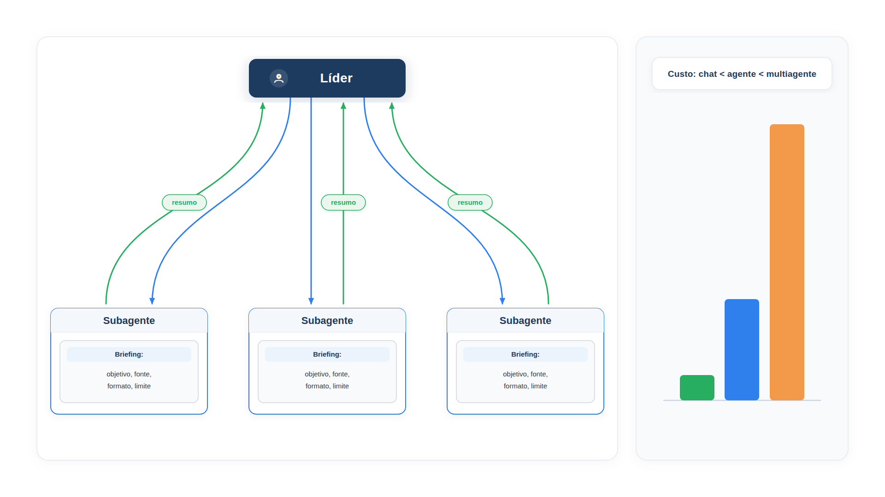

# Capítulo 23 — Orquestrador em produção

O Capítulo 19 apresentou o orquestrador-trabalhadores em pequena escala: um modelo que divide o trabalho, e trabalhadores simples que o executam. Neste capítulo, você o leva a uma escala mais realista, a de um sistema de pesquisa, em que um agente líder investiga um problema aberto e delega a subagentes que exploram em paralelo, cada um com seu próprio contexto. Você vai escrever as instruções de delegação que fazem isso funcionar, medir o que o sistema consome e aprender o critério que decide se ele vale o custo.



> **Antes de começar — PydanticAI neste capítulo**
>
> Neste capítulo você usa `Agent`, `RunContext`, `@agente.tool`, `.override` e `FunctionModel`, além de `BaseModel` do Pydantic para o `Briefing`. Se algum deles não for familiar, revise os capítulos [0.3](../modulo-00/0.3-pydantic-na-pratica.md) (`BaseModel`), [0.4](../modulo-00/0.4-o-primeiro-agente-por-dentro.md) (`Agent`), [0.5](../modulo-00/0.5-mensagens-e-testes-sem-api.md) (`FunctionModel` e testes sem API), [0.6](../modulo-00/0.6-ferramentas-e-saida-tipada.md) (`@agente.tool`) e [0.7](../modulo-00/0.7-dependencias-e-contexto.md) (`RunContext`).

## Por que um sistema multiagente

A Anthropic descreveu como construiu o sistema multiagente de pesquisa do seu produto. A arquitetura é a de orquestrador e trabalhadores: um agente líder analisa a pergunta, desenvolve uma estratégia e cria subagentes que exploram aspectos diferentes em paralelo. Cada subagente funciona como um filtro inteligente: pesquisa com as suas ferramentas, de forma iterativa, e devolve ao líder o que encontrou.

Os motivos para usar vários agentes, nesse tipo de problema, são três:

- **Problemas abertos.** Na pesquisa, é impossível prever de antemão os passos necessários. O caminho depende do que se descobre, e o agente precisa decidir as direções a explorar.
- **Compressão e paralelismo.** Cada subagente trabalha em uma janela de contexto independente e devolve só o essencial. Isso é o isolamento de contexto do Capítulo 9, aplicado em escala, e permite explorar vários aspectos ao mesmo tempo.
- **Separação de preocupações.** Cada subagente tem suas ferramentas, seus prompts e sua trajetória, o que reduz a dependência de caminho.

O resultado relatado: um sistema com um modelo mais capaz como líder e modelos menores como subagentes superou um único agente com o modelo mais capaz em 90,2%, em uma avaliação interna de pesquisa. Mas a mesma fonte traz o preço.

## O preço: tokens

O relato mede o consumo em tokens: os agentes usam cerca de **4 vezes** mais tokens que as interações de chat, e os sistemas multiagente, cerca de **15 vezes** mais. Em uma das avaliações, o uso de tokens, por si só, explicou 80% da variação de desempenho; o número de chamadas de ferramenta e a escolha do modelo explicaram os 15% seguintes. Ou seja, parte importante do ganho do multiagente vem de gastar mais tokens em um problema.

A conclusão econômica é direta: para ser viável, um sistema multiagente precisa de tarefas cujo **valor** seja alto o bastante para pagar o aumento de desempenho. Um cálculo pequeno ajuda a ver isso. Os fatores abaixo são as ordens de grandeza do relato, e o custo por mil tokens é um valor hipotético, que você deve substituir pelo do seu provedor.

*custo.py*

```python
TOKENS_DO_CHAT = 2_000  # tokens de uma interação de chat sobre a tarefa
FATORES = {"chat": 1, "agente": 4, "multiagente": 15}  # ordens de grandeza do relato da Anthropic
CUSTO_POR_MIL_TOKENS = 0.01  # valor hipotético, em reais


def custo_da_tarefa(arquitetura: str) -> float:
    return TOKENS_DO_CHAT * FATORES[arquitetura] / 1000 * CUSTO_POR_MIL_TOKENS


def vale_a_pena(valor_da_tarefa: float, arquitetura: str) -> bool:
    return valor_da_tarefa > custo_da_tarefa(arquitetura)


for arquitetura in FATORES:
    print(f"{arquitetura:12s}: R$ {custo_da_tarefa(arquitetura):.2f} por tarefa")

print()
for valor in (0.10, 2.00):
    print(f"Tarefa que vale R$ {valor:.2f}: multiagente compensa? {vale_a_pena(valor, 'multiagente')}")
```

Saída:

```text
chat        : R$ 0.02 por tarefa
agente      : R$ 0.08 por tarefa
multiagente : R$ 0.30 por tarefa

Tarefa que vale R$ 0.10: multiagente compensa? False
Tarefa que vale R$ 2.00: multiagente compensa? True
```

A conta é simples de propósito. Uma tarefa que vale dez centavos não paga os trinta centavos do multiagente; uma que vale dois reais, paga. Você não usaria um sistema de quinze vezes o custo para responder "onde está meu pedido?", mas pode usá-lo para investigar por que as entregas de um mês inteiro atrasaram.

### Quando vale e quando não vale

A Anthropic aponta onde o padrão rende. Vale para tarefas de valor alto com muito trabalho paralelo, para informação que excede uma janela de contexto, para o uso de muitas ferramentas complexas e para buscas em largura, com várias direções independentes. Não vale para domínios em que todos os agentes precisam compartilhar o mesmo contexto, para tarefas com muitas dependências entre agentes, para a maior parte dos trabalhos de programação, que têm pouca paralelização verdadeira, e para cenários que exigem coordenação em tempo real.

### Faça você mesmo

- **23.1 Seu custo:** altere `TOKENS_DO_CHAT` e `CUSTO_POR_MIL_TOKENS` para valores plausíveis do seu provedor e calcule o valor mínimo de uma tarefa para o multiagente compensar.
- **23.2 Três tarefas:** para cada tarefa do atendimento da Casa Verde, estime o valor e decida se justifica um sistema multiagente: (a) status de um pedido; (b) investigar os atrasos do mês; (c) montar o resumo mensal de reclamações para a diretoria.

## Escrevendo a delegação

O maior risco do orquestrador não é técnico: é uma instrução de delegação vaga. A Anthropic relata que instruções simples do tipo "pesquise X" levaram a trabalho duplicado, subagentes que investigaram o mesmo e lacunas sem cobertura. A solução foi descrever cada subtarefa com **objetivo, formato da saída, orientação sobre ferramentas e fontes, e limites claros**.

Podemos transformar isso em *contrato*, como no Capítulo 11: a ferramenta de delegação não recebe uma frase, mas um `Briefing` com campos obrigatórios. O modelo é forçado a preencher cada um.

Vamos montar um sistema de investigação de atrasos. Os dados de três fontes (transportadoras, estoque, reclamações) estão em `dados_atraso.py`, e cada fonte tem uma função de leitura.

*pesquisa.py*

```python
import asyncio

from pydantic import BaseModel

from pydantic_ai import Agent, RunContext

from config import MODELO, MODELO_RAPIDO
from dados_atraso import ESTOQUE, RECLAMACOES, TRANSPORTADORAS


class Briefing(BaseModel):
    """Instruções completas para um subagente, para que ele não precise adivinhar."""

    objetivo: str
    fonte: str
    formato_da_saida: str
    limite: str


def ler_transportadoras() -> str:
    """Entregas e atrasos de setembro por transportadora."""
    return "\n".join(f"{n}: {d['atrasos']} atrasos em {d['entregas']} entregas" for n, d in TRANSPORTADORAS.items())


def ler_estoque() -> str:
    """Rupturas de estoque em setembro por produto."""
    return "\n".join(f"{n}: {d['rupturas_em_setembro']} rupturas" for n, d in ESTOQUE.items())


def ler_reclamacoes() -> str:
    """Reclamações de clientes em setembro por motivo."""
    return "\n".join(f"{n}: {q}" for n, q in RECLAMACOES.items())


FERRAMENTAS_POR_FONTE = {
    "transportadoras": ler_transportadoras,
    "estoque": ler_estoque,
    "reclamacoes": ler_reclamacoes,
}

subagente = Agent(
    MODELO_RAPIDO,
    name="subagente",
    instructions="Cumpra o briefing recebido, usando só a fonte indicada, e devolva apenas o formato pedido.",
)

lider = Agent(
    MODELO,
    name="lider",
    instructions=(
        "Você investiga problemas operacionais da Casa Verde. Escale o esforço à "
        "complexidade: pergunta simples, nenhum subagente; comparação, de 2 a 4; "
        "investigação ampla, mais. Delegue com `delegar`, escrevendo para cada "
        "subagente um briefing completo (objetivo, fonte, formato da saída e limite) "
        "e sem sobreposição entre eles. Ao final, escreva um relatório de até 5 linhas."
    ),
)


@lider.tool
async def delegar(ctx: RunContext[None], briefing: Briefing) -> str:
    """Delega uma investigação focada a um subagente. Fontes: transportadoras, estoque, reclamacoes."""
    ferramenta = FERRAMENTAS_POR_FONTE.get(briefing.fonte)
    if ferramenta is None:
        return f"Fonte desconhecida: {briefing.fonte}."
    dados = ferramenta()
    resposta = await subagente.run(
        f"Objetivo: {briefing.objetivo}\nFormato: {briefing.formato_da_saida}\n"
        f"Limite: {briefing.limite}\nDados:\n{dados}",
        usage=ctx.usage,
    )
    return resposta.output
```

Quatro decisões de projeto merecem comentário.

**O `Briefing` como contrato.** Um subagente só recebe o que o líder escreveu nos quatro campos. O `fonte` evita que dois subagentes investiguem o mesmo; o `formato_da_saida` e o `limite` mantêm a resposta curta e comparável. O líder não consegue delegar de modo vago, porque o esquema não aceita campos em branco.

**A regra de escala do esforço.** A instrução do líder diz quanto delegar conforme a complexidade: pergunta simples, nenhum subagente; comparação, dois a quatro; investigação ampla, mais. Sem essa regra, os modelos tendem a gastar muito em consultas simples. É uma forma de embutir na instrução o critério de custo da seção anterior.

**Modelos diferentes.** O líder usa o `MODELO`, mais capaz, e os subagentes, o `MODELO_RAPIDO`, mais barato, pois a tarefa deles é focada. O relato da Anthropic usa a mesma combinação.

**O `usage=ctx.usage`.** Como no Capítulo 22, soma o consumo dos subagentes ao do líder.

### Armadilha: campo obrigatório não é campo preenchido

Quando o modelo chama `delegar`, o PydanticAI valida os argumentos com o `Briefing`. Se faltar um campo, a validação falha e o erro volta ao modelo, que tenta de novo. Veja a validação isolada, com uma cópia da classe, para rodar sem chave de API:

*briefing_validacao.py*

```python
from pydantic import BaseModel, ValidationError


class Briefing(BaseModel):
    objetivo: str
    fonte: str
    formato_da_saida: str
    limite: str


try:
    Briefing(objetivo="Investigar atrasos", fonte="estoque")
except ValidationError as erro:
    for problema in erro.errors():
        print(problema["loc"], "->", problema["msg"])

vazio = Briefing(objetivo="", fonte="", formato_da_saida="", limite="")
print("Briefing com textos vazios aceito:", vazio)
```

Saída:

```text
('formato_da_saida',) -> Field required
('limite',) -> Field required
Briefing com textos vazios aceito: objetivo='' fonte='' formato_da_saida='' limite=''
```

O esquema exige que cada campo **exista**, mas `str` aceita texto vazio. Por isso, a frase de que o esquema "não aceita campos em branco" vale para campos ausentes, não para `""`. Se quiser barrar o vazio, use `Field(min_length=1)` nos campos do `Briefing`.

Na execução simulada, o líder pede as três investigações de uma vez, e os subagentes respondem com um resumo curto de cada fonte:

*pesquisa_simulada.py*

```python
import asyncio
from contextlib import ExitStack

from pydantic_ai import ModelResponse, TextPart, ToolCallPart
from pydantic_ai.messages import ToolReturnPart
from pydantic_ai.models.function import FunctionModel
from pydantic_ai.usage import UsageLimits

import modelos_simulados as sim
import pesquisa

FONTES = {
    "transportadoras": "Taxa de atraso por transportadora, em porcentagem.",
    "estoque": "Produto com mais rupturas e a quantidade.",
    "reclamacoes": "Motivo mais citado e a quantidade.",
}


async def modelo_lider(mensagens, info):
    sim.CHAMADAS.append("lider")
    retornos = [p.content for m in mensagens for p in m.parts if isinstance(p, ToolReturnPart)]
    if not retornos:
        return ModelResponse(parts=[
            ToolCallPart("delegar", {"briefing": {
                "objetivo": f"Investigar os atrasos de setembro pela fonte {fonte}.",
                "fonte": fonte,
                "formato_da_saida": formato,
                "limite": "Uma frase, sem opinião.",
            }})
            for fonte, formato in FONTES.items()
        ])
    return ModelResponse(parts=[TextPart(
        "Relatório: a RapidoSul concentra os atrasos (32%), muito acima das demais. "
        "Houve 7 rupturas de caneca, mas o atraso é o motivo de 112 reclamações. "
        "Ação: renegociar prazos com a RapidoSul."
    )])


def modelo_subagente(mensagens):
    texto = sim.prompt_do_usuario(mensagens)
    if "RapidoSul" in texto:
        return "RapidoSul: 32% de atrasos; ViaNorte: 5%; ExpressoLeste: 8%."
    if "ruptura" in texto:
        return "Caneca esmaltada: 7 rupturas."
    return "Atraso na entrega: 112 reclamações."


async def principal():
    with ExitStack() as pilha:
        pilha.enter_context(pesquisa.lider.override(model=FunctionModel(modelo_lider)))
        pilha.enter_context(pesquisa.subagente.override(model=sim.texto(modelo_subagente, "subagente")))
        resultado = await pesquisa.lider.run(
            "Por que as entregas atrasaram em setembro?",
            usage_limits=UsageLimits(request_limit=20),
        )
    print(resultado.output)
    print()
    print("Chamadas por agente:", {n: sim.CHAMADAS.count(n) for n in ("lider", "subagente")})
    print("Total de chamadas ao modelo:", resultado.usage.requests)


asyncio.run(principal())
```

Saída:

```text
Relatório: a RapidoSul concentra os atrasos (32%), muito acima das demais. Houve 7 rupturas de caneca, mas o atraso é o motivo de 112 reclamações. Ação: renegociar prazos com a RapidoSul.

Chamadas por agente: {'lider': 2, 'subagente': 3}
Total de chamadas ao modelo: 5
```

O líder fez duas chamadas, uma para delegar e uma para sintetizar, e os três subagentes, uma cada, em paralelo. O total, 5, aparece no `usage` do líder. O relatório final reúne os achados sem repetir os dados brutos: a RapidoSul concentra 32% de atrasos; as rupturas de estoque são pouco relevantes; o atraso domina as reclamações.

Repare no `UsageLimits(request_limit=20)`. Em um sistema multiagente, um limite global é a proteção mais barata contra um líder que cria subagentes demais. Combine-o com a regra de escala da instrução.

### Faça você mesmo

- **23.3 Briefing vago:** altere `delegar` para receber só uma `str` com a tarefa. Descreva duas formas de falhar que o `Briefing` evitava.
- **23.4 Mais uma fonte:** acrescente a fonte `"avaliacoes"` (notas médias de satisfação) com sua função de leitura. Atualize a instrução do líder e a simulação.
- **23.5 Limite de tokens:** execute o líder simulado com `UsageLimits(total_tokens_limit=100)`. Observe o que acontece e proponha um valor de limite razoável.
- **23.6 Pergunta simples:** escreva um modelo simulado de líder que responde a "Quantos pedidos a loja teve em setembro?" sem delegar, de acordo com a regra de escala. Explique por que isso importa para o custo.

## O que muda em produção

A mesma fonte descreve desafios que só aparecem quando o sistema roda de verdade, e vale conhecê-los antes de chegar lá.

**Estado e erros que se acumulam.** Agentes funcionam por longos períodos e mantêm estado. Uma falha pequena, sem tratamento, vira catastrófica. A resposta é construir sistemas que *retomam de onde pararam*, em vez de recomeçar, e que informam ao modelo as falhas de ferramentas para que ele se adapte. O Módulo 10 trata da execução durável.

**Depuração.** O não determinismo entre execuções dificulta reproduzir um erro. É preciso um rastreamento completo em produção, que registre as decisões e a estrutura das interações dos agentes, sem necessariamente registrar o conteúdo das conversas.

**Implantação.** Como os agentes estão no meio de tarefas longas, trocar a versão do sistema pode interrompê-los. A prática descrita é a *implantação arco-íris*: deslocar o tráfego gradualmente das versões antigas para as novas, mantendo as duas em execução.

**Execução síncrona.** No exemplo deste capítulo, o líder espera todos os subagentes terminarem. Isso simplifica a coordenação, mas impede que o líder reaja a resultados parciais ou que os subagentes se coordenem. A execução assíncrona traria mais paralelismo, ao custo de coordenar resultados e estado.

### Instruções, ferramentas e avaliação

Três lições de prompt do relato valem para qualquer orquestrador. Primeiro, **pense como os seus agentes**: simule o comportamento passo a passo com os prompts e ferramentas reais para ver onde falham. Segundo, **o design das ferramentas é crítico**: descrições ruins desviam um agente completamente; a Anthropic chegou a usar um agente para reescrever descrições de ferramentas e reduziu em 40% o tempo de conclusão de tarefas futuras. Terceiro, **avalie cedo e em pequena escala**: cerca de vinte consultas representativas bastam para revelar mudanças de grande efeito, e um modelo avaliador com uma rubrica única, complementado por avaliação humana, capta a maior parte da qualidade. O Módulo 9 aprofunda a avaliação.

### Faça você mesmo

- **23.7 Falha de uma ferramenta:** faça `ler_estoque` levantar uma exceção. Descreva o que acontece com o líder e como `delegar` deveria devolver o erro ao modelo (veja `ModelRetry` no Capítulo 12).
- **23.8 Rúbrica de avaliação:** escreva, em cinco linhas, uma rubrica para avaliar o relatório do líder: precisão dos números, citação das fontes, completude e concisão.

## Recapitulando

Você agora sabe construir um orquestrador com um líder e subagentes em paralelo, forçando delegações completas por meio de um `Briefing` com campos obrigatórios, e embutindo no líder uma regra de escala de esforço. Viu o preço do multiagente, da ordem de quatro vezes o de um agente e quinze vezes o de um chat, e usou essa informação para decidir o valor mínimo de uma tarefa. Conhece também o que muda em produção: retomada de falhas, rastreamento, implantação gradual e o custo da execução síncrona.

O orquestrador é um modelo de multiagente em que o líder *decide* quais subagentes criar, na hora. Há outro modelo, mais estruturado: uma equipe com papéis definidos de antemão, em que um supervisor conhece os colaboradores e escolhe entre eles. O Capítulo 24 mostra esse padrão.

### Fontes do capítulo

- Anthropic — [How We Built Our Multi-Agent Research System](https://www.anthropic.com/engineering/multi-agent-research-system): arquitetura orquestrador-trabalhadores; ganho de 90,2% sobre um agente único; consumo de cerca de 4 e 15 vezes o de um chat; uso de tokens explicando 80% da variação; instruções de delegação (objetivo, formato, ferramentas, limites); regras de escala do esforço; avaliação em pequena escala; desafios de produção (estado, depuração, implantação arco-íris, execução síncrona); quando o multiagente vale e quando não.
- Documentação do PydanticAI: *Aplicativos multiagentes* e *Uso e limites* (`UsageLimits`).
