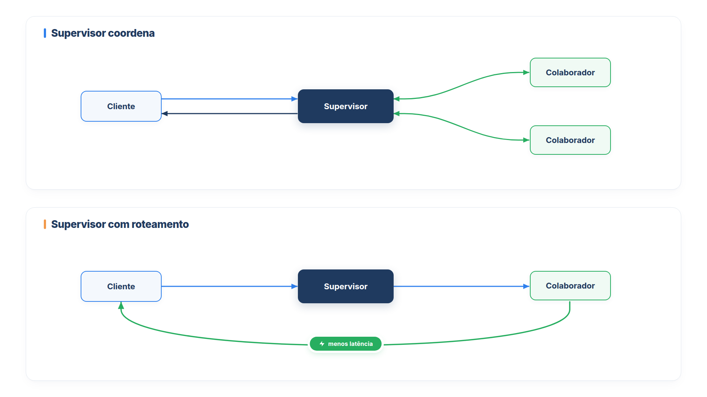

# Capítulo 24 — Supervisor e colaboradores

No Capítulo 23, o líder decidia na hora quais subagentes criar. Neste capítulo, você trabalha com o desenho oposto: uma **equipe** com papéis definidos de antemão, em que um *supervisor* conhece um conjunto de *colaboradores* e escolhe entre eles. É o modelo que serviços gerenciados de multiagente adotam, como o do Amazon Bedrock, e que se adapta bem a empresas, em que cada colaborador representa uma área. Você vai construir uma equipe com dois modos de operação e entender a diferença de custo entre eles.



> **Antes de começar — PydanticAI neste capítulo**
>
> Neste capítulo você usa `@output_validator` (o método `.output_validator` do agente) e, no código, `Tool` com os argumentos `name` e `description`. Se algum deles não for familiar, revise o [Capítulo 0.6](../modulo-00/0.6-ferramentas-e-saida-tipada.md).

## O padrão supervisor e colaboradores

No modelo do Amazon Bedrock, você designa um agente como **supervisor** e associa a ele um ou mais agentes **colaboradores**. O supervisor recebe a pergunta, entende o papel de cada colaborador a partir das descrições que você escreveu, monta um plano e envia as tarefas relevantes ao colaborador adequado. Cada agente da equipe, inclusive o supervisor, é otimizado para um caso de uso e pode ter suas próprias ferramentas, bases de conhecimento e guardrails. É um modelo hierárquico, que responde de forma síncrona às perguntas dos usuários.

Um exemplo da documentação: um assistente de crédito imobiliário, com um supervisor que classifica a pergunta como sobre um crédito existente, sobre um novo ou geral, e três colaboradores, um para cada assunto.

Dois cuidados decorrem do desenho:

- **Papéis claros e sem sobreposição.** O supervisor decide pelo que lê nas descrições. Descreva o papel e as responsabilidades de cada agente em linguagem natural e minimize as áreas em que dois colaboradores poderiam responder à mesma pergunta.
- **Um limite de tamanho.** O serviço permite associar, no máximo, **dez colaboradores** a um supervisor. O limite é uma boa prática mesmo fora dele: com muitas opções, o supervisor erra mais, pelo mesmo motivo do excesso de ferramentas do Capítulo 11. Quando passar de dez, organize em níveis (Capítulo 25).

## Dois modos de operação

O supervisor pode lidar com a informação dos colaboradores de duas formas, configuradas no Bedrock como `SUPERVISOR` e `SUPERVISOR_ROUTER`:

- **Supervisor (coordenar):** o supervisor coordena as respostas dos colaboradores e produz a resposta final. Serve a perguntas que precisam de mais de um colaborador, e a resposta sai unificada.
- **Supervisor com roteamento (rotear):** o supervisor apenas encaminha a pergunta ao colaborador certo, e é *esse* colaborador que envia a resposta final. A documentação observa que esse modo **reduz a latência**.

Os dois modos correspondem aos padrões do Capítulo 22: coordenar é o gerente; rotear é uma transferência em que o supervisor só decide o destino. A diferença prática é o número de chamadas ao modelo.

## Construindo a equipe

Vamos escrever uma classe `Equipe` que reúne o supervisor e os colaboradores, valida o limite de dez e oferece os dois modos. Um **colaborador** tem um nome, uma descrição (as *instruções de colaboração*: quando o supervisor deve recorrer a ele) e uma função que o executa.

*equipe.py*

```python
from collections.abc import Awaitable, Callable
from dataclasses import dataclass
from typing import Literal

from pydantic import BaseModel

from pydantic_ai import Agent, ModelRetry, RunContext, Tool

from config import MODELO

MAX_COLABORADORES = 10


@dataclass
class Colaborador:
    nome: str
    descricao: str  # instruções de colaboração: quando o supervisor deve usar este colaborador
    executar: Callable[[str, list | None], Awaitable[str]]
    repassar_historico: bool = False


def de_agente(nome: str, descricao: str, agente: Agent, repassar_historico: bool = False) -> Colaborador:
    async def executar(pergunta: str, historico: list | None) -> str:
        resposta = await agente.run(pergunta, message_history=historico)
        return resposta.output

    return Colaborador(nome, descricao, executar, repassar_historico)


def de_equipe(nome: str, descricao: str, equipe: "Equipe") -> Colaborador:
    async def executar(pergunta: str, historico: list | None) -> str:
        return await equipe.atender(pergunta, historico)

    return Colaborador(nome, descricao, executar)


class Escolha(BaseModel):
    colaborador: str


class Equipe:
    def __init__(self, colaboradores: list[Colaborador],
                 modo: Literal["coordenar", "rotear"] = "coordenar", modelo=MODELO):
        if len(colaboradores) > MAX_COLABORADORES:
            raise ValueError(f"No máximo {MAX_COLABORADORES} colaboradores por supervisor.")
        if len({c.nome for c in colaboradores}) != len(colaboradores):
            raise ValueError("Os nomes dos colaboradores devem ser únicos.")

        self.modo = modo
        self.por_nome = {c.nome: c for c in colaboradores}
        catalogo = "\n".join(f"- {c.nome}: {c.descricao}" for c in colaboradores)

        if modo == "rotear":
            self.supervisor = Agent(
                modelo,
                name="supervisor",
                output_type=Escolha,
                instructions=f"Escolha o colaborador mais adequado à pergunta.\nColaboradores:\n{catalogo}",
            )

            @self.supervisor.output_validator
            def conferir(escolha: Escolha) -> Escolha:
                if escolha.colaborador not in self.por_nome:
                    raise ModelRetry(f"Colaborador inexistente. Opções: {', '.join(self.por_nome)}.")
                return escolha
        else:
            self.supervisor = Agent(
                modelo,
                name="supervisor",
                deps_type=list,
                tools=[self._ferramenta(c) for c in colaboradores],
                instructions=(
                    "Coordene os colaboradores para responder ao cliente em uma mensagem "
                    f"única e cordial.\nColaboradores:\n{catalogo}"
                ),
            )

    def _ferramenta(self, colaborador: Colaborador) -> Tool:
        async def chamar(ctx: RunContext[list], pergunta: str) -> str:
            historico = ctx.deps if colaborador.repassar_historico else None
            return await colaborador.executar(pergunta, historico)

        return Tool(chamar, name=colaborador.nome, description=colaborador.descricao)

    async def atender(self, pergunta: str, historico: list | None = None) -> str:
        if self.modo == "rotear":
            escolha = (await self.supervisor.run(pergunta, message_history=historico)).output
            colaborador = self.por_nome[escolha.colaborador]
            return await colaborador.executar(pergunta, historico if colaborador.repassar_historico else None)
        resposta = await self.supervisor.run(pergunta, message_history=historico, deps=historico or [])
        return resposta.output
```

Leia o arquivo por partes.

**`Colaborador` e `de_agente`.** O colaborador é uma estrutura de dados com a descrição e uma função `executar`. Isso o torna independente de como o trabalho é feito: `de_agente` embrulha um agente do PydanticAI, mas poderia ser uma chamada a outro serviço, ou, como no Capítulo 25, uma equipe inteira (`de_equipe`).

**As validações.** O construtor recusa mais de dez colaboradores e nomes repetidos. Nomes únicos importam porque o supervisor escolhe *pelo nome*.

**O modo `rotear`.** O supervisor é um agente cuja saída é uma `Escolha`, o nome de um colaborador. Um *validador de saída* (`output_validator`) confere se o nome existe. Se não existe, levanta `ModelRetry`, que devolve ao modelo a lista de opções para ele corrigir (Capítulo 12). Depois, o código executa o colaborador escolhido, e *a resposta dele* é a final.

**O modo `coordenar`.** Cada colaborador vira uma ferramenta do supervisor (`_ferramenta`), com o nome e a descrição dados. O supervisor decide quais chamar, recebe as respostas e escreve a mensagem final.

Para ver o que o supervisor realmente recebe de cada `Tool(chamar, name=..., description=...)`, o exemplo abaixo usa um modelo simulado que só imprime as ferramentas oferecidas (lembrete: `name` e `description` substituem o nome e a docstring da função, como no [Capítulo 0.6](../modulo-00/0.6-ferramentas-e-saida-tipada.md)).

*ferramentas_do_supervisor.py*

```python
import asyncio

from pydantic_ai import Agent, ModelResponse, TextPart
from pydantic_ai.models.function import FunctionModel

from equipe import Equipe, de_agente


def espiar(mensagens, info):
    for ferramenta in info.function_tools:
        print(f"{ferramenta.name}: {ferramenta.description}")
    return ModelResponse(parts=[TextPart("ok")])


async def principal():
    equipe = Equipe(
        [
            de_agente("pedidos", "Status e previsão de entrega de pedidos.", Agent("test")),
            de_agente("politicas", "Regras de devolução, troca, frete e pagamento.", Agent("test")),
        ],
        modelo="test",
    )
    with equipe.supervisor.override(model=FunctionModel(espiar)):
        await equipe.atender("Olá")


asyncio.run(principal())
```

Saída:

```text
pedidos: Status e previsão de entrega de pedidos.
politicas: Regras de devolução, troca, frete e pagamento.
```

O modelo não vê a função `chamar`, que é a mesma para todos: vê apenas o nome e a descrição de cada colaborador. Por isso a descrição é o único critério que o supervisor tem para escolher.


**O histórico repassado.** Em `Colaborador`, o campo `repassar_historico` replica uma opção do Bedrock (`relayConversationHistory`): se ligada, o supervisor compartilha com o colaborador o histórico da conversa. Por padrão, o colaborador vê só a pergunta.

Vamos comparar os dois modos com a mesma pergunta e modelos simulados.

*equipe_simulada.py*

```python
import asyncio

import equipe
import modelos_simulados as sim
from especialistas import especialista_pedidos, especialista_politicas
from equipe import Colaborador, Equipe, de_agente

PERGUNTA = "Onde está o meu pedido 1001?"


def montar(modo, supervisor):
    colaboradores = [
        de_agente("pedidos", "Status e previsão de entrega de pedidos.", especialista_pedidos),
        de_agente("politicas", "Regras de devolução, troca, frete e pagamento.", especialista_politicas),
    ]
    equipe_ = Equipe(colaboradores, modo=modo)
    return equipe_, equipe_.supervisor.override(model=supervisor)


async def executar(modo, supervisor):
    sim.CHAMADAS.clear()
    equipe_, substituicao = montar(modo, supervisor)
    with substituicao, especialista_pedidos.override(model=sim.texto("Pedido 1001 enviado, chega em 12/10.", "colaborador")):
        resposta = await equipe_.atender(PERGUNTA)
    print(f"Modo {modo}: {resposta}")
    print("  chamadas:", sim.CHAMADAS)


async def principal():
    await executar("rotear", sim.saida({"colaborador": "pedidos"}, "supervisor"))
    await executar("coordenar", sim.chamar_ferramentas([("pedidos", {"pergunta": PERGUNTA})], "supervisor"))

    colaboradores = [Colaborador(f"agente{i}", "faz algo", None) for i in range(11)]
    try:
        Equipe(colaboradores)
    except ValueError as erro:
        print("Com 11 colaboradores:", erro)


asyncio.run(principal())
```

Saída:

```text
Modo rotear: Pedido 1001 enviado, chega em 12/10.
  chamadas: ['supervisor', 'colaborador']
Modo coordenar: Pedido 1001 enviado, chega em 12/10.
  chamadas: ['supervisor', 'colaborador', 'supervisor']
Com 11 colaboradores: No máximo 10 colaboradores por supervisor.
```

A diferença está nas listas de chamadas. No modo `rotear`, foram duas: o supervisor escolheu e o colaborador respondeu. No modo `coordenar`, três: o supervisor delegou, o colaborador respondeu e o supervisor voltou para escrever a resposta final. A chamada a mais é o preço da síntese, e é por isso que o roteamento reduz a latência. A última linha mostra a validação do limite de dez.

### Rotear ou coordenar?

A escolha segue o critério do capítulo anterior:

- **Rotear** quando cada pergunta tem, em geral, *um* dono. É mais rápido e mais barato, e a resposta vem de quem entende do assunto.
- **Coordenar** quando uma pergunta pode precisar de *vários* colaboradores e a resposta deve ser unificada. Custa a chamada extra do supervisor.

Muitas equipes começam com o roteamento e passam a coordenar nos casos em que os clientes fazem perguntas compostas com frequência.

### O histórico repassado

Para ver o efeito de `repassar_historico`, usamos um colaborador simulado que apenas informa quantas mensagens recebeu, em uma conversa em que o cliente já tinha trocado uma mensagem com o supervisor.

*historico_repassado.py*

```python
import asyncio

from pydantic_ai import Agent, ModelResponse, TextPart
from pydantic_ai.models.function import FunctionModel

import modelos_simulados as sim
from config import MODELO
from equipe import Equipe, de_agente

colaborador = Agent(MODELO, name="colaborador")


def espiar(mensagens, info):
    return ModelResponse(parts=[TextPart(f"vi {len(mensagens)} mensagem(ns)")])


async def principal():
    for repassar in (False, True):
        equipe = Equipe([de_agente("pedidos", "Status de pedidos.", colaborador, repassar_historico=repassar)])
        conversa = [
            *(await equipe.supervisor.run("oi", model=sim.texto("Olá!"))).all_messages(),
        ]
        with equipe.supervisor.override(model=sim.chamar_ferramentas([("pedidos", {"pergunta": "E o 1002?"})])), \
                colaborador.override(model=FunctionModel(espiar)):
            resposta = await equipe.atender("E o 1002?", historico=conversa)
        print(f"repassar_historico={repassar}: colaborador {resposta}")


asyncio.run(principal())
```

Saída:

```text
repassar_historico=False: colaborador vi 1 mensagem(ns)
repassar_historico=True: colaborador vi 3 mensagem(ns)
```

Sem o repasse, o colaborador viu só a pergunta ("E o 1002?"), sem saber que "o" se refere a um pedido de que se falou antes. Com o repasse, viu também a troca anterior (a pergunta e a resposta), e pode resolver a referência. O custo é o aumento do contexto de cada colaborador, que você aprendeu a medir no Capítulo 8. Ligue o repasse só para os colaboradores que precisam do contexto.

### Armadilha: colaboradores que se sobrepõem

Se `pedidos` descreve "tudo sobre entregas" e `politicas` descreve "regras de frete e prazos de entrega", uma pergunta sobre prazo de entrega cabe nos dois, e o supervisor escolherá ao acaso. A correção está nas descrições: delimite cada responsabilidade com exemplos e diga o que *não* é do colaborador. Teste com uma bancada de perguntas de fronteira, como a do Capítulo 18.

### Faça você mesmo

- **24.1 Terceiro colaborador:** acrescente um colaborador `reclamacoes` com uma descrição que o separe claramente dos outros dois. Adapte a simulação do modo `rotear`.
- **24.2 Nome inexistente:** faça o supervisor simulado do modo `rotear` escolher `"entregas"`, que não existe. Descreva o que o validador de saída faz e quantas chamadas a mais isso custa.
- **24.3 Nomes repetidos:** tente criar uma equipe com dois colaboradores de mesmo nome. Qual erro aparece e por que ele protege o supervisor?
- **24.4 Repasse seletivo:** monte uma equipe com dois colaboradores, um com `repassar_historico=True` e outro sem. Dê um motivo para cada escolha.

## Recapitulando

Você agora sabe montar uma equipe com um supervisor e colaboradores com papéis definidos, em até dez colaboradores, validados no construtor. Conhece os dois modos: coordenar, em que o supervisor sintetiza uma resposta unificada, e rotear, em que o supervisor só escolhe e o colaborador responde, com menos latência. Viu que o repasse de histórico é uma opção por colaborador, com custo de contexto, e que descrições claras e sem sobreposição são o que torna o supervisor confiável.

Uma equipe de um supervisor e dez colaboradores é uma topologia, uma entre várias. Quando a empresa cresce, aparecem hierarquias de vários níveis, moderadores que ajustam a resposta, colaboradores que misturam pareceres e laços de refinamento. O Capítulo 25 apresenta as topologias mais comuns e mostra como montar cada uma com o que você já tem.

### Fontes do capítulo

- AWS — [Amazon Bedrock: colaboração multiagente](https://docs.aws.amazon.com/bedrock/latest/userguide/agents-multi-agent-collaboration.html) e [Criação de uma colaboração multiagente](https://docs.aws.amazon.com/bedrock/latest/userguide/create-multi-agent-collaboration.html): supervisor e colaboradores; papéis claros e sem sobreposição; limite de dez colaboradores; os modos `SUPERVISOR` e `SUPERVISOR_ROUTER`, com redução de latência no roteamento; instruções de colaboração e repasse do histórico da conversa (`relayConversationHistory`).
- Documentação do PydanticAI: *Aplicativos multiagentes*, *Saída* (`output_validator`) e *Function Tools*.
