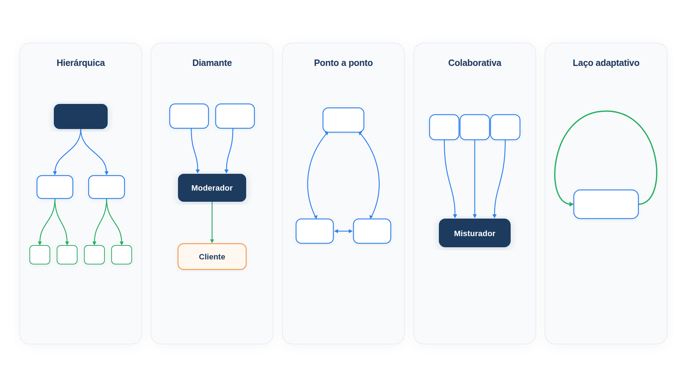

# Capítulo 25 — Topologias de colaboração

Até aqui, você montou equipes com um centro, seja um gerente, seja um supervisor. Esse centro é uma *topologia*: o desenho das ligações entre os agentes. Há outras, e cada uma resolve um problema que a primeira não resolve bem. Neste capítulo, você conhece cinco topologias descritas pelo whitepaper *Agents Companion*, do Google — hierárquica, diamante, ponto a ponto, colaborativa e laço adaptativo — e monta cada uma com as peças que já tem.



> **Antes de começar — PydanticAI neste capítulo**
>
> Neste capítulo você usa `Agent`, `.run`, `.output`, `.override` (para trocar o modelo nos testes) e `output_type` com um modelo Pydantic (`BaseModel` e `Field`). Se algum deles não for familiar, revise os capítulos [0.3](../modulo-00/0.3-pydantic-na-pratica.md), [0.4](../modulo-00/0.4-o-primeiro-agente-por-dentro.md), [0.5](../modulo-00/0.5-mensagens-e-testes-sem-api.md) e [0.6](../modulo-00/0.6-ferramentas-e-saida-tipada.md).

## O mesmo problema, desenhos diferentes

O whitepaper apresenta os padrões a partir de um assistente de bordo de um carro, em que vários agentes especializados (navegação, previsão do tempo, manual do veículo, conhecimento geral) atendem o motorista. Os padrões valem para qualquer domínio. Vamos usá-los no atendimento da Casa Verde.

Antes dos padrões, uma observação: eles não são excludentes. Sistemas reais combinam várias topologias, e a escolha segue o problema, não a moda.

## Hierárquica: equipes dentro de equipes

Na topologia **hierárquica**, um agente orquestrador central classifica a pergunta e a encaminha ao agente especializado certo. Ele analisa o domínio e a intenção, mantém o contexto da conversa entre os turnos e decide uma estratégia de contingência quando um especialista não consegue responder. Em uma empresa maior, a hierarquia ganha *níveis*: um agente do topo trata a intenção do usuário, os intermediários cuidam de domínios, e os de baixo executam ações atômicas.

Com a classe `Equipe` do Capítulo 24, isso é simples: uma equipe pode ser *colaboradora* de outra, por meio de `de_equipe`. Montamos duas camadas. No topo, o supervisor escolhe entre uma equipe de logística e o agente de políticas. A equipe de logística, por sua vez, tem seu próprio supervisor, que escolhe entre os seus colaboradores.

*hierarquia_simulada.py*

```python
import asyncio
from contextlib import ExitStack

import modelos_simulados as sim
from equipe import Equipe, de_agente, de_equipe
from especialistas import especialista_pedidos, especialista_politicas

# Nível de baixo: uma equipe de logística, com um colaborador de pedidos.
logistica = Equipe(
    [de_agente("pedidos", "Status e previsão de pedidos.", especialista_pedidos)],
    modo="rotear",
)

# Nível de cima: o topo escolhe entre a equipe de logística e o agente de políticas.
topo = Equipe(
    [
        de_equipe("logistica", "Tudo sobre pedidos e entregas.", logistica),
        de_agente("politicas", "Regras de devolução, troca e frete.", especialista_politicas),
    ],
    modo="rotear",
)


async def principal():
    with ExitStack() as pilha:
        pilha.enter_context(topo.supervisor.override(model=sim.saida({"colaborador": "logistica"}, "topo")))
        pilha.enter_context(logistica.supervisor.override(model=sim.saida({"colaborador": "pedidos"}, "logistica")))
        pilha.enter_context(especialista_pedidos.override(model=sim.texto("Pedido 1001 enviado, chega em 12/10.", "pedidos")))
        resposta = await topo.atender("Onde está o meu pedido 1001?")
    print(resposta)
    print("Cadeia de chamadas:", " -> ".join(sim.CHAMADAS))


asyncio.run(principal())
```

Saída:

```text
Pedido 1001 enviado, chega em 12/10.
Cadeia de chamadas: topo -> logistica -> pedidos
```

A cadeia mostra a descida pelos níveis: o topo escolheu a logística, o supervisor da logística escolheu o agente de pedidos, e este respondeu. Cada supervisor lida com poucas opções, e a hierarquia permite crescer além do limite de dez colaboradores sem sobrecarregar ninguém. O custo é uma chamada por nível.

### Faça você mesmo

- **25.1 Segundo colaborador:** acrescente à equipe de logística um colaborador `rastreio`. Preveja se a cadeia para a pergunta do exemplo muda e confira.
- **25.2 Três níveis:** acrescente um nível acima do topo, com um supervisor que escolhe entre "atendimento" (o topo atual) e "financeiro" (um agente simples). Escreva a cadeia de chamadas esperada.

## Diamante: um moderador antes do cliente

O **diamante** é uma variação da hierárquica em que as respostas dos especialistas passam por um **agente moderador central** antes de chegar ao usuário. O exemplo do whitepaper é um agente de navegação que gera uma resposta factual sobre um restaurante e um *reescritor* que ajusta o tom e o estilo conforme as preferências do usuário antes da síntese de voz. O reescritor transforma informação técnica em linguagem conversacional, ajusta o tamanho da resposta à situação e adapta o estilo.

O nome vem da forma: a pergunta se ramifica para os especialistas e a resposta volta a convergir em um único ponto, o moderador. A vantagem é separar *o que dizer* de *como dizer*: o especialista se concentra nos fatos, e o moderador cuida da voz da marca.

*diamante.py*

```python
from pydantic_ai import Agent

from config import MODELO, MODELO_RAPIDO

especialista = Agent(
    MODELO,
    name="especialista",
    instructions="Responda com precisão e sem enfeites, em até duas frases.",
)

reescritor = Agent(
    MODELO_RAPIDO,
    name="reescritor",
    instructions=(
        "Reescreva a resposta no tom da marca Casa Verde: acolhedor, direto, sem "
        "jargão. Preserve todos os fatos, números e prazos. Não acrescente informação."
    ),
)


async def responder(pergunta: str) -> tuple[str, str]:
    bruta = (await especialista.run(pergunta)).output
    final = (await reescritor.run(f"Pergunta: {pergunta}\nResposta: {bruta}")).output
    return bruta, final
```

*diamante_simulado.py*

```python
import asyncio

import diamante
import modelos_simulados as sim


async def principal():
    with diamante.especialista.override(model=sim.texto(
            "Devolução admitida em até 7 dias corridos após o recebimento, com embalagem original.")), \
            diamante.reescritor.override(model=sim.texto(
                "Claro! Você tem até 7 dias depois de receber para devolver, com a embalagem original.")):
        bruta, final = await diamante.responder("Posso devolver?")
    print("Resposta do especialista:", bruta)
    print("Resposta ao cliente     :", final)


asyncio.run(principal())
```

Saída:

```text
Resposta do especialista: Devolução admitida em até 7 dias corridos após o recebimento, com embalagem original.
Resposta ao cliente     : Claro! Você tem até 7 dias depois de receber para devolver, com a embalagem original.
```

Os fatos (7 dias, embalagem original) se preservaram, e o tom mudou. A instrução do reescritor proíbe acrescentar informação, porque um moderador criativo demais poderia inventar. É o mesmo cuidado de ancoragem do Capítulo 17: confira que os fatos da saída são os da entrada, por exemplo com um avaliador em código que verifique a presença dos números.

### Faça você mesmo

- **25.3 Conferir os fatos:** escreva uma função que verifique se todos os números da resposta bruta aparecem na reescrita, e use-a depois do reescritor.
- **25.4 Dois tons:** altere o reescritor para receber o tom como parâmetro (`formal` ou `descontraído`). Escreva uma simulação com cada tom.

## Ponto a ponto: corrigir o erro de roteamento

Em uma topologia **ponto a ponto**, os agentes transferem a conversa uns aos outros quando percebem que o roteamento central errou. O sistema ganha resiliência, e o whitepaper lista três vantagens sobre a orquestração centralizada:

1. **Resistência a classificação errada.** Mesmo que o orquestrador erre o destino, os especialistas reconhecem que a pergunta está fora do seu domínio e redirecionam.
2. **Conhecimento de domínio no roteamento.** Cada especialista conhece melhor que um orquestrador as fronteiras do seu domínio.
3. **Menor complexidade de orquestração.** O orquestrador central não precisa de acerto perfeito na primeira escolha.

É a transferência do Capítulo 22. Reutilizamos o `transferencia.py` e simulamos o erro: uma pergunta sobre regras que a triagem encaminha, por engano, ao agente de pedidos.

*p2p_simulado.py*

```python
import asyncio
from contextlib import ExitStack

import modelos_simulados as sim
import transferencia as t


def transferir(destino, motivo):
    return sim.saida({"destino": destino, "motivo": motivo}, tipo="transferencia")


def responder(texto):
    return sim.saida({"texto": texto}, tipo="resposta")


async def principal():
    modelos = {
        "triagem": transferir("pedidos", "a conversa anterior era sobre pedidos"),
        "pedidos": transferir("politicas", "a pergunta é sobre regras, não sobre um pedido"),
        "politicas": responder("O prazo de devolução é de 7 dias após o recebimento."),
    }
    with ExitStack() as pilha:
        for nome, modelo in modelos.items():
            pilha.enter_context(t.AGENTES[nome].override(model=modelo))
        texto, trilha = await t.atender("Qual é o prazo para devolver um produto?")
    print("Roteamento inicial (errado): pedidos")
    print("Trilha:", " -> ".join(trilha))
    print("Resposta:", texto)


asyncio.run(principal())
```

Saída:

```text
Roteamento inicial (errado): pedidos
Trilha: triagem -> pedidos -> politicas
Resposta: O prazo de devolução é de 7 dias após o recebimento.
```

A triagem errou, mas o agente de pedidos reconheceu que "prazo para devolver" é regra, e não pedido, e passou a conversa adiante. O cliente nunca soube. O risco, já visto, são os ciclos, e o limite de transferências continua sendo a rede de proteção.

### Faça você mesmo

- **25.5 Dois erros seguidos:** escreva um cenário em que a triagem erra e o primeiro agente também erra, e o terceiro acerta. Preveja a trilha e confira com `max_transferencias=3`.
- **25.6 Registro de erros:** altere `atender` para registrar cada transferência que *corrige* um erro (quando o destino difere do primeiro). Explique como esse registro ajuda a melhorar a triagem.

## Colaborativa: o misturador de respostas

Na topologia **colaborativa**, vários agentes trabalham em **aspectos complementares** da mesma tarefa, e um **agente misturador** (*response mixer*) combina elementos das respostas em uma resposta completa. O padrão vale quando:

1. diferentes aspectos da pergunta exigem diferentes especialidades;
2. nenhum agente tem toda a informação;
3. o usuário se beneficia de várias perspectivas; ou
4. os agentes têm acesso a bases de conhecimento distintas.

Ao contrário de uma abordagem competitiva, em que as respostas disputam entre si, aqui elas são complementares, e não redundantes. O misturador avalia cada parecer pela precisão e relevância, remove o que está incorreto e combina as partes úteis. No exemplo do whitepaper, a pergunta sobre aquaplanagem recebe contribuições de um agente do manual do carro, de um de dicas de direção e de um de conhecimento geral, cada um com uma confiança.

É a paralelização por divisão do Capítulo 19, com uma síntese inteligente no fim. Cada especialista devolve um `Parecer`, um texto com uma confiança entre 0 e 1.

*misturador.py*

```python
import asyncio

from pydantic import BaseModel, Field

from pydantic_ai import Agent

from config import MODELO


class Parecer(BaseModel):
    texto: str
    confianca: float = Field(ge=0, le=1)


def especialista(nome: str, foco: str) -> Agent:
    return Agent(
        MODELO,
        name=nome,
        output_type=Parecer,
        instructions=f"Responda apenas sobre {foco}. Informe sua confiança de 0 a 1.",
    )


agente_pedidos = especialista("pedidos", "o status do pedido do cliente")
agente_politicas = especialista("politicas", "as regras de devolução da loja")
agente_conteudo = especialista("cuidados", "o cuidado e a limpeza do produto")

misturador = Agent(
    MODELO,
    name="misturador",
    instructions=(
        "Você recebe pareceres de especialistas, cada um com uma confiança. Junte as "
        "partes úteis em uma única resposta curta. Descarte o que for irrelevante ou "
        "contraditório e não acrescente nada que não esteja nos pareceres."
    ),
)


async def responder(pergunta: str) -> str:
    pareceres = await asyncio.gather(*(
        a.run(pergunta) for a in (agente_pedidos, agente_politicas, agente_conteudo)
    ))
    texto = "\n".join(
        f"[{a.name} | confiança {p.output.confianca:.2f}] {p.output.texto}"
        for a, p in zip((agente_pedidos, agente_politicas, agente_conteudo), pareceres)
    )
    return (await misturador.run(f"Pergunta: {pergunta}\nPareceres:\n{texto}")).output
```

*misturador_simulado.py*

```python
import asyncio

import misturador as m
import modelos_simulados as sim


def mesclar(mensagens):
    pareceres = sim.prompt_do_usuario(mensagens)
    return ("Seu pedido 1003 foi entregue e você pode devolvê-lo em até 7 dias. "
            "Lave a peça só com pano úmido.") if "cuidados" in pareceres else "?"


async def principal():
    with m.agente_pedidos.override(model=sim.saida({"texto": "O pedido 1003 foi entregue.", "confianca": 0.95})), \
            m.agente_politicas.override(model=sim.saida({"texto": "A devolução vale por 7 dias.", "confianca": 0.9})), \
            m.agente_conteudo.override(model=sim.saida({"texto": "Limpe com pano úmido.", "confianca": 0.4})), \
            m.misturador.override(model=sim.texto(mesclar)):
        print(await m.responder("Meu vaso 1003 chegou sujo. Posso devolver? Como limpo?"))


asyncio.run(principal())
```

Saída:

```text
Seu pedido 1003 foi entregue e você pode devolvê-lo em até 7 dias. Lave a peça só com pano úmido.
```

A pergunta mistura três assuntos, e cada especialista respondeu o seu; o misturador compôs uma resposta única. O valor está na composição: nenhum agente isolado teria entregue o conjunto.

Um ponto de `Parecer` merece atenção: `Field(ge=0, le=1)` faz o Pydantic recusar uma confiança fora do intervalo de 0 a 1. Veja a recusa isolada, sem agente e sem modelo:

*parecer_validacao.py*

```python
from pydantic import BaseModel, Field, ValidationError


class Parecer(BaseModel):
    texto: str
    confianca: float = Field(ge=0, le=1)


ok = Parecer(texto="O pedido 1003 foi entregue.", confianca=0.95)
print("Válido:", ok)

try:
    Parecer(texto="Limpe com pano úmido.", confianca=1.4)
except ValidationError as erro:
    detalhe = erro.errors()[0]
    print("Campo:", detalhe["loc"][0])
    print("Motivo:", detalhe["msg"])
```

Saída:

```text
Válido: texto='O pedido 1003 foi entregue.' confianca=0.95
Campo: confianca
Motivo: Input should be less than or equal to 1
```

Com `output_type=Parecer`, o PydanticAI valida a resposta do especialista desse mesmo modo. Se o modelo devolver `confianca` igual a 1,4, o `ValidationError` não derruba o programa: o erro volta ao modelo como mensagem, e ele tem uma nova chance de responder dentro do limite. Assim, o misturador só recebe pareceres válidos.

> **Nota:** A confiança que um modelo informa de si mesmo é uma estimativa pouco calibrada. Use-a como pista para o misturador, e não como probabilidade. Se a decisão importa, valide os pareceres com fontes, como no Capítulo 17.

### Faça você mesmo

- **25.7 Parecer irrelevante:** faça um especialista simulado devolver um parecer sem relação com a pergunta e confira se o misturador de verdade o descartaria. Escreva o que mudaria na instrução do misturador para reforçar isso.
- **25.8 Gerente ou misturador:** descreva, em duas frases, a diferença entre o gerente do Capítulo 22 e a topologia colaborativa.

## Laço adaptativo: tentar de novo, de outro jeito

No **laço adaptativo**, o agente refina um resultado por tentativas repetidas, até atingir o critério desejado. O whitepaper exemplifica com uma busca de restaurante: quando "restaurante italiano com opções veganas" não retorna nada, o agente não responde "sem resultados". Ele reformula a consulta, primeiro com "vegetarianas", depois com "restaurantes italianos" filtrando por opções à base de plantas, e depois com "restaurantes veganos" de influência italiana, e apresenta as melhores correspondências explicando a relação com o pedido original.

É o *avaliador-otimizador* do Capítulo 20 aplicado a uma *busca*, e também uma versão do ReAct (Capítulo 5), em que a observação decide a próxima ação. No nosso caso, reutilizamos o índice de políticas do Módulo 5: se a busca não alcança o limiar de relevância, um agente reformula a consulta com o vocabulário da loja.

*laco_adaptativo.py*

```python
from pydantic_ai import Agent

from busca import indice
from config import MODELO_RAPIDO

LIMIAR = 0.2

reformulador = Agent(
    MODELO_RAPIDO,
    name="reformulador",
    instructions=(
        "A busca na base de políticas não achou nada relevante. Reescreva a consulta "
        "com o vocabulário da loja (devolução, reembolso, cancelamento, frete, "
        "pagamento, troca). Responda apenas com a nova consulta."
    ),
)


async def buscar_com_laco(consulta: str, max_voltas: int = 3):
    tentativas = []
    for volta in range(1, max_voltas + 1):
        pontos, fragmento = indice.buscar(consulta, k=1)[0]
        tentativas.append((consulta, round(pontos, 2)))
        if pontos >= LIMIAR:
            return fragmento, tentativas
        if volta < max_voltas:
            consulta = (await reformulador.run(f"Consulta anterior: {consulta}")).output
    return None, tentativas
```

*laco_simulado.py*

```python
import asyncio
from itertools import cycle

import laco_adaptativo as la
import modelos_simulados as sim

novas = cycle(["reembolso do dinheiro", "devolver produto e receber reembolso"])


async def principal():
    with la.reformulador.override(model=sim.texto(lambda mensagens: next(novas))):
        fragmento, tentativas = await la.buscar_com_laco("Como faço para estornar o dinheiro da compra?")
    for consulta, pontos in tentativas:
        print(f"{pontos:.2f}  {consulta}")
    print("Fragmento encontrado:", fragmento.id if fragmento else None)


asyncio.run(principal())
```

Saída:

```text
0.09  Como faço para estornar o dinheiro da compra?
0.15  reembolso do dinheiro
0.29  devolver produto e receber reembolso
Fragmento encontrado: devolucao
```

As pontuações são as do índice real do Módulo 5. A primeira consulta, com "estornar", ficou em 0,09, abaixo do limiar de 0,2. A primeira reformulação subiu para 0,15, ainda insuficiente. A segunda, com o vocabulário da loja, chegou a 0,29, e o laço parou, com o fragmento de devolução. O `max_voltas` impede que a reformulação continue para sempre, e a lista de tentativas explica ao usuário (ou a um registro) como se chegou ao resultado.

### Faça você mesmo

- **25.9 Falha total:** faça o reformulador devolver sempre uma consulta sem relação. Descreva o resultado de `buscar_com_laco` e o que o agente deveria dizer ao cliente.
- **25.10 Reformulação em código:** escreva uma reformulação sem modelo, que troque "estornar" por "reembolsar" em um dicionário de sinônimos. Compare com a do modelo.

## Escolhendo a topologia

| Topologia | Desenho | Use quando | Risco |
| --- | --- | --- | --- |
| Hierárquica | árvore de supervisores | há muitos domínios e subdomínios | uma chamada a mais por nível |
| Diamante | especialistas, moderador, usuário | a voz e o formato da resposta importam | o moderador distorcer os fatos |
| Ponto a ponto | agentes que transferem entre si | o roteamento central pode errar | ciclos de transferência |
| Colaborativa | especialistas em paralelo, misturador | a pergunta cruza várias áreas | contradições; custo de vários agentes |
| Laço adaptativo | tentativa, avaliação, nova tentativa | o primeiro resultado costuma ser insuficiente | custo por volta; laço sem fim |

Como regra, comece pela topologia mais simples que cubra o caso: um roteamento (Capítulo 24). Acrescente um moderador quando o tom virar um problema, a transferência entre pares quando o erro de roteamento aparecer nos registros, o misturador quando as perguntas começarem a cruzar áreas e o laço quando a primeira tentativa falhar com frequência.

### Faça você mesmo

- **25.11 Qual topologia?:** para cada situação, escolha a topologia e justifique: (a) a loja cresce para vinte áreas, cada uma com subáreas; (b) as respostas dos especialistas são corretas, mas soam frias; (c) clientes escrevem perguntas que misturam pedido, política e cuidados do produto; (d) o classificador erra em 8% dos casos e você quer reduzir o impacto; (e) a busca de produtos retorna vazio em perguntas informais.
- **25.12 Desenho:** desenhe, em papel, a topologia combinada de um atendimento da Casa Verde que usa pelo menos três das cinco.

## Recapitulando

Você agora conhece cinco topologias de colaboração e a montou com as peças dos capítulos anteriores. Na hierárquica, equipes se aninham e cada supervisor decide entre poucas opções. No diamante, um moderador separa o que dizer de como dizer. No ponto a ponto, os especialistas corrigem erros do roteamento. Na colaborativa, pareceres complementares se fundem em um misturador. No laço adaptativo, o agente reformula e tenta de novo até alcançar o critério.

Em todas elas, os agentes estavam no mesmo programa, falando por funções. Mas agentes também precisam se conectar a ferramentas e dados de outros sistemas, e a agentes de outras equipes e empresas. Para isso existem protocolos abertos, e o Capítulo 26 apresenta os dois principais: o MCP, que liga agentes a ferramentas, e o A2A, que liga agentes a agentes.

### Fontes do capítulo

- Google — [Whitepaper "Agents Companion"](https://www.kaggle.com/whitepaper-agent-companion): padrões hierárquico, diamante (agente reescritor), ponto a ponto (vantagens sobre a orquestração centralizada), colaborativo (agente misturador de respostas) e laço adaptativo, com os exemplos de navegação, manual do carro e busca iterativa de restaurantes.
- Documentação do PydanticAI: *Aplicativos multiagentes*.
