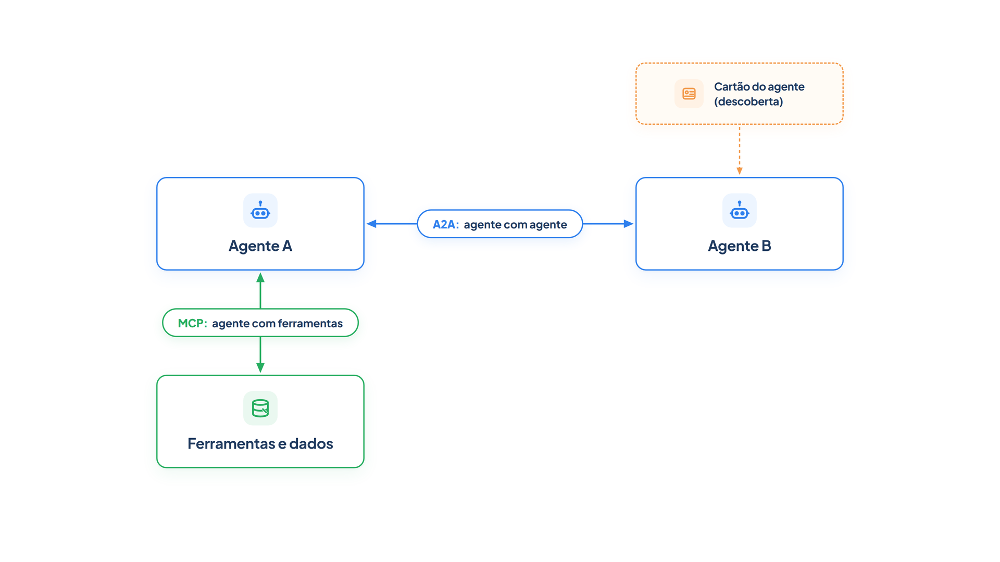

# Capítulo 26 — Protocolos: MCP e A2A

Os agentes que você construiu falam com suas ferramentas por funções Python, e entre si por chamadas de função no mesmo programa. Isso funciona enquanto tudo vive em um só lugar. Mas uma empresa quer que o agente de atendimento use ferramentas mantidas por outra equipe, e que o seu agente converse com agentes de um parceiro, sem que cada integração seja escrita sob medida. Para isso existem protocolos abertos. Neste capítulo, você conecta um agente a um servidor com o **MCP** e conhece o modelo de conversa entre agentes do **A2A**.



> **Antes de começar — PydanticAI neste capítulo**
>
> Neste capítulo você usa `Agent`, `instructions=` e `.run`, além de ferramentas com docstring e `FunctionModel`. Se algum deles não for familiar, revise os capítulos [0.4](../modulo-00/0.4-o-primeiro-agente-por-dentro.md), [0.5](../modulo-00/0.5-mensagens-e-testes-sem-api.md) e [0.6](../modulo-00/0.6-ferramentas-e-saida-tipada.md).

## Dois protocolos, duas direções

Os dois protocolos resolvem problemas diferentes, e a distinção é o primeiro ponto a fixar:

- **MCP** (*Model Context Protocol*) conecta um **agente a ferramentas e dados**.
- **A2A** (*Agent2Agent*) conecta um **agente a outro agente**.

No desenho acima, a seta entre o agente A e as ferramentas é o MCP; a seta entre o agente A e o agente B é o A2A. Um sistema pode usar os dois ao mesmo tempo: o agente A usa o MCP para acessar o sistema de pedidos e usa o A2A para pedir ajuda ao agente de um transportador.

## MCP: um conector padrão para ferramentas

O MCP é um padrão aberto para conectar aplicações de IA a sistemas externos: fontes de dados (arquivos locais, bancos de dados), ferramentas (mecanismos de busca, calculadoras) e fluxos de trabalho (prompts especializados). A comparação oficial é a de uma porta USB-C para aplicações de IA: assim como o USB-C padroniza a conexão de dispositivos, o MCP padroniza a conexão de aplicações de IA com sistemas externos.

O benefício é duplo. Quem mantém uma ferramenta a publica *uma vez*, como um **servidor MCP**, e qualquer aplicação com **cliente MCP** a usa, sem escrever uma integração para cada produto. Quem constrói o agente ganha acesso a um ecossistema de fontes, ferramentas e aplicações. Uma ferramenta que o servidor expõe chega ao agente com o mesmo contrato que você aprendeu no Capítulo 11: nome, descrição e parâmetros.

### Um servidor MCP

Vamos publicar as consultas da Casa Verde como um servidor MCP, com a biblioteca FastMCP. O servidor expõe duas ferramentas e um *recurso*, um dado que o cliente pode ler.

*servidor_mcp.py*

```python
from fastmcp import FastMCP

from loja import buscar_pedido, buscar_politica

servidor = FastMCP("casa-verde")


@servidor.tool
def consultar_pedido(codigo: str) -> str:
    """Consulta o status e a previsão de entrega de um pedido pelo código de quatro dígitos."""
    pedido = buscar_pedido(codigo)
    return str(pedido) if pedido else "Pedido não encontrado."


@servidor.tool
def consultar_politica(tema: str) -> str:
    """Consulta uma política da loja. Temas: devolucao, cancelamento, frete."""
    return buscar_politica(tema) or "Tema não encontrado."


@servidor.resource("loja://politicas/devolucao")
def texto_da_politica_de_devolucao() -> str:
    """Texto oficial da política de devolução."""
    return buscar_politica("devolucao")


if __name__ == "__main__":
    servidor.run()
```

O decorador `@servidor.tool` transforma uma função em uma ferramenta do servidor, e a docstring vira a descrição: tudo o que você aprendeu sobre contratos continua valendo. O `@servidor.resource` publica um dado identificado por um endereço (`loja://politicas/devolucao`). Executar `python servidor_mcp.py` inicia o servidor, por padrão em um canal de entrada e saída padrão, que um cliente local sabe usar.

> **Por dentro do PydanticAI — `FastMCP`**
>
> **O que é:** uma classe da biblioteca `fastmcp` (não do PydanticAI) que cria um servidor MCP.
> **Como funciona aqui:** `FastMCP("casa-verde")` cria o objeto `servidor`, e o nome identifica o servidor para os clientes. Os decoradores `@servidor.tool` e `@servidor.resource` registram as funções nele, e `servidor.run()` o coloca para atender.
> **O que o PydanticAI faz por você:** nada neste lado: o servidor é independente do agente. O PydanticAI entra só no cliente, com o `MCPToolset`, e por isso aceita o objeto `servidor` diretamente nos testes.
> **Cuidado:** `fastmcp` é uma dependência à parte do `pydantic-ai`. Sem ela instalada, o `import` falha.

> **Por dentro do PydanticAI — `@resource`**
>
> **O que é:** o decorador `@servidor.resource("endereço")`, que publica o retorno de uma função como um *recurso*: um dado de leitura, identificado por um endereço (URI).
> **Como funciona aqui:** `texto_da_politica_de_devolucao` fica disponível em `loja://politicas/devolucao`. Diferente de uma ferramenta, o modelo não "chama" o recurso com argumentos: o cliente o lê pelo endereço, como abrir um arquivo.
> **O que o PydanticAI faz por você:** nada de especial; a leitura é do cliente MCP. O exemplo abaixo usa o `Client` do `fastmcp` para ver o recurso, sem agente nem modelo.
> **Cuidado:** o endereço não precisa existir na web; `loja://` é só um nome. Pedir um endereço que não foi registrado gera erro.

*mcp_recurso_lido.py*

```python
import asyncio

from fastmcp import Client

from servidor_mcp import servidor


async def principal():
    async with Client(servidor) as cliente:
        recursos = await cliente.list_resources()
        print("Recursos publicados:", [str(r.uri) for r in recursos])
        conteudo = await cliente.read_resource("loja://politicas/devolucao")
        print("Texto lido:", conteudo[0].text)


asyncio.run(principal())
```

Saída:

```text
Recursos publicados: ['loja://politicas/devolucao']
Texto lido: Devolução em até 7 dias após o recebimento, com o produto na embalagem original.
```

### Um cliente MCP

No lado do agente, o PydanticAI oferece o `MCPToolset`, um conjunto de ferramentas que se liga a um servidor MCP. Ele aceita um endereço (`"http://localhost:8000/mcp"`), o caminho de um script ou, para testes, o próprio objeto do servidor, o que dispensa processos e rede.

*cliente_mcp.py*

```python
import asyncio

from pydantic_ai import Agent
from pydantic_ai.mcp import MCPToolset

from config import MODELO
from servidor_mcp import servidor

toolset = MCPToolset(servidor)  # em produção: MCPToolset("http://localhost:8000/mcp")

agente = Agent(
    MODELO,
    toolsets=[toolset],
    instructions="Você atende clientes da Casa Verde. Use as ferramentas disponíveis e responda em uma frase.",
)
```

A novidade é o argumento `toolsets=[...]`: um *toolset* é uma coleção de ferramentas, e o do MCP as obtém do servidor em vez de você as declarar. O agente não sabe, e não precisa saber, que as funções vivem em outro lugar.

> **Por dentro do PydanticAI — `Agent(toolsets=)`**
>
> **O que é:** um argumento do `Agent` que recebe uma lista de *toolsets*, cada um uma coleção de ferramentas que o agente pode chamar.
> **Como funciona aqui:** em `cliente_mcp.py`, `toolsets=[toolset]` entrega ao `agente` o `MCPToolset` ligado ao servidor. Antes de cada execução, o agente pergunta ao toolset quais ferramentas ele tem e as repassa ao modelo, junto com as que você declarou com `tools=` ou `@agente.tool`.
> **O que o PydanticAI faz por você:** abre a conexão com o servidor ao executar o agente e a fecha ao final, e traduz cada chamada do modelo em uma chamada ao servidor.
> **Cuidado:** o argumento é uma *lista*, mesmo com um só toolset. Passar `toolsets=toolset` (sem colchetes) gera `TypeError`.

> **Por dentro do PydanticAI — `MCPToolset`**
>
> **O que é:** a classe do PydanticAI (`pydantic_ai.mcp`) que faz o papel de *cliente MCP* e se comporta como um toolset.
> **Como funciona aqui:** `MCPToolset(servidor)` recebe o objeto `FastMCP` criado em `servidor_mcp.py`; com uma URL ou um caminho de script, ele se ligaria a um servidor externo. As ferramentas descobertas chegam com o nome e a docstring que o servidor definiu, e foi isso que o modelo simulado imprimiu.
> **O que o PydanticAI faz por você:** lista as ferramentas do servidor, guarda essa lista em cache (por padrão) e repassa os argumentos que o modelo escolher.
> **Cuidado:** o que o servidor devolve é texto ou dado de um terceiro. Trate-o como entrada não confiável, como na seção seguinte.

Para ver a descoberta e a chamada, executamos com um modelo simulado que imprime as ferramentas que recebe e chama a de pedido:

*cliente_mcp_simulado.py*

```python
import asyncio

from pydantic_ai import ModelResponse, TextPart, ToolCallPart
from pydantic_ai.messages import ToolReturnPart
from pydantic_ai.models.function import FunctionModel

from cliente_mcp import agente


def modelo(mensagens, info):
    if any(isinstance(p, ToolReturnPart) for m in mensagens for p in m.parts):
        return ModelResponse(parts=[TextPart("Seu pedido 1001 foi enviado e chega em 12/10.")])
    print("Ferramentas descobertas no servidor MCP:")
    for ferramenta in info.function_tools:
        print(f"  {ferramenta.name}: {ferramenta.description}")
    return ModelResponse(parts=[ToolCallPart("consultar_pedido", {"codigo": "1001"})])


async def principal():
    resultado = await agente.run("Onde está o pedido 1001?", model=FunctionModel(modelo))
    retornos = [p.content for m in resultado.all_messages() for p in m.parts if isinstance(p, ToolReturnPart)]
    print("Retorno do servidor:", retornos[0])
    print("Resposta:", resultado.output)


asyncio.run(principal())
```

Saída:

```text
Ferramentas descobertas no servidor MCP:
  consultar_pedido: Consulta o status e a previsão de entrega de um pedido pelo código de quatro dígitos.
  consultar_politica: Consulta uma política da loja. Temas: devolucao, cancelamento, frete.
Retorno do servidor: {'status': 'enviado', 'previsao': '12/10', 'valor': 189.9}
Resposta: Seu pedido 1001 foi enviado e chega em 12/10.
```

O modelo simulado recebeu, sem que você declarasse nada no agente, as duas ferramentas do servidor com suas descrições. A chamada passou pelo protocolo e voltou com o dado do pedido. Essa é uma comunicação MCP real, só que em um único processo; trocar `servidor` por um endereço faz o mesmo por rede.

### Cuidados com servidores externos

Conectar um agente a um servidor MCP de terceiros é dar-lhe novas capacidades, e é preciso o mesmo cuidado de qualquer ferramenta, com mais um: você não escreveu aquelas descrições, e elas entram no contexto do modelo. Uma descrição maliciosa poderia tentar manipulá-lo. Por isso, conecte apenas servidores confiáveis, restrinja as ferramentas expostas ao agente ao necessário (Capítulo 11) e trate os resultados como dados não confiáveis. O Módulo 8 aborda o tema com guardrails e classificação de risco por ferramenta.

### Faça você mesmo

- **26.1 Terceira ferramenta:** acrescente ao servidor a ferramenta `consultar_frete(valor_da_compra: float)`, que informa se o frete é grátis. Execute o cliente simulado e confira se a descoberta mostra três ferramentas.
- **26.2 Descrição melhor:** reescreva a docstring de `consultar_politica` para listar os temas com um exemplo de uso. Verifique a descrição na saída.
- **26.3 Restringir ferramentas:** escreva, em prosa, como você impediria que o agente de atendimento usasse uma ferramenta `cancelar_pedido` que o servidor expõe, mas que só o agente de cancelamentos deveria usar.
- **26.4 Servidor por script:** substitua `MCPToolset(servidor)` por `MCPToolset("servidor_mcp.py")` e execute com o modelo simulado. Descreva o que muda na execução.

## A2A: conversa entre agentes independentes

O A2A trata de outro cenário: agentes *independentes e potencialmente opacos*, construídos em tecnologias diferentes, por equipes diferentes, que precisam colaborar sem acessar o estado interno uns dos outros. Os objetivos da especificação são a interoperabilidade entre sistemas de agentes, a descoberta de capacidades, a colaboração (delegação de tarefas e troca de contexto), a flexibilidade de modos de interação (síncrono, em fluxo contínuo e por notificações assíncronas) e a segurança, com padrões consolidados da web.

A diferença para o MCP é de natureza. Uma ferramenta MCP é uma *função*: você a chama e ela devolve um resultado. Um agente A2A é uma *entidade que raciocina*: pode pedir mais informações, trabalhar por minutos e devolver resultados parciais. Por isso, o A2A modela o trabalho como **tarefas**, com ciclo de vida.

### Os conceitos da especificação

Quatro conceitos organizam o protocolo:

- **Agent Card:** um documento JSON que o agente remoto publica descrevendo sua identidade, capacidades, habilidades, endereço do serviço e requisitos de autenticação. Permite que outros agentes o *descubram* dinamicamente.
- **Task (tarefa):** a unidade de trabalho, com um identificador único e um ciclo de vida de estados. Há estados normais (submetida, em andamento), terminais (concluída, falha, cancelada, rejeitada) e interrompidos (precisa de entrada adicional, precisa de autenticação).
- **Message e Part:** uma mensagem é a unidade de comunicação entre cliente e servidor, com um papel (usuário ou agente), e é composta de partes, que podem ser texto, referência a arquivo ou dados estruturados.
- **Artifact (artefato):** a saída que a tarefa produz, como um documento ou dados, também composta de partes.

Os métodos incluem enviar uma mensagem (que devolve uma tarefa ou uma mensagem), enviar com atualizações em fluxo contínuo, consultar uma tarefa, listá-las, cancelá-la e assiná-la. As atualizações chegam por consulta periódica, por fluxo contínuo ou por notificação a um *webhook*. O transporte pode ser JSON-RPC sobre HTTP, gRPC ou HTTP/REST com eventos enviados pelo servidor, e a autenticação usa esquemas padrão da web, como chave de API, OAuth2 e OpenID Connect.

### Uma ilustração dos conceitos

O PydanticAI não traz, nesta versão, uma implementação do A2A; por isso, vamos ilustrar os *conceitos* com um servidor fictício em memória. **Este código não implementa o protocolo:** ele usa nomes simplificados e não fala em rede. O objetivo é fixar o modelo de cartão, de tarefa e de estados.

*a2a_conceito.py*

```python
import json
from dataclasses import dataclass, field
from enum import Enum

AGENT_CARD = {
    "name": "Agente de Pedidos da Casa Verde",
    "description": "Responde sobre status e previsão de pedidos.",
    "url": "https://agentes.casaverde.example/pedidos",
    "skills": [{"id": "status-pedido", "description": "Consulta o status de um pedido."}],
    "authentication": ["OAuth2"],
}


class Estado(Enum):
    SUBMETIDA = "submitted"
    EM_ANDAMENTO = "working"
    PRECISA_DE_ENTRADA = "input-required"
    CONCLUIDA = "completed"
    FALHOU = "failed"


TERMINAIS = {Estado.CONCLUIDA, Estado.FALHOU}


@dataclass
class Tarefa:
    id: str
    estado: Estado = Estado.SUBMETIDA
    historico: list[str] = field(default_factory=list)
    artefatos: list[str] = field(default_factory=list)

    def mudar(self, novo: Estado) -> None:
        if self.estado in TERMINAIS:
            raise ValueError("Uma tarefa em estado terminal não muda mais.")
        self.estado = novo
        self.historico.append(novo.value)


def servidor_a2a(tarefa: Tarefa, mensagem: str) -> Tarefa:
    """Agente remoto fictício: pede o código se faltar; senão, conclui com um artefato."""
    tarefa.mudar(Estado.EM_ANDAMENTO)
    if not any(c.isdigit() for c in mensagem):
        tarefa.mudar(Estado.PRECISA_DE_ENTRADA)
        return tarefa
    tarefa.artefatos.append("Pedido 1001: enviado, chega em 12/10.")
    tarefa.mudar(Estado.CONCLUIDA)
    return tarefa


print("Agent Card (descoberta):")
print(json.dumps(AGENT_CARD, ensure_ascii=False, indent=2))

tarefa = servidor_a2a(Tarefa("t-1"), "Onde está o meu pedido?")
print("\nPrimeira mensagem, sem código:", tarefa.historico)

tarefa = servidor_a2a(Tarefa("t-2"), "Pedido 1001")
print("Segunda mensagem, com código :", tarefa.historico)
print("Artefato:", tarefa.artefatos[0])
```

Saída:

```text
Agent Card (descoberta):
{
  "name": "Agente de Pedidos da Casa Verde",
  "description": "Responde sobre status e previsão de pedidos.",
  "url": "https://agentes.casaverde.example/pedidos",
  "skills": [
    {
      "id": "status-pedido",
      "description": "Consulta o status de um pedido."
    }
  ],
  "authentication": [
    "OAuth2"
  ]
}

Primeira mensagem, sem código: ['working', 'input-required']
Segunda mensagem, com código : ['working', 'completed']
Artefato: Pedido 1001: enviado, chega em 12/10.
```

Leia o resultado em duas partes.

O **cartão** é o que um agente cliente leria para decidir se o agente remoto serve: o nome, a descrição, o endereço, as habilidades e a autenticação. É o equivalente de uma ferramenta bem descrita, mas para um agente inteiro.

A **tarefa** mostra o que o torna diferente de uma chamada de função. Na primeira mensagem, sem código de pedido, a tarefa foi de `working` para `input-required`: o agente remoto *interrompeu* o trabalho para pedir um dado. A conversa continuaria, e o cliente enviaria o dado em uma nova mensagem. Na segunda, a tarefa foi a `completed` e produziu um artefato. Um estado terminal não muda mais, e `mudar` recusa a alteração.

> **Nota:** Os nomes da especificação oficial são outros: os estados se chamam, por exemplo, `TASK_STATE_WORKING` e `TASK_STATE_INPUT_REQUIRED`, e o cartão tem mais campos. Consulte a [especificação](https://a2a-protocol.org/latest/specification/) antes de implementar.

### MCP ou A2A?

Use esta regra: se o outro lado é uma **função previsível** que devolve um resultado, é uma ferramenta, e o protocolo é o MCP. Se o outro lado é um **agente com autonomia**, que pode pedir esclarecimentos, demorar e usar as próprias ferramentas, é um colaborador, e o protocolo é o A2A. Dentro do seu próprio programa, os padrões do Capítulo 22 bastam; os protocolos se justificam quando as fronteiras são entre equipes, produtos ou empresas.

### Faça você mesmo

- **26.5 Estado novo:** acrescente à ilustração o estado `CANCELADA` e uma função `cancelar(tarefa)`. Garanta que cancelar uma tarefa já concluída é recusado.
- **26.6 Um cartão para a Casa Verde:** escreva o cartão de um agente de reclamações, com ao menos duas habilidades, e explique como outro agente decidiria se deve usá-lo.
- **26.7 Ferramenta ou agente:** para cada capacidade, diga se você a exporia por MCP ou A2A, e justifique: (a) consultar o CEP de um endereço; (b) um agente de crédito de um banco parceiro que analisa o cliente e pode pedir documentos; (c) a leitura do estoque; (d) um agente de transportadora que negocia a janela de entrega.

## Recapitulando

Você agora distingue os dois protocolos: o MCP liga agentes a ferramentas e dados, com um servidor que publica funções e recursos e um cliente que as descobre; o A2A liga agentes a agentes, com cartões de descoberta, tarefas de ciclo de vida, mensagens e artefatos. Conectou um agente a um servidor MCP, viu a descoberta de ferramentas e a chamada pelo protocolo, e ilustrou os conceitos do A2A, em particular o estado em que o agente pede mais informações.

Com isso, o Módulo 7 está completo. Você escolhe entre gerente e transferência, projeta orquestradores com subagentes e custo controlado, monta equipes com supervisor, reconhece as topologias de colaboração e sabe quando um protocolo aberto se justifica. Quanto mais autonomia e mais conexões o agente tem, maior o risco: ferramentas externas, dados de terceiros e ações no mundo. O próximo módulo trata de como contê-lo: guardrails em camadas, classificação de risco das ferramentas e a intervenção humana.

### Fontes do capítulo

- Model Context Protocol — [modelcontextprotocol.io](https://modelcontextprotocol.io): o MCP como padrão aberto para conectar aplicações de IA a fontes de dados, ferramentas e fluxos de trabalho; a analogia com o USB-C.
- A2A — [Agent2Agent (A2A) Protocol Specification](https://a2a-protocol.org/latest/specification/): objetivos; Agent Card; Task e seus estados; Message, Part e Artifact; métodos; mecanismos de atualização; transportes e autenticação; relação com o MCP.
- Documentação do PydanticAI: `MCPToolset` e a capacidade de MCP.
