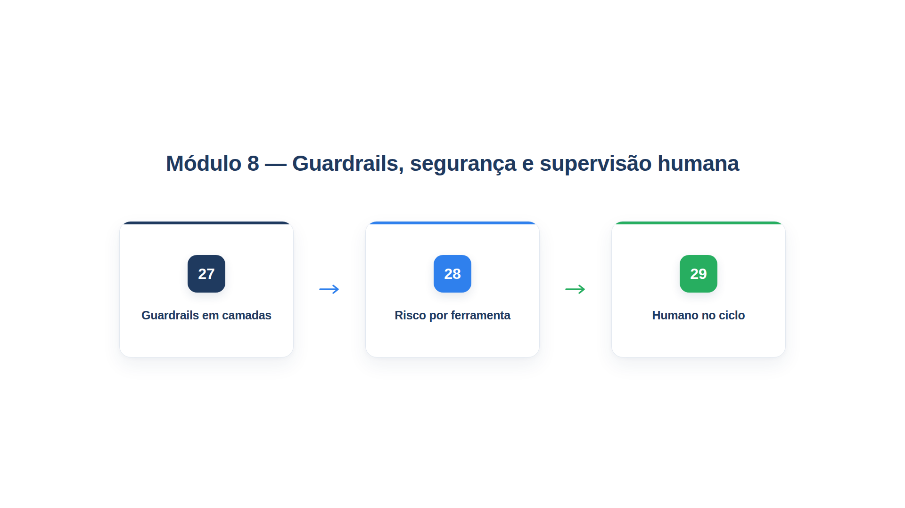

# Módulo 8 — Guardrails, segurança e supervisão humana

Quanto mais um agente faz sozinho, mais importa o que o impede de fazer a coisa errada. Um agente que só conversa pode, no máximo, dizer algo inadequado. Um agente que consulta dados, altera pedidos e reembolsa valores pode causar um prejuízo real, por erro do modelo, por manipulação de um usuário mal-intencionado ou por um simples mal-entendido. Este módulo ensina a conter o agente sem tirar dele o que o torna útil. Ao final dele, você será capaz de:

- proteger a entrada e a saída com camadas de guardrails, das regras baratas aos classificadores de modelo;
- classificar o risco de cada ação por regras determinísticas e limitar o que cada agente pode fazer, com privilégio mínimo;
- pausar ações de risco para aprovação humana, com prazo, escalonamento, padrão seguro e registro de cada decisão.

## Percurso

1. **Capítulo 27 — Guardrails em camadas.** Você monta uma defesa de entrada com regras e classificadores de relevância e de segurança, uma proteção de saída contra dados pessoais e promessas indevidas, e a execução otimista que não atrasa a resposta.
2. **Capítulo 28 — Risco por ferramenta.** Você classifica cada ação em autônoma, notificar ou aprovar com regras em código, e usa permissões da sessão para que um modelo manipulado não consiga o que não deveria.
3. **Capítulo 29 — Humano no ciclo.** Você constrói o fluxo de aprovação com as ferramentas diferidas do PydanticAI: pedido de revisão estruturado, prazo, revisor secundário, padrão seguro e trilha de auditoria.

Os arquivos `config.py`, `loja.py`, `trajetoria.py` e `modelos_simulados.py` são os do Módulo 7. Os exemplos continuam usando modelos simulados para que as saídas sejam exatas; as decisões de segurança, porém, são sempre do *código*, e é isso que o módulo defende.

## Um princípio para o módulo inteiro

A AWS, em seu guia de boas práticas para agentes (o *Agentic AI Lens* do Well-Architected), resume a ideia central em uma frase: os limites de cada agente devem ser definidos de antemão e **impostos por controles em camadas, e não apenas por instruções no prompt**. Duas famílias de controle convivem:

- **Controles determinísticos:** regras de acesso, validação de esquemas, mecanismos de política. Funcionam sempre, da mesma forma, e não podem ser persuadidos.
- **Controles probabilísticos:** filtros de entrada e saída, avaliação de comportamento, classificadores baseados em modelos. Captam o que as regras não alcançam, mas erram de vez em quando.

Eles atuam em etapas distintas da cadeia de chamadas, de modo que a falha de uma camada raramente leva a uma violação de limite. Um agente cujos limites existem apenas como texto no prompt depende de o modelo obedecer, e uma única entrada maliciosa pode desviá-lo sem nenhuma defesa em profundidade.
