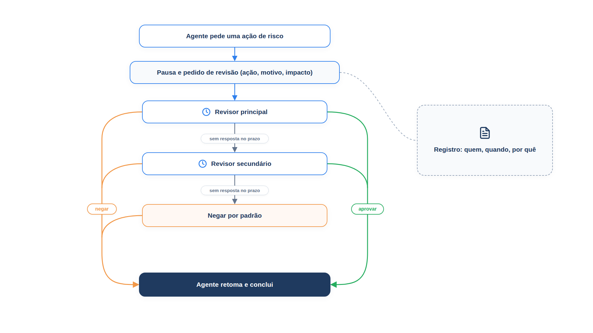

# Capítulo 29 — Humano no ciclo

O Capítulo 28 terminou com uma lacuna: a ação de R$ 5.000 passou porque a sessão tinha permissão, e nada exigia que uma pessoa a visse. Neste capítulo, você fecha a lacuna com a **supervisão humana** (*human-in-the-loop*, ou HITL): uma ação de alto risco pausa, um revisor decide, e o agente retoma de onde parou. Você vai construir o fluxo completo com as ferramentas diferidas do PydanticAI, com pedido de revisão estruturado, prazo, revisor secundário, padrão seguro e trilha de auditoria.



> **Antes de começar — PydanticAI neste capítulo**
>
> Neste capítulo você usa `Agent`, `RunContext`, `FunctionModel`, `ModelResponse`, `ToolCallPart` e o `tool_call_id` de cada chamada. Se algum deles não for familiar, revise os capítulos [0.4](../modulo-00/0.4-o-primeiro-agente-por-dentro.md), [0.5](../modulo-00/0.5-mensagens-e-testes-sem-api.md), [0.6](../modulo-00/0.6-ferramentas-e-saida-tipada.md) e [0.7](../modulo-00/0.7-dependencias-e-contexto.md).

## Por que e quando chamar uma pessoa

A intervenção humana é uma salvaguarda crítica. O guia da OpenAI a destaca como especialmente importante no início da implantação, porque ajuda a identificar falhas, a descobrir casos extremos e a estabelecer um ciclo robusto de avaliação. Ela permite ao agente transferir o controle com elegância quando não consegue concluir uma tarefa: em atendimento, escalando a um atendente; em programação, devolvendo o controle ao usuário.

Dois gatilhos costumam justificar a intervenção:

- **Limite de falhas excedido.** Estabeleça limites de tentativas ou de ações. Se o agente os ultrapassa, por exemplo, ao não entender a intenção do cliente depois de várias tentativas, escale a uma pessoa.
- **Ações de alto risco.** Ações sensíveis, irreversíveis ou de grande impacto devem acionar supervisão humana até que a confiança na confiabilidade do agente cresça. São exemplos cancelar pedidos, autorizar reembolsos grandes ou fazer pagamentos.

O segundo gatilho é a camada *aprovar* do Capítulo 28. O primeiro é simples de implementar, e vamos vê-lo antes.

### Gatilho 1: limite de falhas

A regra: *N* falhas **seguidas** de compreensão encaminham o atendimento a uma pessoa. Uma compreensão bem-sucedida zera a contagem.

*gatilhos.py*

```python
from dataclasses import dataclass


@dataclass
class Atendimento:
    limite_de_falhas: int = 3
    falhas_seguidas: int = 0
    escalado: bool = False

    def registrar(self, entendeu: bool) -> None:
        self.falhas_seguidas = 0 if entendeu else self.falhas_seguidas + 1
        if self.falhas_seguidas >= self.limite_de_falhas:
            self.escalado = True


atendimento = Atendimento()
for rodada, entendeu in enumerate([True, False, False, True, False, False, False], start=1):
    atendimento.registrar(entendeu)
    estado = "ESCALADO PARA UMA PESSOA" if atendimento.escalado else f"{atendimento.falhas_seguidas} falha(s) seguida(s)"
    print(f"Rodada {rodada}: {'entendeu' if entendeu else 'não entendeu'} -> {estado}")
    if atendimento.escalado:
        break
```

Saída:

```text
Rodada 1: entendeu -> 0 falha(s) seguida(s)
Rodada 2: não entendeu -> 1 falha(s) seguida(s)
Rodada 3: não entendeu -> 2 falha(s) seguida(s)
Rodada 4: entendeu -> 0 falha(s) seguida(s)
Rodada 5: não entendeu -> 1 falha(s) seguida(s)
Rodada 6: não entendeu -> 2 falha(s) seguida(s)
Rodada 7: não entendeu -> ESCALADO PARA UMA PESSOA
```

Duas falhas em seguida não escalam, e uma compreensão no meio zera a contagem (rodada 4). Só a terceira falha *seguida*, na rodada 7, encaminha o atendimento. É o mesmo desenho do limite de chamadas do Capítulo 3, aplicado à experiência do cliente: o agente reconhece que não está ajudando e passa a vez.

## Gatilho 2: pausar a ação de alto risco

Para as ações de alto risco, o PydanticAI oferece as **ferramentas diferidas**. Uma ferramenta pode declarar que exige aprovação; quando o modelo a chama, a execução *termina* com um objeto `DeferredToolRequests`, que lista as chamadas pendentes. Quem chamou o agente reúne as aprovações e inicia uma nova execução, passando o histórico e as decisões em `DeferredToolResults`. O agente então retoma de onde parou: as chamadas aprovadas rodam, e as negadas voltam ao modelo como recusas.

Há duas formas de declarar a exigência. Uma ferramenta que *sempre* precisa de aprovação usa `requires_approval=True`. Quando a necessidade depende dos argumentos, como o valor, a ferramenta levanta `ApprovalRequired` e consulta `ctx.tool_call_approved` para saber se já foi aprovada. É a forma que usamos, porque o limite é de valor.

*aprovacao.py*

```python
import asyncio
from dataclasses import dataclass
from datetime import datetime, timezone

from pydantic_ai import (
    Agent,
    ApprovalRequired,
    DeferredToolRequests,
    DeferredToolResults,
    RunContext,
    ToolDenied,
)

from config import MODELO
from risco import Acao, Camada, classificar

REGISTRO: list[dict] = []


def registrar(decisao: str, quem: str, motivo: str, acao: str) -> None:
    REGISTRO.append({
        "quando": datetime.now(timezone.utc).isoformat(timespec="seconds"),
        "acao": acao,
        "decisao": decisao,
        "revisor": quem,
        "motivo": motivo,
    })


agente = Agent(
    MODELO,
    name="atendente",
    output_type=[str, DeferredToolRequests],
    instructions=(
        "Você atende clientes da Casa Verde. Para reembolsos, use `reembolsar`. "
        "Explique ao cliente o resultado em uma frase."
    ),
)


@agente.tool
def reembolsar(ctx: RunContext[None], codigo: str, valor: float) -> str:
    """Reembolsa um valor em um pedido."""
    camada = classificar(Acao("reembolsar", escreve=True, reversivel=False, valor=valor))
    if camada is Camada.APROVAR and not ctx.tool_call_approved:
        raise ApprovalRequired(metadata={"pedido": codigo, "valor": valor, "camada": camada.value})
    if camada is Camada.NOTIFICAR:
        registrar("notificado", "sistema", "dentro do limite de alçada", f"reembolsar {codigo} R$ {valor:.2f}")
    return f"Reembolso de R$ {valor:.2f} registrado para o pedido {codigo}."


@dataclass
class PedidoDeRevisao:
    id_da_chamada: str
    acao: str
    argumentos: dict
    impacto: str
    resumo_da_conversa: str


def montar_pedido(chamada, metadata: dict, conversa: str) -> PedidoDeRevisao:
    valor = metadata.get("valor", 0)
    return PedidoDeRevisao(
        id_da_chamada=chamada.tool_call_id,
        acao=chamada.tool_name,
        argumentos=chamada.args_as_dict(),
        impacto=f"Saída financeira de R$ {valor:.2f}, irreversível.",
        resumo_da_conversa=conversa,
    )


async def decidir(pedido: PedidoDeRevisao, revisores: list, espera: float):
    """Pergunta a cada revisor, em ordem, com prazo. Sem decisão: nega por padrão."""
    for revisor in revisores:
        try:
            aprovado, motivo = await asyncio.wait_for(revisor["decidir"](pedido), timeout=espera)
        except asyncio.TimeoutError:
            registrar("sem resposta", revisor["nome"], f"prazo de {espera} s esgotado", pedido.acao)
            continue
        registrar("aprovado" if aprovado else "negado", revisor["nome"], motivo, pedido.acao)
        return aprovado, motivo
    registrar("negado", "sistema", "nenhum revisor respondeu; padrão seguro", pedido.acao)
    return False, "nenhum revisor respondeu a tempo"


async def atender(mensagem: str, revisores: list, espera: float = 0.2, model=None) -> str:
    resultado = await agente.run(mensagem, model=model)
    while isinstance(resultado.output, DeferredToolRequests):
        pedidos = resultado.output
        decisoes = DeferredToolResults()
        for chamada in pedidos.approvals:
            pedido = montar_pedido(chamada, pedidos.metadata.get(chamada.tool_call_id, {}), mensagem)
            aprovado, motivo = await decidir(pedido, revisores, espera)
            decisoes.approvals[chamada.tool_call_id] = True if aprovado else ToolDenied(motivo)
        resultado = await agente.run(
            message_history=resultado.all_messages(), deferred_tool_results=decisoes, model=model
        )
    return resultado.output
```

Este arquivo reúne todos os elementos do fluxo. Leia-o por seus papéis.

**O tipo de saída.** `output_type=[str, DeferredToolRequests]` diz ao agente que a execução pode terminar com um texto ou com um pedido de aprovação. Sem isso, a pausa não teria como sair.

> **Por dentro do PydanticAI — `DeferredToolRequests`**
>
> **O que é:** um objeto que o agente devolve, no lugar de um texto, quando a execução parou à espera de uma decisão externa.
> **Como funciona aqui:** como `output_type=[str, DeferredToolRequests]`, `resultado.output` pode ser uma coisa ou outra, e o laço de `atender` usa `isinstance` para distinguir. Dentro dele, `pedidos.approvals` lista as chamadas que aguardam aprovação, e `pedidos.metadata` guarda os metadados de cada uma, indexados por `tool_call_id`.
> **O que o PydanticAI faz por você:** interrompe a execução sem rodar a ferramenta e reúne todas as pendências em um só objeto.
> **Cuidado:** sem `DeferredToolRequests` no `output_type`, a pausa dá erro de uso em vez de sair como saída.

**A ferramenta e a regra de risco.** `reembolsar` reutiliza `classificar` do Capítulo 28. Se a camada é `APROVAR` e a chamada ainda não foi aprovada, levanta `ApprovalRequired`, com *metadados* (o pedido, o valor, a camada) que acompanharão o pedido de aprovação. Se é `NOTIFICAR`, registra a ação e executa. Se é autônoma, executa. A decisão de risco continua sendo código.

> **Por dentro do PydanticAI — `ApprovalRequired`**
>
> **O que é:** uma exceção que a ferramenta levanta para dizer “não execute isto sem a aprovação de alguém”.
> **Como funciona aqui:** em `reembolsar`, se a camada é `APROVAR` e `ctx.tool_call_approved` ainda é falso, a ferramenta faz `raise ApprovalRequired(...)`. A função para ali: o `return` do reembolso não é alcançado.
> **O que o PydanticAI faz por você:** captura a exceção, marca a chamada como pendente e encerra a execução com um `DeferredToolRequests`. Na nova execução, com a chamada aprovada, chama `reembolsar` de novo, agora com `ctx.tool_call_approved` verdadeiro.
> **Cuidado:** a ferramenta roda do início uma segunda vez. Tudo o que ela fizer antes do `raise` (gravar, cobrar) acontece duas vezes. Deixe a checagem de aprovação antes de qualquer efeito.

> **Por dentro do PydanticAI — `ApprovalRequired(metadata=)`**
>
> **O que é:** um dicionário opcional que acompanha a exceção, com os dados que o revisor precisa ver.
> **Como funciona aqui:** `metadata={"pedido": codigo, "valor": valor, "camada": camada.value}` guarda o pedido, o valor e a camada. Mais adiante, `atender` o lê com `pedidos.metadata.get(chamada.tool_call_id, {})` e entrega a `montar_pedido`, que usa o `valor` para escrever o impacto.
> **O que o PydanticAI faz por você:** guarda o dicionário em `DeferredToolRequests.metadata`, indexado pelo `tool_call_id`.
> **Cuidado:** sem `metadata`, a chave existe só se você a tratar; por isso o `.get(..., {})`. Coloque no dicionário só valores que sirvam ao revisor, e não segredos.

**O pedido de revisão.** Um revisor decide bem quando tem contexto. A AWS recomenda que o pedido de revisão estruturado contenha a descrição da ação, o raciocínio do agente, uma avaliação do impacto e o histórico da execução, para que o revisor decida rápido e não aprove no automático. `PedidoDeRevisao` e `montar_pedido` reúnem esses elementos: a ação, os argumentos, o impacto financeiro e o resumo da conversa.

**A decisão com prazo e escalonamento.** `decidir` consulta os revisores em ordem, cada um com um prazo (`asyncio.wait_for`). Se o primeiro não responde a tempo, passa ao seguinte (um revisor secundário). Se nenhum responde, o resultado é a **negação por padrão**: um sistema que espera para sempre trava o agente, e um que aprova por padrão derruba a segurança. A AWS aponta o erro oposto como anti-padrão: fluxos de aprovação sem prazo nem alternativa fazem o agente parar indefinidamente quando os revisores estão indisponíveis.

**O registro.** Cada decisão é gravada com a ação, a decisão, o revisor, o motivo e o instante. A AWS pede exatamente isso: registrar cada decisão de supervisão com a identidade do revisor, a justificativa e o horário, para auditoria e relatórios de conformidade.

**O laço `atender`.** Roda o agente. Enquanto a saída for um `DeferredToolRequests`, percorre as aprovações pendentes, monta o pedido de revisão, decide e acumula as decisões em um `DeferredToolResults`: `True` para aprovar, ou um `ToolDenied(motivo)` para negar, e retoma o agente com `message_history` e `deferred_tool_results`. O modelo recebe, como retorno da ferramenta, o resultado da execução ou o motivo da negação, e redige a resposta ao cliente.

> **Por dentro do PydanticAI — `DeferredToolResults`**
>
> **O que é:** o objeto em que você entrega ao agente as decisões sobre as chamadas pausadas.
> **Como funciona aqui:** em `atender`, `decisoes = DeferredToolResults()` começa vazio. Para cada chamada pendente, o código escreve em `decisoes.approvals[chamada.tool_call_id]`: `True` aprova, e um `ToolDenied(motivo)` nega. A chave é o `tool_call_id` que o modelo gerou para aquela chamada (veja o [Capítulo 0.5](../modulo-00/0.5-mensagens-e-testes-sem-api.md)), e é ele que liga a decisão à chamada certa.
> **O que o PydanticAI faz por você:** ao receber `deferred_tool_results=decisoes` junto do `message_history`, executa as chamadas aprovadas e devolve ao modelo o retorno de cada uma.
> **Cuidado:** a chave precisa ser exatamente o `tool_call_id` da chamada. Uma pendência sem decisão faz a nova execução falhar com erro.

> **Por dentro do PydanticAI — `ToolDenied`**
>
> **O que é:** a classe que representa uma chamada de ferramenta recusada por quem revisou.
> **Como funciona aqui:** `ToolDenied(motivo)` recebe o texto do revisor (por exemplo, `"prazo de devolução expirado"`). Sem argumento, a mensagem é `"The tool call was denied."`.
> **O que o PydanticAI faz por você:** não executa a ferramenta e entrega ao modelo a mensagem como retorno dela. Por isso, na saída do cenário “o gerente nega”, a resposta repete o motivo.
> **Cuidado:** o texto vai para o modelo e, em geral, chega ao cliente. Escreva um motivo que possa ser lido por quem não é da equipe, sem dados internos.

### Espiando o pedido pendente

Antes de ler o laço inteiro, veja os objetos em ação, sem revisor nenhum: uma execução que termina pausada e outra que a retoma com uma negação. Um agente mínimo, com um modelo simulado que pede `reembolsar` com um `tool_call_id` fixo, `"chamada-1"`, deixa a saída previsível.

*pedido_pendente_simulado.py*

```python
from pydantic_ai import (
    Agent,
    ApprovalRequired,
    DeferredToolRequests,
    DeferredToolResults,
    ModelResponse,
    RunContext,
    TextPart,
    ToolCallPart,
    ToolDenied,
)
from pydantic_ai.models.function import FunctionModel


def modelo(mensagens, info):
    if len(mensagens) == 1:
        return ModelResponse(parts=[ToolCallPart("reembolsar", {"codigo": "1001", "valor": 250.0}, tool_call_id="chamada-1")])
    return ModelResponse(parts=[TextPart("Não foi possível reembolsar.")])


agente = Agent(FunctionModel(modelo), output_type=[str, DeferredToolRequests])


@agente.tool
def reembolsar(ctx: RunContext[None], codigo: str, valor: float) -> str:
    if not ctx.tool_call_approved:
        raise ApprovalRequired(metadata={"pedido": codigo, "valor": valor})
    return f"Reembolso de R$ {valor:.2f} registrado."


primeira = agente.run_sync("Reembolso do pedido 1001.")
pedidos = primeira.output
print("Tipo da saída:", type(pedidos).__name__)
print("Chamadas diretas:", pedidos.calls)
for chamada in pedidos.approvals:
    print("Pendente:", chamada.tool_name, chamada.args_as_dict(), chamada.tool_call_id)
    print("Metadados:", pedidos.metadata[chamada.tool_call_id])

decisoes = DeferredToolResults()
decisoes.approvals["chamada-1"] = ToolDenied("prazo de devolução expirado")
segunda = agente.run_sync(message_history=primeira.all_messages(), deferred_tool_results=decisoes)
print("Tipo da saída:", type(segunda.output).__name__)
print("Resposta:", segunda.output)
```

Saída:

```text
Tipo da saída: DeferredToolRequests
Chamadas diretas: []
Pendente: reembolsar {'codigo': '1001', 'valor': 250.0} chamada-1
Metadados: {'pedido': '1001', 'valor': 250.0}
Tipo da saída: str
Resposta: Não foi possível reembolsar.
```

A primeira execução devolve um `DeferredToolRequests`, com a chamada em `approvals` e os metadados em `metadata`. A segunda, com o `ToolDenied`, volta como um texto comum. O `calls` vazio indica que nenhuma ferramenta está pendente por outro motivo além da aprovação.


Vamos exercitar cinco cenários, com um modelo simulado que pede o reembolso e redige a resposta com o retorno da ferramenta. Os revisores são funções simuladas: um gerente que aprova, um que nega e um ausente, que nunca responde a tempo.

*aprovacao_simulada.py*

```python
import asyncio

from pydantic_ai import ModelResponse, TextPart, ToolCallPart
from pydantic_ai.messages import ToolReturnPart
from pydantic_ai.models.function import FunctionModel

import aprovacao as a


def montar_modelo(valor):
    def modelo(mensagens, info):
        retornos = [p.content for m in mensagens for p in m.parts if isinstance(p, ToolReturnPart)]
        if not retornos:
            return ModelResponse(parts=[ToolCallPart("reembolsar", {"codigo": "1001", "valor": valor})])
        return ModelResponse(parts=[TextPart(f"Resultado para você: {retornos[-1]}")])

    return FunctionModel(modelo)


async def gerente_que_aprova(pedido):
    return True, "pedido conferido: produto danificado, dentro da política"


async def gerente_que_nega(pedido):
    return False, "prazo de devolução expirado"


async def ausente(pedido):
    await asyncio.sleep(5)
    return True, "nunca chega"


def revisor(nome, funcao):
    return {"nome": nome, "decidir": funcao}


async def cenario(titulo, valor, revisores):
    a.REGISTRO.clear()
    resposta = await a.atender("Quero o reembolso do pedido 1001.", revisores, model=montar_modelo(valor))
    print(f"\n== {titulo}\nResposta: {resposta}")
    for linha in a.REGISTRO:
        print("  registro:", {k: v for k, v in linha.items() if k != "quando"})


async def principal():
    await cenario("R$ 40: dentro da alçada, sem revisão", 40.0, [])
    await cenario("R$ 250: o gerente aprova", 250.0, [revisor("gerente", gerente_que_aprova)])
    await cenario("R$ 250: o gerente nega", 250.0, [revisor("gerente", gerente_que_nega)])
    await cenario("R$ 250: o gerente não responde; a diretora aprova", 250.0,
                  [revisor("gerente", ausente), revisor("diretora", gerente_que_aprova)])
    await cenario("R$ 250: ninguém responde", 250.0, [revisor("gerente", ausente)])


asyncio.run(principal())
```

Saída (o instante de cada registro foi omitido):

```text
== R$ 40: dentro da alçada, sem revisão
Resposta: Resultado para você: Reembolso de R$ 40.00 registrado para o pedido 1001.
  registro: {'acao': 'reembolsar 1001 R$ 40.00', 'decisao': 'notificado', 'revisor': 'sistema', 'motivo': 'dentro do limite de alçada'}

== R$ 250: o gerente aprova
Resposta: Resultado para você: Reembolso de R$ 250.00 registrado para o pedido 1001.
  registro: {'acao': 'reembolsar', 'decisao': 'aprovado', 'revisor': 'gerente', 'motivo': 'pedido conferido: produto danificado, dentro da política'}

== R$ 250: o gerente nega
Resposta: Resultado para você: prazo de devolução expirado
  registro: {'acao': 'reembolsar', 'decisao': 'negado', 'revisor': 'gerente', 'motivo': 'prazo de devolução expirado'}

== R$ 250: o gerente não responde; a diretora aprova
Resposta: Resultado para você: Reembolso de R$ 250.00 registrado para o pedido 1001.
  registro: {'acao': 'reembolsar', 'decisao': 'sem resposta', 'revisor': 'gerente', 'motivo': 'prazo de 0.2 s esgotado'}
  registro: {'acao': 'reembolsar', 'decisao': 'aprovado', 'revisor': 'diretora', 'motivo': 'pedido conferido: produto danificado, dentro da política'}

== R$ 250: ninguém responde
Resposta: Resultado para você: nenhum revisor respondeu a tempo
  registro: {'acao': 'reembolsar', 'decisao': 'sem resposta', 'revisor': 'gerente', 'motivo': 'prazo de 0.2 s esgotado'}
  registro: {'acao': 'reembolsar', 'decisao': 'negado', 'revisor': 'sistema', 'motivo': 'nenhum revisor respondeu; padrão seguro'}
```

Observe cada cenário:

1. **R$ 40.** Dentro da alçada, a ação foi executada na hora, com um registro de *notificação*: ninguém foi interrompido, mas ficou rastro.
2. **R$ 250, aprovado.** A execução pausou, o gerente aprovou com um motivo, o agente retomou, e o reembolso saiu.
3. **R$ 250, negado.** A recusa e o motivo voltaram ao modelo como resultado da ferramenta, e a resposta ao cliente os reflete. Nada foi reembolsado.
4. **O gerente ausente.** O primeiro revisor não respondeu em 0,2 s, e a decisão passou ao secundário, que aprovou. O registro mostra os dois passos.
5. **Ninguém responde.** Esgotados os revisores, o sistema negou por padrão e registrou a decisão como sua.

> **Nota:** Em um sistema real, o revisor é uma pessoa em uma fila de tarefas (um aplicativo de mensagens, um painel, um chamado), e a espera é de minutos ou horas. Quando o prazo é longo, não mantenha o processo vivo esperando: o fluxo de *parar a execução* com `DeferredToolRequests`, gravar o histórico e retomar quando a decisão chegar é feito para isso.

> **Nota:** A aprovação de uma ferramenta não é uma fronteira de autorização contra um cliente não confiável. A documentação do PydanticAI avisa que, quando o agente é servido por uma interface de usuário, a decisão de aprovação é enviada pelo próprio cliente, junto do restante do pedido. Valide no servidor quem pode aprovar o quê.

### Armadilha: cansaço do revisor

O extremo oposto da falta de supervisão é a supervisão em excesso. Se *toda* ação passa por revisão humana, os revisores se cansam e passam a aprovar no automático, e o controle vira um carimbo. A AWS lista como problema comum os fluxos de aprovação que mandam toda ação à revisão, produzindo cansaço e aprovação mecânica, ou que pulam a revisão onde ela é necessária: o pior dos dois mundos. A solução é a que você construiu: camadas de risco que mandam à pessoa só o que justifica sua atenção, com contexto suficiente para que decida de fato, e a revisão automatizada de primeira passagem (os guardrails do Capítulo 27) filtrando antes o que viola a política.

### Faça você mesmo

- **29.1 Terceiro revisor:** acrescente um revisor `"sistema_de_regras"` que nega automaticamente reembolsos acima de R$ 1.000 *antes* de qualquer pessoa. Escreva o cenário e a ordem dos registros.
- **29.2 Prazo maior:** execute o cenário do gerente ausente com `espera=6`. Descreva o que acontece com o tempo total e por que esse é o custo de esperar demais.
- **29.3 Padrão aprovar:** altere `decidir` para aprovar quando ninguém responde. Execute o último cenário e explique por que essa é uma escolha perigosa.
- **29.4 Pedido de revisão completo:** acrescente ao `PedidoDeRevisao` o raciocínio do agente (o texto anterior à chamada da ferramenta, quando há) e escreva uma função que o formate em até cinco linhas para o revisor.
- **29.5 Ferramenta sempre aprovada:** crie `excluir_conta(cliente)` com `requires_approval=True`. Execute um cenário em que o gerente a nega.
- **29.6 Fila de revisão:** descreva, em prosa, como você gravaria os pedidos pendentes em um banco, ao invés de esperar em memória, e como o agente retomaria quando a decisão chegasse.

## Fechando o ciclo: aprender com a intervenção

Cada decisão humana é um dado valioso. Os registros dizem onde o agente erra, o que os revisores sempre aprovam e o que sempre negam. Dois usos:

- **Calibrar as camadas.** Se os revisores aprovam 99% das ações de uma faixa de valor, a faixa pode migrar de *aprovar* para *notificar*. Se negam muitas de um tipo, a instrução ou a ferramenta têm um defeito. A AWS descreve esse ciclo: controles calibrados com os dados de intervenção e avaliação, em um laço de realimentação que, nos níveis mais maduros, passa de manual a automático.
- **Alimentar as avaliações.** As ações negadas e os motivos viram casos de teste para a bancada do Módulo 9.

A confiança é gradual. O agente começa supervisionado e ganha autonomia onde a evidência permite, uma progressão que a documentação da AWS descreve também em ferramentas de desenvolvimento: um modo supervisionado, em que cada ação é revisada, e um modo autônomo para fluxos de confiança.

### Faça você mesmo

- **29.7 Mover a faixa:** em uma semana, 200 reembolsos entre R$ 100 e R$ 150 foram todos aprovados por humanos. Que mudança você proporia ao `LIMITE_DE_VALOR`? Que risco precisa continuar monitorado?
- **29.8 Casos de teste:** transforme os cenários de ação negada em cinco casos para uma bancada: a pergunta do cliente, a ação tentada e a decisão esperada.

## Recapitulando

Você agora sabe pausar uma ação de alto risco e entregá-la a uma pessoa: a ferramenta levanta `ApprovalRequired` quando a classificação determinística manda aprovar, a execução termina com um `DeferredToolRequests`, o revisor recebe um pedido estruturado, decide dentro de um prazo, com escalonamento a um secundário e negação por padrão, e o agente retoma com `DeferredToolResults`. Registrou cada decisão com revisor, motivo e horário, conheceu o gatilho do limite de falhas e viu o perigo do cansaço do revisor.

Com isso, o Módulo 8 está completo. Você protege a entrada e a saída em camadas, classifica o risco de cada ação por regras em código, restringe o que cada agente pode e traz humanos ao ciclo onde importa. O próximo módulo trata de saber se tudo isso *funciona*: como avaliar um agente, com vocabulário próprio, avaliadores de código, de modelo e humanos, e olhando tanto o resultado quanto a trajetória.

### Fontes do capítulo

- OpenAI — [A Practical Guide to Building Agents](https://cdn.openai.com/business-guides-and-resources/a-practical-guide-to-building-agents.pdf): intervenção humana como salvaguarda; os dois gatilhos (limite de falhas e ações de alto risco).
- AWS — [AGENTREL02-BP05: supervisão humana em camadas](https://docs.aws.amazon.com/wellarchitected/latest/agentic-ai-lens/agentrel02-bp05.html) e [AGENTSEC04](https://docs.aws.amazon.com/wellarchitected/latest/agentic-ai-lens/agentsec04.html): pedido de revisão estruturado, prazos e escalonamento, padrão seguro, registro de cada decisão, cansaço de revisão e calibração a partir dos dados.
- Documentação do PydanticAI: *Deferred Tools* (aprovação humana de ferramentas, `ApprovalRequired`, `DeferredToolRequests` e `DeferredToolResults`).
