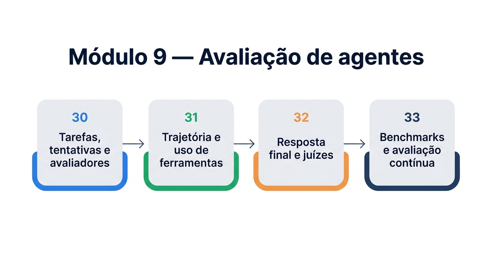

# Módulo 9 — Avaliação de agentes

Você construiu agentes que raciocinam, usam ferramentas, lembram, colaboram e pedem aprovação. Mas como saber se funcionam? Testar à mão algumas perguntas não escala, e um agente que acerta hoje pode errar amanhã, depois de uma mudança no prompt, no modelo ou em uma ferramenta. Este módulo ensina a medir: um conjunto de tarefas, avaliadores que pontuam o que importa e uma rotina que roda a cada mudança. Ao final dele, você será capaz de:

- montar um conjunto de avaliação com tarefas, tentativas e avaliadores, usando o vocabulário que a área adotou;
- avaliar não só a resposta final, mas a trajetória do agente e o uso das ferramentas;
- usar um modelo como juiz da resposta final e calibrá-lo contra o julgamento de pessoas;
- calibrar suas expectativas com benchmarks públicos e manter as avaliações vivas, no desenvolvimento e em produção.

## Percurso

1. **Capítulo 30 — Tarefas, tentativas e avaliadores.** Você aprende o vocabulário, monta o primeiro conjunto de oito casos com a biblioteca `pydantic-evals` e escreve avaliadores em código.
2. **Capítulo 31 — Trajetória e uso de ferramentas.** Você compara o caminho que o agente seguiu com o esperado, com métricas exata, na ordem e em qualquer ordem, e mede a confiabilidade de várias tentativas com pass@k e pass^k.
3. **Capítulo 32 — Resposta final e juízes.** Você avalia respostas abertas com um modelo como juiz, e mede quanto o juiz concorda com uma pessoa.
4. **Capítulo 33 — Benchmarks e avaliação contínua.** Você conhece o GAIA, escreve uma conferência quase exata e monta o portão de regressão que roda a cada mudança.

Este módulo usa duas bibliotecas além do PydanticAI: `pydantic-evals`, que fornece conjuntos, casos e avaliadores, e `logfire`, usada apenas localmente (sem enviar dados) para registrar os passos do agente, que os avaliadores de trajetória leem. Instale com `pip install pydantic-evals logfire`. O arquivo `instrumentacao.py` faz essa configuração, e os arquivos `config.py`, `loja.py` e `modelos_simulados.py` são os dos módulos anteriores.

> **Nota:** Como em todo o livro, os exemplos de saída usam um agente simulado (`comportamento_simulado.py`), que se comporta de modo reproduzível e tem três defeitos de propósito: assim, as avaliações têm o que encontrar. Com um agente real, você executa os mesmos conjuntos e obtém os seus próprios números.

## Por que avaliar é diferente de testar

Quem programa conhece os testes automatizados. Avaliar agentes é parecido, mas com duas diferenças. Primeiro, o agente é **estocástico**: a mesma entrada pode produzir saídas diferentes, e uma única execução não diz muito. Segundo, a resposta **raramente tem um único valor correto**: "Seu pedido foi enviado" e "Já despachamos o seu pedido" dizem o mesmo. Por isso os avaliadores precisam de graus, de tolerância e, às vezes, de um julgamento.

O guia do Google sobre avaliação resume a motivação: assim como os testes automáticos poupam tempo e dão confiança no software, no caso de agentes essa automação compensa mais rápido, em tempo e em confiança. E acrescenta que a curadoria dos dados de avaliação é ainda mais importante que nos testes de software, porque ela precisa representar o caso de uso que o agente enfrentará.
