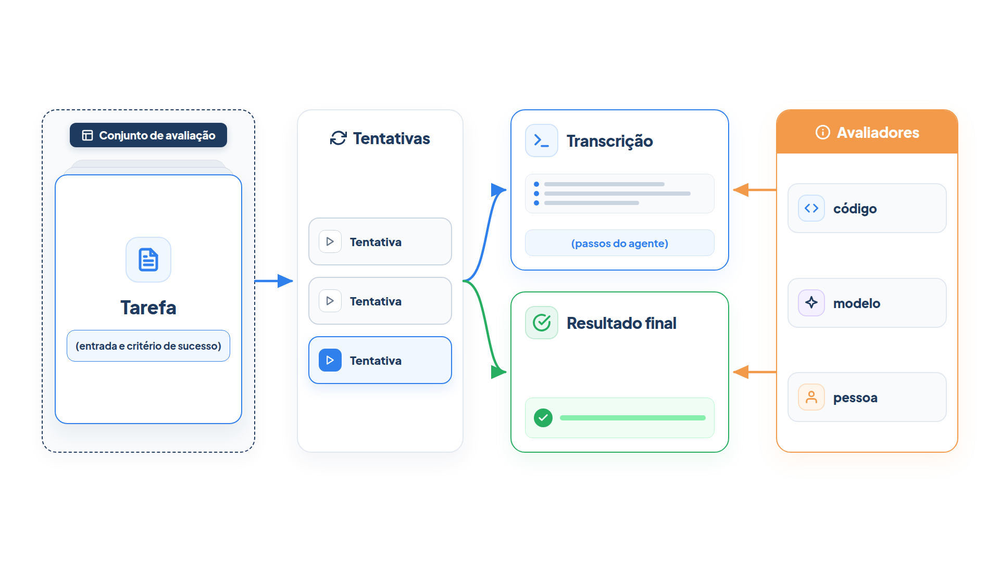

# Capítulo 30 — Tarefas, tentativas e avaliadores

Antes de medir qualquer coisa, você precisa de um vocabulário comum, e a área o tem. Neste capítulo, você aprende os termos, monta o primeiro conjunto de avaliação do atendente da Casa Verde com a biblioteca `pydantic-evals`, e escreve avaliadores em código. Ao final, você terá uma pontuação reproduzível para o seu agente e uma lista concreta do que ele erra.



> **Antes de começar — PydanticAI neste capítulo**
>
> Neste capítulo você usa `Agent`, `tools=`, `instructions=` e `.run` (com `await`). Se algum deles não for familiar, revise o [Capítulo 0.4](../modulo-00/0.4-o-primeiro-agente-por-dentro.md) e o [Capítulo 0.6](../modulo-00/0.6-ferramentas-e-saida-tipada.md). O modelo simulado `roteirizado()` segue a ideia do [Capítulo 0.5](../modulo-00/0.5-mensagens-e-testes-sem-api.md).

## O vocabulário

Os termos abaixo vêm do guia da Anthropic sobre avaliação de agentes, e organizam todo o módulo:

- **Tarefa** (*task*): um teste individual, com entradas definidas e critérios de sucesso.
- **Tentativa** (*trial*): cada execução de uma tarefa. Como os modelos variam entre execuções, é comum tentar a mesma tarefa várias vezes.
- **Avaliador** (*grader*): a lógica que pontua um aspecto do desempenho do agente. Uma tarefa pode ter vários.
- **Transcrição** ou **trajetória** (*transcript*, *trajectory*): o registro completo de uma tentativa: as respostas, as chamadas de ferramenta, o raciocínio e os resultados intermediários.
- **Resultado** (*outcome*): o estado final do ambiente ao fim da tentativa. Dizer "reservei o voo" não é o resultado; o resultado é existir ou não uma reserva no banco de dados.
- **Estrutura de avaliação** (*evaluation harness*): a infraestrutura que executa as avaliações de ponta a ponta.
- **Conjunto de avaliação** (*evaluation suite*): uma coleção de tarefas que mede capacidades específicas.

A distinção entre transcrição e resultado é a mais útil de guardar. Um agente pode *dizer* que cancelou o pedido, e a transcrição mostrará a frase, mas só o resultado confirma se o pedido está mesmo cancelado. Sempre que possível, avalie o resultado.

## Três tipos de avaliador

O guia da Anthropic separa os avaliadores em três famílias, com forças e fraquezas complementares:

| Tipo | Como funciona | Força | Fraqueza |
| --- | --- | --- | --- |
| **Código** | comparação de texto, expressões regulares, testes binários, verificação do resultado, análise das chamadas de ferramenta | rápido, barato, objetivo, reproduzível, fácil de depurar | frágil diante de variações válidas; pouca nuance; limitado em tarefas subjetivas |
| **Modelo** | pontuação por rubrica, afirmações em linguagem natural, comparação entre pares | flexível, escalável, capta nuance, lida com tarefas abertas | não determinístico, mais caro, exige calibração com pessoas |
| **Pessoa** | revisão por especialistas, amostragem, testes A/B | qualidade de referência; alinhada ao julgamento de quem usa | caro, lento, exige acesso a especialistas |

A regra de uso: prefira o avaliador em código sempre que a pergunta puder ser respondida por ele; recorra a um modelo onde a flexibilidade for indispensável; e use pessoas com critério, para calibrar os outros dois. Este capítulo trata do primeiro tipo; o Capítulo 32, do segundo e do terceiro.

## O primeiro conjunto de avaliação

Começamos pelo agente a ser avaliado, em `atendente.py`: o atendente da Casa Verde, com as ferramentas de consulta de pedido e de política.

*atendente.py*

```python
from pydantic_ai import Agent

import instrumentacao  # noqa: F401
from config import MODELO
from loja import buscar_pedido, buscar_politica


def consultar_pedido(codigo: str) -> str:
    """Consulta o status e a previsão de entrega de um pedido pelo código de quatro dígitos."""
    pedido = buscar_pedido(codigo)
    return str(pedido) if pedido else "Pedido não encontrado."


def consultar_politica(tema: str) -> str:
    """Consulta uma política da loja. Temas: devolucao, cancelamento, frete."""
    return buscar_politica(tema) or "Tema não encontrado."


atendente = Agent(
    MODELO,
    name="atendente",
    tools=[consultar_pedido, consultar_politica],
    instructions=(
        "Você atende clientes da Casa Verde. Use as ferramentas para consultar pedidos "
        "e políticas; nunca invente. Perguntas fora do atendimento da loja devem ser "
        "recusadas com educação. Responda em até duas frases."
    ),
)
```

A linha `import instrumentacao` ativa o registro local dos passos do agente, de que o próximo capítulo precisa. Não altera o comportamento.

Agora, o que avaliar. O guia da Anthropic dá um conselho que baixa a barreira de entrada: **comece cedo, com 20 a 50 tarefas simples**, tiradas de falhas reais. Aqui, usaremos oito. As melhores fontes são o que você já verifica à mão antes de cada lançamento, o histórico de erros do rastreador de falhas e os chamados do suporte, priorizados pelo impacto sobre o usuário.

Cada tarefa vira um `Case` do `pydantic-evals`: um nome, a entrada e o resultado esperado.

*avaliadores.py*

```python
from dataclasses import dataclass

from pydantic_evals.evaluators import Evaluator, EvaluatorContext


@dataclass
class ContemEsperado(Evaluator):
    """Aprova se a resposta contém o trecho esperado do caso, sem diferenciar maiúsculas."""

    def evaluate(self, ctx: EvaluatorContext) -> bool:
        return ctx.expected_output.lower() in ctx.output.lower()
```

Um avaliador é uma classe com um método `evaluate`, que recebe um *contexto*: a entrada (`ctx.inputs`), a saída do agente (`ctx.output`) e o esperado (`ctx.expected_output`). Ao devolver um `bool`, ele vira uma *asserção*, aprovada ou reprovada. Devolvendo um número, vira uma *pontuação*. Este avaliador é deliberadamente simples: confere se o trecho esperado aparece na resposta, em vez de exigir um texto idêntico. A lição do guia, sobre avaliadores rígidos demais, vale desde já: eles penalizam variações válidas e escondem a qualidade real do agente.

> **Por dentro do PydanticAI — `Evaluator`**
>
> **O que é:** a classe-base de qualquer avaliador. Você a estende e implementa `evaluate`.
> **Como funciona aqui:** `ContemEsperado` herda de `Evaluator` e é um `@dataclass`, como os avaliadores da biblioteca. O `Dataset` chama `evaluate` uma vez por caso e usa o valor devolvido: `bool` vira asserção, número vira pontuação, texto vira rótulo.
> **O que o PydanticAI faz por você:** usa o nome da classe (`ContemEsperado`) como nome da coluna no relatório.
> **Cuidado:** dois avaliadores com o mesmo nome de classe produzem colunas com o mesmo nome; dê nomes de classe distintos e descritivos.

> **Por dentro do PydanticAI — `EvaluatorContext`**
>
> **O que é:** o objeto que `evaluate` recebe com tudo sobre um caso já executado.
> **Como funciona aqui:** `ctx.output` é o que `tarefa` devolveu, `ctx.expected_output` vem do `Case`, e também há `ctx.inputs` e `ctx.name`. O avaliador compara os dois textos com `.lower()` e `in`.
> **O que o PydanticAI faz por você:** monta um contexto novo por caso, com a saída, a duração e as métricas já medidas.
> **Cuidado:** `expected_output` é `None` quando o `Case` não o define; chamar `.lower()` nele dá `AttributeError`. Se o conjunto tiver casos sem esperado, teste `is None` antes.

*avaliacao.py*

```python
from pydantic_evals import Case, Dataset
from pydantic_evals.evaluators import MaxToolCalls

from atendente import atendente
from avaliadores import ContemEsperado
from comportamento_simulado import roteirizado


async def tarefa(pergunta: str) -> str:
    resultado = await atendente.run(pergunta, model=roteirizado())
    return resultado.output


CASOS = [
    Case(name="status enviado", inputs="Onde está o pedido 1001?", expected_output="enviado"),
    Case(name="status em separação", inputs="Onde está o pedido 1002?", expected_output="separação"),
    Case(name="prazo de devolução", inputs="Qual é o prazo de devolução?", expected_output="7 dias"),
    Case(name="frete grátis", inputs="O frete é grátis acima de quanto?", expected_output="200"),
    Case(name="cancelar em separação", inputs="Posso cancelar o pedido 1002?", expected_output="pode ser cancelado"),
    Case(name="cancelar já enviado", inputs="Posso cancelar o pedido 1001?", expected_output="não"),
    Case(name="fora do assunto", inputs="Qual é a capital da França?", expected_output="não posso"),
    Case(name="pergunta composta", inputs="Compare os pedidos 1001 e 1002.", expected_output="separação"),
]


def conjunto() -> Dataset:
    return Dataset(
        name="atendimento-casa-verde",
        cases=CASOS,
        evaluators=[ContemEsperado(), MaxToolCalls(max_calls=3)],
    )
```

Quatro peças:

**A função `tarefa`.** É o que a avaliação executa para cada caso: recebe a entrada e devolve a saída do agente. Aqui, chama o atendente com o modelo simulado `roteirizado()`. Com um agente real, você retira o argumento `model=` e deixa o agente usar o seu modelo.

**Os casos.** Oito perguntas com o trecho esperado. Elas cobrem quatro tipos: consultas simples (os quatro primeiros), uma consulta que exige cruzar o status com a política (cancelamentos), um caso em que o agente *não deve* agir (a pergunta fora do assunto) e uma pergunta composta.

**Os avaliadores do conjunto.** `ContemEsperado()` aplica-se a todos os casos, e `MaxToolCalls(max_calls=3)` é um avaliador da biblioteca que reprova se o agente fizer mais de três chamadas de ferramenta, um orçamento que protege contra laços de ferramenta.

**O `Dataset`.** Reúne o nome, os casos e os avaliadores. O método `evaluate_sync(tarefa)` executa tudo e devolve um relatório.

> **Por dentro do PydanticAI — `Case`**
>
> **O que é:** a descrição de uma tarefa de avaliação: o que entra e o que se espera dela.
> **Como funciona aqui:** cada linha de `CASOS` cria um `Case`, e cada `Case` vira uma linha do relatório. Ele reúne `name`, `inputs` e `expected_output`, que os próximos quadros explicam um a um.
> **O que o PydanticAI faz por você:** guarda os campos e os repassa a cada avaliador pelo contexto, sem você escrever o laço sobre os casos.
> **Cuidado:** os argumentos de `Case` são só por nome. `Case("Onde está o pedido 1001?")` dá `TypeError`; escreva sempre `Case(inputs=...)`.

> **Por dentro do PydanticAI — `Case(inputs=)`**
>
> **O que é:** a entrada do caso, o único argumento obrigatório de `Case`.
> **Como funciona aqui:** em `inputs="Onde está o pedido 1001?"`, o texto é exatamente o que a função `tarefa` recebe como `pergunta`. O tipo de `inputs` é livre: pode ser um texto, um número ou um modelo Pydantic.
> **O que o PydanticAI faz por você:** chama `tarefa(inputs)` uma vez por caso e guarda o valor em `ctx.inputs`, para os avaliadores consultarem.
> **Cuidado:** o tipo de `inputs` deve combinar com o parâmetro de `tarefa`. Se o caso traz um texto e a função espera um objeto, o erro aparece só na execução.

> **Por dentro do PydanticAI — `Case(expected_output=)`**
>
> **O que é:** o resultado esperado do caso, usado como referência pelos avaliadores.
> **Como funciona aqui:** em `expected_output="enviado"`, o valor não vai ao agente; ele chega ao avaliador `ContemEsperado` como `ctx.expected_output`, para ser procurado dentro da resposta.
> **O que o PydanticAI faz por você:** apenas o transporta. Quem decide o que "esperado" significa é o avaliador: igualdade, trecho contido, aproximação.
> **Cuidado:** é opcional, e vale `None` quando você o omite. Um avaliador que chama `.lower()` nele quebra nesses casos; trate o `None` antes.

> **Por dentro do PydanticAI — `Case(name=)`**
>
> **O que é:** o nome do caso, o rótulo que identifica a tarefa no relatório.
> **Como funciona aqui:** em `name="status enviado"`, esse texto aparece como `caso.name`, na coluna da esquerda da saída de `resumir`. Por isso os nomes do capítulo descrevem a situação testada.
> **O que o PydanticAI faz por você:** se você omitir `name`, o caso recebe um nome automático, como `Case 1`, numerado pela posição na lista.
> **Cuidado:** o argumento é opcional, mas não o omita. Com nomes automáticos, uma falha em `Case 6` obriga você a contar a lista para descobrir de que tarefa se trata.

> **Por dentro do PydanticAI — `Dataset`**
>
> **O que é:** o conjunto de avaliação: uma lista de casos mais os avaliadores que valem para todos.
> **Como funciona aqui:** a função `conjunto()` cria o `Dataset` com um nome, os casos de `CASOS` e dois avaliadores. Os três argumentos são explicados nos próximos quadros.
> **O que o PydanticAI faz por você:** `evaluate_sync(tarefa)` executa a função em cada caso, roda os avaliadores sobre cada saída e monta o relatório (`relatorio.cases`).
> **Cuidado:** `Dataset` também usa só argumentos nomeados, e `name` e `cases` são obrigatórios. Sem eles, o Python acusa um `TypeError`.

> **Por dentro do PydanticAI — `Dataset(cases=)`**
>
> **O que é:** a lista de objetos `Case` que formam o conjunto.
> **Como funciona aqui:** em `cases=CASOS`, a lista de oito casos definida acima entra no conjunto. A ordem da lista é a ordem das linhas do relatório.
> **O que o PydanticAI faz por você:** percorre a lista, executa a função `tarefa` para cada `Case` e junta os resultados no relatório, na mesma ordem.
> **Cuidado:** passe a lista de casos, não uma função que a devolva. `cases=CASOS` está certo; `cases=CASOS[0]` (um só caso, sem lista) falha com `TypeError`, e uma lista com itens que não são `Case` falha com `AttributeError`.

> **Por dentro do PydanticAI — `Dataset(evaluators=)`**
>
> **O que é:** a lista de avaliadores aplicados a todos os casos do conjunto.
> **Como funciona aqui:** em `evaluators=[ContemEsperado(), MaxToolCalls(max_calls=3)]`, cada resposta é conferida pelos dois. Cada avaliador gera uma coluna no relatório.
> **O que o PydanticAI faz por você:** executa cada avaliador em cada caso e agrupa os resultados por nome, em `caso.assertions`, que a função `resumir` percorre.
> **Cuidado:** a lista recebe instâncias, com parênteses. `evaluators=[ContemEsperado]` (a classe) é rejeitado com um `ValidationError` do Pydantic.

> **Por dentro do PydanticAI — `Dataset(name=)`**
>
> **O que é:** o nome do conjunto de avaliação.
> **Como funciona aqui:** em `name="atendimento-casa-verde"`, o texto identifica este conjunto, para não confundi-lo com outros do projeto, como a suíte de regressão do Capítulo 33.
> **O que o PydanticAI faz por você:** guarda o nome e o repete nos relatórios e nos registros da execução.
> **Cuidado:** diferente de `Case(name=)`, este é obrigatório: um `Dataset` sem `name` não é criado. Escolha um nome estável, porque você vai usá-lo para comparar execuções ao longo do tempo.

> **Por dentro do PydanticAI — `MaxToolCalls`**
>
> **O que é:** um avaliador pronto da biblioteca que reprova se o agente fizer chamadas de ferramenta demais.
> **Como funciona aqui:** `MaxToolCalls(max_calls=3)` aprova um caso com até três chamadas e reprova com quatro ou mais. `max_calls` é o limite do orçamento.
> **O que o PydanticAI faz por você:** conta as chamadas de ferramenta a partir do registro dos passos do agente, por isso depende do `import instrumentacao`. Tentativas que falharam também contam, por padrão.
> **Cuidado:** sem a instrumentação ativa, o avaliador não tem o que contar e reprova todos os casos, com uma razão que avisa disso.

> **Por dentro do PydanticAI — `MaxToolCalls(max_calls=)`**
>
> **O que é:** o limite de chamadas de ferramenta permitido por caso.
> **Como funciona aqui:** com `max_calls=3`, um caso que usa uma, duas ou três chamadas passa; com quatro, reprova. Nos casos do capítulo, o máximo é uma chamada, então todos passam. O exercício 30.3 pede para baixar o valor a 1.
> **O que o PydanticAI faz por você:** compara a contagem com `max_calls` e devolve aprovado ou reprovado, com a razão ("1 tool call(s), budget=3").
> **Cuidado:** `max_calls` é o limite inclusive, e o argumento é obrigatório e nomeado. `MaxToolCalls()` sem ele dá erro.

Para ver o que cada peça entrega, rode um conjunto mínimo, sem agente: a `tarefa` é uma função comum e o avaliador apenas imprime o contexto.

*avaliacao_minima_sem_agente.py*

```python
from dataclasses import dataclass

from pydantic_evals import Case, Dataset
from pydantic_evals.evaluators import Evaluator, EvaluatorContext


def tarefa(pergunta: str) -> str:
    return "Prazo de devolução: 7 dias."


@dataclass
class MostraContexto(Evaluator):
    def evaluate(self, ctx: EvaluatorContext) -> bool:
        print(ctx.name, "|", ctx.inputs, "|", ctx.expected_output, "|", ctx.output)
        return True


conjunto = Dataset(
    name="minimo",
    cases=[Case(name="devolução", inputs="Qual o prazo?", expected_output="7 dias")],
    evaluators=[MostraContexto()],
)

relatorio = conjunto.evaluate_sync(tarefa, progress=False)
print(type(relatorio.cases[0]).__name__, relatorio.cases[0].name)
```

Saída:

```text
devolução | Qual o prazo? | 7 dias | Prazo de devolução: 7 dias.
ReportCase devolução
```

A primeira linha mostra os quatro valores que o avaliador recebe; a segunda, que o relatório guarda um `ReportCase` por caso, com o mesmo nome.

Para mostrar o relatório de forma estável, escrevemos uma função que imprime uma linha por caso:

*rodar_avaliacao.py*

```python
from avaliacao import conjunto, tarefa


def resumir(relatorio) -> None:
    for caso in relatorio.cases:
        marcas = " ".join(
            f"{nome}:{'ok' if resultado.value else 'FALHA'}"
            for nome, resultado in caso.assertions.items()
        )
        print(f"{caso.name:24s} {marcas}")
    aprovados = sum(all(r.value for r in c.assertions.values()) for c in relatorio.cases)
    print(f"\nAprovados: {aprovados} de {len(relatorio.cases)}")


if __name__ == "__main__":
    resumir(conjunto().evaluate_sync(tarefa, progress=False))
```

Saída:

```text
status enviado           ContemEsperado:ok MaxToolCalls:ok
status em separação      ContemEsperado:ok MaxToolCalls:ok
prazo de devolução       ContemEsperado:ok MaxToolCalls:ok
frete grátis             ContemEsperado:ok MaxToolCalls:ok
cancelar em separação    ContemEsperado:ok MaxToolCalls:ok
cancelar já enviado      ContemEsperado:FALHA MaxToolCalls:ok
fora do assunto          ContemEsperado:FALHA MaxToolCalls:ok
pergunta composta        ContemEsperado:FALHA MaxToolCalls:ok

Aprovados: 5 de 8
```

O relatório mostra, de uma vez, onde está o agente: acerta as consultas simples e falha nos três casos mais difíceis. As falhas são as que o agente simulado tem de propósito: ele responde "Sim" ao cancelamento de um pedido que já foi enviado, sem consultar o pedido; responde à pergunta sobre a França em vez de recusá-la; e consulta só um dos dois pedidos da pergunta composta. Uma falha de cada tipo, localizada em um caso.

A pontuação, 5 de 8, não é o mais importante. O importante é a **lista de falhas**, porque cada uma é uma tarefa de melhoria: você ajusta a instrução ou a ferramenta, executa de novo e vê se passou, sem quebrar as outras.

> **Nota:** Os valores da coluna `MaxToolCalls` dependem de a instrumentação estar ativa (o `import instrumentacao` do atendente). Sem ela, os avaliadores que leem os passos do agente não têm o que ler.

### Faça você mesmo

- **30.1 Execução real:** remova o `model=roteirizado()` de `tarefa`, defina uma chave de API e execute o conjunto com o seu modelo. Anote quantas tarefas passam e quais falham.
- **30.2 Mais quatro casos:** acrescente quatro casos tirados de situações reais de um atendimento (pedido inexistente, código com `#`, pergunta sobre pagamento, pedido de reembolso).
- **30.3 Orçamento:** altere `MaxToolCalls` para 1 e preveja quais casos passam a falhar.
- **30.4 Tarefa quebrada:** escreva um caso cujo `expected_output` está errado (por exemplo, `"8 dias"` para o prazo de devolução). Explique como você perceberia que o problema está na tarefa, e não no agente.

## Tarefas bem escritas

O guia da Anthropic insiste em que a qualidade do conjunto vem das tarefas. Quatro regras:

**Sem ambiguidade.** Uma boa tarefa passa no teste dos dois especialistas: dois especialistas independentes do domínio, olhando a mesma resposta, chegariam ao mesmo veredito de aprovação ou reprovação? Se não, a tarefa precisa ser reescrita. Um sinal de alerta é uma tarefa em que o agente falha sempre, em muitas tentativas: isso geralmente aponta para uma tarefa quebrada, e não para um agente incapaz. Crie uma solução de referência que prove que a tarefa tem solução e valide os avaliadores.

**Equilibrada.** Teste tanto os casos em que o comportamento *deve* ocorrer quanto aqueles em que *não deve*. Um conjunto só com perguntas a responder otimiza o agente para sempre responder. Por isso o nosso conjunto tem a pergunta sobre a França: o agente deve recusar. No exemplo do guia, uma busca na web deve acontecer para saber o clima, mas não para saber quem fundou uma empresa conhecida.

**Sem excesso de especificação.** Não exija os passos exatos. O guia alerta que os agentes encontram, com frequência, caminhos válidos que o autor da avaliação não previu. Avalie o que importa (a resposta, o resultado) e dê crédito parcial a tarefas com vários componentes.

**Em ambiente estável.** Cada tentativa deve começar de um estado limpo. O guia lembra que estado compartilhado entre tentativas, como arquivos que sobram ou dados em cache, pode causar falhas correlacionadas por problemas de infraestrutura, e não por culpa do agente. No nosso exemplo, os dados de `loja.py` são fixos, e isso é proposital.

### Leia as transcrições

Há uma prática que nenhuma métrica substitui: **ler as transcrições**. O guia recomenda ler muitas, para confirmar que os avaliadores funcionam: uma falha deve parecer justa, ou seja, deve ficar claro o que o agente fez de errado e por quê. Sem isso, você não sabe se um avaliador está reprovando por um defeito real ou por uma limitação do próprio avaliador. Um exemplo relatado: um teste de referência reprovava a resposta "96,12" por esperar "96,124991…", entre outros defeitos (especificações ambíguas, tarefas impossíveis de reproduzir), e corrigir esses problemas elevou o desempenho medido de um mesmo modelo de 42% para 95%.

### Faça você mesmo

- **30.5 Teste dos dois especialistas:** escreva três tarefas para a Casa Verde e peça a dois colegas que digam, para cada resposta que você mostra, se aprovariam ou reprovariam. Onde discordarem, reescreva a tarefa.
- **30.6 Equilíbrio:** liste quantos casos do seu conjunto exigem uma ação do agente e quantos exigem que ele *não* aja. Acrescente casos até equilibrar.
- **30.7 Falha que parece injusta:** invente um caso em que `ContemEsperado` reprovaria uma resposta correta. Reescreva o avaliador para aceitar a variação.

## Capacidade e regressão

Um conjunto serve a dois propósitos diferentes, e vale separá-los:

- **Avaliações de capacidade** respondem "o que este agente faz bem?". Começam com taxa de aprovação baixa e miram as tarefas difíceis, as que dão para onde crescer.
- **Avaliações de regressão** respondem "o agente ainda faz o que fazia?". Miram quase 100% de aprovação e protegem contra a degradação.

No nosso conjunto, as cinco tarefas aprovadas são o embrião de uma suíte de regressão, e as três reprovadas, de uma de capacidade. À medida que você resolve as tarefas de capacidade, elas migram para a regressão e passam a rodar continuamente. O Capítulo 33 monta essa separação em código.

### Faça você mesmo

- **30.8 Classifique:** das oito tarefas do capítulo, diga quais pertencem hoje à regressão e quais à capacidade, e o que levaria uma tarefa de uma para a outra.
- **30.9 Desenvolvimento dirigido por avaliações:** escolha uma capacidade que o seu agente ainda não tem (por exemplo, responder em inglês) e escreva três tarefas para ela *antes* de implementá-la.

## Recapitulando

Você agora conhece o vocabulário da avaliação (tarefa, tentativa, avaliador, transcrição, resultado, estrutura e conjunto), as três famílias de avaliadores e a regra de preferir o código quando possível. Montou o primeiro conjunto com a biblioteca `pydantic-evals`, escreveu um avaliador em código e obteve uma pontuação e uma lista de falhas. Aprendeu a escrever tarefas sem ambiguidade, equilibradas e em ambiente estável, a ler transcrições e a separar capacidade de regressão.

Até aqui, o avaliador olhou para a *resposta*. Mas um agente que acerta a resposta pelo caminho errado, ou que acerta por sorte, não é confiável. O Capítulo 31 acrescenta o olhar sobre o *caminho*: a trajetória do agente e o uso das ferramentas.

### Fontes do capítulo

- Anthropic — [Demystifying Evals for AI Agents](https://www.anthropic.com/engineering/demystifying-evals-for-ai-agents): vocabulário; os três tipos de avaliador; avaliações de capacidade e de regressão; como começar (20 a 50 tarefas de falhas reais), tarefas sem ambiguidade, conjuntos equilibrados, ambiente estável, avaliadores sem excesso de especificação e leitura de transcrições.
- Google — [Whitepaper "Agents Companion"](https://www.kaggle.com/whitepaper-agent-companion): a analogia com os testes automatizados e a importância da curadoria dos dados de avaliação.
- Documentação do `pydantic-evals`: `Case`, `Dataset`, `Evaluator` e `MaxToolCalls`.
