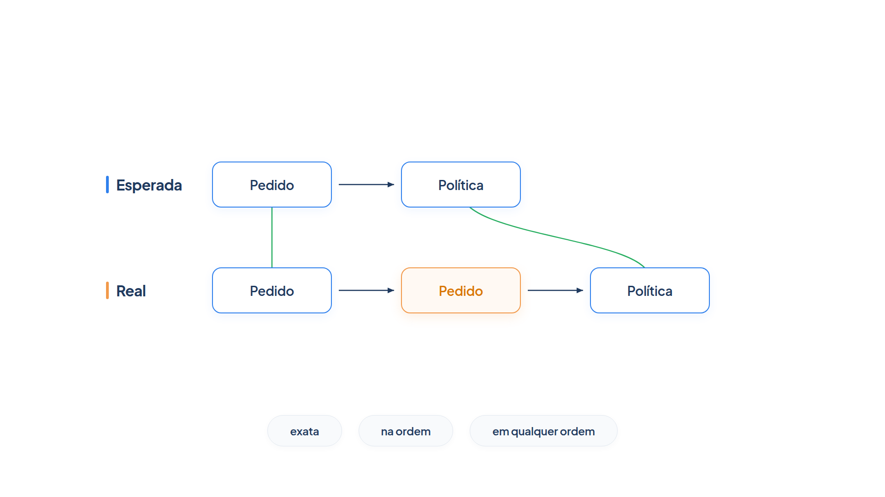

# Capítulo 31 — Trajetória e uso de ferramentas

O Capítulo 30 avaliou a resposta final. Mas um agente que acerta a resposta sem consultar o pedido pode estar apenas chutando bem, e um que consulta cinco vezes a mesma ferramenta acerta caro. Neste capítulo, você passa a avaliar o *caminho*: a sequência de ferramentas que o agente chamou. Você aprende as métricas de trajetória, aplica-as com a biblioteca `pydantic-evals`, e mede uma propriedade que a avaliação de uma execução só não mostra: a confiabilidade ao longo de várias tentativas.



> **Antes de começar — PydanticAI neste capítulo**
>
> Neste capítulo você usa `Agent` e `.run` (com `await`) por meio do `atendente`, e as ferramentas que ele chama. Se algum deles não for familiar, revise o [Capítulo 0.4](../modulo-00/0.4-o-primeiro-agente-por-dentro.md) e o [Capítulo 0.6](../modulo-00/0.6-ferramentas-e-saida-tipada.md). O modelo simulado `roteirizado()` segue a ideia do [Capítulo 0.5](../modulo-00/0.5-mensagens-e-testes-sem-api.md).

## A trajetória

Um agente costuma executar várias ações antes de responder: consultar o histórico, buscar uma política, chamar uma API. Cada ação é um passo em um caminho, a **trajetória**. Comparar a trajetória *esperada* com a *real* é útil, em especial, para depurar: revela erros e ineficiências, e é um caminho para melhorar o desempenho.

O guia do Google sobre avaliação recomenda duas abordagens para começar, ambas práticas: avaliar a **resposta final** e avaliar a **trajetória**. O Capítulo 30 cobriu a primeira; este cobre a segunda.

## Seis métricas de trajetória

O guia lista seis métricas automáticas, baseadas em uma trajetória de referência, cada uma uma lente diferente:

1. **Correspondência exata:** a trajetória real tem de espelhar a ideal. É a métrica mais rígida: não admite desvio.
2. **Correspondência na ordem:** o agente deve concluir os passos esperados na ordem, mas ações extras não são penalizadas.
3. **Correspondência em qualquer ordem:** ignora a ordem e pergunta apenas se todas as ações necessárias aparecem, admitindo passos extras.
4. **Precisão:** das chamadas feitas, quantas são relevantes ou corretas segundo a referência?
5. **Revocação:** das chamadas essenciais da referência, quantas aparecem na trajetória real?
6. **Uso de uma ferramenta específica:** a ação aparece na trajetória? Útil para saber se o agente já aprendeu a usar certa ferramenta.

Elas não são excludentes: cada uma responde a uma pergunta, e nem todas valem para toda situação. Há casos que exigem fidelidade estrita ao caminho ideal, e outros que permitem desvios criativos. Uma limitação deve ficar clara: para usar qualquer uma delas, você precisa de uma trajetória de referência.

Para entender cada métrica, vamos implementá-las. São pequenas funções sobre listas de nomes de ferramenta.

*metricas_de_trajetoria.py*

```python
from collections import Counter


def exata(real: list[str], esperada: list[str]) -> float:
    return 1.0 if real == esperada else 0.0


def f1(precisao: float, revocacao: float) -> float:
    return 0.0 if precisao + revocacao == 0 else 2 * precisao * revocacao / (precisao + revocacao)


def _maior_subsequencia(a: list[str], b: list[str]) -> int:
    tabela = [[0] * (len(b) + 1) for _ in range(len(a) + 1)]
    for i, x in enumerate(a, start=1):
        for j, y in enumerate(b, start=1):
            tabela[i][j] = tabela[i - 1][j - 1] + 1 if x == y else max(tabela[i - 1][j], tabela[i][j - 1])
    return tabela[-1][-1]


def na_ordem(real: list[str], esperada: list[str]) -> float:
    """F1 sobre a maior subsequência comum: chamadas extras custam precisão; faltantes, revocação."""
    comum = _maior_subsequencia(real, esperada)
    if not real and not esperada:
        return 1.0
    precisao = comum / len(real) if real else 0.0
    revocacao = comum / len(esperada) if esperada else 0.0
    return f1(precisao, revocacao)


def em_qualquer_ordem(real: list[str], esperada: list[str]) -> float:
    comum = sum((Counter(real) & Counter(esperada)).values())
    if not real and not esperada:
        return 1.0
    precisao = comum / len(real) if real else 0.0
    revocacao = comum / len(esperada) if esperada else 0.0
    return f1(precisao, revocacao)


def precisao(real: list[str], esperada: list[str]) -> float:
    comum = sum((Counter(real) & Counter(esperada)).values())
    return comum / len(real) if real else 1.0


def revocacao(real: list[str], esperada: list[str]) -> float:
    comum = sum((Counter(real) & Counter(esperada)).values())
    return comum / len(esperada) if esperada else 1.0


def usou_a_ferramenta(real: list[str], ferramenta: str) -> bool:
    return ferramenta in real
```

Leia as funções em duas ideias. **Precisão** e **revocacao** medem, respectivamente, "do que o agente fez, quanto era necessário" e "do que era necessário, quanto o agente fez". O **F1** é a média harmônica das duas: só é alto quando ambas são altas. Para a correspondência na ordem, a "parte em comum" é a *maior subsequência comum* (LCS): a maior sequência de ferramentas que aparece nas duas trajetórias na mesma ordem relativa, ainda que haja outras no meio. Para a correspondência em qualquer ordem, a parte em comum é a interseção dos multiconjuntos: contam-se as ferramentas, sem olhar a posição.

Aplicamos as métricas a quatro cenários, para uma trajetória esperada de duas chamadas:

*metricas_demo.py*

```python
from metricas_de_trajetoria import (
    em_qualquer_ordem, exata, na_ordem, precisao, revocacao, usou_a_ferramenta,
)

ESPERADA = ["consultar_pedido", "consultar_politica"]

CENARIOS = {
    "igual à esperada": ["consultar_pedido", "consultar_politica"],
    "com uma chamada extra": ["consultar_pedido", "consultar_pedido", "consultar_politica"],
    "ordem trocada": ["consultar_politica", "consultar_pedido"],
    "falta uma chamada": ["consultar_pedido"],
}

print(f"Esperada: {ESPERADA}\n")
print(f"{'cenário':24s} exata na_ordem qualquer prec. revoc.")
for nome, real in CENARIOS.items():
    print(f"{nome:24s} {exata(real, ESPERADA):5.2f} {na_ordem(real, ESPERADA):8.2f} "
          f"{em_qualquer_ordem(real, ESPERADA):7.2f} {precisao(real, ESPERADA):5.2f} {revocacao(real, ESPERADA):6.2f}")

print("\nUsou consultar_politica?")
for nome, real in CENARIOS.items():
    print(f"  {nome:24s} {usou_a_ferramenta(real, 'consultar_politica')}")
```

Saída:

```text
Esperada: ['consultar_pedido', 'consultar_politica']

cenário                  exata na_ordem qualquer prec. revoc.
igual à esperada          1.00     1.00    1.00  1.00   1.00
com uma chamada extra     0.00     0.80    0.80  0.67   1.00
ordem trocada             0.00     0.50    1.00  1.00   1.00
falta uma chamada         0.00     0.67    0.67  1.00   0.50

Usou consultar_politica?
  igual à esperada          True
  com uma chamada extra     True
  ordem trocada             True
  falta uma chamada         False
```

Cada linha ensina algo:

- **Com uma chamada extra.** A exata zera, porque o caminho não é idêntico. Na ordem e em qualquer ordem dão 0,80: o agente fez tudo o que devia (revocação 1,00), mas gastou uma chamada à toa (precisão 0,67). É o sinal de *ineficiência*.
- **Ordem trocada.** A exata zera e a na-ordem cai para 0,50, mas em qualquer ordem dá 1,00: o agente fez as chamadas certas, em ordem diferente. Se a ordem não importa para o resultado, essa métrica é a adequada; se importa (consultar o pedido antes de aplicar a política), a que a exige.
- **Falta uma chamada.** A precisão é 1,00 (tudo o que o agente fez era necessário), mas a revocação é 0,50: faltou metade. É o sinal de *omissão*.

Em resumo, a precisão detecta o desperdício e a revocação detecta a omissão. Olhar só a nota final de uma métrica combinada esconde qual dos dois problemas ocorreu.

### Faça você mesmo

- **31.1 Seus cenários:** acrescente três cenários a `CENARIOS`, como uma chamada repetida três vezes e uma trajetória vazia, e preveja as seis métricas antes de executar.
- **31.2 Qual métrica?:** para cada tarefa do atendimento, diga qual métrica você usaria e por quê: (a) consultar o pedido e depois cancelá-lo; (b) consultar um pedido e uma política, em qualquer ordem; (c) uma pergunta que não deve acionar ferramenta alguma.
- **31.3 A fórmula do F1:** calcule à mão o F1 de uma trajetória com precisão 1,00 e revocação 0,50, e confira com a função `f1`.

## Avaliando a trajetória com `pydantic-evals`

Você não precisa implementar as métricas toda vez. A biblioteca `pydantic-evals` traz avaliadores prontos que leem as chamadas de ferramenta registradas durante a execução: `TrajectoryMatch` (que aceita as ordens `"exact"`, `"in_order"` e `"any_order"`, as três correspondências do guia), `ToolCorrectness` (confere o conjunto de ferramentas chamadas), `MaxToolCalls` e `MaxModelRequests` (limites de orçamento). Eles leem os registros que a instrumentação do `instrumentacao.py` produz.

Vamos aplicá-los ao nosso atendente. Cada caso traz a trajetória esperada, e o conjunto limita as chamadas ao modelo.

*avaliacao_de_trajetoria.py*

```python
from pydantic_evals import Case, Dataset
from pydantic_evals.evaluators import MaxModelRequests, TrajectoryMatch

from atendente import atendente
from comportamento_simulado import roteirizado


async def tarefa(pergunta: str) -> str:
    return (await atendente.run(pergunta, model=roteirizado())).output


def caso(nome, pergunta, trajetoria):
    return Case(
        name=nome,
        inputs=pergunta,
        evaluators=[TrajectoryMatch(expected_trajectory=trajetoria, order="exact")],
    )


CASOS = [
    caso("status enviado", "Onde está o pedido 1001?", ["consultar_pedido"]),
    caso("prazo de devolução", "Qual é o prazo de devolução?", ["consultar_politica"]),
    caso("cancelar já enviado", "Posso cancelar o pedido 1001?", ["consultar_pedido"]),
    caso("fora do assunto", "Qual é a capital da França?", []),
    caso("pergunta composta", "Compare os pedidos 1001 e 1002.", ["consultar_pedido", "consultar_pedido"]),
]


def conjunto() -> Dataset:
    return Dataset(name="trajetoria", cases=CASOS, evaluators=[MaxModelRequests(max_requests=3)])


if __name__ == "__main__":
    relatorio = conjunto().evaluate_sync(tarefa, progress=False)
    for c in relatorio.cases:
        trajetoria = c.scores["TrajectoryMatch"]
        orcamento = c.assertions["MaxModelRequests"].value
        print(f"{c.name:22s} trajetória={trajetoria.value:.1f}  orçamento={'ok' if orcamento else 'FALHA'}")
```

Um detalhe de projeto: o `TrajectoryMatch` é um avaliador *de caso*, passado dentro do `Case`, porque cada caso tem a sua trajetória esperada. O `MaxModelRequests` vale para todos, por isso vai no conjunto. O valor da correspondência é uma *pontuação*, e a do orçamento, uma *asserção*; o relatório as guarda em `scores` e `assertions`.

> **Por dentro do PydanticAI — `Case(evaluators=)`**
>
> **O que é:** a lista de avaliadores que valem só para aquele caso, somados aos do conjunto.
> **Como funciona aqui:** na função `caso`, cada `Case` recebe `evaluators=[TrajectoryMatch(...)]` com a trajetória esperada daquele caso. O `Dataset` ainda tem o seu próprio `evaluators=[MaxModelRequests(...)]`, que vale para todos.
> **O que o PydanticAI faz por você:** ao avaliar um caso, executa os avaliadores do caso e os do conjunto sobre a mesma execução e junta os resultados no relatório.
> **Cuidado:** passe uma lista, mesmo com um só avaliador. Se pôr a trajetória esperada no conjunto, todos os casos serão comparados com a mesma trajetória.

> **Por dentro do PydanticAI — `TrajectoryMatch`**
>
> **O que é:** um avaliador pronto que compara os nomes das ferramentas que o agente chamou com uma lista esperada e devolve uma pontuação entre 0,0 e 1,0.
> **Como funciona aqui:** em cada caso, ele recebe a lista esperada (`["consultar_pedido"]`, por exemplo) e a compara com as chamadas registradas durante `tarefa`. Por isso a pontuação aparece em `c.scores["TrajectoryMatch"]`.
> **O que o PydanticAI faz por você:** lê as chamadas de ferramenta dos registros da instrumentação; você não precisa extrair a lista real.
> **Cuidado:** sem a instrumentação ativa (o `instrumentacao.py`), não há registros e a pontuação é sempre 0,0, ainda que o agente tenha agido certo. Chamadas de ferramenta que terminaram em erro ou em `ModelRetry` não entram na trajetória, a menos que você passe `include_failed=True`.

> **Por dentro do PydanticAI — `TrajectoryMatch(expected_trajectory=)`**
>
> **O que é:** a lista ordenada de nomes de ferramenta que você espera ver, a trajetória de referência.
> **Como funciona aqui:** a função `caso` repassa o parâmetro `trajetoria`: `["consultar_pedido", "consultar_pedido"]` na pergunta composta, e `[]` na pergunta fora do assunto.
> **O que o PydanticAI faz por você:** compara cada nome com o da chamada real. Se as duas listas estiverem vazias, a nota é 1,0; se só uma estiver vazia, é 0,0.
> **Cuidado:** os nomes são os das funções registradas como ferramenta (`consultar_pedido`), não os textos dos argumentos. Uma letra diferente conta como outra ferramenta.

> **Por dentro do PydanticAI — `TrajectoryMatch(order=)`**
>
> **O que é:** escolhe o rigor da comparação: `"exact"`, `"in_order"` (o padrão) ou `"any_order"`.
> **Como funciona aqui:** com `order="exact"`, a nota é 1,0 se a trajetória real for idêntica à esperada, e 0,0 em qualquer outro caso, por isso só aparecem 1,0 e 0,0 na saída. As outras duas ordens calculam o F1 das seções anteriores: `"in_order"` pela maior subsequência comum, e `"any_order"` pela interseção dos multiconjuntos.
> **O que o PydanticAI faz por você:** implementa as três correspondências do guia, as mesmas das funções `exata`, `na_ordem` e `em_qualquer_ordem`.
> **Cuidado:** se omitir `order`, vale `"in_order"`, e a nota passa a ter valores intermediários, como 0,67.

> **Por dentro do PydanticAI — `MaxModelRequests`**
>
> **O que é:** um avaliador de orçamento: afirma que o agente fez no máximo certo número de chamadas ao modelo.
> **Como funciona aqui:** vai no `Dataset`, então vale para os cinco casos. Cada caso recebe verdadeiro ou falso, e o relatório guarda o resultado em `c.assertions["MaxModelRequests"]`.
> **O que o PydanticAI faz por você:** conta as chamadas ao modelo registradas na execução do caso.
> **Cuidado:** ele mede chamadas ao *modelo*, e não às ferramentas. Para limitar ferramentas, existe o `MaxToolCalls`. Como o `TrajectoryMatch`, também depende da instrumentação.

> **Por dentro do PydanticAI — `MaxModelRequests(max_requests=)`**
>
> **O que é:** o teto de chamadas ao modelo que o caso pode fazer, um número inteiro.
> **Como funciona aqui:** com `max_requests=3`, um caso passa com até três chamadas. Uma pergunta que consulta uma ferramenta usa duas: uma para o modelo pedir a ferramenta, outra para escrever a resposta.
> **O que o PydanticAI faz por você:** compara a contagem com o teto: `<=` dá `True` e `>` dá `False`, e guarda também o motivo, algo como "2 model request(s) (from ctx.metrics['requests']), budget=3".
> **Cuidado:** o teto é inclusivo: `max_requests=2` ainda aprovaria esses cinco casos, e `max_requests=1` reprovaria os que consultam uma ferramenta, porque eles usam duas chamadas.

Saída:

```text
status enviado         trajetória=1.0  orçamento=ok
prazo de devolução     trajetória=1.0  orçamento=ok
cancelar já enviado    trajetória=0.0  orçamento=ok
fora do assunto        trajetória=0.0  orçamento=ok
pergunta composta      trajetória=0.0  orçamento=ok
```

A avaliação de trajetória descobre o que a de resposta final não via. Releia os três casos que falharam no Capítulo 30: agora você sabe *por que*:

- **Cancelar já enviado.** A trajetória esperada era consultar o pedido, mas o agente simulado não chamou ferramenta alguma: respondeu "sim" sem olhar. Foi um chute, e o avaliador de resposta só viu a resposta errada.
- **Fora do assunto.** A trajetória esperada era vazia (recusar sem consultar), mas o agente consultou uma política à toa.
- **Pergunta composta.** Eram esperadas duas consultas de pedido, e houve uma: omissão. É o caso de revocação baixa.

Combinar as duas avaliações, de resposta e de trajetória, dá o diagnóstico completo: a resposta diz *se* o agente acertou, e a trajetória diz *como* e *se por sorte*.

### Armadilha: a trajetória exata demais

A correspondência exata é a mais frágil. Se o agente consulta o pedido e a política em ordem diferente, ou chama uma ferramenta a mais que era inofensiva, ela reprova uma execução boa. Como no Capítulo 30, não especifique passos além do necessário. Use a exata para casos em que o caminho é o requisito (uma ação de risco só pode ocorrer depois de uma consulta), e as outras ordens para o restante.

### Faça você mesmo

- **31.4 Na ordem:** troque `order="exact"` por `"in_order"` nos cinco casos e preveja quais pontuações deixam de ser 0 ou 1. Confira executando.
- **31.5 Ferramenta proibida:** use `ToolCorrectness` para afirmar que, na pergunta fora do assunto, nenhuma ferramenta é chamada, e explique a diferença para `TrajectoryMatch` com trajetória vazia.
- **31.6 Orçamento por caso:** acrescente `MaxModelRequests(max_requests=2)` apenas ao caso `status enviado` e verifique que o orçamento do caso é independente do geral.

## Confiabilidade: uma tentativa não basta

Há uma pergunta que nenhuma das avaliações acima responde: o agente acerta *sempre*? Como o modelo é estocástico, uma tarefa aprovada em uma execução pode falhar na seguinte. Por isso as avaliações usam várias **tentativas** por tarefa, e duas métricas resumem o resultado, ambas descritas pelo guia da Anthropic:

- **pass@k:** a probabilidade de obter *pelo menos uma* solução correta em *k* tentativas. Cresce com *k*. Serve a situações em que basta um sucesso, como uma ferramenta de apoio em que o usuário pode repetir.
- **pass^k:** a probabilidade de *todas* as *k* tentativas darem certo. *Diminui* com *k*. É a métrica de agentes voltados ao cliente, em que se exige confiabilidade em toda interação.

Com *p* a taxa de acerto por tentativa, e tentativas independentes, as fórmulas são `pass@k = 1 − (1 − p)^k` e `pass^k = p^k`. Em *k* = 1 elas coincidem; em *k* = 10, divergem muito.

*confiabilidade.py*

```python
import random


def pass_at_k(p: float, k: int) -> float:
    """Probabilidade de pelo menos um sucesso em k tentativas."""
    return 1 - (1 - p) ** k


def pass_hat_k(p: float, k: int) -> float:
    """Probabilidade de todas as k tentativas darem certo."""
    return p**k


def simular(p: float, tarefas: int, k: int, semente: int = 7) -> tuple[float, float]:
    sorteio = random.Random(semente)
    pelo_menos_uma = todas = 0
    for _ in range(tarefas):
        tentativas = [sorteio.random() < p for _ in range(k)]
        pelo_menos_uma += any(tentativas)
        todas += all(tentativas)
    return pelo_menos_uma / tarefas, todas / tarefas


P = 0.75
print(f"Taxa de acerto por tentativa: {P:.0%}\n")
print(" k   pass@k   pass^k   (simulado: pass@k / pass^k, 2000 tarefas)")
for k in (1, 3, 5, 10):
    empirico_a, empirico_t = simular(P, 2000, k)
    print(f"{k:2d}   {pass_at_k(P, k):6.3f}   {pass_hat_k(P, k):6.3f}   ({empirico_a:.3f} / {empirico_t:.3f})")
```

Saída:

```text
Taxa de acerto por tentativa: 75%

 k   pass@k   pass^k   (simulado: pass@k / pass^k, 2000 tarefas)
 1    0.750    0.750   (0.745 / 0.745)
 3    0.984    0.422   (0.988 / 0.426)
 5    0.999    0.237   (1.000 / 0.242)
10    1.000    0.056   (1.000 / 0.057)
```

A tabela mostra a diferença de natureza das duas métricas. Um agente que acerta 75% das vezes parece muito bom, e o pass@3 de 98% reforça a impressão: se você puder tentar três vezes, quase sempre terá um acerto. Mas o pass^3 é de 42%: em um atendimento em que *cada* conversa precisa acertar, três conversas seguidas sem erro acontecem em menos da metade das vezes. Em dez, 5,6%. As colunas simuladas, de um sorteio com semente fixa sobre 2.000 tarefas, confirmam as fórmulas.

A consequência prática: **para agentes de atendimento, olhe o pass^k**. Um 75% por tentativa é, na prática, um agente que erra com muita frequência, e é o pass^k que mostra isso.

> **Nota:** As fórmulas supõem tentativas independentes e a mesma taxa para todas as tarefas. Na realidade, as tarefas variam: algumas o agente sempre acerta, outras sempre erra. Meça o pass^k de verdade, com várias tentativas por tarefa, em vez de deduzi-lo da taxa média.

### Faça você mesmo

- **31.7 Outra taxa:** altere `P` para 0,95 e preveja o pass^10. Confira e interprete: o que um acerto de 95% por tentativa significa para um atendimento de dez interações?
- **31.8 Quantas tentativas?:** para um agente de 90% por tentativa, calcule o menor *k* em que o pass^k cai abaixo de 50%.
- **31.9 Tentativas reais:** no conjunto do Capítulo 30, com o agente real, rode cada caso cinco vezes e calcule a fração de casos aprovados nas cinco (pass^5). Compare com a taxa média por tentativa.

## Recapitulando

Você agora avalia o caminho do agente, e não só o fim: conhece as seis métricas de trajetória (exata, na ordem, em qualquer ordem, precisão, revocação e uso de uma ferramenta), sabe que a precisão revela desperdício e a revocação, omissão, e usou os avaliadores `TrajectoryMatch` e `MaxModelRequests` da biblioteca para localizar as causas das falhas do Capítulo 30. Entendeu também por que uma tentativa não basta e por que, em atendimento, o pass^k conta a história que a taxa média esconde.

Faltam as respostas que não têm um único texto correto: o tom de uma mensagem, a clareza de uma explicação. Para elas, o avaliador em código é curto, e entra um modelo como juiz. O Capítulo 32 mostra como usá-lo e, principalmente, como saber se ele merece confiança.

### Fontes do capítulo

- Google — [Whitepaper "Agents Companion"](https://www.kaggle.com/whitepaper-agent-companion): avaliação da trajetória e do uso de ferramentas; as seis métricas (correspondência exata, na ordem, em qualquer ordem, precisão, revocação e uso de uma ferramenta); a necessidade de uma trajetória de referência.
- Anthropic — [Demystifying Evals for AI Agents](https://www.anthropic.com/engineering/demystifying-evals-for-ai-agents): pass@k e pass^k; a recomendação de não especificar passos em excesso.
- Documentação do `pydantic-evals`: `TrajectoryMatch`, `ToolCorrectness`, `MaxToolCalls` e `MaxModelRequests`.
