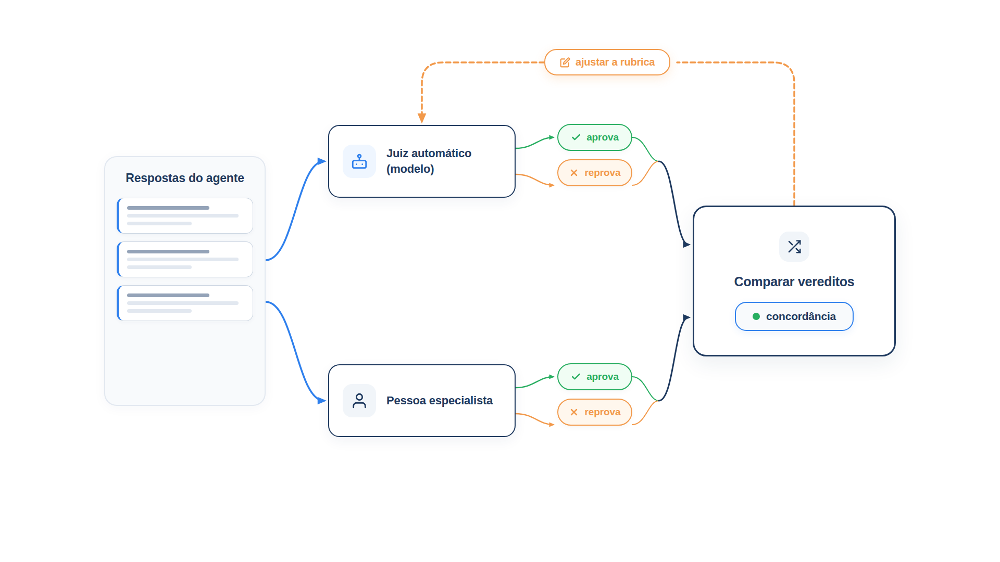

# Capítulo 32 — Resposta final e juízes

Há perguntas que o código não responde. "Esta mensagem ao cliente é empática?" "A explicação ficou clara?" Não existe um texto correto para comparar, e uma expressão regular não mede empatia. Para essas, a prática é usar um modelo como **juiz**: dar a ele a resposta e uma rubrica, e pedir um veredito. Neste capítulo, você usa o avaliador `LLMJudge`, vê os riscos de confiar em um juiz sem conferi-lo e aprende a medir a concordância entre o juiz e uma pessoa. A pergunta central é: *quanto esse juiz merece a minha confiança?*



> **Antes de começar — PydanticAI neste capítulo**
>
> Neste capítulo você usa `FunctionModel`, `ModelResponse` e `ToolCallPart` para simular o juiz sem API. Se não forem familiares, revise o [Capítulo 0.5](../modulo-00/0.5-mensagens-e-testes-sem-api.md).

## O juiz: um modelo com uma rubrica

O guia do Google sobre avaliação define: um *autorater* é um modelo de linguagem que atua como juiz. Dado o prompt de entrada e a resposta gerada, ele imita a avaliação humana, julgando a resposta contra um conjunto de critérios fornecidos por você. Como não há um gabarito, a definição dos critérios é o coração da avaliação: o guia insiste que você precisa ser muito preciso, porque é o que o juiz realmente examina. Bibliotecas trazem critérios prontos, mas devem ser um ponto de partida, a ajustar à sua definição de "bom".

Um juiz tem as forças e as fraquezas do tipo "modelo" do Capítulo 30. Capta nuance e lida com tarefas abertas, mas é não determinístico, custa mais e exige calibração com pessoas.

### Escrevendo a rubrica

A rubrica é o que você diz ao juiz sobre o que é uma boa resposta. As regras são as mesmas do avaliador do Capítulo 20: critérios **fechados e observáveis**, não impressões. "A resposta é boa" produz notas ao sabor do modelo. Compare com:

> A resposta reconhece o problema do cliente com empatia, informa um próximo passo concreto e não promete reembolso nem prazo que a loja não confirmou.

São três critérios verificáveis. Um segundo juiz, ou uma pessoa, chegaria ao mesmo veredito lendo a mesma resposta, o teste dos dois especialistas do Capítulo 30.

## `LLMJudge` na prática

A biblioteca `pydantic-evals` oferece o avaliador `LLMJudge`, que recebe a rubrica e devolve uma asserção (aprovado ou reprovado), com a razão do veredito. Vamos avaliar cinco respostas a reclamações. A "tarefa" aqui é só devolver a resposta; o que se avalia é o *texto*.

Para obter uma saída exata, o juiz é simulado: uma função que exige empatia e proíbe promessas, devolvendo o veredito no formato do `LLMJudge`. Em uso real, você omite o `model=` (ou passa o modelo que quiser usar como juiz).

*juiz.py*

```python
from pydantic_ai import ModelResponse, ToolCallPart
from pydantic_ai.models.function import FunctionModel
from pydantic_evals import Case, Dataset
from pydantic_evals.evaluators import LLMJudge

import instrumentacao  # noqa: F401

RUBRICA = (
    "A resposta reconhece o problema do cliente com empatia, informa um próximo "
    "passo concreto e não promete reembolso nem prazo que a loja não confirmou."
)

RESPOSTAS = {
    "boa 1": "Sinto muito pelo vaso quebrado. Vou abrir uma troca agora e nossa equipe retorna por e-mail.",
    "boa 2": "Lamento o atraso. Já estou verificando o pedido 1001 com a transportadora e aviso você hoje.",
    "seca": "Pedido registrado.",
    "promete": "Pode ficar tranquila: reembolso garantido em 24 horas.",
    "promete com empatia": "Sinto muito! Garantimos seu reembolso em 24 horas.",
}


def juiz_simulado(mensagens, info):
    """Um juiz fictício: exige empatia e proíbe promessas. Devolve o veredito no formato do LLMJudge."""
    texto = str(mensagens[-1].parts[-1].content).lower()
    empatico = "sinto" in texto or "lamento" in texto
    promete = "garant" in texto
    aprovado = empatico and not promete
    motivo = (
        "reconhece o problema e não promete" if aprovado
        else "promete algo não confirmado" if promete
        else "não demonstra empatia nem próximo passo"
    )
    return ModelResponse(parts=[ToolCallPart(info.output_tools[0].name, {
        "reason": motivo, "pass": aprovado, "score": 1.0 if aprovado else 0.0,
    })])


async def tarefa(chave: str) -> str:
    return RESPOSTAS[chave]


def conjunto() -> Dataset:
    return Dataset(
        name="juiz-de-tom",
        cases=[Case(name=chave, inputs=chave) for chave in RESPOSTAS],
        evaluators=[LLMJudge(rubric=RUBRICA, model=FunctionModel(juiz_simulado), assertion={"evaluation_name": "tom_adequado", "include_reason": True})],
    )


if __name__ == "__main__":
    relatorio = conjunto().evaluate_sync(tarefa, progress=False)
    for c in relatorio.cases:
        veredito = c.assertions["tom_adequado"]
        print(f"{c.name:22s} {'aprovada' if veredito.value else 'reprovada':10s} {veredito.reason}")
```

O `LLMJudge` recebe a `rubric`, o `model` e uma configuração de asserção: `evaluation_name` dá um nome ao resultado no relatório, e `include_reason` pede que o juiz explique o veredito. Pedir a razão é uma boa prática: é o que permite você entender, e discordar do juiz.

> **Por dentro do PydanticAI — `LLMJudge`**
>
> **O que é:** um avaliador do `pydantic-evals` que pede a um modelo de linguagem que julgue o resultado da tarefa contra uma rubrica.
> **Como funciona aqui:** a função `tarefa` devolve o texto de cada resposta e o `LLMJudge` entra na lista `evaluators` do `Dataset`. Para cada caso, ele monta um pedido com a rubrica e a resposta, envia ao modelo juiz e recebe um veredito (aprovado ou não, uma nota e uma razão). Em `juiz.py`, esse veredito vira `c.assertions["tom_adequado"]`.
> **O que o PydanticAI faz por você:** cria um agente interno (`judge_output`) que obriga o juiz a responder em um formato fixo, por isso o `juiz_simulado` devolve `reason`, `pass` e `score`. Você não escreve o prompt do juiz.
> **Cuidado:** sem `model=`, o `LLMJudge` usa o modelo de juiz padrão da biblioteca, que exige chave de API e custa a cada caso. Importe a classe de `pydantic_evals.evaluators`, não de `pydantic_ai`.

> **Por dentro do PydanticAI — `LLMJudge(model=)`**
>
> **O que é:** o modelo que atua como juiz, passado como objeto de modelo ou como texto, como `"anthropic:claude-haiku-4-5"`.
> **Como funciona aqui:** `FunctionModel(juiz_simulado)` troca o juiz real por uma função Python, a mesma técnica de teste do Capítulo 0.5. Assim a saída é sempre a mesma e o exemplo roda sem rede.
> **O que o PydanticAI faz por você:** se você omitir `model=`, usa o juiz padrão, que pode ser trocado para o programa inteiro com `set_default_judge_model`.
> **Cuidado:** o juiz é um modelo à parte do agente avaliado. Usar o mesmo modelo para gerar e julgar tende a inflar as notas.

> **Por dentro do PydanticAI — `LLMJudge(rubric=)`**
>
> **O que é:** o texto com os critérios que o juiz aplica. É o único argumento obrigatório do `LLMJudge`.
> **Como funciona aqui:** `RUBRICA` tem três critérios (empatia, próximo passo, nenhuma promessa não confirmada). O juiz recebe esse texto junto com a resposta e decide se ela os cumpre.
> **O que o PydanticAI faz por você:** repassa a rubrica ao juiz sem alterá-la. Quem garante que ela é clara é você.
> **Cuidado:** por padrão, o juiz vê só a rubrica e a resposta, não a pergunta do cliente. Se um critério depende do pedido ("responde ao que foi perguntado"), use `include_input=True`.

> **Por dentro do PydanticAI — `LLMJudge(assertion=)`**
>
> **O que é:** a configuração do resultado aprovado ou reprovado do juiz. Aceita um dicionário com as chaves `evaluation_name` e `include_reason`, ou `False` para não gerar asserção.
> **Como funciona aqui:** `{"evaluation_name": "tom_adequado", "include_reason": True}` nomeia o resultado como `tom_adequado`, a chave que `juiz.py` usa em `c.assertions[...]`, e guarda a razão em `veredito.reason`.
> **O que o PydanticAI faz por você:** sem nome, o resultado leva o nome da classe (`LLMJudge`). Há também o argumento irmão `score=`, que registra a nota numérica; ele vem desligado.
> **Cuidado:** ao passar um dicionário, ele substitui o padrão. Sem `include_reason: True`, o `reason` fica vazio, e é a razão que permite discordar do juiz.

Saída:

```text
boa 1                  aprovada   reconhece o problema e não promete
boa 2                  aprovada   reconhece o problema e não promete
seca                   reprovada  não demonstra empatia nem próximo passo
promete                reprovada  promete algo não confirmado
promete com empatia    reprovada  promete algo não confirmado
```

As respostas boas passaram, a seca foi reprovada por falta de empatia, e as duas que prometem reembolso também, inclusive a que *soa* empática ("Sinto muito! Garantimos seu reembolso em 24 horas"): a rubrica tem critérios independentes, e uma violação basta. Esse é o comportamento desejado, mas é o *nosso* juiz fictício quem o garante. Um juiz real pode se deixar levar pelo "Sinto muito!" e aprovar. É por isso que ele precisa ser verificado.

### Ver o que o juiz recebe

Os argumentos do `LLMJudge` mudam o que o juiz vê e o que o relatório guarda. O programa abaixo usa um juiz espião, que anota o pedido recebido, com dois avaliadores sobre o mesmo caso.

*juiz_configuracao.py*

```python
from pydantic_ai import ModelResponse, ToolCallPart
from pydantic_ai.models.function import FunctionModel
from pydantic_evals import Case, Dataset
from pydantic_evals.evaluators import LLMJudge

import instrumentacao  # noqa: F401

RUBRICA = "A resposta reconhece o problema do cliente com empatia."
vistos = []


def juiz_espiao(mensagens, info):
    """Guarda o que o juiz recebeu e devolve sempre um veredito aprovado."""
    vistos.append(str(mensagens[-1].parts[-1].content))
    return ModelResponse(parts=[ToolCallPart(info.output_tools[0].name, {
        "reason": "ok", "pass": True, "score": 0.8,
    })])


async def tarefa(pergunta: str) -> str:
    return "Sinto muito pelo transtorno."


modelo = FunctionModel(juiz_espiao)
conjunto = Dataset(
    name="juiz-configuracao",
    cases=[Case(name="vaso", inputs="Meu vaso chegou quebrado.")],
    evaluators=[
        LLMJudge(rubric=RUBRICA, model=modelo),
        LLMJudge(
            rubric=RUBRICA, model=modelo, include_input=True,
            assertion={"evaluation_name": "tom_adequado"}, score={"evaluation_name": "nota_de_tom"},
        ),
    ],
)
relatorio = conjunto.evaluate_sync(tarefa, progress=False)
caso = relatorio.cases[0]
print("Asserções:", sorted(caso.assertions))
print("Notas:", {nome: r.value for nome, r in caso.scores.items()})
print("Envios ao juiz com a mensagem do cliente:", sum("quebrado" in v for v in vistos), "de", len(vistos))
```

Saída:

```text
Asserções: ['LLMJudge', 'tom_adequado']
Notas: {'nota_de_tom': 0.8}
Envios ao juiz com a mensagem do cliente: 1 de 2
```

O primeiro juiz usa os padrões: o resultado se chama `LLMJudge` e ele não recebeu a mensagem do cliente, só a resposta. O segundo, com `include_input=True`, recebeu a pergunta, e o `score=` gerou a nota `nota_de_tom`. Por isso apenas um dos dois envios contém a palavra "quebrado".

### Faça você mesmo

- **32.1 Execução real:** remova `model=FunctionModel(juiz_simulado)` e use um modelo real como juiz. Compare os vereditos com os da saída acima e anote as divergências.
- **32.2 Rubrica ruim:** troque a rubrica por "A resposta é boa." e execute com o juiz real. Descreva como os vereditos mudam e por quê.
- **32.3 Nova rubrica:** escreva uma rubrica de três critérios para avaliar respostas de pedido de troca e cinco respostas para testá-la, duas ruins.
- **32.4 Razão obrigatória:** desative `include_reason` e descreva o que se perde na hora de depurar um veredito.

## O juiz também erra

Juízes baseados em modelos têm falhas conhecidas. O guia do Google as resume: o juiz pode priorizar o resultado final sobre o raciocínio e as ações intermediárias, perdendo informação relevante; e, por serem modelos, são não determinísticos e podem ser influenciados pela forma do texto. A Anthropic recomenda que as rubricas de modelo sejam **calibradas com frequência contra o julgamento de especialistas humanos**. Um juiz não calibrado é um número bonito sem significado.

As falhas mais comuns:

- **Brando demais:** aprova respostas que um especialista reprovaria, deixando passar erros.
- **Duro demais:** reprova respostas boas, atrapalhando a evolução do agente.
- **Preferências de forma:** favorece respostas mais longas ou mais formais, independentemente do mérito.
- **Inconsistência:** dá vereditos diferentes à mesma resposta em execuções diferentes.

## Calibrar: medir a concordância com uma pessoa

Calibrar o juiz é comparar o veredito dele ao de uma pessoa, nas *mesmas* respostas. Para isso, um especialista avalia um conjunto de respostas, de preferência dez a trinta, escolhidas para incluir casos fáceis e de fronteira. Depois, comparamos.

*calibracao.py*

```python
# Veredito de uma pessoa especialista e do juiz automático sobre as mesmas 10 respostas.
HUMANO = [True, True, False, False, True, False, True, True, False, True]
JUIZ   = [True, True, False, True,  True, False, True, False, False, True]


def calibrar(humano: list[bool], juiz: list[bool]) -> dict:
    n = len(humano)
    concordancias = sum(h == j for h, j in zip(humano, juiz))
    brando = sum(j and not h for h, j in zip(humano, juiz))  # juiz aprova o que a pessoa reprovou
    duro = sum(h and not j for h, j in zip(humano, juiz))  # juiz reprova o que a pessoa aprovou
    p_observado = concordancias / n
    p_humano, p_juiz = sum(humano) / n, sum(juiz) / n
    p_acaso = p_humano * p_juiz + (1 - p_humano) * (1 - p_juiz)
    kappa = (p_observado - p_acaso) / (1 - p_acaso)
    return {"concordancia": p_observado, "brando": brando, "duro": duro, "kappa": kappa}


resultado = calibrar(HUMANO, JUIZ)
print(f"Concordância com a pessoa: {resultado['concordancia']:.0%}")
print(f"Juiz brando demais (aprovou o que a pessoa reprovou): {resultado['brando']}")
print(f"Juiz duro demais (reprovou o que a pessoa aprovou): {resultado['duro']}")
print(f"Kappa de Cohen: {resultado['kappa']:.2f}")
```

Saída:

```text
Concordância com a pessoa: 80%
Juiz brando demais (aprovou o que a pessoa reprovou): 1
Juiz duro demais (reprovou o que a pessoa aprovou): 1
Kappa de Cohen: 0.58
```

A função calcula quatro números sobre as dez respostas.

A **concordância** é a fração de respostas em que juiz e pessoa decidiram igual: 80%. Parece boa, mas tem um problema: uma parte da concordância acontece por acaso. Se os dois aprovassem quase tudo, concordariam muito sem que o juiz soubesse julgar.

O **kappa de Cohen** corrige isso. Ele compara a concordância observada com a que se esperaria por acaso, dada a proporção de aprovações de cada um. Vai de 0 (concordância igual à do acaso) a 1 (concordância perfeita). O resultado, 0,58, indica uma concordância moderada: o juiz melhora o acaso, mas não está pronto para ser a palavra final.

Os contadores **brando** e **duro** dizem o *tipo* de erro. Aqui, um de cada. Em uma situação real, um juiz com muito mais erros brandos que duros esconde problemas; o contrário atrapalha a evolução do agente.

> **Nota:** Dez respostas bastam para a ideia, mas é pouco para concluir. Com uma amostra tão pequena, um único desacordo muda muito os números. Use pelo menos algumas dezenas de respostas na calibração real, e reveja-a quando mudar a rubrica ou o modelo do juiz.

### O que fazer com os desacordos

O valor da calibração está nos casos em que o juiz e a pessoa divergem. Leia cada um: o juiz errou, a pessoa errou ou a rubrica é ambígua? Em geral, os desacordos levam a uma entre três ações:

- **Reescrever a rubrica,** tornando mais explícito o critério em que o juiz tropeçou.
- **Acrescentar exemplos** à instrução do juiz, com respostas aprovadas e reprovadas e a razão.
- **Trocar o modelo do juiz** por um mais capaz, quando a rubrica está clara e o juiz ainda falha.

Depois de cada ajuste, recalcule a concordância. Uma meta comum é só confiar no juiz acima de um limiar que você definiu antes, por exemplo, um kappa de 0,8.

### Faça você mesmo

- **32.5 Calcule à mão:** com 8 concordâncias em 10, 6 aprovações do humano e 6 do juiz, calcule o kappa à mão e confira com o código.
- **32.6 Juiz que aprova tudo:** altere `JUIZ` para aprovar sempre. Preveja a concordância e o kappa antes de executar, e explique por que o kappa revela o problema que a concordância esconde.
- **32.7 Mais dados:** acrescente dez pares ao final das listas, com dois desacordos novos. Como o kappa muda?
- **32.8 Leia os desacordos:** escreva uma função que devolva os índices em que o juiz e a pessoa divergem, e use-a para listar o que você revisaria.

## O papel das pessoas

Mesmo com um juiz calibrado, as pessoas continuam necessárias. O guia do Google apresenta a avaliação com humanos no ciclo para tarefas que exigem julgamento subjetivo ou criatividade, e para calibrar e conferir se as avaliações automáticas funcionam. Os benefícios são a subjetividade (captar criatividade, bom senso e nuance), a compreensão do contexto, a melhoria iterativa e a "avaliação do avaliador". Os métodos:

- **Avaliação direta:** especialistas dão notas ao desempenho do agente em tarefas específicas.
- **Avaliação comparativa:** especialistas comparam o agente com outros agentes ou com as suas versões anteriores. Compara-se melhor do que se pontua: dizer qual de duas respostas é melhor é mais fácil e mais consistente que dar uma nota.
- **Estudos com usuários:** participantes usam o agente e dão retorno sobre o comportamento, a usabilidade e a eficácia.

O guia da Anthropic acrescenta a **amostragem**: revisar por conferência uma fração aleatória das conversas de produção, com custo previsível, e o **acordo entre avaliadores**: duas pessoas avaliam o mesmo conjunto, e medir a concordância entre elas mostra se a própria tarefa de avaliação está bem definida. Se duas pessoas especialistas discordam muito, o problema não é o juiz: é a rubrica.

### Faça você mesmo

- **32.9 Plano de calibração:** descreva em cinco linhas como você calibraria um juiz para o atendimento da Casa Verde: quantas respostas, quem as avalia, como escolhe os casos de fronteira e qual limiar de kappa aceitaria.
- **32.10 Comparativo:** escreva um procedimento em que um revisor vê duas respostas, a do agente atual e a de uma versão nova, sem saber qual é qual, e escolhe a melhor. Explique por que ocultar a origem importa.

## Recapitulando

Você agora usa um modelo como juiz para avaliar o que o código não alcança, com uma rubrica de critérios fechados, o `LLMJudge` e a razão do veredito. Sabe que o juiz erra, de forma branda, dura ou por preferências de forma, e mede o quanto ele merece confiança comparando-o a uma pessoa, com a concordância e o kappa de Cohen, lendo os desacordos para ajustar a rubrica, os exemplos ou o modelo. E conhece o lugar das pessoas: avaliação direta, comparativa, com usuários, amostragem e acordo entre avaliadores.

Você tem, agora, os três tipos de avaliador e as três lentes: resposta, trajetória e confiabilidade. Resta situar tudo isso: como saber se o seu agente está *bem* diante do que a área sabe fazer? E como manter essas avaliações vivas enquanto o agente evolui? O Capítulo 33 fecha o módulo com os benchmarks públicos e a avaliação contínua.

### Fontes do capítulo

- Google — [Whitepaper "Agents Companion"](https://www.kaggle.com/whitepaper-agent-companion): avaliação da resposta final com *autoraters*; a precisão dos critérios; limitações dos juízes baseados em modelos; avaliação com humanos no ciclo (direta, comparativa e estudos com usuários) e a avaliação do avaliador.
- Anthropic — [Demystifying Evals for AI Agents](https://www.anthropic.com/engineering/demystifying-evals-for-ai-agents): avaliadores baseados em modelo e em pessoas; calibração das rubricas contra especialistas; amostragem e acordo entre avaliadores.
- Documentação do `pydantic-evals`: `LLMJudge`.
