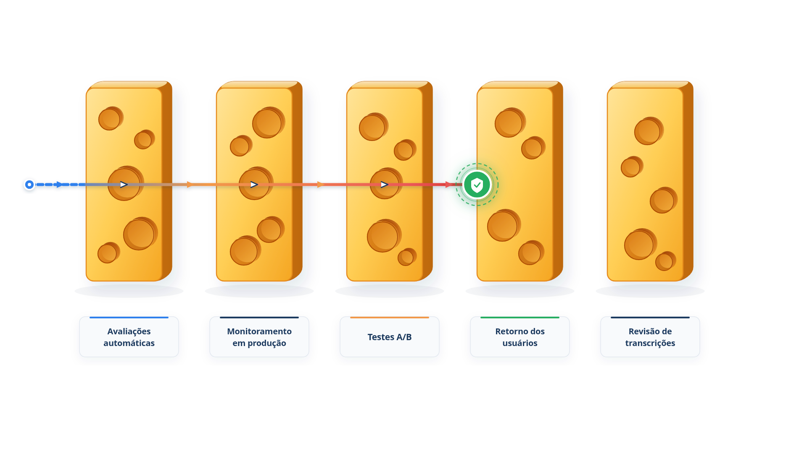

# Capítulo 33 — Benchmarks e avaliação contínua

Você sabe montar tarefas, avaliar respostas e trajetórias e calibrar um juiz. Duas perguntas ficam em aberto. Primeiro: *o que é um bom resultado?* Se o seu agente acerta 70% das tarefas, isso é muito ou pouco? Segundo: como manter essas avaliações úteis enquanto o agente muda, semana após semana? Este capítulo responde às duas. Para a primeira, apresenta o GAIA, um benchmark de referência que ajuda a calibrar expectativas. Para a segunda, monta o portão de regressão que roda a cada mudança e mostra como combinar avaliações automáticas com outras fontes de evidência.



> **Antes de começar — PydanticAI neste capítulo**
>
> Neste capítulo você usa `Agent` e `.run` (com `await`) por meio do `atendente` e da função `tarefa`, que o `portao.py` importa do Capítulo 30. Se algum deles não for familiar, revise o [Capítulo 0.4](../modulo-00/0.4-o-primeiro-agente-por-dentro.md). O modelo simulado `roteirizado()` segue a ideia do [Capítulo 0.5](../modulo-00/0.5-mensagens-e-testes-sem-api.md).

## Benchmarks públicos: para que servem

Um *benchmark* é um conjunto de tarefas padronizadas, com avaliação definida, que permite comparar sistemas. O guia do Google recomenda olhá-los *antes* de avaliar o seu caso de uso, porque oferecem uma ideia das capacidades e limitações essenciais dos modelos. Há benchmarks para as capacidades fundamentais, como o uso de funções (o Berkeley Function-Calling Leaderboard e o τ-bench), para planejamento e raciocínio (o PlanBench) e para desempenho de ponta a ponta (o AgentBench). A Anthropic cita, por tipo de agente: SWE-bench Verified e Terminal-Bench para programação, τ-bench para agentes conversacionais, BrowseComp para pesquisa e WebArena e OSWorld para uso de computador.

Os benchmarks públicos são um bom ponto de partida, mas não substituem as suas próprias tarefas, por dois motivos: medem o *modelo* em situações genéricas, e não o *seu sistema* no seu domínio; e ficam saturados com o tempo. O SWE-bench Verified, por exemplo, começou o último ano em torno de 30%, e os modelos de ponta se aproximam de 80%: com a saturação, o benchmark deixa de dar sinal de melhoria.

## O GAIA

O **GAIA** (*A Benchmark for General AI Assistants*, de 2023) é um benchmark de referência para assistentes de IA gerais. Sua filosofia vai na contramão da tendência de buscar tarefas cada vez mais difíceis *para humanos*, como provas de direito ou de química. O GAIA propõe perguntas do mundo real que exigem capacidades fundamentais, como raciocínio, tratamento de múltiplas modalidades, navegação na web e, em geral, uso de ferramentas, e que são **conceitualmente simples para pessoas**, mas difíceis para as IAs mais avançadas.

O resultado inicial foi forte: pessoas acertaram 92% das perguntas, e o GPT-4 equipado com *plugins*, 15%. Os autores veem nessa diferença uma pista: o caminho para sistemas gerais passaria por exibir a robustez de uma pessoa comum nessas perguntas. Mesmo com ferramentas, o GPT-4 não passava de 30% nas tarefas mais fáceis e chegava a 0% nas mais difíceis. O conjunto tem 466 perguntas, e as respostas de 300 delas foram mantidas em segredo, para alimentar um *leaderboard*.

### Os três níveis

As perguntas se dividem em níveis de dificuldade, definidos por uma medida aproximada: o número de passos e de ferramentas que as pessoas usaram para resolvê-las.

- **Nível 1:** em geral, nenhuma ferramenta, ou no máximo uma, e não mais de cinco passos.
- **Nível 2:** mais passos, aproximadamente entre cinco e dez, combinando ferramentas diferentes.
- **Nível 3:** sequências arbitrariamente longas de ações, com qualquer número de ferramentas e acesso ao mundo em geral.

Essas definições não são limites rígidos, e o próprio artigo diz que uma pergunta com poucos passos, mas navegação complexa, pode ser classificada em nível superior. Vale reproduzir a ideia no seu domínio: a função `nivel`, mais adiante, classifica as suas tarefas pelo mesmo critério.

### Quatro propriedades de uma boa avaliação

O GAIA é instrutivo porque cumpre, por desenho, propriedades que você também deve buscar nas suas tarefas:

- **Dificuldade real, com enunciados simples.** A pergunta é fácil de entender, e difícil de resolver.
- **Resistência a "jogar o sistema".** Responder exige completar uma série de passos; não é possível acertar por sorte ou por cópia.
- **Facilidade de uso.** As respostas são **factuais, concisas e sem ambiguidade**: um número, poucas palavras ou uma lista. Isso permite uma conferência simples, rápida e objetiva.
- **Resposta única.** Cada pergunta tem uma só resposta correta.

A terceira e a quarta propriedades fazem a avaliação ser feita por uma conferência **quase exata**: a resposta do sistema é normalizada (ajustes de forma, como formato de número ou artigos) e comparada ao gabarito. É o avaliador em código mais robusto que você pode ter.

*conferencia_quase_exata.py*

```python
import re
import unicodedata

ARTIGOS = {"o", "a", "os", "as", "um", "uma"}


def _sem_acento(texto: str) -> str:
    decomposto = unicodedata.normalize("NFD", texto)
    return "".join(c for c in decomposto if unicodedata.category(c) != "Mn")


def _como_numero(texto: str) -> float | None:
    limpo = re.sub(r"[R$%\s]", "", texto)
    if "," in limpo:
        limpo = limpo.replace(".", "").replace(",", ".")
    try:
        return float(limpo)
    except ValueError:
        return None


def _normalizar_texto(texto: str) -> str:
    palavras = re.findall(r"\w+", _sem_acento(texto).casefold())
    return " ".join(p for p in palavras if p not in ARTIGOS)


def igual_quase_exato(resposta: str, gabarito: str) -> bool:
    """Compara uma resposta curta com o gabarito, ignorando diferenças de forma."""
    numero_gabarito = _como_numero(gabarito)
    if numero_gabarito is not None:
        numero_resposta = _como_numero(resposta)
        return numero_resposta is not None and abs(numero_resposta - numero_gabarito) < 1e-9
    if "," in gabarito:
        itens_g = [_normalizar_texto(i) for i in gabarito.split(",")]
        itens_r = [_normalizar_texto(i) for i in resposta.split(",")]
        return itens_g == itens_r
    return _normalizar_texto(resposta) == _normalizar_texto(gabarito)


def nivel(passos: int, ferramentas_distintas: int) -> int:
    """Nível de dificuldade no estilo do GAIA, pelo número de passos e de ferramentas."""
    if passos <= 5 and ferramentas_distintas <= 1:
        return 1
    if passos <= 10:
        return 2
    return 3
```

A função `igual_quase_exato` trata três tipos de gabarito. **Números:** tira símbolos (`R$`, `%`) e espaços e trata o formato brasileiro (`1.234,50`), comparando valores numéricos. **Listas** (gabarito com vírgulas): compara item a item, na ordem. **Textos:** ignora maiúsculas, acentos, pontuação e artigos. A função `nivel` classifica uma tarefa pelo número de passos e de ferramentas, no espírito do GAIA. Veja o resultado em sete pares:

*conferencia_demo.py*

```python
from conferencia_quase_exata import igual_quase_exato, nivel

CASOS = [
    ("R$ 1.234,50", "1234.5"),
    ("1234,5", "1234.5"),
    ("12%", "12"),
    ("Em separação", "em separacao"),
    ("o pedido 1002, o pedido 1001", "pedido 1002, pedido 1001"),
    ("o pedido 1001, o pedido 1002", "pedido 1002, pedido 1001"),
    ("cerca de 90", "90"),
]

for resposta, gabarito in CASOS:
    print(f"{resposta!r:34s} vs {gabarito!r:28s} -> {igual_quase_exato(resposta, gabarito)}")

print()
for passos, ferramentas in [(3, 1), (7, 3), (18, 5)]:
    print(f"{passos:2d} passos, {ferramentas} ferramenta(s): nível {nivel(passos, ferramentas)}")
```

Saída:

```text
'R$ 1.234,50'                      vs '1234.5'                     -> True
'1234,5'                           vs '1234.5'                     -> True
'12%'                              vs '12'                         -> True
'Em separação'                     vs 'em separacao'               -> True
'o pedido 1002, o pedido 1001'     vs 'pedido 1002, pedido 1001'   -> True
'o pedido 1001, o pedido 1002'     vs 'pedido 1002, pedido 1001'   -> False

 3 passos, 1 ferramenta(s): nível 1
 7 passos, 3 ferramenta(s): nível 2
18 passos, 5 ferramenta(s): nível 3
```

Os cinco primeiros pares mostram a tolerância à *forma*: o número com `R$` e vírgula, o percentual, o acento e o artigo. O sexto mostra que a ordem de uma lista conta, e o sétimo, que "cerca de 90" não é "90": a conferência exige uma resposta curta e limpa. Isso se resolve no enunciado da tarefa e na instrução do agente ("responda apenas com o número"), e não afrouxando o avaliador. As três últimas linhas classificam três tarefas nos níveis 1, 2 e 3.

### O que o GAIA ensina a você

Três lições práticas:

1. **Calibre expectativas.** Tarefas fáceis para uma pessoa podem ser muito difíceis para um agente que precisa encadear passos e ferramentas. Se o seu agente tropeça em perguntas de níveis 2 e 3 do *seu* domínio, não é sinal de que o problema é seu: é a natureza do trabalho.
2. **Escreva respostas conferíveis.** Quando puder, desenhe tarefas com resposta curta e única, que aceitem uma conferência quase exata. Elas são rápidas, baratas e reproduzíveis.
3. **Mantenha níveis.** Separe tarefas fáceis, médias e difíceis. As fáceis protegem contra regressões, e as difíceis dão a você o que melhorar.

### Faça você mesmo

- **33.1 Mais pares:** acrescente cinco pares a `CASOS`, incluindo uma data (`12/10` contra `12 de outubro`) e uma resposta em maiúsculas. Decida se a conferência deve aceitar a data em outro formato e ajuste o código se quiser.
- **33.2 Tarefas conferíveis:** reescreva três tarefas do conjunto do Capítulo 30 para terem resposta curta e única, e use `igual_quase_exato` como avaliador.
- **33.3 Seus níveis:** classifique as oito tarefas do Capítulo 30 em níveis 1, 2 ou 3, contando os passos e as ferramentas de uma resolução ideal.
- **33.4 Contaminação:** explique por que as respostas de parte do GAIA são mantidas em segredo e que problema isso evita para quem treina modelos.

## Do conjunto à rotina

Tarefas e avaliadores só protegem o agente se rodarem *sempre*, a cada mudança. A Anthropic descreve a evolução natural de um conjunto: à medida que as tarefas de capacidade são resolvidas, elas migram para a regressão e passam a rodar continuamente, para detectar qualquer desvio.

Em código, isso é um **portão**: um script que executa as suítes e decide se a mudança pode seguir. Separamos as tarefas do Capítulo 30 em duas suítes: as cinco que passam formam a regressão, e as três que falham, a capacidade.

*portao.py*

```python
from pydantic_evals import Dataset

from avaliacao import CASOS, tarefa
from avaliadores import ContemEsperado

REGRESSAO = {"status enviado", "status em separação", "prazo de devolução", "frete grátis", "cancelar em separação"}


def dividir() -> tuple[Dataset, Dataset]:
    regressao = [c for c in CASOS if c.name in REGRESSAO]
    capacidade = [c for c in CASOS if c.name not in REGRESSAO]
    return (
        Dataset(name="regressao", cases=regressao, evaluators=[ContemEsperado()]),
        Dataset(name="capacidade", cases=capacidade, evaluators=[ContemEsperado()]),
    )


def taxa(relatorio) -> float:
    aprovados = sum(all(r.value for r in c.assertions.values()) for c in relatorio.cases)
    return aprovados / len(relatorio.cases)


def saturada(historico: list[float], limite: float = 0.98, execucoes: int = 3) -> bool:
    return len(historico) >= execucoes and all(t >= limite for t in historico[-execucoes:])


if __name__ == "__main__":
    regressao, capacidade = dividir()
    t_regressao = taxa(regressao.evaluate_sync(tarefa, progress=False))
    t_capacidade = taxa(capacidade.evaluate_sync(tarefa, progress=False))

    print(f"Regressão : {t_regressao:.0%} (exigido: 100%) -> {'APROVADO' if t_regressao == 1.0 else 'REPROVADO: bloqueie a mudança'}")
    print(f"Capacidade: {t_capacidade:.0%} (meta: crescer) -> acompanhar; não bloqueia")
    print()
    print("Saturada com [0.97, 1.0, 1.0, 1.0]?", saturada([0.97, 1.0, 1.0, 1.0]))
    print("Saturada com [1.0, 0.9, 1.0, 1.0]?", saturada([1.0, 0.9, 1.0, 1.0]))
```

Saída:

```text
Regressão : 100% (exigido: 100%) -> APROVADO
Capacidade: 0% (meta: crescer) -> acompanhar; não bloqueia

Saturada com [0.97, 1.0, 1.0, 1.0]? True
Saturada com [1.0, 0.9, 1.0, 1.0]? False
```

As duas suítes têm regras diferentes. A **regressão** exige 100%: qualquer queda bloqueia a mudança, porque indica que algo que funcionava deixou de funcionar. A **capacidade** não bloqueia: o objetivo é ver a taxa crescer. Em uma integração contínua, o script terminaria com um código de saída diferente de zero quando a regressão reprova, e a plataforma recusaria a mudança.

A função `saturada` detecta o que a Anthropic chama de **saturação**: uma suíte em que todas as tarefas passam sempre não dá sinal de melhoria. Aqui, três execuções seguidas com 98% ou mais. Quando uma suíte satura, é hora de acrescentar tarefas mais difíceis, e não de comemorar.

> **Armadilha — suíte vazia no portão**
>
> A função `taxa` divide por `len(relatorio.cases)`. Se um filtro de `dividir` não selecionar nenhum caso (por exemplo, por um erro de digitação em `REGRESSAO`), o `Dataset` é criado sem casos, `evaluate_sync` devolve um relatório com `cases` vazio e `taxa` falha com `ZeroDivisionError: division by zero`. O erro é bom: um portão que "aprovasse" uma suíte vazia daria falsa confiança. Confira o nome de cada caso com o de `CASOS` no Capítulo 30.

### Manter a suíte saudável

Algumas práticas, do guia da Anthropic, mantêm as avaliações úteis ao longo do tempo:

- **Uma equipe responsável** pela infraestrutura central de avaliação, com especialistas de domínio e times de produto contribuindo com tarefas.
- **Desenvolvimento dirigido por avaliações:** escreva as avaliações *antes* de o agente ter a capacidade, e itere até ela passar.
- **Alimentação por falhas reais:** cada falha em produção vira uma tarefa nova.
- **Leitura periódica de transcrições,** para conferir se os avaliadores continuam justos.

### Faça você mesmo

- **33.5 Portão com código de saída:** acrescente ao final de `portao.py` uma chamada a `sys.exit(1)` quando a regressão for reprovada. Teste quebrando de propósito um caso de regressão.
- **33.6 Nova suíte difícil:** acrescente três casos de nível 3 à capacidade e descreva como a taxa de capacidade muda.
- **33.7 Migração:** o que você faria com um caso de capacidade que passou a ser aprovado em dez execuções seguidas? Escreva a regra de migração.
- **33.8 Falha de produção:** descreva, em três passos, como uma reclamação de cliente em produção vira uma tarefa no conjunto.

## Avaliações não são tudo: o modelo do queijo suíço

Nenhum método isolado capta tudo. A Anthropic usa a imagem do **queijo suíço**: cada fatia tem furos, e o que escapa de uma é barrado pela seguinte. Os métodos se complementam:

| Método | Pontos fortes | Pontos fracos |
| --- | --- | --- |
| Avaliações automáticas | iteração rápida, reproduzível, sem impacto no usuário, roda a cada mudança | exige investimento e manutenção; pode dar falsa confiança |
| Monitoramento em produção | comportamento real, em escala; detecta o que as avaliações sintéticas perdem | reativo; ruidoso; exige instrumentação; sem gabarito |
| Testes A/B | mede resultados reais (retenção, conclusão de tarefas); controla fatores externos | lento (dias ou semanas); só testa o que já foi implantado |
| Retorno dos usuários | revela problemas não previstos, com exemplos reais | escasso, autosselecionado, enviesado para problemas graves |
| Revisão manual de transcrições | constrói intuição; capta problemas sutis; calibra o que é "bom" | consome tempo; não escala |
| Estudos sistemáticos com pessoas | julgamentos de referência; lida com tarefas subjetivas; calibra juízes | caros; lentos; difíceis de rodar com frequência |

A recomendação é uma abordagem por estágios: **antes do lançamento e na integração contínua**, as avaliações automáticas são a primeira linha de defesa; **depois do lançamento**, o monitoramento em produção; **com tráfego suficiente**, os testes A/B; e, sempre, o retorno dos usuários, a amostragem semanal de transcrições e estudos periódicos com pessoas. As mais eficazes combinam avaliações automáticas para a iteração rápida, o monitoramento de produção para a verdade do mundo real e a revisão humana periódica para a calibração.

O guia do Google acrescenta uma ressalva honesta: a avaliação de agentes ainda é um campo em evolução, com desafios como definir objetivos claros, projetar ambientes realistas e lidar com comportamento estocástico, e as avaliações de agentes podem ser incompletas. Tome os números como evidência, e não como verdade.

### Faça você mesmo

- **33.9 Seu queijo suíço:** para o atendente da Casa Verde, escreva o que você colocaria em cada fatia (as seis linhas da tabela), e o primeiro incidente que cada uma pegaria.
- **33.10 Falsa confiança:** descreva uma situação em que as avaliações automáticas passam 100% e, mesmo assim, o agente falha com um cliente real. Qual fatia pegaria?
- **33.11 Ordem de implantação:** você tem uma semana para melhorar a confiança no agente antes de um lançamento. Em que ordem faria cada atividade da tabela, e por quê?

## Recapitulando

Você agora usa benchmarks públicos para calibrar expectativas e conhece o GAIA, com suas perguntas simples para pessoas e difíceis para agentes, seus três níveis e suas respostas conferíveis. Escreveu uma conferência quase exata e um classificador de nível. Montou o portão que separa regressão (exigida em 100%) de capacidade (acompanhada) e detecta a saturação, e entendeu por que as avaliações automáticas são só uma fatia do queijo suíço, ao lado do monitoramento, dos testes A/B, do retorno dos usuários e da revisão por pessoas.

Com isso, o Módulo 9 está completo. Você mede o agente por sua resposta, sua trajetória e sua confiabilidade, usa juízes calibrados e mantém as avaliações como rotina. Resta o último passo: operar o agente em produção. O Módulo 10, o último, trata de observabilidade e de execução durável que retoma de onde parou, do framework contínuo de avaliação em produção, com custo, qualidade, desempenho e responsabilidade, e do deploy gerenciado.

### Fontes do capítulo

- Mialon et al. — [GAIA: a Benchmark for General AI Assistants](https://arxiv.org/abs/2311.12983) (2023): perguntas do mundo real, simples para pessoas e difíceis para IAs; 92% contra 15%; 466 perguntas, com respostas mantidas em segredo para 300 delas; os três níveis; respostas factuais e únicas conferidas por correspondência quase exata.
- Anthropic — [Demystifying Evals for AI Agents](https://www.anthropic.com/engineering/demystifying-evals-for-ai-agents): benchmarks por tipo de agente; saturação; de capacidade para regressão; práticas para manter suítes saudáveis; o modelo do queijo suíço e a abordagem por estágios.
- Google — [Whitepaper "Agents Companion"](https://www.kaggle.com/whitepaper-agent-companion): benchmarks públicos (BFCL, τ-bench, PlanBench, AgentBench) como ponto de partida; desafios da avaliação de agentes.
- Documentação do `pydantic-evals`: `Dataset` e `Case`.
