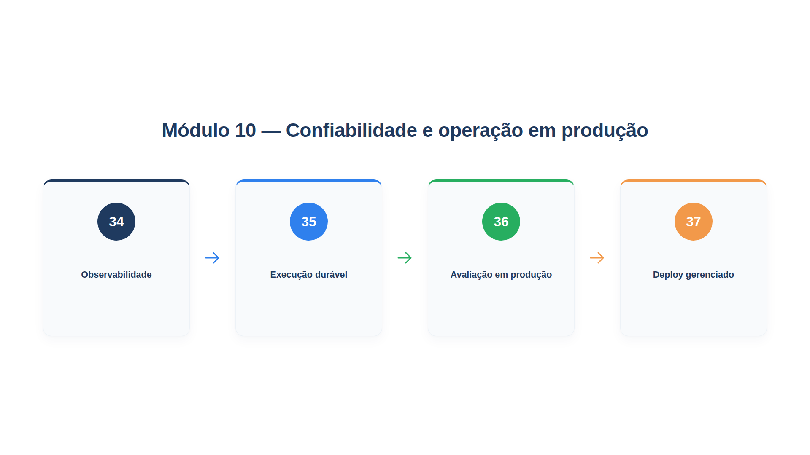

# Módulo 10 — Confiabilidade e operação em produção

Chegamos à última etapa. O agente que você construiu raciocina, usa ferramentas, lembra, colabora, é contido por guardrails e medido por avaliações. Falta colocá-lo para trabalhar de verdade, atendendo gente real, vinte e quatro horas por dia, sob falhas de rede, picos de uso e mudanças de comportamento do modelo. Operar um agente é uma disciplina própria, que a área chama de **AgentOps**. Este módulo ensina o essencial dela. Ao final dele, você será capaz de:

- observar o que o agente fez e por que, passo a passo, com rastros de execução;
- fazer uma execução sobreviver a quedas, retomando de onde parou, sem repetir efeitos no mundo;
- acompanhar a qualidade, o desempenho, a responsabilidade e o custo em produção, com alertas e revisão humana;
- decidir como hospedar o agente e o que um runtime gerenciado resolve por você.

## Percurso

1. **Capítulo 34 — Observabilidade.** Você coleta o rastro de uma execução, a árvore de chamadas ao modelo e às ferramentas, e aprende o que registrar e o que não registrar.
2. **Capítulo 35 — Execução durável.** Você implementa pontos de retomada, descobre por que eles sozinhos repetem efeitos e resolve isso com um registro de efeitos idempotente.
3. **Capítulo 36 — Avaliação em produção.** Você constrói um painel com as quatro dimensões do framework da Amazon (qualidade, desempenho, responsabilidade e custo), com alertas, e um ciclo que leva as falhas de produção de volta ao conjunto de avaliação.
4. **Capítulo 37 — Deploy gerenciado.** Você sobe o agente como um serviço, com sessões, limites e tempo máximo, e compara com os runtimes gerenciados dos grandes fornecedores.

Os arquivos `config.py`, `loja.py` e `modelos_simulados.py` são os dos módulos anteriores. O capítulo 34 usa `logfire` (localmente, sem enviar dados), e o 37, o `starlette`, que já vem com as dependências do PydanticAI para servidores. Os exemplos continuam usando modelos simulados, e os registros de produção são gerados com semente fixa, para que as saídas sejam exatas.

## O que muda quando o agente vai para a produção

A AWS, em seu guia de boas práticas para agentes, resume por que a operação merece atenção própria. Os agentes **raciocinam, e não só respondem**: um único pedido pode disparar várias inferências, chamadas de ferramenta, consultas de memória e comunicações entre agentes, e cada uma soma latência, custo e superfície de falha. Os agentes **agem de forma autônoma**, o que exige controles de segurança e supervisão proporcionais. O comportamento é **estocástico**: a mesma entrada pode produzir saídas diferentes, de modo que a confiabilidade depende de monitoramento do comportamento, de avaliações e de degradação graciosa, e não só de testes determinísticos. Eles **colaboram**, o que traz custos de coordenação e falhas distribuídas. E **lembram**, o que traz desafios de integridade, privacidade e custo.

Cada um desses pontos já apareceu neste livro. O Módulo 10 os reúne em uma pergunta de produção: *dá para confiar nisto, de forma contínua, e dá para ver quando deixar de dar?*
