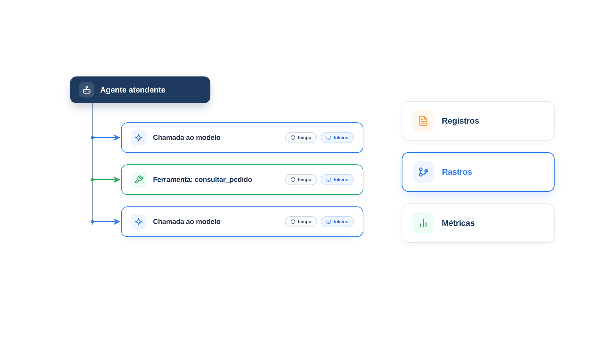

# Capítulo 34 — Observabilidade

Quando um cliente reclama que o agente "respondeu errado", a pergunta é: o que ele fez? Consultou o pedido certo? Qual ferramenta chamou, com quais argumentos? Quantas vezes falou com o modelo? Sem registro, você só pode adivinhar, e agentes são não determinísticos demais para adivinhar. Neste capítulo, você aprende a **observar** o agente: coletar o rastro de cada execução, reconstruí-lo como uma árvore e decidir o que guardar, e o que não guardar, para depurar sem violar a privacidade.



> **Antes de começar — PydanticAI neste capítulo**
>
> Neste capítulo você usa `Agent` (com o argumento `name`), `.run_sync` e `@agente.tool_plain`. Se algum deles não for familiar, revise os capítulos [0.4](../modulo-00/0.4-o-primeiro-agente-por-dentro.md) e [0.6](../modulo-00/0.6-ferramentas-e-saida-tipada.md). O modelo simulado usa `FunctionModel`, `ModelResponse`, `TextPart`, `ToolCallPart` e `ToolReturnPart`, vistos no [Capítulo 0.5](../modulo-00/0.5-mensagens-e-testes-sem-api.md). O pacote `logfire` é apresentado no [Capítulo 0.1](../modulo-00/0.1-o-ecossistema-pydantic.md).

## Por que agentes precisam de observabilidade

A Anthropic, ao descrever o seu sistema multiagente de pesquisa, explica o problema: a não determinação entre execuções torna a depuração difícil, e o que resolveu foi o **rastreamento completo em produção**, que permitiu diagnosticar por que os agentes falhavam. Eles monitoravam os padrões de decisão e as estruturas de interação dos agentes, sem monitorar o conteúdo das conversas dos usuários, o que preserva a privacidade e ainda revela comportamentos inesperados.

Três tipos de dado compõem a observabilidade, e vale distingui-los:

- **Registros** (*logs*): eventos pontuais, como "guardrail acionado".
- **Rastros** (*traces*): o caminho de uma execução, como uma árvore de passos, cada um com início, fim e atributos.
- **Métricas:** números agregados ao longo do tempo, como a latência média e a taxa de erro (assunto do Capítulo 36).

Para agentes, o rastro é o mais valioso: ele conta a história de *uma* execução.

## Rastreando com OpenTelemetry

A instrumentação do PydanticAI é construída sobre o **OpenTelemetry**, um padrão aberto de observabilidade. Isso significa que você pode enviar os rastros para qualquer sistema compatível. Com o **Logfire**, da própria equipe do PydanticAI, basta duas linhas:

```python
import logfire

logfire.configure()
logfire.instrument_pydantic_ai()
```

Com a instrumentação ligada, cada execução do agente produz um rastro detalhado, que mostra as mensagens trocadas com o modelo, as chamadas de ferramenta com argumentos e valores de retorno, o uso de tokens por solicitação e acumulado, a latência de cada operação e os erros, com contexto completo. A documentação do PydanticAI resume o valor: entender por que um agente tomou uma decisão, depurar comportamentos inesperados, otimizar desempenho e custos e monitorar implantações.

Para que você veja o rastro sem enviar nada para fora e com saída reproduzível, configuramos o Logfire para *não enviar dados* e coletamos os passos em memória:

*rastro.py*

```python
import logfire
from opentelemetry.sdk.trace.export import SimpleSpanProcessor
from opentelemetry.sdk.trace.export.in_memory_span_exporter import InMemorySpanExporter

COLETOR = InMemorySpanExporter()

# Os passos do agente ficam registrados em memória; nada sai do processo.
logfire.configure(
    send_to_logfire=False,
    console=False,
    additional_span_processors=[SimpleSpanProcessor(COLETOR)],
)
logfire.instrument_pydantic_ai()


def arvore_do_rastro() -> list[str]:
    """Reconstrói a árvore de passos (quem chamou quem) a partir dos registros coletados."""
    spans = sorted(COLETOR.get_finished_spans(), key=lambda s: s.start_time)
    filhos: dict[int | None, list] = {}
    for span in spans:
        pai = span.parent.span_id if span.parent else None
        filhos.setdefault(pai, []).append(span)

    linhas: list[str] = []

    def descrever(span) -> str:
        atributos = span.attributes or {}
        if span.name.startswith("invoke_agent"):
            tokens = atributos.get("gen_ai.aggregated_usage.input_tokens", 0) + atributos.get(
                "gen_ai.aggregated_usage.output_tokens", 0
            )
            return f"agente {atributos.get('gen_ai.agent.name')} ({tokens} tokens)"
        if span.name.startswith("execute_tool"):
            return f"ferramenta {atributos.get('gen_ai.tool.name')} {atributos.get('gen_ai.tool.call.arguments')}"
        return "chamada ao modelo"

    def percorrer(pai, nivel: int) -> None:
        for span in filhos.get(pai, []):
            linhas.append("  " * nivel + descrever(span))
            percorrer(span.context.span_id, nivel + 1)

    percorrer(None, 0)
    return linhas
```

Um **span** é um passo do rastro: tem um nome, um instante de início e de fim, um *pai* (o passo que o originou) e atributos. O PydanticAI nomeia os spans conforme as convenções do OpenTelemetry para IA generativa: `invoke_agent` (a execução inteira), `chat` (uma chamada ao modelo) e `execute_tool` (uma chamada de ferramenta). A função `arvore_do_rastro` reconstrói a hierarquia ligando cada span ao seu pai, e descreve cada tipo com os atributos que interessam: o nome do agente e os tokens consumidos, ou a ferramenta e seus argumentos.

Vamos executar o atendente com um modelo simulado que consulta um pedido e responde:

*rastro_demo.py*

```python
from pydantic_ai import Agent, ModelResponse, TextPart, ToolCallPart
from pydantic_ai.messages import ToolReturnPart
from pydantic_ai.models.function import FunctionModel

from config import MODELO
from loja import buscar_pedido
from rastro import arvore_do_rastro

agente = Agent(MODELO, name="atendente")


@agente.tool_plain
def consultar_pedido(codigo: str) -> str:
    """Consulta o status de um pedido."""
    return str(buscar_pedido(codigo))


def modelo(mensagens, info):
    if any(isinstance(p, ToolReturnPart) for m in mensagens for p in m.parts):
        return ModelResponse(parts=[TextPart("Seu pedido 1001 foi enviado.")])
    return ModelResponse(parts=[ToolCallPart("consultar_pedido", {"codigo": "1001"})])


agente.run_sync("Onde está o pedido 1001?", model=FunctionModel(modelo))
for linha in arvore_do_rastro():
    print(linha)
```

Saída:

```text
agente atendente (133 tokens)
  chamada ao modelo
  ferramenta consultar_pedido {"codigo":"1001"}
  chamada ao modelo
```

Aí está a história da execução em quatro linhas. A raiz é o agente, com o consumo total de tokens. Dentro dele, três passos, na ordem em que aconteceram: o modelo foi chamado e pediu uma ferramenta; a ferramenta `consultar_pedido` foi executada com o código `1001`; o modelo foi chamado de novo e produziu a resposta. Com a reclamação do cliente em mãos, você consulta o rastro daquela conversa e vê, sem adivinhar, que consulta foi feita e com que argumentos.

> **Lembrete:** a função `modelo(mensagens, info)` é o que o `FunctionModel` chama no lugar de um modelo real: se já há um `ToolReturnPart` no histórico, responde com texto; senão, pede a ferramenta. Detalhes no [Capítulo 0.5](../modulo-00/0.5-mensagens-e-testes-sem-api.md).

Os rastros de produção carregam, além disso, o tempo de cada passo, os textos trocados com o modelo e os erros. Um painel de observabilidade os mostra como uma linha do tempo, e permite filtrar, por exemplo, as execuções que chamaram uma ferramenta específica ou que levaram mais de cinco segundos.

### Faça você mesmo

- **34.1 Duas ferramentas:** altere o modelo simulado para consultar dois pedidos em sequência e preveja a árvore antes de executar.
- **34.2 Agente que delega:** use o gerente do Capítulo 22 e imprima o rastro. Descreva como os passos dos especialistas aparecem dentro do rastro do gerente.
- **34.3 Erros no rastro:** faça uma ferramenta levantar uma exceção e inspecione os atributos do span da ferramenta. Que informação sobre o erro está registrada?
- **34.4 Um filtro:** escreva uma função que receba os spans e devolva apenas as chamadas de uma ferramenta, com seus argumentos. Que pergunta de produção ela responderia?

## O que registrar, e o que não registrar

Um rastro útil registra a *estrutura* da execução: quais passos, em que ordem, com que resultado e a que custo. O *conteúdo* das conversas é outra questão. Ele inclui dados pessoais, e a decisão de guardá-lo não é só técnica: é de privacidade e de conformidade. A prática relatada pela Anthropic, de monitorar padrões de decisão e estruturas de interação sem registrar o conteúdo das conversas, é um bom ponto de partida.

Algumas regras:

- **Registre a estrutura sempre:** nomes de ferramentas, contagem de chamadas, tokens, latência, erros e decisões de guardrail.
- **Trate os argumentos com cuidado.** Eles podem conter dados pessoais (um código de pedido é inócuo; um CPF, não). Mascare-os antes de registrar, com a função de máscara do Capítulo 27.
- **Guarde o conteúdo das conversas só com base legal e com prazo.** Se precisar dele para depurar, mantenha-o por tempo limitado, com acesso restrito e com a possibilidade de exclusão a pedido do titular.
- **Associe os rastros a identificadores, não a pessoas.** Um identificador de conversa permite depurar sem expor quem é o cliente.

> **Nota:** Os atributos dos spans nesta versão incluem, por padrão, os argumentos das ferramentas. Antes de enviar rastros para um serviço externo, revise o que está sendo registrado e configure o filtro ou a máscara apropriada.

### Faça você mesmo

- **34.5 Política de registro:** escreva, em dez linhas, a política de registro do atendente da Casa Verde: o que se guarda, por quanto tempo, quem acessa e como se mascaram os dados pessoais.
- **34.6 Máscara nos argumentos:** altere `descrever` para aplicar `mascarar_dados_pessoais` (do Capítulo 27) aos argumentos de ferramenta antes de exibi-los. Teste com um argumento que contenha um CPF.

## Do rastro à explicação

O rastro mostra *o que* aconteceu, e quase sempre é isso que você precisa. Para entender *por que* o agente tomou uma decisão, combine-o com três fontes:

- **O texto do raciocínio,** quando o agente o produz (Capítulos 5 e 6), que aparece entre as chamadas de ferramenta.
- **As instruções e as descrições de ferramenta,** a versão em uso naquele momento. Registre a versão do prompt em cada execução, para saber o que estava valendo.
- **O modelo e os parâmetros,** incluindo o identificador exato do modelo. Uma troca de modelo é, na prática, uma mudança de comportamento.

Sem esses dados, comparar uma execução de hoje com uma da semana passada é comparar coisas diferentes sem saber.

### Faça você mesmo

- **34.7 Versão do prompt:** acrescente ao rastro um atributo com a versão das instruções do agente. Descreva como usaria esse atributo para investigar uma piora de qualidade depois de uma mudança de prompt.
- **34.8 Perguntas de investigação:** liste cinco perguntas que você faria ao rastro quando um cliente reclama, e o atributo de cada uma.

## Recapitulando

Você agora sabe observar o agente: instrumentou a execução com o OpenTelemetry, coletou os passos como spans e reconstruiu a árvore de quem chamou quem, com os argumentos das ferramentas e os tokens. Distingue registros, rastros e métricas, e sabe que o valor está na *estrutura* da execução, enquanto o *conteúdo* das conversas pede decisões de privacidade, com máscara, prazo e identificadores em vez de pessoas.

Observar mostra a falha, mas não a evita. Quando a API do modelo cai no meio de uma execução de vários passos, o que acontece com o trabalho já feito? O Capítulo 35 trata disso: como retomar de onde parou, em vez de recomeçar do zero, sem repetir efeitos no mundo.

### Fontes do capítulo

- Anthropic — [How We Built Our Multi-Agent Research System](https://www.anthropic.com/engineering/multi-agent-research-system): a não determinação dificulta a depuração; o rastreamento completo em produção; monitorar padrões de decisão e estruturas de interação sem o conteúdo das conversas.
- AWS — [Well-Architected Agentic AI Lens](https://docs.aws.amazon.com/wellarchitected/latest/agentic-ai-lens/agentic-ai-lens.html): o que torna os agentes diferentes (raciocínio iterativo, autonomia, comportamento estocástico, colaboração e memória).
- Documentação do PydanticAI: *Agentes* (instrumentação com OpenTelemetry e Logfire).
