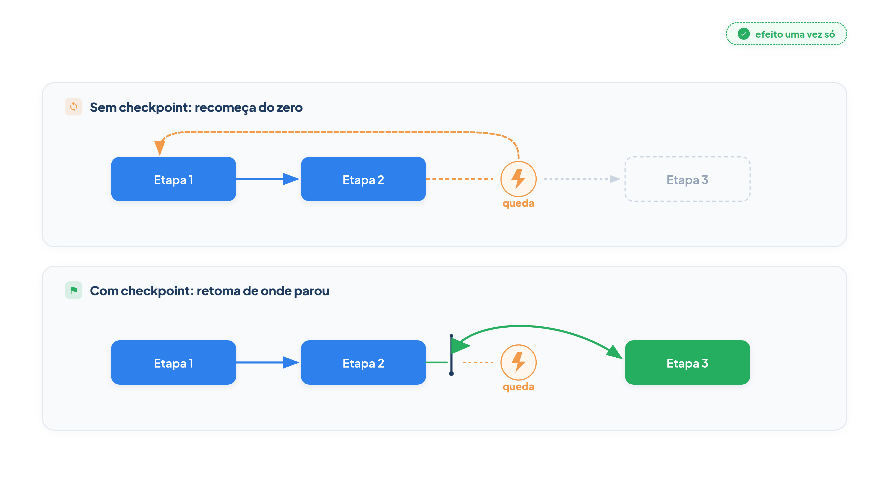

# Capítulo 35 — Execução durável

Um agente executa trabalho em vários passos: consulta, decide, age, consulta de novo. Em cada passo, algo pode falhar: a API do modelo fica fora do ar, a rede oscila, o processo é reiniciado em uma implantação. Se a execução recomeça do zero a cada falha, você paga de novo por passos já feitos e, pior, repete efeitos no mundo: dois reembolsos, duas notificações, dois pedidos. Neste capítulo, você faz a execução **sobreviver** a quedas: grava pontos de retomada, vê por que eles sozinhos não bastam e fecha a lacuna com um registro de efeitos.



> **Antes de começar — PydanticAI neste capítulo**
>
> Neste capítulo você usa `async for` e `async with` (o código de `executar_com_checkpoint` depende dos dois), além de `Agent` e `ModelMessagesTypeAdapter`. Se algum deles não for familiar, revise o [Capítulo 0.2](../modulo-00/0.2-o-python-que-o-livro-assume.md) (Python assíncrono) e o [Capítulo 0.5](../modulo-00/0.5-mensagens-e-testes-sem-api.md) (mensagens).

## O problema de recomeçar

A Anthropic relata o problema em seu sistema de pesquisa: agentes executam por longos períodos e mantêm estado, e erros pequenos, sem tratamento, viram falhas catastróficas. Reiniciar tudo a cada falha é caro e frustrante para o usuário. A solução adotada foi construir sistemas que **retomam de onde o agente estava quando o erro ocorreu**, em vez de recomeçar, e usar a inteligência do modelo para se adaptar: informar a ele que uma ferramenta falhou e deixar que ele ajuste o plano costuma funcionar bem.

A isso se dá o nome de **execução durável**: um programa que, ao falhar ou ser interrompido, retoma e conclui, preservando o progresso. Vamos construir uma versão didática para enxergar os mecanismos, e depois apresentar como os motores de produção resolvem o mesmo problema.

## Quando a falha custa caro

Imagine um processo de três etapas, cada uma com efeito no mundo. O modelo as pede uma por vez. Na terceira chamada ao modelo, a API cai. Vamos ver o que acontece sem proteção alguma. O agente de demonstração tem uma ferramenta `etapa`, que registra em `EFEITOS` cada execução real, e um modelo simulado que cai na terceira chamada, *uma vez*.

## Pontos de retomada

A primeira técnica é gravar o histórico da execução a cada passo, em um arquivo. Se o processo cair, a nova execução carrega o arquivo e continua de lá. O PydanticAI facilita isso com o método `agent.iter()`, que percorre a execução nó a nó, e com o conversor de mensagens para JSON do Capítulo 10.

*execucao_duravel.py*

```python
from pathlib import Path

from pydantic_ai import Agent, ModelMessagesTypeAdapter


async def executar_com_checkpoint(agente: Agent, pergunta: str, arquivo: Path, **opcoes) -> str:
    """Executa o agente gravando um ponto de retomada a cada passo. Se o arquivo existe, retoma dele."""
    historico = ModelMessagesTypeAdapter.validate_json(arquivo.read_bytes()) if arquivo.exists() else None
    prompt = None if historico else pergunta
    async with agente.iter(prompt, message_history=historico, **opcoes) as execucao:
        async for _ in execucao:
            arquivo.write_bytes(ModelMessagesTypeAdapter.dump_json(execucao.all_messages()))
    arquivo.unlink()  # concluída: o ponto de retomada não é mais necessário
    return execucao.result.output
```

A função tem quatro partes:

1. **Carregar.** Se o arquivo de retomada existe, lê o histórico gravado; senão, começa do zero.
2. **O prompt.** Quando há histórico, a nova execução continua dele, sem uma nova pergunta (`prompt = None`): o agente retoma a partir da última mensagem. Sem histórico, usa a pergunta.
3. **O laço `async for`.** O método `agente.iter(...)` devolve a execução como uma sequência de *nós* do grafo do agente: preparar a pergunta, chamar o modelo, executar as ferramentas, e assim por diante. A cada nó, o código regrava o histórico acumulado em `execucao.all_messages()`.
4. **Limpeza.** Ao concluir, apaga o arquivo: não há mais o que retomar.

> **Por dentro do PydanticAI — `.iter`**
>
> **O que é:** um método do agente que, em vez de rodar tudo e devolver o resultado final (como `.run`), entrega a execução passo a passo, para você olhar e agir entre um passo e o próximo.
> **Como funciona aqui:** `agente.iter(prompt, ...)` abre uma execução com `async with`. Ao percorrê-la com `async for _ in execucao`, cada volta do laço é um *nó* do grafo do agente que acabou de rodar. Dentro do laço, `execucao.all_messages()` devolve o histórico até aquele ponto, e é esse histórico que `executar_com_checkpoint` grava no arquivo. Terminado o laço, `execucao.result.output` traz a resposta final.
> **O que o PydanticAI faz por você:** decide a ordem dos nós (pergunta, chamada ao modelo, execução das ferramentas, fim), faz as chamadas e acumula as mensagens. Você só observa.
> **Cuidado:** `execucao.result` vale `None` até o laço terminar; ler `.output` antes disso falha. E o laço precisa ser percorrido até o fim, senão a execução fica incompleta.

Para enxergar os nós, rode este exemplo mínimo, que usa o `TestModel` (sem API) e imprime o tipo de cada nó e quantas mensagens existem naquele momento.

*iter_nos_demo.py*

```python
import asyncio

from pydantic_ai import Agent
from pydantic_ai.models.test import TestModel

agente = Agent(TestModel(custom_output_text="Pronto."))


@agente.tool_plain
def consultar_estoque(produto: str) -> int:
    """Devolve o estoque de um produto."""
    return 7


async def principal():
    async with agente.iter("Quanto há de estoque de vaso?") as execucao:
        async for no in execucao:
            print(type(no).__name__, "-> mensagens até aqui:", len(execucao.all_messages()))
    print("saída:", execucao.result.output)


asyncio.run(principal())
```

Saída:

```text
UserPromptNode -> mensagens até aqui: 0
ModelRequestNode -> mensagens até aqui: 0
CallToolsNode -> mensagens até aqui: 2
ModelRequestNode -> mensagens até aqui: 2
CallToolsNode -> mensagens até aqui: 4
End -> mensagens até aqui: 4
saída: Pronto.
```

Observe que o número de mensagens cresce a cada `CallToolsNode` (a resposta do modelo e o resultado das ferramentas entram juntos no histórico): é nesses pontos que um checkpoint tem algo novo para gravar. O `End` marca o fim da execução.

## O que acontece em cada abordagem

Agora, o experimento. A função `com_queda` roda o mesmo processo duas vezes: na primeira, a API do modelo está fora do ar e a execução falha; na segunda, a API voltou, e a execução é refeita ou retomada. Em cada cenário, imprimimos as etapas realmente executadas.

*duravel_demo.py*

```python
import asyncio
import tempfile
from pathlib import Path

from pydantic_ai import Agent, ModelResponse, RunContext, TextPart, ToolCallPart
from pydantic_ai.messages import ToolReturnPart
from pydantic_ai.models.function import FunctionModel

from config import MODELO
from execucao_duravel import executar_com_checkpoint
from idempotencia import Livro

EFEITOS: list[int] = []  # cada execução real de uma etapa deixa um rastro aqui
API = {"fora_do_ar": True}
LIVRO: dict[str, Livro | None] = {"atual": None}

agente = Agent(MODELO)


@agente.tool
def etapa(ctx: RunContext[None], numero: int) -> str:
    """Executa uma etapa do processo (com efeito no mundo)."""

    def efeito() -> str:
        EFEITOS.append(numero)
        return f"etapa {numero} concluída"

    livro = LIVRO["atual"]
    return livro.executar_uma_vez(ctx.tool_call_id, efeito) if livro else efeito()


def modelo(mensagens, info):
    concluidas = sum(isinstance(p, ToolReturnPart) for m in mensagens for p in m.parts)
    if concluidas == 2 and API["fora_do_ar"]:
        raise ConnectionError("a API do modelo caiu")
    if concluidas < 3:
        return ModelResponse(parts=[ToolCallPart("etapa", {"numero": concluidas + 1})])
    return ModelResponse(parts=[TextPart("As três etapas foram concluídas.")])


async def com_queda(titulo: str, executar):
    EFEITOS.clear()
    API["fora_do_ar"] = True
    print(f"== {titulo}")
    try:
        await executar()
    except ConnectionError as erro:
        print("  queda:", erro)
    API["fora_do_ar"] = False
    resposta = await executar()
    print("  resposta:", resposta if isinstance(resposta, str) else resposta.output)
    print("  etapas executadas:", EFEITOS)


async def principal():
    pergunta = "Execute as três etapas do processo."
    modelo_simulado = FunctionModel(modelo)

    await com_queda(
        "1. Sem checkpoint: recomeça do zero",
        lambda: agente.run(pergunta, model=modelo_simulado),
    )

    pasta = Path(tempfile.mkdtemp())
    await com_queda(
        "2. Com checkpoint: retoma, mas a etapa 2 se repete",
        lambda: executar_com_checkpoint(agente, pergunta, pasta / "a.json", model=modelo_simulado),
    )

    LIVRO["atual"] = Livro(pasta / "efeitos.json")
    await com_queda(
        "3. Com checkpoint e registro de efeitos: cada etapa acontece uma vez",
        lambda: executar_com_checkpoint(agente, pergunta, pasta / "b.json", model=modelo_simulado),
    )


asyncio.run(principal())
```

Leia o código antes da saída, em três pontos. A ferramenta `etapa` registra a execução real em `EFEITOS` e consulta, se houver, um `LIVRO` (o registro de efeitos, que veremos já); o modelo simulado decide a próxima etapa pelo número de resultados de ferramenta que já vê e cai quando vê dois e a API está fora do ar; e `com_queda` repete a execução depois da queda.

Saída:

```text
== 1. Sem checkpoint: recomeça do zero
  queda: a API do modelo caiu
  resposta: As três etapas foram concluídas.
  etapas executadas: [1, 2, 1, 2, 3]
== 2. Com checkpoint: retoma, mas a etapa 2 se repete
  queda: a API do modelo caiu
  resposta: As três etapas foram concluídas.
  etapas executadas: [1, 2, 2, 3]
== 3. Com checkpoint e registro de efeitos: cada etapa acontece uma vez
  queda: a API do modelo caiu
  resposta: As três etapas foram concluídas.
  etapas executadas: [1, 2, 3]
```

As três linhas de "etapas executadas" contam a história inteira:

1. **Sem checkpoint:** `[1, 2, 1, 2, 3]`. A queda ocorreu depois das etapas 1 e 2; ao recomeçar, ambas foram refeitas. Duas etapas com efeito, duplicadas.
2. **Com checkpoint:** `[1, 2, 2, 3]`. Melhorou: a etapa 1 não se repete. Mas a **etapa 2 aconteceu duas vezes**. Por quê? Os pontos de retomada são gravados *entre* os nós. Quando a etapa 2 foi executada, a queda aconteceu antes de o resultado ser gravado no arquivo. Ao retomar, o último histórico gravado dizia "o modelo pediu a etapa 2", e a retomada a executou de novo. É uma garantia de *pelo menos uma vez*: nada se perde, mas algo pode se repetir.
3. **Com checkpoint e registro de efeitos:** `[1, 2, 3]`. Cada etapa aconteceu exatamente uma vez.

## Idempotência: o efeito acontece uma vez

A terceira linha usou uma ideia central de sistemas confiáveis: a **idempotência**. Uma operação é idempotente quando executá-la uma ou várias vezes produz o mesmo efeito. Reembolsar o pedido 1001 *com a chave de chamada X* é idempotente se uma repetição com a mesma chave não reembolsa de novo.

Implementamos isso com um **registro de efeitos**: uma tabela de chaves já executadas e seus resultados.

*idempotencia.py*

```python
import json
from pathlib import Path


class Livro:
    """Registro de efeitos: a mesma chamada, com a mesma chave, só produz efeito uma vez."""

    def __init__(self, arquivo: Path):
        self.arquivo = arquivo
        self.dados = json.loads(arquivo.read_text()) if arquivo.exists() else {}

    def executar_uma_vez(self, chave: str, efeito):
        if chave in self.dados:
            return self.dados[chave]
        resultado = efeito()
        self.dados[chave] = resultado
        self.arquivo.write_text(json.dumps(self.dados))
        return resultado
```

O método `executar_uma_vez` recebe uma chave e uma função de efeito. Se a chave já está registrada, devolve o resultado guardado, *sem* executar o efeito. Senão, executa, registra e devolve. No cenário 3, a chave é o `ctx.tool_call_id`, o identificador que o modelo gerou para aquela chamada de ferramenta. Ele é o mesmo no histórico gravado e na retomada, o que faz a repetição da etapa 2 ser reconhecida.

Veja o princípio isolado, com um reembolso:

*idempotencia_demo.py*

```python
import tempfile
from pathlib import Path

from idempotencia import Livro

REEMBOLSOS: list[str] = []


def reembolsar(livro: Livro, id_da_chamada: str, pedido: str, valor: float) -> str:
    def efeito():
        REEMBOLSOS.append(pedido)
        return f"reembolso de R$ {valor:.2f} registrado para o pedido {pedido}"

    return livro.executar_uma_vez(id_da_chamada, efeito)


livro = Livro(Path(tempfile.mkdtemp()) / "efeitos.json")

print(reembolsar(livro, "chamada-77", "1001", 120.0))
print("Retentativa da mesma chamada:", reembolsar(livro, "chamada-77", "1001", 120.0))
print("Reembolsos efetivamente feitos:", REEMBOLSOS)

livro_reaberto = Livro(livro.arquivo)  # o processo reiniciou
print("Depois do reinício:", reembolsar(livro_reaberto, "chamada-77", "1001", 120.0))
print("Reembolsos efetivamente feitos:", REEMBOLSOS)
```

Saída:

```text
reembolso de R$ 120.00 registrado para o pedido 1001
Retentativa da mesma chamada: reembolso de R$ 120.00 registrado para o pedido 1001
Reembolsos efetivamente feitos: ['1001']
Depois do reinício: reembolso de R$ 120.00 registrado para o pedido 1001
Reembolsos efetivamente feitos: ['1001']
```

A retentativa devolveu o mesmo resultado, e só *um* reembolso foi feito, mesmo depois de o processo ter sido reaberto, porque o registro está em arquivo. Para um reembolso real, o registro estaria no mesmo banco de dados do pagamento, na mesma transação, ou o sistema de pagamento aceitaria uma *chave de idempotência* enviada pelo agente, o que muitos aceitam.

> **Nota:** Este registro em arquivo é uma ilustração. Em produção, use o recurso de idempotência do serviço que executa o efeito (uma chave de idempotência na API de pagamentos, por exemplo) ou uma tabela no seu banco com restrição de unicidade na chave.

### Armadilha: tratar o checkpoint como suficiente

O cenário 2 é o erro mais comum: gravar o histórico e achar que o problema acabou. Gravar o progresso protege contra *refazer* passos já completos, mas não contra *repetir* o passo que estava em andamento quando a falha ocorreu. Toda ferramenta que tem efeito externo (cobrar, enviar, cancelar, criar) precisa ser idempotente ou protegida por um registro.

### Faça você mesmo

- **35.1 Queda na etapa 3:** altere o modelo simulado para cair quando vê *três* resultados em vez de dois. Preveja as etapas executadas nos três cenários e confira.
- **35.2 Queda duas vezes:** faça a API cair em duas execuções seguidas antes de voltar. Quantas vezes a etapa 2 se repete sem o registro? E com ele?
- **35.3 Chave frágil:** troque a chave de `ctx.tool_call_id` por `numero`. Em que situação a chave por número seria incorreta (duas chamadas legítimas com o mesmo número)?
- **35.4 Ferramenta de reembolso:** reescreva a ferramenta `reembolsar` do Capítulo 29 para usar o `Livro` com o identificador da chamada.

## Como os motores de produção resolvem

Escrever o seu próprio mecanismo de retomada é útil para entender o problema, mas, em produção, a recomendação é usar um motor de execução durável, que já resolveu os detalhes difíceis. O PydanticAI integra vários: Temporal, DBOS, Prefect, Restate e AWS Lambda, mantidos em colaboração com os fornecedores, além de Airflow, Kitaru e outros.

O exemplo do Temporal mostra a ideia. Em uma execução durável, um programa que cai ou encontra uma exceção ao falar com um modelo ou uma API tenta de novo até conseguir. O Temporal se apoia em *reprodução*: à medida que o programa avança, ele salva as entradas e decisões-chave, de modo que um programa reiniciado retoma exatamente de onde estava. Para isso, separa o código em duas partes:

- **Workflows:** a parte determinística, que executa da mesma forma quando refeita com as mesmas entradas. Pode rodar por longos períodos e, se interrompida, retoma onde estava. Em geral, não faz entrada e saída.
- **Activities (atividades):** a parte não determinística, que pode fazer qualquer coisa, inclusive entrada e saída. Se uma atividade falha no meio, ela recomeça do início.

Para um agente, isso significa que o laço do agente roda como um *workflow*, e as chamadas ao modelo, as ferramentas com entrada e saída e a comunicação com servidores MCP rodam como *atividades*. Cada chamada ao modelo e cada chamada de ferramenta é, então, uma unidade durável com resultado registrado: o equivalente profissional dos nossos pontos de retomada, com a garantia de que uma etapa concluída não é refeita. No PydanticAI, anexa-se a capacidade `TemporalDurability()` ao agente, e a execução vira durável quando ocorre dentro de um workflow que sua aplicação inicia.

Três observações da documentação do PydanticAI:

- **Uma execução só é durável dentro do workflow.** Anexar a capacidade, por si só, não torna nada durável; fora de um workflow, o agente roda como um agente normal.
- **Um motor por agente.** Cada motor trata cada chamada ao modelo e cada ferramenta como uma unidade durável, então anexar um segundo motor ao mesmo agente é um erro.
- **Durabilidade não é armazenamento.** Um motor durável mantém *uma execução* viva diante de quedas e reinícios; ele não guarda as suas conversas. Salvar uma conversa e retomá-la dias depois é outro problema, com uma solução bem mais leve: gravar o histórico em seu banco, como fizemos na memória de curto prazo do Capítulo 10.

Lembre-se, por fim, da lição do Capítulo 29: uma ação que espera a aprovação de uma pessoa pode demorar horas. Execuções duráveis servem a esses fluxos longos e assíncronos, em que manter o processo vivo seria impraticável.

### Faça você mesmo

- **35.5 Qual solução?:** para cada situação, escolha entre um arquivo de retomada simples, um registro de efeitos ou um motor durável, e justifique: (a) um chat curto, de uma chamada de ferramenta de consulta; (b) um processo de reembolso com três sistemas e aprovação humana; (c) uma pesquisa de vários minutos com subagentes.
- **35.6 Lista de efeitos:** liste as ferramentas do atendente da Casa Verde que têm efeito externo e, para cada uma, como você a tornaria idempotente.

## Recapitulando

Você agora sabe fazer uma execução sobreviver a quedas. Gravou pontos de retomada com `agent.iter()` e viu que eles evitam refazer o que já foi concluído. Descobriu o limite deles, a repetição do passo em andamento, e o resolveu com um registro de efeitos idempotente, chaveado pelo identificador da chamada. Sabe também que, em produção, os motores de execução durável, como o Temporal, tratam o laço do agente como um workflow e as chamadas ao modelo e às ferramentas como atividades registradas.

Com a execução observável e resiliente, resta saber se ela continua *boa*. O Capítulo 36 acompanha a qualidade, o desempenho, a responsabilidade e o custo em produção, com alertas e revisão humana.

### Fontes do capítulo

- Anthropic — [How We Built Our Multi-Agent Research System](https://www.anthropic.com/engineering/multi-agent-research-system): agentes com estado e erros que se acumulam; retomar de onde o erro ocorreu em vez de recomeçar; usar a inteligência do modelo para se adaptar a falhas de ferramentas.
- Documentação do PydanticAI: *Durable Execution* (visão geral, Temporal, motores suportados, o aviso de que "uma execução só é durável dentro do workflow") e *Persistência* ("durabilidade não é armazenamento").
